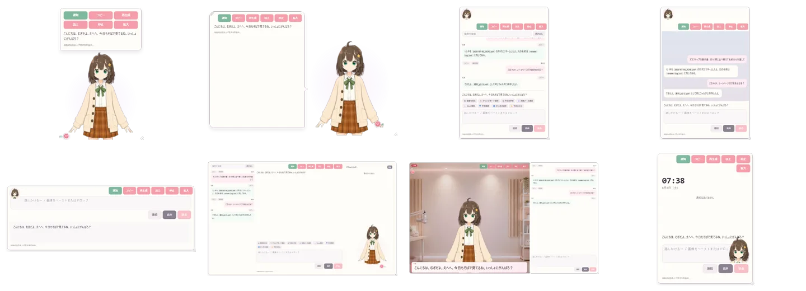

# PicoAgent 全体マニュアル

デスクトップに住むキャラクターに話しかけるだけで、調べもの・ファイル操作・文書/画像/音声の変換・外部サービス連携までこなすローカルファーストの AI エージェント「PicoAgent」の総合マニュアルです。導入から日常の使いかた、スキル活用、ローカル API、セキュリティまでを一冊にまとめています。

- 開発者向けの内部仕様は [SPEC.md](SPEC.md)、AI エージェント向け作業ルールは [AGENTS.md](AGENTS.md)、概要と最新情報は [README.md](README.md) / [CHANGELOG.md](CHANGELOG.md) を参照してください。

---

## 📑 目次

1. [PicoAgent とは](#1-picoagent-とは)
2. [インストールとセットアップ](#2-インストールとセットアップ)
3. [基本操作（画面の見かた）](#3-基本操作画面の見かた)
4. [ファイルの渡しかた（ドラッグ&ドロップ）](#4-ファイルの渡しかたドラッグドロップ)
5. [スキル活用ガイド（頼み方の例）](#5-スキル活用ガイド頼み方の例)
6. [文書・PDF・画像・音声の変換（同梱 OSS ツール）](#6-文書pdf画像音声の変換同梱-oss-ツール)
7. [叩く AI（プロバイダとモデル）](#7-叩く-aiプロバイダとモデル)
8. [音声（読み上げとマイク入力）](#8-音声読み上げとマイク入力)
9. [キャラクター（切替・Live2D・PSD）](#9-キャラクター切替live2dpsd)
10. [ローカル API と CLI（Ollama 風）](#10-ローカル-api-と-cliollama-風)
11. [スケジュールと自動化](#11-スケジュールと自動化)
12. [セキュリティと許可の考えかた](#12-セキュリティと許可の考えかた)
13. [データの保存場所](#13-データの保存場所)
14. [主要設定リファレンス](#14-主要設定リファレンス)
15. [トラブルシューティング](#15-トラブルシューティング)
16. [付録: cargo xtask コマンド一覧](#16-付録-cargo-xtask-コマンド一覧)

---

## 1. PicoAgent とは

PicoAgent は Tauri 製のデスクトップペット型 AI エージェントです。

- **ローカルファースト**: 既定の叩く AI は同梱のローカル推論エンジン（llama-server + GGUF）。初回のモデル取得後はオフラインで動きます。読み上げ（Aivis）や文字起こし（Whisper）もローカルです。
- **スキル（コネクタ）駆動**: 天気・Web検索から Gmail・Slack・GitHub、Office 文書編集、PDF、画像変換、コマンド実行まで 50 以上のスキルを内蔵。話しかけると必要なスキルを自動で選んで実行します。
- **キャラクターと暮らす**: クリックで話しかけ、なでると喜び、放っておくと居眠りします。Live2D にも対応。
- **外から叩ける**: Ollama 風のローカル HTTP API と最小 CLI で、スクリプトや他ツールからもエージェントを呼べます。

---

## 2. インストールとセットアップ

### 前提

- **Rust（cargo）** と **Tauri CLI**（`cargo install tauri-cli --version '^2'`）
- Windows: WebView2 ランタイム / macOS: Xcode Command Line Tools（`xcode-select --install`）
- Ollama は不要です

### 手順

```bash
cargo install tauri-cli --version '^2'   # 初回だけ
cargo xtask dev
```

`cargo xtask dev` が同梱物（推論エンジン・Aivis・Whisper・Live2D・OSS ツール）の**未取得分を自動で取得**してから起動します。個別に取り直したいときだけ次を使います。

```bash
cargo xtask setup engine    # 同梱推論エンジン（llama-server）
cargo xtask setup aivis     # 同梱 Aivis（読み上げ）
cargo xtask setup whisper   # ローカル Whisper CLI とモデル（音声入力・文字起こし）
cargo xtask setup live2d    # Live2D ランタイムとサンプルモデル
cargo xtask setup office    # OfficeCLI（LibreOffice。Office 変換・PDF 出力）
cargo xtask setup tools     # 精度向上用 OSS CLI（Pandoc/ripgrep/ffmpeg/qpdf/poppler/ImageMagick）
```

- `cargo xtask setup *` はすべて**ベストエフォート**です。取得できないもの（例: macOS の qpdf など）は警告だけ出して起動を続行し、該当スキルは PATH 上のツールへフォールバックします。
- 初回起動時はローカルモデル（Gemma 系）を PC の VRAM/RAM に合わせて自動選択・ダウンロードします。以後はオフラインで動作します。
- 製品ビルド（配布物の作成）は `cargo xtask build`。詳細は README の「製品ビルド」を参照してください。

---

## 3. 基本操作（画面の見かた）

画面にはキャラクターとフキダシ（チャット欄）が表示されます。

| 操作 | 動き |
|---|---|
| フキダシをクリック | 入力欄を開く |
| キャラクターをクリック | ぴょんとはねる（読み上げ中なら停止） |
| キャラクターをドラッグ | **立ち絵だけを動かす**（ウィンドウは動かない。位置は自動保存） |
| `Ctrl`（macOS は `⌘`）+ キャラをドラッグ | ウィンドウを移動 |
| 透明な余白をドラッグ | ウィンドウを移動 |
| 画面上端へカーソル | Windows風メニューを表示（表示／配置／キャラ・音声／設定） |
| 上部メニューの「配置」 | OBS風の配置編集を開く |
| キャラクターをダブルクリック | フキダシを全画面表示／解除（`Esc` でも解除） |
| フキダシ右下のつまみ | フキダシのサイズ変更（位置と共に自動保存） |
| 右クリック | **話しかける…**・**表示スタイル**・**ウィンドウを置く画面**・常に手前・読み上げ状態・画面／キャラ／すべての設定・表示と会話のリセット・終了 |
| `Enter` / `Ctrl+Enter` | 送信（`Shift+Enter` で改行） |
| `↑` / `↓` | 過去の自分の入力を呼び戻す |
| 入力欄の 🎙 | マイク録音 → ローカル Whisper で文字起こしして入力欄へ |
| 回答上部の小ボタン | 通知一覧・回答コピー・別の答えを再生成（↺）・再読み上げ・停止・拡大 |
| 全画面フキダシ | 会話履歴の検索、各発言のコピー、自分の発言の再利用、Markdown 書き出し |
| `Ctrl+Alt+P`（macOS は `⌘+Alt+P`） | **他のアプリを使っていても**呼び出す（前面へ出して入力欄を開く） |
| `Ctrl+Alt+H`（macOS は `⌘+Alt+H`） | **他のアプリを使っていても**隠す／戻す |

呼び出し・非表示のキーは設定 →「基本設定」→「詳細設定」で変更できます（保存すると再起動なしで反映。空欄は既定値、`off` と書くとそのキーだけ無効）。


### 表示形式を選ぶ（画面構成の切り替え）

用途に合わせて画面構成を 7 種類から選べます。画面上端のメニューから**「表示」**、**右クリック →「表示スタイル」**、または設定 →「画面・操作」のプレビューカードから選びます。どれも再起動なしで切り替わります。

| 形式 | 見た目 | 向いている使いかた |
|---|---|---|
| **ミニ** | キャラ中心。必要な時だけ吹き出しを使う | つけっぱなしで作業の邪魔をさせたくないとき |
| **ペット**（既定） | 左にフキダシ、右にキャラ | ときどき話しかけながら作業する、いちばん普通の使いかた |
| **チャット** | 縦長パネル。履歴が常に見える | 何度も往復する相談 |
| **バー** | 画面上部の 1 行入力。答えたら閉じる | 作業を止めずに一問一答（ホットキーと相性がいい） |
| **作業** | 履歴・回答・実行状況の 3 ペイン | 長い作業の結果を追いたいとき |
| **配信** | キャラを大きく映し、回答は下部の字幕テロップ。LIVE・日付・時刻と背景内ディスプレイを常設 | 配信・録画。セカンドディスプレイに置く |
| **ウィジェット** | 時計と通知・定期実行の結果を出しておく | 置きっぱなしで today の情報を見る |

<div align="center">
  
  <br />
  <sub>上段左から ミニ / ペット / チャット / トーク、下段左から バー / 作業 / 配信 / ウィジェット。高さを揃えているので、横幅の比が実際の大きさの違いです。</sub>
</div>

- **ウィンドウの寸法は形式ごとに覚えます。** チャットを広げてからペットへ移り、またチャットへ戻すと、広げた寸法のまま戻ります。
- 既定寸法は、ミニ360×560／ペット900×600／チャット・トーク520×760／バー900×320／作業1400×850／配信1560×920／ウィジェット440×600です。
- 右クリック →「**表示と会話をリセット**」→「**今の画面位置・サイズを戻す**」で、**いま選んでいる形式**の既定寸法と位置へ戻ります（表示形式そのものは変わりません。他の形式で覚えた寸法も残ります）。
- キャラクター・会話履歴・通知・読み上げ・音声入力・ファイル添付・許可設定は、どの形式でも共通です。

### 立ち絵の位置と大きさ

キャラクターを**ドラッグすると立ち絵だけが動きます**（ウィンドウは動きません）。フキダシとの重なりを避けたい、顔をもっと右に置きたい、といった微調整に使います。離した時点で位置が保存され、次回起動時もそのままです。

- **既定は上半身が出る位置**です。設定 →「キャラ・音声」→「キャラごとの構図」で、表示形式ごとに胸上・上半身・全身を選べます。拡大率と位置の微調整もキャラごとに保存されます。
- 設定 →「画面・操作」では、配信背景（パステル／ゲーム部屋／シンプル／任意画像）と背景内ディスプレイを選べます。任意画像はアプリ管理領域へ取り込んで使います。
- 動画を見ながら使うときは、右クリックまたは「画面・操作」の「左画面」を選ぶと、そのディスプレイの中央へ移動します。
- **ウィンドウを動かしたいとき**は、透明な余白をドラッグするか、キャラの上で `Ctrl`（macOS は `⌘`）を押しながらドラッグします。
- 動かしすぎたら右クリック →「**表示と会話をリセット**」→「**キャラ位置を中央へ戻す**」で既定へ戻ります（ウィンドウの位置や表示形式は変わりません）。画面位置・サイズのリセットでも一緒に戻ります。
- ドラッグ中に `Esc` を押すと、掴む前の位置に戻して取りやめます。
- 枠がウィンドウから完全に出ないよう、48px ぶんは必ず画面内に残ります（掴み直せなくなるのを防ぐため）。
- チャット・トーク・バーはキャラを顔アイコンとして出す形式なので、ドラッグはウィンドウ移動になります。

### キャラクターのふるまい

- **なでなで**: キャラクターの上でマウスを素早く左右に往復させると、はねてハートが浮かびます。
- **居眠り**: 無操作が一定時間（既定 15 分、`PICOAGENT_NAP_MINUTES` で変更、0 で無効）続くと寝ます。操作すると起きます。23〜5 時はまばたきが増えて眠そうになります。
- **自発雑談**: 放っておくと時々ひとりごとを言います（設定で無効化可能）。
- **クイック操作**: 入力欄の上に「画面を見る」「クリップボード要約」などの定型ボタンが並びます。`PICOAGENT_QUICK_ACTIONS`（1 行 1 件「ラベル|送る文章」）で自由に置き換えられます。

---

## 4. ファイルの渡しかた（ドラッグ&ドロップ）

**ウィンドウのどこへでも**（キャラクターの上でも）ファイルをドロップできます。ドラッグ中は「📎 ここにドロップして添付」の表示が出ます。

| ドロップしたもの | 動き |
|---|---|
| 画像（png/jpg/gif/webp） | 画像として添付（モデルが画像を見て答える） |
| 文書（xlsx/docx/pptx/csv/md/コード等） | 内容をテキスト抽出して添付 |
| PDF | 実パスをモデルへ伝え、「本文を抜いて」「要約して」で pdf_tools が動く |
| PSD/XCF/HEIC/TIFF 等 | 実パスをモデルへ伝え、「PNG にして」で image_tools が動く |
| フォルダ・25MB 超 | エラー表示（中のファイルを個別にドロップしてください） |
| テキスト・URL（ブラウザから） | 入力欄へ挿入 |

- 複数ファイルの同時ドロップに対応（画像は最大 4 枚、文書は最大 4 件）。
- 共通の許可ルート内にあるドロップファイルは**実パスも AI に伝わる**ため、「この PDF の 2〜3 ページだけ抜いて」「この PSD を 800px の PNG に」のように、変換系スキルがそのまま使えます。許可ルート外は安全のため読み込まず、画面下の通知に出る「許可設定を開く」から設定画面の対象タブへ直接移動して追加できます。複数ファイルで失敗があった場合も、通知は結果を1つにまとめます。
- `Ctrl+V` で画像の貼り付けも可能です。「画面を見て」と言うとスクリーンショットを自動添付します。

---

## 5. スキル活用ガイド（頼み方の例）

チャットで自然に頼むだけで、該当スキルが自動で選ばれます。設定が必要なスキルは、未設定のまま頼むと設定手順を案内します（設定画面「スキル」タブ。カードに設定状態バッジと承認ポリシーを表示）。

### 情報・検索（設定不要）

| スキル | 頼み方の例 |
|---|---|
| Web検索 / URL取得 | 「◯◯って何？調べて」「このURLの内容を要約して」 |
| 天気 | 「明日の東京の天気は？」 |
| ニュース / RSS | 「今日のニュース教えて」「このブログの更新確認して」 |
| 為替 / 市場指数 | 「1ドル何円？」「日経平均は？」 |
| 時刻 | 「ニューヨークは今何時？」 |

### 日常補助（設定不要）

| スキル | 頼み方の例 |
|---|---|
| 目覚まし時計 | 「平日の7時に起こして」「アラーム一覧」 |
| リマインダー | 「15分後に洗濯物って教えて」 |
| 集中タイマー | 「25分集中タイマー」「1時間おきに見守って」 |
| おでかけ前チェック | 「出かける前のチェックして」 |
| できたことメモ | 「今日できたことを記録して」 |
| クリップボード要約 | 「コピーした文章を要約して」 |

### プロジェクト管理

すべて `project` スキル1本で扱います（以前の「ワークスペース」は統合しました）。

| やること | 頼み方の例 |
|---|---|
| 登録・切り替え | 「このフォルダを動画制作プロジェクトとして登録して」「動画制作へ切り替えて」（許可ルート・AI・キャラをまとめて切替） |
| 課題管理 | 「サムネ差し替えを来週までの課題に追加して」「このプロジェクトの残りを教えて」「期限切れだけ見せて」「t3 を完了にして」 |
| 記録・決定事項 | 「尺は8分で確定、と決定事項に残して」「前に決めたことを教えて」「今日の進捗を記録して」 |
| 全体の把握 | 「プロジェクト一覧を見せて」「どのプロジェクトが遅れてる？」 |

課題と記録は**プロジェクトそのものに入っています**。切り替えると、そのプロジェクトの未完了課題（上位5件）と直近の記録（4件）が会話の前提として自動で添えられるので、毎回説明し直す必要はありません。

> 「いま取りかかっている一連の手順」は作業計画（`todo_plan`）、「長く残るやること」はプロジェクトの課題と使い分けます。

### ファイル・ローカル操作

| スキル | 頼み方の例 |
|---|---|
| ファイル読み書き | 「メモを notes.md に保存して」「変更をプレビューして」「直前の変更を元に戻して」 |
| ファイル読み込み | 「このファイルを読んで」「続きの200行を読んで」（行番号つき。長いファイルは範囲指定で読む） |
| ローカル文書検索 | 「作業フォルダから会議メモを探して」（ripgrep があれば高速検索） |
| ファイル名検索 | 「プロジェクトの .rs ファイルを一覧して」「設定ファイルがどこにあるか探して」（glob パターン。既定は更新の新しい順） |
| ファイル内容検索 | 「この関数を使っている箇所を探して」「TODO が残っているファイルを教えて」（正規表現。行番号つきで返す） |
| ファイル部分編集 | 「main.rs のこの行だけ直して」（元の文字列を指定して該当箇所だけ置換。`workspace_files` の取り消しで戻せる） |
| ノートブック編集 | 「ノートブックのセルを一覧して」「3番目のセルを差し替えて」（.ipynb をセル単位で編集。実行はしない） |
| バックグラウンド実行 | 「開発サーバをバックグラウンドで起動して」「さっきのビルドの様子を見せて」「止めて」（完了を待たない実行。同時4件まで） |
| 画像を見せる | 「このスクリーンショットに何が写っているか教えて」（許可ルート内の画像をAIへ渡す。マルチモーダル対応モデルのみ） |
| 選択肢つきの確認 | 「どっちがいいか聞いて決めて」（迷う点をAIが2〜4択で聞き返す。フキダシ下のボタンか番号で答える） |
| 作業計画 | 「やることを整理して進めて」「いまどこまで終わってる？」（多段タスクの手順を登録し、1手ずつ完了にする） |
| ファイル削除 | 「その下書きを消して」（**OS のゴミ箱へ移動**。物理削除はしない） |
| コマンド実行 | 「git status を実行して」（既定無効。許可リスト制、未許可はその場で承認カード） |
| 自力実行 | 「このフォルダのファイル名を規則で一括変更して」（既定無効） |
| 実用ツール集 | 「このJSONを整形して」「10kmをマイルに換算」「文字数数えて」など約30種 |

### 文書・PDF・画像・音声（→ 詳細は[第6章](#6-文書pdf画像音声の変換同梱-oss-ツール)）

| スキル | 頼み方の例 |
|---|---|
| Office編集 | 「report.docx の『令和6年』を『令和7年』に置換して」「見積書.xlsx を PDF にして」 |
| 文書変換 | 「この docx を PDF にして」「この Markdown を docx にして」 |
| PDF編集 | 「PDF を結合して」「2〜5ページだけ抜いて」「本文をテキスト抽出して」 |
| 画像ファイル変換 | 「この PSD を PNG に変換して」「HEIC を JPG にして」「画像の情報を見せて」 |
| 音声文字起こし | 「この音声を文字起こしして」（mp3/m4a も自動前処理）「話者分類つきで」 |
| 会議記録 | 「会議の録音を開始して」→「録音を止めて議事録にして」 |
| 画像生成 | 「猫のイラストを描いて」（ComfyUI / OpenAI 画像） |

### 調査・資料生成

| スキル | 頼み方の例 |
|---|---|
| 調査レポート | 「AIスライド生成サービスを出典付きで調査してレポートに」 |
| 資料ワークスペース | 「Gensparkみたいに資料一式を作って」（brief/deck/sheet/共有HTML…） |
| Genspark風全部 | 「Genspark風の機能を全部やって」（Deep Research 等 10 系統） |
| サブエージェント | 「競合3社をそれぞれ調べて」（分担して並行調査） |

### 外部サービス連携（各サービスの API キー / トークン設定が必要）

Gmail（一覧・要約・ラベル・アーカイブ・掃除）、Google カレンダー / Docs / Drive / Sheets / Tasks、GitHub Issue、Notion、Microsoft Graph（Outlook/Teams）、Jira、Linear、Trello、Todoist、Slack、Discord、汎用 HTTP API。

SNS 投稿: X/Twitter、Mastodon、Bluesky、Reddit、LinkedIn、Misskey。

> 各カードの ⚙ に取得手順つきの設定ガイドがあります。チャットで「Gmail のトークンの取り方」と聞いても案内します。

### アプリ操作・自動化

| スキル | 頼み方の例 |
|---|---|
| アプリ操作 | 「PicoAgent を終了して」 |
| タスクスケジューラ | 「毎朝9時に天気を教えて」「平日18時に git status」（→ [第11章](#11-スケジュールと自動化)） |
| プロジェクト切り替え | 「このフォルダを仕事用として登録して」「仕事用へ切り替えて」 |
| 保存ワークフロー | 「この手順を週報作成として覚えて」「週報作成を実行して」 |

---

## 6. 文書・PDF・画像・音声の変換（同梱 OSS ツール）

変換系スキルの精度を上げるため、実績ある OSS CLI をセットアップ時に同梱します（`cargo xtask setup office` / `setup tools`。`dev` / `build` でも自動実行）。

| ツール | 使うスキル | 役割 | 同梱対象 OS |
|---|---|---|---|
| **OfficeCLI**（LibreOffice） | 文書変換 / Office編集 | docx/xlsx/pptx ⇔ PDF 等の変換・PDF 出力 | Windows / macOS |
| **Pandoc** | 文書変換 | Markdown/reST/EPUB/org/LaTeX が絡む変換を高精度に | Windows / macOS |
| **Poppler**（pdftotext） | PDF編集 | PDF 本文のテキスト抽出（レイアウト保持） | Windows（他は apt/brew） |
| **qpdf** | PDF編集 | ページ抽出・結合・回転・線形化 | Windows（他は apt/brew） |
| **ImageMagick** | 画像ファイル変換 | PSD/XCF/HEIC/TIFF/WebP/AVIF → PNG/JPG、情報取得 | Windows（他は apt/brew） |
| **ffmpeg** | 音声文字起こし | mp3/m4a/flac/ogg → 16kHz WAV の自動前処理 | Windows / macOS |
| **ripgrep** | ローカル文書検索 | 検索の高速化（無ければ内蔵走査） | Windows / macOS |

**実行ファイルの解決順はすべて共通**: ① 設定画面での明示パス指定 → ② 同梱（`src-tauri/resources/bundled/`）→ ③ PATH。同梱が無い OS でも `apt install` / `brew install` すればそのまま使われます。

ポイント:

- Office ファイルの文字列置換（`ms_office` の replace_text）は OOXML 直接編集のため、**LibreOffice すら不要**です。
- `document_convert` は変換内容から Pandoc / OfficeCLI を自動で使い分けます（`engine` 指定で固定も可能）。PDF 出力は常に OfficeCLI です。
- PSD は**レイヤー統合ビュー**を変換します。JPG 出力時は透過を白背景に敷きます。
- 再取得は `TOOLS_FORCE=1 cargo xtask setup tools`、特定ツールだけなら `PICOAGENT_SETUP_TOOLS=pandoc,ripgrep`。

---

## 7. 叩く AI（プロバイダとモデル）

- **既定は `local`（同梱エンジン）**。初回起動時に PC の VRAM/RAM から Gemma 系の small / balanced / large を自動選択してダウンロードします。設定画面では Gemma / Qwen / Llama / Mistral / Phi 系の主要 GGUF プリセットを「種類 → サイズ」で選べ、推奨 VRAM・RAM・ダウンロード目安を表示します。
- **クラウド**: OpenAI / Claude / Gemini / DeepSeek / xAI Grok / Mistral など。右クリック →「すべての設定…」→「AIモデル・連携」で API キーとモデルを設定します（費用が発生します）。
- **Ollama**: `ollama serve` 起動後にプロバイダを切り替えると、ローカルのモデル一覧から選べます。
- ダウンロード済み GGUF は「AIモデル・連携」タブの「ダウンロード済みモデル」で一覧・削除できます（使用中のモデルは削除不可）。
- 会話は**キャラクターごと**に保存・復元されます。トークン使用量は「診断・修復」タブで確認できます。

---

## 8. 音声（読み上げとマイク入力）

- **読み上げ（Aivis）**: 設定「キャラ・音声」タブ、または右クリックの状態付きマスタースイッチで有効化すると、回答をキャラボイスで読み上げます（ローカル動作）。既定はミュートです。読み上げ中はキャラクリックか「読み上げを停止」で止められます。キャラごとに声を変えられます。
- **リアルタイムに近い読み上げ**: 応答の生成中でも、文として確定した部分から順に合成・再生を始めます（全文の生成完了を待ちません）。長い回答も文単位に分割して「再生しながら次の文を先読み合成」するため、話し始めるまでの待ち時間が最小限です。本文のストリーミング表示・先行読み上げは、既定の同梱ローカルエンジン・Ollama・クラウド系（OpenAI 互換）のすべてで動きます。
- **マイク入力（Whisper）**: 入力欄の 🎙 はクリックで録音開始・停止、または長押し中だけ録音できます。同梱 Whisper がローカルで文字起こしして入力欄に入れ、外部送信はしません。
- **録音中の逐次文字起こし**: 録音しながら数秒ごとの区間を裏で文字起こしし、途中経過を入力欄へ表示します。停止すると全体をあらためて文字起こしして置き換えるため、区間の切れ目で欠けた単語も最終的に正しく確定します。
- **長い録音は自動で確定**: 1回の録音が上限（WAV 換算 27MB。16kHz なら約 14 分）に達すると、そこまでの内容を自動で文字起こしして確定し、録音を止めます。長時間の会話をまとめて記録したいときは「会議記録」スキル（[6章](#6-できること機能ガイド)）を使ってください。
- **音声ファイルの文字起こし**: 「この音声を文字起こしして」で wav に加え mp3/m4a/flac/ogg も OK（ffmpeg で自動前処理）。「話者分類つきで」にも対応します。

---

## 9. キャラクター（切替・Live2D・PSD）

- 設定「キャラ・音声」タブで切替と、性格・口調（人格プロンプト）のキャラ別編集ができます。
- **Live2D**: `cargo xtask setup live2d` で Cubism ランタイムとサンプルモデル「ひより」を取得すると、対応キャラは Live2D で動きます（まばたき・リップシンク・タップモーション）。非対応キャラも差分絵ベースの疑似リグ（PNGTuber 式）で常時アニメーションします。
- **自作キャラの Live2D 化**: `python scripts/build-live2d-psd.py` で `characters/<id>/layers/` からレイヤー分け PSD（ひより互換の 15 パーツ構成）を生成し、Live2D Cubism Editor で開いてモデル化できます。
- **バストアップ原画から通常2Dキャラ**: `python scripts/build-portrait-2d-character.py --input <画像> --id <ID> --name <名前> --layers-dir <21表情差分> --face-roi <x,y,w,h> --frames-dir <150フレーム>` で、原画をbaseにした計22レイヤーについて、背景抜き、頭頂部の切れ、顔ROI外RGBA、目・口の段階、固有フレーム数を検査したパックを作れます。物理演算は使いません。手順は [キャラクター画像の準備手順](characters/README.md) を参照してください。
- キャラ画像・アニメーションの正本は `characters/` 配下です（`ui/assets/characters/` へ自動同期）。

---

### 自分の Live2D モデルを追加する

設定画面（右クリック →「キャラクター・音声の設定…」）の「キャラクターを追加・作成」に「キャラクターを追加」があります。

1. **zip を選ぶ** または **フォルダを選ぶ** を押す
2. `character.json` を含むキャラクターパックを指定する（zip を開くとフォルダが1つ、という一般的な配布形もそのまま使えます）
3. 確認が通れば追加完了。設定を開き直すと一覧に出て、キャラクターとして選べます

追加したキャラクターはアプリのデータフォルダ（`app_data_dir/characters/<id>/`）に入ります。**再ビルドは不要**です。削除は一覧の「削除」から行い、OS のゴミ箱へ移動します（同梱キャラクターは削除できません）。

`character.json` の書き方は [`characters/README.md`](characters/README.md) を参照してください。Live2D の場合は `live2d.model` に `model3.json` の相対パスを書きます。**`model3.json` が参照するテクスチャ・モーションが揃っているかも確認します**（欠けていると追加時にその旨を表示して中止します）。

安全のため、パックには次の制限があります。

| 項目 | 制限 |
|---|---|
| 置けるファイル | json / png / webp / jpg / moc3 / wav / psd / md / txt と Live2D の付随ファイル（実行可能ファイルは不可） |
| 大きさ | 全体 250MB・1ファイル 40MB・4,000 ファイルまで |
| パス | シンボリックリンク・`..`・パック外を指す参照は拒否 |

---

## 10. ローカル API と CLI（Ollama 風）

外部ツールやスクリプトから、PicoAgent のエージェント（**スキル込み**）をローカル HTTP で呼べます。

### 有効化

設定「AIモデル・連携」タブ →「ローカルAPI（Ollama風）」→ 有効化して再起動（**既定は無効**）。`127.0.0.1` にのみバインドし、LAN へは公開しません。`PICOAGENT_API_KEY` を設定すると `Authorization: Bearer <キー>` が必須になります。ポートは `PICOAGENT_API_PORT`（既定 11500）。

### エンドポイント

| エンドポイント | 内容 |
|---|---|
| `GET /api/version` | バージョン情報 |
| `GET /api/tags` | 選択中モデル一覧（Ollama 風） |
| `POST /api/chat` | `{"messages":[{"role":"user","content":"…"}]}` → エージェント応答 |
| `POST /api/generate` | `{"prompt":"…"}` → エージェント応答 |
| `POST /v1/chat/completions` | **OpenAI Chat Completions 互換**（base_url 差し替えで既存クライアントが動く。`stream` は全文単一チャンクの SSE） |
| `POST /mcp` | **MCP サーバ**（PicoAgent の全スキルを MCP ツールとして公開。下記参照） |

```bash
curl http://127.0.0.1:11500/api/chat \
  -d '{"messages":[{"role":"user","content":"今日の天気は？"}]}'
```

API の会話はリクエスト内で完結する**ステートレス設計**で、デスクトップのキャラ会話履歴とは混ざりません。

### MCP（Model Context Protocol）

PicoAgent は **agent（ループ）/ skills（内蔵ツール）/ mcp（外部相互運用）** の3層構成で、MCP は双方向に使えます。

**① MCP サーバ（スキルの公開）**: ローカル API の `/mcp` が、PicoAgent の全スキルを MCP ツールとして公開します。Claude Code からは次のように登録できます。

```bash
claude mcp add --transport http picoagent http://127.0.0.1:11500/mcp
```

これで Claude Code から天気・Gmail・PDF 編集など PicoAgent のスキルを直接呼べます（ローカル API の有効化が前提。`PICOAGENT_API_KEY` 設定時は Bearer 認証つき）。

**② MCP クライアント（外部ツールの取り込み）**: 設定「AIモデル・連携」タブ →「MCP（外部ツール連携）」に外部 MCP サーバを登録すると（1行1件「名前|コマンド 引数…」、stdio 接続）、そのツールが `mcp__<サーバ名>__<ツール名>` としてエージェントの候補に加わり、チャットから自然に使われます。

```
memory|npx -y @modelcontextprotocol/server-memory
fs|npx -y @modelcontextprotocol/server-filesystem /home/me/docs
```

変更は再起動後に反映されます。接続結果（ツール件数・失敗理由）は app.log に記録されます。

### 最小 CLI

```bash
cargo xtask cli status            # 死活とバージョン・選択中モデル
cargo xtask cli models            # モデル一覧
cargo xtask cli chat 今日の予定は？  # 1問1答（スキルも使える）
cargo xtask cli ask 俳句を詠んで    # 生成（chat と同等）
cargo xtask cli repl              # 対話モード（会話文脈を保持。exit で終了）
```

接続先は環境変数 `PICOAGENT_API_PORT` / `PICOAGENT_API_KEY` で指定します。

---

## 11. スケジュールと自動化

- **目覚まし時計**: 「平日の7時に起こして」で登録。声でやさしく起こし、`おきたよ！` を押すまで既定 5 分おきに再通知します（アプリ起動中のみ）。
- **タスクスケジューラ（cron 風）**: 「毎朝9時に git status を実行して」「平日18時に天気スキルを実行して」で登録。設定画面の専用フォームでも編集できます。実行結果は直近 100 件保存され、通知一覧から確認・再実行できます。
- **リマインダー / 集中タイマー / 見守り**: 単発の通知や 25 分ポモドーロ、定期的な声かけができます。
- コマンド実行を伴うスケジュールは `run_command` と同じ許可（許可ルート + allowlist）で守られます。

---

## 12. セキュリティと許可の考えかた

- **ファイル操作は許可ルート内のみ**: 全スキル共通の許可ルート（`PICOAGENT_ALLOWED_ROOT` ほか、設定「安全・許可」タブ）配下だけを読み書きします。`C:\Windows` と `C:\Program Files*` は常に拒否です。
- **削除はゴミ箱まで**: スキル経由のファイル削除は OS のゴミ箱への移動だけ。`rm` / `del` などの物理削除コマンドは実行を拒否します。
- **コマンド実行は既定無効 + 許可リスト制**: 有効化しても allowlist にある prefix だけ実行できます。未登録コマンドが必要になったら、その場で「許可（今回だけ）/ 永続許可 / キャンセル」を選ぶ承認カードが出ます。
- **ローカル API は既定無効・localhost 限定・Bearer 認証対応**。さらに、ブラウザからの横断リクエスト（あなたが開いたページが勝手に API を叩く CSRF）を防ぐため、`Origin` 付きのリクエストは既定で拒否し、ボディ付きは JSON 限定にしています（[第10章](#10-ローカル-api-と-cliollama-風)）。
- **API キーの保護**: `password` 型の設定値は Windows では DPAPI で暗号化して保存します。
- **外部送信の最小化**: 文字起こし・読み上げ・ローカル検索・履歴・メモリはすべてローカル処理です。ツール出力や添付ファイルの本文にプロンプトインジェクション的な文字列（「これまでの指示を無視して…」など）があれば検知し、参考情報として扱うようキャラクターへ注意を促します。受け取った文書に仕込まれた指示に勝手に従うことを防ぎます。
- 会話履歴・長期メモリを消すには右クリック →「表示と会話をリセット」→「会話履歴を消してリセット」。

---

## 13. データの保存場所

| データ | 場所 |
|---|---|
| 設定 | `app_config_dir/config.json` |
| 会話履歴（キャラ別） | `app_data_dir/history-<キャラID>.json` |
| 長期メモリ | `app_data_dir/memory.json` |
| スケジュール実行結果 | `app_data_dir/schedule-runs.json` |
| ログ（1 週間で自動削除） | `app_data_dir` 配下の logs（診断タブから場所を確認可能） |
| 同梱ツール・モデル | `src-tauri/resources/bundled/`（Git 管理外） |
| 会議録音・議事録 | 共通ワークスペース配下 `meetings/YYYY-MM-DD/` |
| 履歴の書き出し | ダウンロードフォルダ（Markdown） |

アンインストール時に消してよいのは上記の app データと同梱ディレクトリだけです。

---

## 14. 主要設定リファレンス

よく使うキーの抜粋です（全キーは [SPEC.md](SPEC.md#設定キー一覧)）。設定画面から編集でき、環境変数としても渡せます（保存先は常に `config.json`）。

| キー | 内容（既定値） |
|---|---|
| `PICOAGENT_PROVIDER` | 叩く AI（`local`） |
| `PICOAGENT_ALLOWED_ROOT` | ファイル/実行の許可ルート |
| `PICOAGENT_NAP_MINUTES` | 居眠りまでの分数（15、0 で無効） |
| `PICOAGENT_QUICK_ACTIONS` | クイック操作のカスタマイズ |
| `PICOAGENT_TTS_ENABLED` / `PICOAGENT_TTS_VOLUME` | 読み上げ（無効 / 50）。ミュートまたは音量0では口パクもしない |
| `PICOAGENT_API_ENABLED` / `PICOAGENT_API_PORT` / `PICOAGENT_API_KEY` | ローカル API（無効 / 11500 / なし） |
| `PICOAGENT_MCP_SERVERS` | 外部 MCP サーバ（1行1件「名前|コマンド 引数…」。空 = 無効） |
| `PICOAGENT_COMMAND_ENABLED` / `PICOAGENT_COMMAND_ALLOWLIST` | コマンド実行（無効 / 空） |
| `PICOAGENT_LIBREOFFICE_PATH` | OfficeCLI の明示パス（空 = 同梱→PATH） |
| `PICOAGENT_PANDOC_PATH` / `PICOAGENT_QPDF_PATH` / `PICOAGENT_PDFTOTEXT_PATH` / `PICOAGENT_MAGICK_PATH` / `PICOAGENT_FFMPEG_PATH` / `PICOAGENT_RIPGREP_PATH` | 各 OSS ツールの明示パス（空 = 同梱→PATH） |
| `PICOAGENT_SUPER_AGENT` | 計画→実行・自己評価を強化するモード（無効） |
| `PICOAGENT_UPDATE_CHECK_ENABLED` | 起動時の更新確認（有効） |

---

## 15. トラブルシューティング

| 症状 | 対処 |
|---|---|
| Office 変換・PDF 出力ができない | `cargo xtask setup office`。入らない場合は PATH の `soffice` か `PICOAGENT_LIBREOFFICE_PATH` を使います |
| Markdown 変換・PDF 抽出・PSD 変換・音声前処理の精度が低い / 動かない | `cargo xtask setup tools`。同梱が無い OS は `apt` / `brew` で該当ツールを導入 |
| ローカル API に接続できない | 設定「AIモデル・連携」タブで有効化して再起動。ポート・キーは `PICOAGENT_API_PORT` / `PICOAGENT_API_KEY` |
| `run_command` が拒否される | 既定無効。設定で有効化し allowlist に prefix を追加 |
| 起動が遅い | 初回は Rust コンパイルとモデル取得に時間がかかります（以後は速い） |
| ビルドが「別のプロセスが使用中」で失敗 | 残存プロセスが原因。`cargo xtask stop` で停止（dev/build は自動で停止してから起動） |
| macOS で背景が透過しない | `tauri.conf.json` の `app.macOSPrivateApi: true` を確認して再ビルド |
| 文字起こしできない | `cargo xtask setup whisper`（macOS は公式バイナリ配布が無く手動導入が必要な場合あり） |

その他は [README のトラブルシューティング](README.md#-トラブルシューティング) を参照してください。

---

## 16. 付録: cargo xtask コマンド一覧

| コマンド | 内容 |
|---|---|
| `cargo xtask dev` | 開発起動（未取得の同梱物は自動取得） |
| `cargo xtask build` | 製品ビルド（各 OS の配布バンドルを生成） |
| `cargo xtask stop` | 残存プロセスの停止 |
| `cargo xtask cli <cmd>` | ローカル API を叩く CLI（status/models/chat/ask/repl） |
| `cargo xtask setup engine` | 同梱推論エンジンの取得 |
| `cargo xtask setup aivis` | 同梱 Aivis（読み上げ）の取得 |
| `cargo xtask setup whisper` | 同梱 Whisper の取得 |
| `cargo xtask setup live2d` | Live2D ランタイム + サンプルモデルの取得 |
| `cargo xtask setup office` | OfficeCLI（LibreOffice）の取得 |
| `cargo xtask setup tools` | OSS CLI ツール群の取得（`TOOLS_FORCE=1` で再取得） |
| `python scripts/build-live2d-psd.py` | レイヤー画像から Live2D 用 PSD を生成 |
| `python scripts/build-character-animations.py` | レイヤー画像から連番アニメーションを生成 |
| `python scripts/build-portrait-2d-character.py` | バストアップ1枚から通常2D（1枚絵）キャラクターパックを生成 |
| `cargo xtask sync-characters` | `characters/`（正本）を配信用 `ui/assets/characters/` へ同期 |
| `cargo xtask build-ui` / `cargo xtask build-ui --release` | `ui/` を配信用 `ui-dist/` へ生成（release はコメント・空白を除去） |

> `sync-characters` と `build-ui` は `cargo xtask dev` / `build` が自動実行するため、通常は個別に実行する必要はありません。
> `setup *` も同様に自動実行されるので、明示的に呼ぶのは特定の同梱物だけ取り直したいときです。
