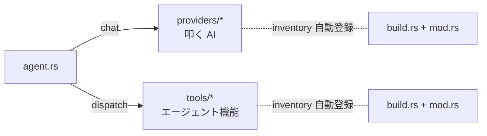

<div align="center">
  <h1>🐾 PicoAgent</h1>
  <p><strong>叩く AI とエージェント機能をコネクタで拡張できる、キャラクター + フキダシだけの透明デスクトップペット</strong></p>

  
  
  
</div>

<br />

> 透明な Tauri ウィンドウに常駐するデスクトップペット。バックエンドは Rust、フロントは webview。**Ollama 不要** — 推論エンジンを同梱し、初回起動時に gemma4(Gemma 3n E2B) を取得してローカルで動きます。**叩く AI（LLM バックエンド）** と **エージェント機能（ツール）** を、フォルダに `.rs` を1枚足すだけのコネクタ開発で差し替え・追加できます。

---

## 📑 目次

- [🚀 クイックスタート](#-クイックスタート)
- [✨ 特徴](#-特徴)
- [🧩 コネクタの仕組み](#-コネクタの仕組み)
- [🖱 使い方](#-使い方)
- [⚙️ 設定](#️-設定)
- [📦 製品ビルド（配布）](#-製品ビルド配布)
- [📁 フォルダ構成](#-フォルダ構成)
- [🛟 トラブルシューティング](#-トラブルシューティング)

> [!NOTE]
> アーキテクチャ・コネクタ仕様の詳細は **[SPEC.md](SPEC.md)**、AI エージェント向け作業ルールは **[AGENTS.md](AGENTS.md)** を参照してください。

---

## 🚀 クイックスタート

前提: **Rust（cargo）** と **Node.js ≥ 20**、Windows は WebView2 ランタイム。**Ollama は不要**です。

```powershell
npm install
npm run setup:engine   # 同梱推論エンジン(llama-server)を取得
npm run dev
```

- 既定の叩く AI は **`local`（同梱エンジン）**。**初回起動時に gemma4(Gemma 3n E2B) の GGUF（約3〜4GB）を自動ダウンロード**し、以後はオフラインで動作します。ダウンロード中はキャラクターの吹き出し下に「モデルを準備中… NN%」と表示されます。
- Ollama を使いたい場合は `ollama serve` 後に右クリック →「設定…」でプロバイダを切り替えます（任意）。Ollama 選択時はローカルのモデル一覧を読み込み、モデル欄から選べます。

> [!NOTE]
> 初回の `npm run dev` / `npm run build` は Rust の crate 取得・コンパイルで時間がかかります（ネットワーク必須）。モデル DL も初回のみネットが必要です。

OpenAI 互換の叩く AI を使う場合（費用が発生します）は、起動後に右クリック →「設定…」で API キーとプロバイダを設定します。

---

## ✨ 特徴

- **Ollama 不要・ローカル完結** — 推論エンジン同梱、初回 DL の gemma4 でそのまま動く（既定 `local`）。
- **叩く AI を差し替え可能** — local / Ollama / OpenAI 互換を同梱。コネクタを足せば他社 AI にも切替できる。
- **エージェント機能を追加可能** — ツールコネクタを足すと、モデルが function calling で呼び出せる。
- **原則Web検索** — 通常の質問ではローカルモデルの判断に頼らずWeb検索してから参照元のハイパーリンク付きで回答する。短い挨拶は検索に引っ張られないよう例外扱いし、キャラクター本人として返す。
- **設定画面ですべて設定** — 右クリック →「設定…」で叩く AI・モデル・接続先・API キー・ツール設定などを GUI 編集。保存すると即反映。
- **軽量な Tauri ネイティブ** — システム WebView を使い、Rust バックエンドで動作。
- キャラクターパックごとの連続フレームと状態別の滑らかな補間動作（待機 / 考え中 / 返答 / エラー）。
- キャラクターごとに名前・挨拶・性格・口調・一人称を定義でき、設定画面でキャラ選択と人格の上書きが可能。
- 会話は選択中の叩く AI にのみ送られる。ローカル Ollama を使えば外部送信なし。

---

## 🧩 コネクタの仕組み



- **叩く AI を増やす**: `src-tauri/src/providers/` に `Provider` トレイトを実装した `.rs` を置き、`inventory::submit!` で登録。
- **エージェント機能を増やす**: プロジェクト直下の `skills/` に `Tool` トレイトを実装した `.rs` を置き、`inventory::submit!` で登録。

`build.rs` が `.rs` を自動で `mod` 取り込みし、再ビルドで**自動登録**されます（`mod.rs` 編集不要）。書き方は [SPEC.md](SPEC.md#新しいコネクタの作り方) を参照。

---

## 🖱 使い方

- フキダシをクリック: 入力欄を開く
- フキダシ右下のつまみをドラッグ: フキダシの幅・高さを変更（自動保存）
- キャラクターをダブルクリック: フキダシを全画面表示／元に戻す（`Esc` でも解除）
- `Enter`: 送信 / `Shift + Enter`: 改行 / `Esc`: 入力欄を閉じる
- キャラクターをドラッグ: 移動
- 右クリック: **設定…**・**常に手前に表示**・**PicoAgent を終了**

---

## ⚙️ 設定

右クリック →「**設定…**」で設定ウィンドウを開き、すべての設定を編集できます。保存するとアプリ再起動なしで反映されます。設定は `app_config_dir/config.json`（個人 PC ローカル）に保存されます。

設定画面の項目は「基本設定」＋「各コネクタが申告した設定」で構成され、**コネクタを足すと設定項目も自動で増えます**。

| キー | 既定 | 区分 | 用途 |
|---|---|---|---|
| `CODA_PROVIDER` | `local` | 基本 | 選択中の叩く AI |
| `CODA_MODEL` | プロバイダ既定 | 基本 | 選択中モデル |
| `CODA_SYSTEM_PROMPT` | 既定プロンプト | 基本 | システムプロンプト |
| `CODA_BUBBLE_FONT_PX` | `13` | 基本 | フキダシの文字サイズ(px) |
| `CODA_BUBBLE_WIDTH_PX` | 自動 | 基本 | ドラッグで保存したフキダシの幅(px) |
| `CODA_BUBBLE_HEIGHT_PX` | 自動 | 基本 | ドラッグで保存したフキダシの高さ(px) |
| `CODA_ALWAYS_ON_TOP` | `true` | 基本 | 常に手前に表示 |
| `CODA_CHARACTER` | `mugi` | 基本 | 選択中のキャラクターID |
| `CODA_CHARACTER_OVERRIDES` | `{}` | 基本 | キャラクターIDごとの人格設定上書き |
| `CODA_TTS_ENABLED` | `false` | 基本 | Aivis で回答を読み上げる |
| `CODA_TTS_ENDPOINT` | `http://127.0.0.1:10101` | 基本 | AivisSpeech Engine の接続先 |
| `CODA_TTS_SPEAKER` | `888753760` | 基本 | Aivis の speaker/style ID |
| `CODA_MODEL_URL` | gemma-3n-E2B Q4_K_M | local | 同梱エンジンが取得するモデル GGUF の URL |
| `CODA_LOCAL_PORT` | `11435` | local | 同梱エンジンのポート |
| `CODA_LOCAL_CTX` | `4096` | local | コンテキスト長 |
| `OLLAMA_HOST` | `http://127.0.0.1:11434` | Ollama | Ollama 接続先 |
| `OLLAMA_MODEL` | `qwen3:8b` | Ollama | Ollama 既定モデル |
| `OPENAI_BASE_URL` | `https://api.openai.com/v1` | OpenAI | OpenAI 互換エンドポイント |
| `OPENAI_API_KEY` | （なし） | OpenAI | OpenAI 互換の API キー |
| `OPENAI_MODEL` | `gpt-4o-mini` | OpenAI | OpenAI 互換の既定モデル |
| `CODA_TOOLS_ROOT` | ユーザーホーム | read_file | `read_file` ツールが読めるルート |
| `CODA_WEB_SEARCH_MAX_RESULTS` | `5` | web_search | Web検索で返す件数（1〜8） |
| `CODA_WEB_SEARCH_TIMEOUT_SECS` | `15` | web_search | Web検索の待ち時間（秒、3〜60） |

> [!TIP]
> 各キーは環境変数としても渡せます（既定値としての参照のみ。保存先は常に `config.json`）。

---

## 📦 製品ビルド（配布）

```powershell
npm run setup:engine   # 同梱エンジンを resources/engine へ取得（未取得の場合）
npm run build
```

`src-tauri/target/release/bundle/` に Windows インストーラ（NSIS）が生成されます。推論エンジンは同梱されますが、モデル GGUF（数 GB）は含めず初回起動時に取得します。

- アプリ識別子 `com.coda.app`、アイコンは `src-tauri/icons/`（`npx tauri icon src-tauri/icon-source.png` で再生成）。
- コード署名（Authenticode）・自動更新（`tauri-plugin-updater`）はリリース時に鍵・証明書を用意して有効化します（現状は未設定）。

---

## 📁 フォルダ構成

```text
20_agt/
├── characters/          ← キャラクター正本（index.json・人格定義・連番フレーム）
├── skills/              ← エージェント機能（スキル）コネクタ（.rs を足すと自動登録）
├── ui/                  ← webview フロント（coda.js シム・ペット UI・設定画面）
│                          ※ assets/characters/ は characters/ の配信コピー（自動生成）
├── src-tauri/
│   ├── Cargo.toml / build.rs / tauri.conf.json / capabilities / icons
│   └── src/
│       ├── main.rs / lib.rs / commands.rs / menu.rs
│       ├── config.rs / agent.rs / message.rs
│       ├── providers/   ← 叩く AI コネクタ（.rs を足すと自動登録）
│       └── tools/mod.rs ← スキルの Tool トレイト・レジストリ本体
├── scripts/             ← fetch-engine.mjs / sync-characters.mjs
├── README.md / SPEC.md / CHANGELOG.md / AGENTS.md / CLAUDE.md
```

---

## 🛟 トラブルシューティング

- **「モデルを準備中…」のまま** → 初回のモデル DL 中（数 GB）。ネット接続を確認。`CODA_MODEL_URL` を変えると別モデルを取得。
- **「準備に失敗」と出る** → `npm run setup:engine` でエンジンが入っているか、DL 元 URL が有効か確認。
- **オンライン表示が赤い / 応答しない（Ollama 利用時）** → `ollama serve` を起動。設定の `OLLAMA_HOST` も確認。
- **AIプロバイダで OpenAI が「未接続」** → `OPENAI_API_KEY` 未設定。設定画面で入力して保存。
- **ツールが呼ばれない** → モデルが function calling 非対応の可能性。`qwen3:8b` などツール対応モデルを使う。
- **`read_file` が拒否される** → 許可ルート（既定はホーム）外。`CODA_TOOLS_ROOT` を設定するか、ルート配下のパスを指定。
- **Web検索に失敗する** → インターネット接続を確認。短時間の連続検索で拒否された場合は、時間を置いて再試行。
- **`npm run dev` が遅い / 失敗する** → 初回は Rust のコンパイルに時間がかかります。Rust（cargo）と WebView2 が入っているか確認。
- **ビルドが `os error 32`（別のプロセスが使用中）で失敗する** → 前回の `llama-server` やアプリ本体が残って同梱 DLL を掴んでいる状態。dev/build 前に `scripts/stop-stale.mjs` が自動で停止する（`beforeDevCommand`/`beforeBuildCommand`）ため通常は再発しないが、手動で止めたいときは `npm run stop`。
