> **[PicoAgent 公式ページ・Windowsアルファ版ダウンロード](https://benybeny777.github.io/PicoAgent-Distribution/)**

<div align="center">

<h1>🐾 PicoAgent</h1>

<p><strong>ローカルで完結する、キャラクター型 AI エージェント。</strong><br />
透明ウィンドウに常駐するデスクトップペットへ、<b>74 種のスキル</b>と<b>9 系統の叩く AI</b> をぶら下げた Rust / Tauri 製の常駐アプリです。<br />
叩く AI もエージェント機能もコネクタを足すだけで増え、1 体で決めきれない依頼は複数の AI へ合議・分担させられます。</p>


<table>
  <tr>
    <th width="50%">2D（連番フレーム）</th>
    <th width="50%">Live2D</th>
  </tr>
  <tr>
    <td>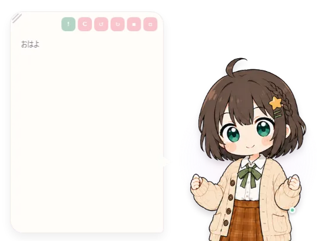</td>
    <td></td>
  </tr>
</table>
<sub>枠なしの透明ウィンドウ。デスクトップにフキダシとキャラクターだけが浮かびます。実際の動きです。<br />
ダークテーマ、配信表示、同梱 7 体と Live2D 6 体のプレビューは <a href="#-キャラクター">キャラクター</a> にあります。</sub>

</div>

> [!WARNING]
> 公開インストーラは、**Windows版 PicoAgent v1.0.5 Alpha**と**macOS版 v1.0.4 Alpha**です。macOS版は現行v1.0.4を維持します。アプリ画面の小型`ALPHA`表示はクリックを妨げず、配信形式では操作UIと重ならない位置へ表示します。
> アルファ版は`beta-full`ビルドでPro対象を含む全機能を試用可能にし、正式リリースではこのfeatureを付けずFree／Pro制限を有効にします。

---

## 3 行で

- **ローカルAIを同梱。** 初回起動時にPCのVRAM／RAM目安からモデルを自動で選んで取得します。画面は先に使える状態へ戻し、取得・確認・起動中は進捗を表示して送信だけを待機させます。以後はオフラインでも動きます。OllamaやOpenAI互換APIにも切り替えられます。
- **叩く AI は差し替え式。** `local` / Ollama / OpenAI 互換 / Claude / Gemini / DeepSeek / xAI Grok / Mistral / 手元の CLI エージェントの 9 系統。1 体に決めず、2〜8 体へ**合議・分担**させて 1 つの答えにまとめることもできます。
- **74種の機能を会話から実行。** Web検索、PC操作、画像・動画生成、文書処理、業務サービス連携まで、必要なツールをAIが選んで組み合わせます。

## 60 秒で動かす

```bash
git lfs pull                              # clone 直後の 1 回だけ
cargo install tauri-cli --version '^2'    # 初回だけ
cargo xtask dev
```

Windows ならリポジトリ直下の **`PicoAgentを起動.bat`** をダブルクリックでも同じです。`dev` は残存プロセス停止・キャラクター同期・UI 生成だけを行う**最小の開発起動**で、数 GB の追加取得はしません。OS ごとの前提パッケージ、ローカル AI・読み上げ・Live2D の個別取得は [🚀 まず動かす](#-まず動かす) を参照してください。

```bash
cargo xtask verify   # PR 前の一括ローカル検証（書式・静的解析・テスト・JS 構文・Git 差分）
```

## 設計のポイント

| | |
|---|---|
| **ローカル完結が既定** | 会話は選択中の叩く AI にだけ送られ、`local` なら外部送信なし。録音の文字起こしも端末内（Whisper）で行う。クラウド AI は選んだときだけ使う |
| **コネクタで増える** | ツールコネクタを足すとモデルが function calling で呼べる。コネクタは `config_schema()` で自分の設定項目を申告し、設定画面へ自動で並ぶ |
| **複数 AI の合議・分担** | 同じ質問を 2〜8 体へ送って統合、または仕事を割り振って統合・個別返却。参加 AI ごとにモデルと「担当の希望」を指定できる |
| **安全側の既定** | 許可ルート制、削除は OS のゴミ箱、物理削除コマンドは拒否。PC 操作・ブラウザ操作・ローカル API・MCP は既定 OFF |
| **常駐前提の性能要件** | 描画は単一 `requestAnimationFrame` ループへ合流。定期処理は目覚まし照合 20 秒と居眠り判定 30 秒だけ。上限とタイムアウトは固定値で明文化している |
| **キャラクターは差し替え可能** | LocalVTuberStudioの独自2.5Dパック、連番 PNG パック、Cubism 4／5 の Live2D。人格・口調・関係性は `character.json` と設定画面で定義する |

## アーキテクチャ

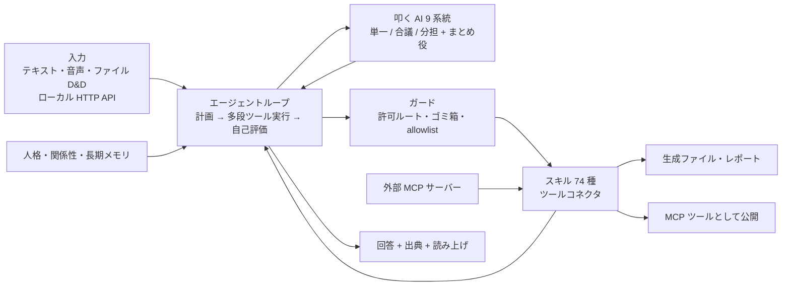

フロントは webview、バックエンドは Rust。アーキテクチャとコネクタ仕様の正本は [SPEC.md](SPEC.md) です。

## キャラクターができて動くまで

付属7体は、キャラごとの専用描画コードではなく、LocalVTuberStudioの同一パイプラインで立ち絵から作った自己完結パックです。制作時だけローカルGPUモデルを使い、PicoAgentで表示するときは完成済みPNGパーツを共通のPIXI描画層で動かします。

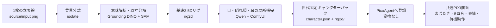

| 工程 | 保存する主な成果物 | 役割 |
|---|---|---|
| 入力登録 | `source/input.png`、人物設定 | 原画を上書きせず、すべての再生成の起点にする |
| `isolate` | 透過済み立ち絵 | 既存透過を保ち、不透明な入力だけ背景を分離する |
| `decompose` | 解析結果、原寸マスク、部位PNG、確認用PSD | 目・口・髪・顔・胴体などを意味解析して分ける |
| `rig2d` | 補完前の基底リグ | 重なり順・座標・可動範囲を検証する。ここでは完成扱いにしない |
| `complete` | 不変世代の完成リグ、局所編集の証跡 | 閉眼・髪に隠れた顔・耳を局所補完し、検査に通った世代だけ公開する |
| PicoAgent表示 | `character.json`、`rig2d/rig.json`、`rig2d/parts/*.png` | パックをそのまま読み、キャラ固有分岐なしで連続描画する |

上流だけをやり直した場合は、その工程より後だけを再生成します。失敗中の世代や空素材へ黙って切り替えず、直前の公開済み世代を保持します。設定の「キャラ作成（テスト）」から利用でき、初回だけ「追加機能・更新」で約77GBの管理ランタイムを導入します。空き容量85GB以上とCUDA対応NVIDIA GPUが必要です。Python 3.12はTHA3を含まない共通環境1つだけを使います。この機能はテスト扱いで、現行の自動生成は同梱7体で動作していますが、入力画風を問わずLive2D「ひより」と同等になる保証はまだありません。描画形式は [メッシュ変形リグ設計](docs/MESH-RIG.md)、素材更新手順は [キャラクター画像の追加・再生成手順](docs/CHARACTER-ASSET-WORKFLOW.md)を参照してください。

## 技術スタック

| 領域 | 採用技術 | 役割 |
|---|---|---|
| デスクトップアプリ | Tauri 2、Rust、Windows WebView2 | ウィンドウ、設定、権限制御、サイドカーと推論プロセスの管理 |
| UI | HTML、CSS、JavaScript | 会話・設定・配信表示。製品のビルドと起動にNode.jsは使わない |
| 2D/2.5D描画 | PIXI.js 6.5.10、独自メッシュリグ | 透過PNGパーツを連続変形し、口・目・視線・髪・身体を動かす |
| Live2D表示 | Cubism Core、pixi-live2d-display | 利用者が権利を持つCubism 4／5モデルを表示する。モデルは同梱しない |
| ローカル会話AI | llama.cpp、GGUF | Windows上で会話モデルをローカル推論する |
| 音声 | whisper.cpp、AivisSpeech | ローカル文字起こしと読み上げ。母音時間を2D口パクへ渡す |
| キャラクター制作 | Python 3.12、PyTorch、Grounding DINO、SAM 2.1 | 立ち絵の意味解析と原寸部位分解 |
| 局所画像編集 | 管理下ComfyUI、Qwen-Image-Edit-2511 | 閉眼・隠れ顔・耳を原寸範囲だけ補完する |
| ビルド・検証 | Cargo、`cargo xtask`、Playwright | セットアップ、同期、ビルド、テスト、実画面キャプチャを一つの入口へ集約する |

## 数字

| | |
|---|---|
| スキル | **74 種**（会話の内容から自動選択） |
| 叩く AI | **9 系統** ／ 回答の作り方 **4 モード**（単一・合議・分担＋統合・分担のみ） |
| 表示形式 | **7 つ**（ミニ／ペット／チャット／バー／作業／配信／ウィジェット） |
| 同梱キャラクター | 独自 2D/2.5D **7 体**（ほかに Live2D 動作例 6 体・非同梱） |
| ローカルモデル | 既定は軽量な LFM2.5 2.6B QAD Q4（約 1.59 GB）。PCに合うLFM／Gemma／Qwen等を設定画面で選択 |
| 最小構成 | RAM 8 GB・GPU なしでも動作（通常推奨 RAM 16 GB・VRAM 4 GB） |
| 実行構成 | 既定のローカルAIを同梱。追加機能と外部サービスは必要なものだけ選択して利用 |

---

## 📑 ドキュメント地図

| | |
|---|---|
| [🚀 まず動かす](#-まず動かす) | 前提、2 コマンド起動、`setup` 対象、叩く AI の選択 |
| [✨ できること](#-できること) | 土台・エージェント・表示形式・スキル一覧 |
| [キャラクターができて動くまで](#キャラクターができて動くまで) | 立ち絵から2.5Dパックを作り、PicoAgentで描画する工程と成果物 |
| [技術スタック](#技術スタック) | 製品実行時とキャラクター制作時に使う技術の境界 |
| [🎭 キャラクター](#-キャラクター) | 同梱 2D・Live2D のプレビューとモーション対応表 |
| [🖱 使い方](#-使い方) | マウス・キーボード・ホットキー・ファイル受け渡し |
| [⚙️ 設定](#️-設定) | 設定画面、会話の記憶、主要な設定キー |
| [📊 性能要件](#-性能要件) | 動作環境の目安、GPU 対応境界、上限とタイムアウト |
| [🔌 ローカル API](#-ローカル-api) | Ollama 風 / OpenAI 互換 / MCP エンドポイント |
| [🛟 困ったとき](#-困ったとき) | 症状別の対処 |
| [🛠 開発・配布ガイド](docs/DEVELOPMENT.md) | コネクタ、xtask、ビルド、リポジトリ構成 |

> [!TIP]
> **使いかたを一冊で読みたいなら [MANUAL.md](MANUAL.md)。** 導入から日常の使いかた、スキル活用、ローカル API までまとまっています。
> アーキテクチャとコネクタ仕様は [SPEC.md](SPEC.md)、全設定キーは [docs/SETTINGS.md](docs/SETTINGS.md)、開発・配布手順は [docs/DEVELOPMENT.md](docs/DEVELOPMENT.md)、AI エージェント向けの作業ルールは [AGENTS.md](AGENTS.md) です。
---

## 🚀 まず動かす

> [!IMPORTANT]
> **この節はソースから動かす開発者向けです。** 製品を使うだけなら Rust も cargo も要りません。
> 配布ページのインストーラを実行してください（利用者向けの案内は公開サイトの `support.html`／`distribution/site/support.html`）。

### 前提

**対応 OS は Windows、macOS、Ubuntu Linux 24.04 LTS x64です。初期販売版の配布はWindows 10/11 x64から開始します。** macOS版は未署名アルファv1.0.4を公開済みで、正式な一般配布は署名方針と実機QAが揃ってから行います。Linux版の一般公開も実機QA後です。

| | 必要なもの |
|---|---|
| 共通 | **Rust 1.88以上（cargo）** / **Tauri CLI**（`cargo install tauri-cli --version '^2'`） / **Git LFS**（clone後に`git lfs pull`） |
| Windows | WebView2 ランタイム |
| macOS | Xcode Command Line Tools（`xcode-select --install`）<br />読み上げも使うなら `brew install p7zip` |
| Ubuntu Linux 24.04 x64 | 下記のTauri／音声／入力操作／画面取得用パッケージ |

Ubuntuでは、ソースからのビルド前に次を1回実行します。AppImageの音声同梱に必要なGStreamerは`base`と`good`だけを使い、再配布条件の異なる`ugly`は既定へ入れません。

```bash
sudo apt-get update
sudo apt-get install -y build-essential pkg-config curl ca-certificates git git-lfs \
  libgtk-3-dev libwebkit2gtk-4.1-dev libsoup-3.0-dev librsvg2-dev \
  libayatana-appindicator3-dev libasound2-dev libxdo-dev libclang-dev \
  libxcb1-dev libxrandr-dev libdbus-1-dev libpipewire-0.3-dev \
  libwayland-dev libegl-dev libgbm-dev patchelf squashfs-tools \
  gstreamer1.0-plugins-base gstreamer1.0-plugins-good
```

### 起動

Windowsでは、リポジトリ直下の **`PicoAgentを起動.bat`** をダブルクリックすれば起動できます。BATは自身の置かれたフォルダへ移動してから、下記と同じ正規の開発起動を実行します。起動中に開く黒い画面はPicoAgentを終了するまで閉じないでください。

```bash
cargo install tauri-cli --version '^2'   # 初回だけ
cargo xtask dev
```

`cargo xtask dev` は、残存プロセス停止・キャラクター同期・UI生成だけを行う**最小の開発起動**です。未使用の追加機能や取得元の障害で本体起動を止めません。ローカルAI、読み上げ、Live2Dなどを使う場合だけ、下表の `cargo xtask setup <対象>` を先に実行してください。Live2Dサンプルモデルも自動取得しません。保存中の追加キャラやLive2Dが欠損・破損・応答停止している場合も、短時間で同梱2.5Dキャラ「むぎ」へ切り替えて画面を起動します。

PR前の一括ローカル検証は次の1コマンドです。

```bash
cargo xtask verify
```

本体とxtaskの書式・全target静的解析・テスト、追跡JavaScript／MJSの構文、Git差分を順に検査します。
途中で失敗しても残りを実行し、最後に失敗一覧を出します。`node`が無い環境ではJavaScript構文だけを
スキップし、その事実を結果へ表示します。依存更新時と販売前の`cargo audit`は別の必須検査です。

キャラクターまたはUIの生成物だけを更新するときは、`cargo xtask sync-characters` と
`cargo xtask build-ui`を使います。通常はサイズと更新日時が同じファイルを飛ばす差分同期です。
生成先をすべて作り直す必要がある場合だけ、それぞれへ`--force`を付けます。

> [!NOTE]
> 初回コンパイルではRustのcrate取得にネットワークが必要な場合があります。AIモデルなど数GBの追加取得は `setup` を明示実行したときだけ行います。取得済みなら以後はオフラインでも開発起動できます。

<details>
<summary>個別に取得したいとき（通常は不要）</summary>

| コマンド | 取得するもの |
|---|---|
| `cargo xtask setup engine` | 同梱推論エンジン（llama-server。Windows は Vulkan / GPU 版） |
| `cargo xtask setup aivis` | 同梱 Aivis（読み上げ） |
| `cargo xtask setup whisper` | ローカル Whisper CLI とモデル（録音の文字起こし用） |
| `cargo xtask setup live2d` | Cubism Editor 5.3互換のLive2Dランタイム（Cubism 4／5モデル対応。サンプルは含まない） |
| `cargo xtask setup live2d-samples` | 開発者が利用条件を確認したうえで公式サンプルを明示取得（製品ビルドには含まない）。未実行でも `dev` / `build` は通る（対応済みサンプル6体が一覧から外れるだけ） |
| `cargo xtask setup office` | OfficeCLI（LibreOffice。Office ファイルの変換・PDF 出力） |
| `cargo xtask setup tools` | 精度向上用の OSS CLI（Pandoc / ripgrep / ffmpeg / ImageMagick ほか） |
| `cargo xtask stop` | 残存プロセスの停止（本体・同梱エンジンに加えて、`tools/screenshots/` の撮影ツールが残した `node` と、PicoAgent 専用プロファイルで動く `browser_control` のブラウザも回収します。無関係な `node` や普段使いのブラウザは止めません） |

全対象が本当に必要な場合だけ `cargo xtask setup all` を明示します。引数なしの `cargo xtask setup` は、不要な数GB級ランタイムの取得を防ぐため実行しません。再取得は `TOOLS_FORCE=1` などの環境変数、対象を絞るなら `PICOAGENT_SETUP_TOOLS=pandoc,ripgrep`。

`cargo xtask build`も任意の大容量追加機能を暗黙取得しない軽量構成です。Aivis、Whisper、Office、外部CLIまで含む開発用フルビルドが本当に必要な場合だけ、`cargo xtask build-full`を明示します。

Ubuntu Linuxの配布確認は、Linux x64用エンジンを準備してから標準形式を指定します。AppImageは音声再生に必要なGStreamerを`tauri.linux.conf.json`で同梱します。

```bash
cargo xtask setup engine
cargo xtask build --bundles deb,appimage
```

一部の OS では公式のポータブル配布が無いツールがあります。その場合は警告のみで起動を続け、`apt` / `brew` で入れた PATH 上のツールへ自動で切り替わります。

</details>

### 叩く AI を選ぶ

既定は **`local`（同梱エンジン）** です。何も設定しなくても動きます。

- **軽量なローカルモデルを既定にする** — 初回は連続ツール利用を検証済みの LFM2.5 2.6B QAD Q4（約1.59GB）を選びます。既存利用者が選択済みのGemma 4等は変更しません。Windowsは対応NVIDIAで`CUDA → Vulkan → CPU`、AMDで`ROCm → Vulkan → CPU`、Intelで`SYCL → Vulkan → CPU`の順に起動確認します。Ubuntu LinuxはVulkan、macOSはMetalをGPU経路に使います。
- **設定画面でPC向け候補を選ぶ** — 「AIモデル・連携」に実PCのRAMと、正確に取得できた場合だけ専用VRAMを表示し、日本語対応のLFM2.5、Gemma 4、Qwen3.5、gpt-oss、Phi-4 miniを複数候補として案内します。カードまたは「種類 → サイズ」で選択でき、推奨VRAM・RAM・ダウンロード目安も確認できます。取得中はフキダシ下に「モデルを準備中… NN%」と出ます。
- **ディスク整理** — 「AIモデル・連携」タブの「ダウンロード済みモデル」から、取得済み GGUF の一覧・サイズ確認・削除ができます（使用中のモデルは削除不可）。削除は再ダウンロードが必要になることを画面内で案内し、同じボタンをもう一度押したときだけ実行します。
- **クラウド AI を使う**（費用が発生します） — 右クリック →「設定を開く…」→「AIモデル・連携」でプロバイダ・API キー・モデルを設定。OpenAI / Claude / Gemini / DeepSeek / xAI Grok / Mistral に対応しています。
- **外部 Ollama を使う** — `ollama serve` の後、設定画面でプロバイダを切り替えるとモデル一覧を読み込みます。
- **手元の CLI エージェントを使う** — Claude Code / Codex CLI が入っていれば、そのまま叩く AI として選べます。

> [!NOTE]
> **「手元の CLI エージェント」の動きかた**
>
> | 項目 | 内容 |
> |---|---|
> | 必要なもの | CLI のインストールとログイン。同梱ローカル AI と違い、利用者側で先に用意します |
> | 応答速度 | CLI の起動に毎回 1〜3 秒かかります。ひと言の雑談より、まとまった依頼を任せる使いかたが向きます |
> | セッション | 応答ごとにCLIプロセスは終了しますが、同じ通常会話ではClaude Codeの`session_id`／Codexの`thread_id`を明示して再開します。別会話・別キャラ・CLI設定変更・中断・失敗では新しく始めます。複数AIの候補は互いに分離し、分担計画と最終統合だけ同じまとめ役セッションを使います。形式不明の`custom` CLIは単発です |
> | ツールの境界 | Claude Code は safe mode・組み込みツールなし、Codex はユーザー設定なし・read-only sandboxで起動します。ファイルや PC の操作は PicoAgent 側のスキル境界だけを通ります |
> | スキルの呼び出し | CLI は function calling を受け付けないため、**プロンプトの約束事**（決められた JSON を返させる）でスキルを呼びます。通常のプロバイダより取りこぼしが起こりえます。約束を守らない出力は普通の返答として扱うので壊れはしません |
> | 配布時の扱い | 利用者側の導入とログインが前提になるため、配布・販売する構成の既定プロバイダにはしないでください。組み込んで配布する場合は、各サービスの利用規約の確認が別途必要です |


---

## ✨ できること

### 土台

- **同梱ローカルAIで完結** — 推論エンジンと初回取得したモデルだけで動作し、必要に応じてOllamaやクラウドAIへ切り替え可能
- **叩く AI を差し替え可能** — local / Ollama / OpenAI 互換 / Claude / Gemini / DeepSeek / xAI Grok / Mistral / 手元の CLI エージェント（Claude Code・Codex CLI）の 9 通り
- **エージェント機能を追加可能** — ツールコネクタを足すと、モデルが function calling で呼べる
- **叩く AI は 1 体に決めなくていい** — 2〜8 体へ同じ質問を送って統合する合議、仕事を割り振って統合・個別返却する分担を設定から選べる（[マルチAI合議・分担](#エージェント)）
- **軽量な Tauri ネイティブ** — システム WebView + Rust バックエンド
- 会話は選択中の叩く AI にだけ送られる。ローカルモデルなら外部送信なし

### エージェント

- **スーパーエージェントモード** — 複雑な依頼を「計画 → 多段ツール実行 → 自己評価」まで自律的に回し、必要なら `subagent` スキルでサブタスクを分担。進捗はフキダシ上部のステータス行にリアルタイム表示
- **マルチAI合議・分担** — 設定した複数のlocal／Ollama／各社API／Claude Code・Codex CLIへ同じ質問を送り、まとめ役がより良い回答へ統合できる。作業を自動分担して統合するモードと、分担結果を個別に返すモードにも対応。AIごとにモデルと「担当の希望」を指定でき、空欄なら自動で割り振る。統合結果は選択中キャラクターの口調で返し、停止ボタンでも止められる。既定は従来どおり単発で、単発以外は Pro 版の機能
- **原則 Web 検索** — 通常の質問はローカルモデルの判断に頼らず検索してから、参照元リンク付きで回答（短い挨拶は例外扱いでキャラクター本人として返答）

`PICOAGENT_MULTI_AI_MODE` で選べる回答の作り方は次の 4 つ。

| 値 | 動き |
|---|---|
| `single`（既定） | 選んだ叩く AI が 1 体で答える。推論も外部 API 利用も最小 |
| `consensus` | 同じ質問を参加 AI 全員へ送り、まとめ役が正確さ・具体性・抜けを比較して 1 つの回答へ統合する |
| `collaborate` | まとめ役が仕事を割り振り、各 AI の結果を 1 つへ統合する |
| `divide` | 割り振った結果を統合せず、AI ごとに並べて返す |

参加 AI は 2〜8 件。同梱ローカル AI 同士は同梱モデルの取り合いを避けて直列、その他は `PICOAGENT_MULTI_AGENT_MAX_CONCURRENCY` まで並行実行する。参加数に加えて統合 1 回分（分担時は計画 1 回分も）の推論が増えるため、応答時間と API 利用量は単発より増える。


### 表示形式（画面構成を選べる）

画面上端へカーソルを合わせるとWindows風メニューが現れ、**「表示」**から画面設定、**「配置」**からOBS風の直接編集、**「キャラ選択」**と**「設定」**から各設定画面を開けます。右クリックの「画面レイアウト」も利用できます。設定 →「画面・操作」では実際のスクリーンショット・用途・既定寸法を見比べながらカードで選択でき、どれも再起動なしで反映します。旧「トーク」はLINE風の「チャット」へ統合され、保存済み設定も自動移行します。起動準備中は680×430へ縮めた配信画面を使い、専用の寝姿を持つキャラクター（現在はむぎ・りん・まい）から起動ごとにランダムで表示します。対象は一覧 `characters/index.json` の `bootSleeping` で決まり、キャラクターを足しても実装の書き換えは要りません。選択中のキャラクター、ローカルAI、読み上げが有効なら音声モデルと最初の挨拶音声まで準備してから、保存中の形式へ戻ります。ただし初回セットアップの案内はローカルAIを使わないため、モデル取得の完了を待たずに開きます（取得は続行し、準備できるまでは送信ボタン側が理由を出します）。

<div align="center">
  <table>
    <tr>
      <td width="25%" align="center"><br /><b>ミニ</b><br /><sub>キャラ中心。必要な時だけ会話</sub></td>
      <td width="25%" align="center"><br /><b>ペット</b>（既定）<br /><sub>キャラ＋会話。ふだん使い</sub></td>
      <td width="25%" align="center"><br /><b>チャット</b><br /><sub>LINE風の左右吹き出し</sub></td>
    </tr>
    <tr>
      <td align="center">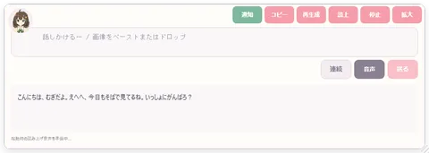<br /><b>バー</b><br /><sub>1 行入力。呼んで消す</sub></td>
      <td align="center">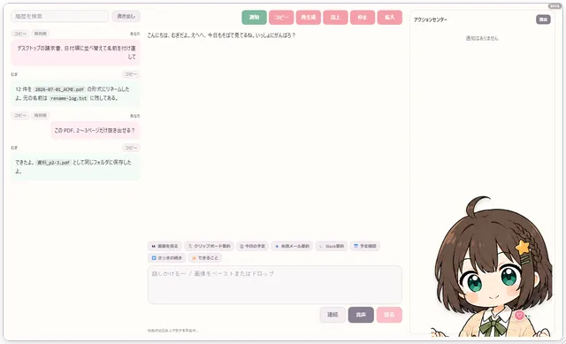<br /><b>作業</b><br /><sub>履歴・回答・実行状況の 3 ペイン</sub></td>
      <td align="center"><br /><b>配信</b><br /><sub>フルHD背景＋胸上キャラ＋字幕</sub></td>
      <td align="center">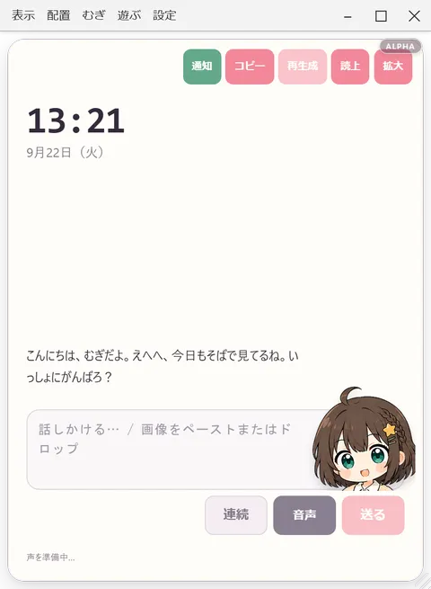<br /><b>ウィジェット</b><br /><sub>時計と通知を出しておく</sub></td>
    </tr>
  </table>
  <sub>既定寸法は、ミニ360×560／ペット900×600／チャット520×760／バー900×320／作業1400×850／配信1920×1080（フルHD）／ウィジェット440×600です。寸法は形式ごとに覚えます。枠なしウィンドウの<b>辺をドラッグすると幅または高さ、四隅をドラッグすると縦横を同時に変更</b>できます。キャラをドラッグするとウィンドウを動かせます。低頭身2Dは上半身、長身・実写と構図調整済みLive2Dは胸上が初期構図です。利用者が追加したLive2Dは全身を欠けさせない倍率から始まります。「配置」モードではOBSのようにキャラやフキダシを直接ドラッグ／拡大縮小し、キャラ位置と倍率はキャラごと・表示形式ごとに保存できます（保存先は他の設定と同じ設定ファイルなので、アップデートや再インストールでも残ります）。右クリックの「配置を直接調整」からも開け、縮小しすぎや画面外への消失を防ぎます。</sub>
</div>

### キャラクター

- キャラクターパックごとの連続フレームと、状態別（待機 / 傾聴 / 検索 / 作業 / 返答 / 成功 / エラー）の滑らかな補間動作
- **通常2Dの局所二次動作** — `character.json` の `secondaryMotion` で胸元の範囲と強さをキャラ別に指定し、全身呼吸とは別の遅れた動きを付けられる。Live2Dは不要で、動きを減らすOS設定では停止する
- **LocalVTuberStudio独自2.5D** — 現行`lvs-anime25d-v1` schema 3を変換せず読み、原寸の分離パーツをPIXIで瞬き・呼吸・小角度・髪揺れ・腕寄せへ連続描画する。`secondary_motion`がある生成物は、保存された周波数・減衰比・強さで髪を頭へ遅延追従させる。待機・会話・考え中・よろこび・困りでは、頭と全身を小さく連動させる。Aivisの母音時間から`MouthOpenY × MouthForm`を駆動し「あ・い・う・え・お」を分ける。同梱むぎは`characters/mugi/rig2d/`へ同形式の成果物をそのまま配置しており、キャラ固有の変換コードを持たない。Live2D対応は従来どおり残り、キャラクターごとに選べる
- **Live2D 対応** — `character.json` に `live2d.model` があるキャラは Cubism ランタイムで WebGL 描画。Cubism Editor 5.3互換の公式CoreでCubism 4／5モデルを読み込み、まばたき・モーション・声量連動の口パクを行う。視線追従は既定OFFで、設定から有効にした場合だけ顔付近のマウスへ控えめに追従する。サンプルモデルは同梱・自動取得せず、利用者が配布元の条件を確認して取得したzip／フォルダを設定画面から追加する。**2D と Live2D の見た目は[キャラクター](#-キャラクター)で見比べられます**
- キャラごとに名前・挨拶・性格・口調・一人称を定義でき、設定画面で切替と人格の上書きが可能
- **ユーザーとの関係を選べる** — 相棒（既定）／友達／恋人／妹／姉／先輩／自由設定。キャラの性格や口調の芯はそのままに、呼び方・距離感・敬語かタメ口かだけが変わります。キャラごとに別の関係を設定することもできます
- **関係性と共有記録** — キャラごとに会話・完了した作業・ふれあいを端末内へ保存。「出会ったばかり」から自然に距離感が変わる。作業記録は固定・個別削除・全消去でき、「続きをやる」で依頼を入力欄へ戻せる。保存自体も設定で停止可能
- **2Dのふれあい** — 頭・頬・手へのタップとなでなでで、キャラ固有の台詞と照れ・喜びモーションを返す。数値ゲージではなく反応で親しさを表現
- **会話の内容で表情が変わる** — 話の流れから推定した感情（喜び・落ち込み・高揚・落ち着き・興味・驚き）が、キャラのオーラの色・顔色・動きの速さに出ます
- **スタイルバリアント** — `character.json` の `variants` で同一キャラの別衣装・季節差分・演出を切替可能。**`variants[].live2d` を書けば、同じキャラの「絵版」と「Live2D 版」も切り替えられます**
- **2Dキャラパック** — `cargo xtask character-pack validate <フォルダ>` で形式・容量・画像寸法・パスを検証し、`install` で途中状態を残さず正本と一覧へ追加できる

#### 独自2.5Dの確認画面

開発中の独自2.5Dは、PicoAgent本番の`mesh-rig.js + PIXI`へ直結した確認画面で見比べる。あおい・むぎ（SD／通常頭身）・りん・まい・セナ・実写テストの7体を切り替え、原画との比較、左右まばたき、視線、閉口と5母音、通常／笑顔／困り顔／考え顔／照れ／怒り、待機／会話／考え中／よろこび／困り／聞く、腕寄せ、全身表示、背景色を個別または自動で確認できる。口パクの無音テストでは発話入力に連動する上体と胸の遅れも確認でき、停止後は微小な呼吸へ戻る。通常頭身むぎは`characters/mugi-normal-lvs/`へ独立したキャラクターパックとして置き、既存のSDむぎを上書きしない。顔・首・襟・胴の境界を保つため、独自2.5Dの動作は上半身を一体で動かし、顔だけを平行移動・回転しない。OBS・VRMの確認機能ではない。

```powershell
uv run python -m http.server 8776 --bind 0.0.0.0 --directory .
```

- PCのChrome: `http://127.0.0.1:8776/tools/mesh-rig-preview/`
- 同じLANのスマホ: `http://<このPCのIPv4アドレス>:8776/tools/mesh-rig-preview/`
- IPv4確認: `Get-NetIPAddress -AddressFamily IPv4 | Where-Object IPAddress -NotLike '127.*'`

確認用スクリーンショットは`temp/`だけに置き、Gitへ含めない。あおい・むぎ・りん・まい・セナ・実写テストはLocalVTuberStudioが出力した現行schema 3の自己完結パックをそのまま読む。`rig.json`と参照先PNGを同じ配置規則で持ち込めばよく、髪物理を含めてPicoAgent専用の画像変換やキャラ別描画分岐は行わない。旧形式では左右別閉眼と腕寄せを無効表示にする。

### スキル（一部）

| 分野 | できること |
|---|---|
| 情報・検索 | Web検索・ページ取得、ローカル文書検索、天気、為替、株価指数、ニュース、RSS、出典付き調査 |
| ブラウザ | 実際の Chrome / Edge を開いてページを読む（JS 描画・ログインが要るページ向け。既定は無効） |
| 日常補助 | リマインダー、集中タイマー、見守り通知、できたことメモ、おでかけ前チェック、クリップボード要約 |
| 文書・画像・音声 | PDF抽出・分割・結合、Office編集・変換、PSD/HEICなど画像変換、ComfyUI／Stable Diffusion系／OpenAIによる画像生成、AnimateDiff等の動画出力、録音 → 文字起こし → 議事録 |
| 調査・資料 | 出典付き調査レポート、スライド下書き、HTML ダッシュボード、資料一式の生成 |
| 外部連携 | Gmail、Slack、Discord、Google Workspace、Microsoft Graph、GitHub、Notion、Jira、Linear、Trello、Todoist、各種SNS、汎用HTTP API |
| ローカル操作 | ファイル読み書き、コマンド実行、自力コード実行、cron 風スケジュール |
| PC 操作 | マウス・キーボードの直接操作とウィンドウ一覧・前面化（シェルを介さない固定操作のみ。既定は無効。ウィンドウ一覧・前面化は現在Windowsのみ） |
| プロジェクト管理 | 案件ごとの作業環境の切替、課題台帳（期限・優先度・タグ）、決定事項と進捗の記録、切替時の文脈復元 |
| 自作AIスキル | 普通の `SKILL.md` へ手順を書き、チャットから作成・更新・利用。再ビルド・再起動は不要 |
| コーディング支援 | 行番号つき部分読み、ファイル名検索（glob）、内容検索（正規表現）、既存ファイルの部分編集、ノートブック編集、バックグラウンド実行の様子見、多段タスクの作業計画、画像を見る、選択肢つきの確認 |
| 実用ツール | 文字数分析、JSON 整形、Base64、URL 変換、単位換算、日付計算、CSV 表化、色変換 ほか約 30 種 |

> 頼み方の具体例は **[MANUAL.md 第5章「スキル活用ガイド」](MANUAL.md#5-スキル活用ガイド頼み方の例)** にまとまっています。設定画面の「使い方」タブからも同じ内容を見られます。
>
> 上の表は用途別です。「読むだけか、送信・削除まで行うか」という設計上の分類は **[SPEC.md「スキルの分類」](SPEC.md#スキルの分類エージェント設計としての位置づけ)** にあります。

#### Markdownで自分のAIスキルを追加

「週報を成果・課題・次の予定の3項目にまとめるAIスキルを作って」のようにチャットで頼むと、`app_config_dir/user-skills/<名前>/SKILL.md` を作成します。「追加スキル一覧」「weekly-reportスキルでこのメモを週報にして」「説明を変更して」で一覧・利用・更新もできます。外部エディタでUTF-8の`SKILL.md`を直接追加しても、次の会話から反映されます。

```markdown
---
name: weekly-report
description: 作業メモを週報の三項目へ整理する
when_to_use: 週報、進捗報告、今週の成果を頼まれたとき
metadata:
  tags: 週報, 進捗
---

成果、残った課題、次の予定の順に簡潔にまとめる。
事実が足りない項目は推測せず「未確認」と書く。
```

Markdownスキルはモデルへ手順を渡す仕組みで、任意コードや新しい権限を追加しません。ファイル操作・外部送信・コマンド実行が必要なら既存の74種のToolを使い、それぞれの許可、確認、ライセンス判定に従います。`name`と`description`に加え、用途を明確にする`when_to_use`、分類用の`metadata.tags`、自動候補へ出さない`disable-model-invocation`を使えます。Agent Skills互換の`license`、`compatibility`、`metadata`、`allowed-tools`も保持しますが、`allowed-tools`から新しい実行権限は得られません。最大32件です。

---

## 🎭 キャラクター

<div align="center">
  <table>
    <tr>
      <th width="50%">2D（連番フレーム）</th>
      <th width="50%">Live2D</th>
    </tr>
    <tr>
      <td></td>
      <td></td>
    </tr>
    <tr>
      <td></td>
      <td></td>
    </tr>
  </table>
  <h3>Live2D動作例（非同梱）</h3>
  <table>
    <tr>
      <td align="center">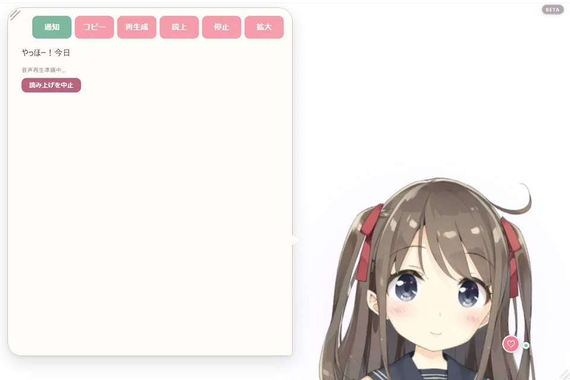<br />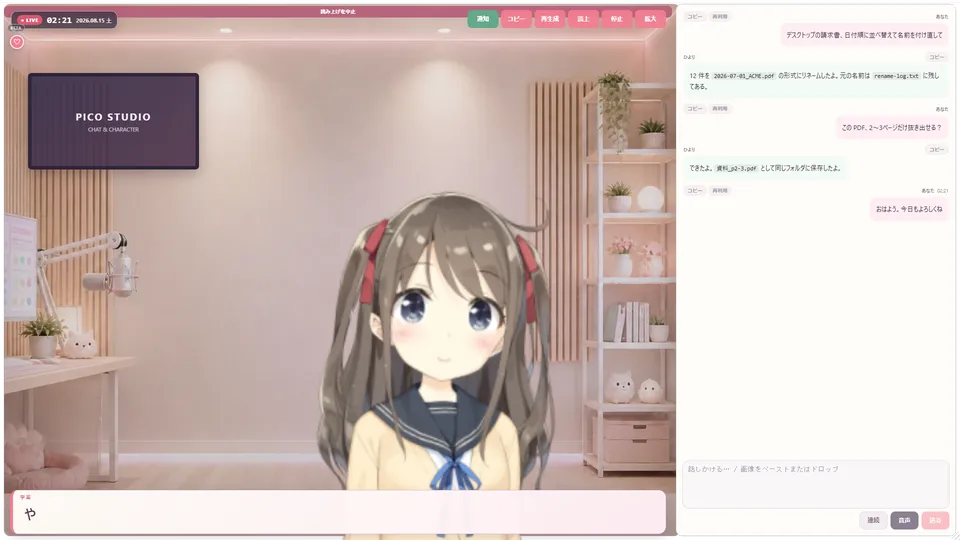<br /><sub><b>ひより</b>（通常／配信）</sub></td>
      <td align="center">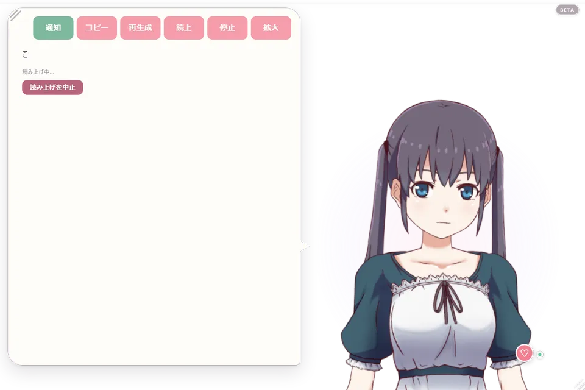<br />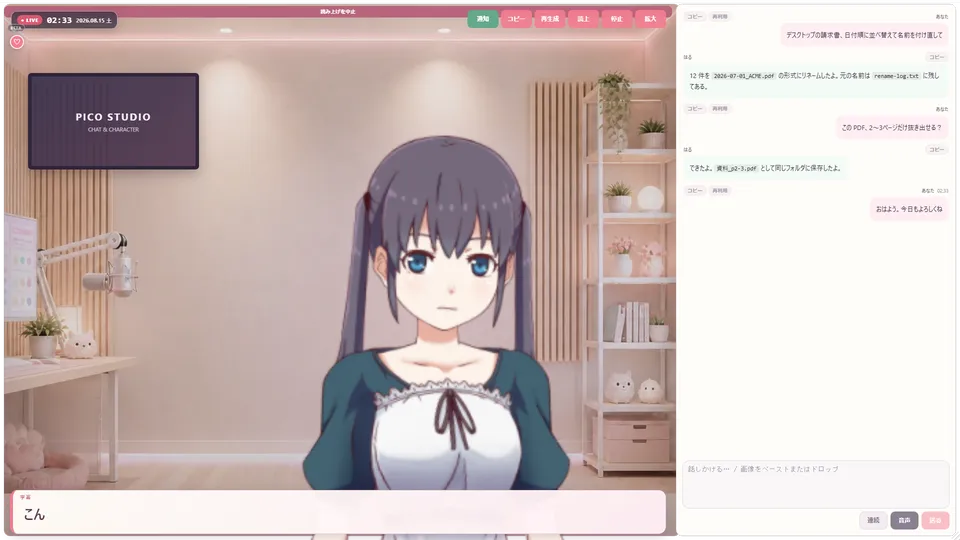<br /><sub><b>はる</b>（通常／配信）</sub></td>
      <td align="center"><br /><br /><sub><b>イプシロン</b>（通常／配信）</sub></td>
      <td align="center">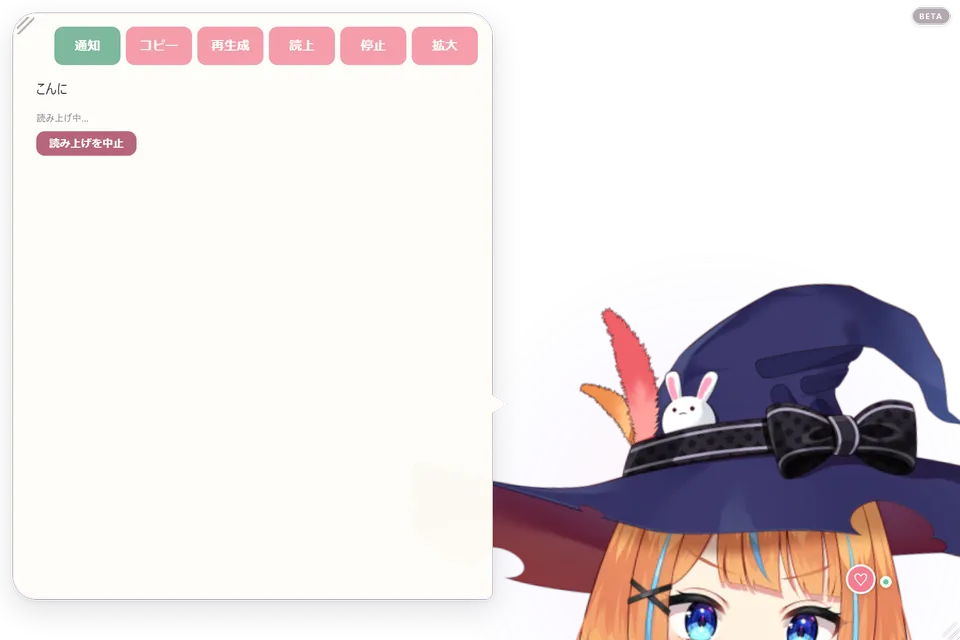<br /><br /><sub><b>まお</b>（通常／配信）</sub></td>
    </tr>
    <tr>
      <td align="center">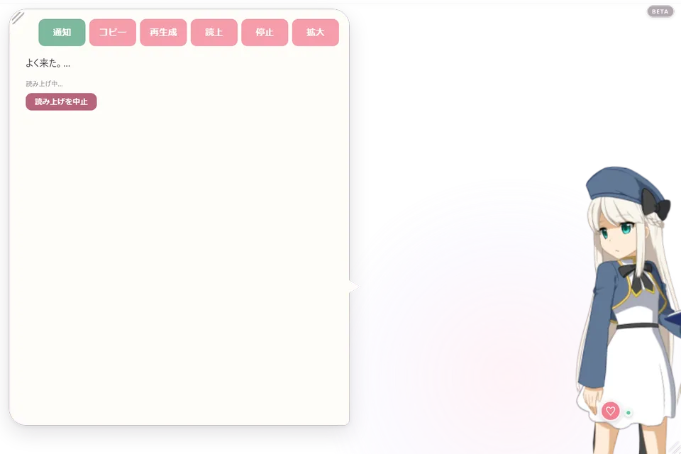<br />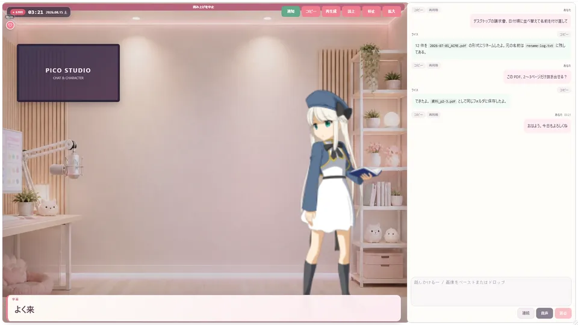<br /><sub><b>ライス</b>（通常／配信）</sub></td>
      <td align="center"><br />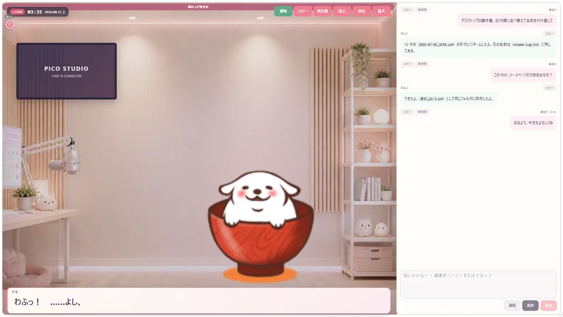<br /><sub><b>わんこ</b>（通常／配信）</sub></td>
      <td></td>
      <td></td>
    </tr>
  </table>
  <sub>
    ウィンドウは枠なしの透明。デスクトップにフキダシとキャラクターだけが浮かびます（上：ライト／下：ダーク）。実際の動きです。<br />
    左は 2D キャラ「むぎ」、右は Live2D キャラ「ひより」。Live2D はまばたき・モーション・口パクをモデル自身が行います。
  </sub>
</div>

<br />

<div align="center">
  <h3>同梱キャラクター</h3>
  <details>
    <summary><strong>同梱キャラクター7体の通常表示・配信表示を開く</strong></summary>
  <table>
    <tr>
      <td align="center"><br />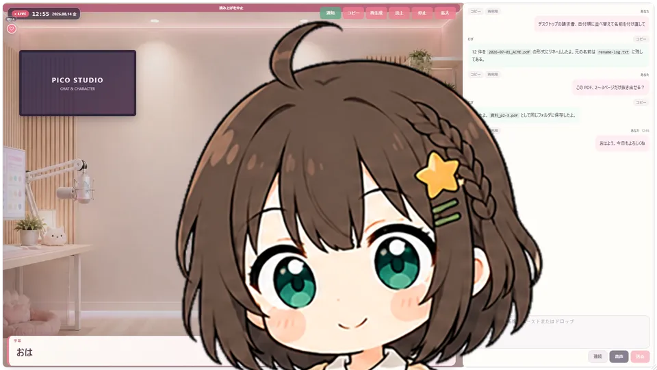<br /><sub><b>むぎ</b><br />通常／配信</sub></td>
      <td align="center">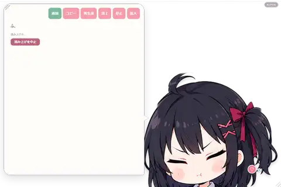<br />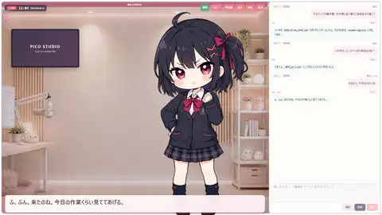<br /><sub><b>りん</b><br />通常／配信</sub></td>
      <td align="center"><br />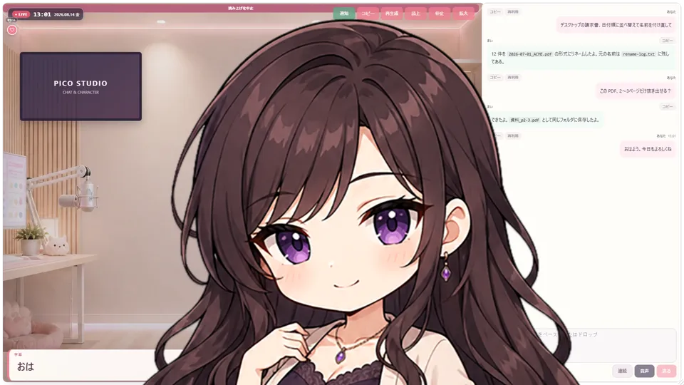<br /><sub><b>まい</b><br />通常／配信</sub></td>
    </tr>
    <tr>
      <td align="center">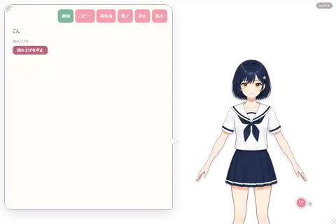<br /><br /><sub><b>あおい</b><br />通常／配信</sub></td>
      <td align="center">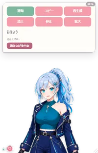<br />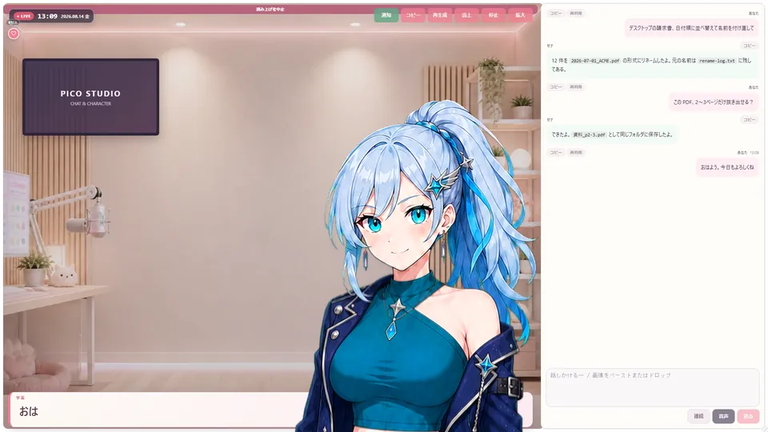<br /><sub><b>セナ</b><br />通常／配信</sub></td>
      <td align="center"><br /><br /><sub><b>むぎ（通常頭身）</b><br />通常／配信</sub></td>
      <td align="center"><br /><br /><sub><b>実写テスト</b><br />84フレーム／目・口7段階</sub></td>
    </tr>
  </table>
  <details open>
    <summary><strong>通常2Dの分離メッシュリグを拡大して確認</strong></summary>
    <p>画像を選ぶと、GitHubの画像表示でさらに拡大できます。</p>
    <p>
      <a href="docs/images/character-sena-stream.webp"></a><br />
      <sub>配信表示：6分離原画、左右視線・まばたき・口パク・頭部・腕・呼吸。待機・思考中・会話で表示寸法を維持</sub>
    </p>
    <p>
      <a href="docs/images/character-sena.webp"></a><br />
      <sub>通常表示：実際のペット画面全体</sub>
    </p>
  </details>
  <sub>
    各キャラを標準ペット表示と配信表示の両方で、960px・16fps・6秒（96コマ）撮影しています。通常版は実画面を2倍密度で描画し、配信版はネイティブ1920×1080のフルHD画面から、既存動画を再圧縮せず直接書き出しています。同じ「おはよう。今日もよろしくね」への返事から、<b>音声同期の口パク → 考え中 → 待機</b>を再生し、まばたきや物理演算もそのまま動かしています。<br />
    人格・口調はキャラクターごとに定義されていて、設定画面から編集できます。<br />
    同梱7体はLocalVTuberStudio schema 3または互換メッシュリグを直接読み、まばたき、音声再生中の2軸口パク、左右視線、共通表情、頭部・左右腕・呼吸の連続動作を描画します。生成由来の素材充足度と半閉眼の造形品質はキャラごとに異なり、ひより相当のLive2D品質を保証するものではありません。WebGLを使えない環境や省モーション設定では利用可能な従来表示へ戻ります。ミュート中と音量0では口パクしません。<br />
    このほかに Live2D キャラクター（ひより・はる・イプシロン・まお・ライス・わんこ）があります。<br />
    Live2D はランタイムとモデルを配布に含めないため、<code>cargo xtask setup live2d</code> で取得した環境でだけ表示できます。
  </sub>
  </details>
</div>

### キャラクター別モーション対応

`◎` は専用素材またはモデルパラメータ、`○` は共通の状態モーションです。PNGのフル仕様は `motionProfile=full` で宣言し、必要な9レイヤーが1枚でも欠けると同期テストが失敗します。

| キャラクター | 形式 | 状態動作 | まばたき | 口パク | 視線 | 感情表情 | 胸元二次動作 |
|---|---|---:|---:|---:|---:|---:|---:|
| むぎ / むぎ（通常頭身） / りん / まい / セナ / あおい | LocalVTuberStudio系2.5D | ○ | ◎ | ◎ | ◎ | ○ | ○ |
| 実写・物理演算テスト | 独自2.5D | ○ | ◎ | ◎ | ◎ | ○ | ◎（8領域） |
| ひより / はる / イプシロン / まお / わんこ | Live2D | ◎ | ◎ | ◎ | ◎ | モデル動作 | モデル物理 |
| ライス | Live2D | ◎ | ◎ | 無効 | ◎ | モデル動作 | モデル物理 |

通常2Dの口パクは実際の音声再生開始後に声量同期し、ミュート中と音量0では口を閉じます。Live2Dも同じ再生条件でモデルの口パラメータを動かし、ライスだけはモデル設定により口パクを無効にしています。LocalVTuberStudio系は原寸の部位PNGと連続パラメータを使い、固定枚数の紙芝居へ変換しません。実写テストは髪・胸・肩・腰の8領域に実行時の局所バネ物理も併用します。利用者が追加済みのPNGパックはそのまま使えます。低頭身2Dは上半身、長身・実写と構図調整済みLive2Dは胸上を初期構図にし、チャット／バーの小型アイコンは首上で表示します。利用者が追加したLive2Dは、モデルごとに異なる顔位置を誤って切らないよう全身表示から始めます。画像追加・差し替えの再現手順は[キャラクター画像の追加・再生成手順](docs/CHARACTER-ASSET-WORKFLOW.md)に固定しています。

---

## 🖱 使い方

### マウス操作

| 操作 | 動き |
|---|---|
| フキダシをクリック | 入力欄を開く |
| フキダシ上部の小ボタン | 回答コピー / 再読み上げ / 停止 / 拡大 |
| ウィンドウの辺／四隅をドラッグ | 画面の幅／高さ／縦横をOS標準操作で変更（終了時に自動保存） |
| フキダシ左上のつまみをドラッグ | フキダシの幅・高さを変更（位置も含めて自動保存） |
| キャラクターをダブルクリック | フキダシを全画面表示 ⇄ 元に戻す |
| キャラクターをドラッグ | ウィンドウを移動 |
| 読み上げ中にキャラクターをクリック | 読み上げを停止 |
| キャラクターをクリック / なでる | 触った場所に応じて反応し、ふれあいを記録 |
| キャラクター横の `♡` | 関係性と最近いっしょにしたことを表示 |
| 画面上端へカーソル →「配置」 | OBS風の配置モードを開き、キャラ／フキダシ／入力／履歴／画面内ディスプレイをドラッグ・拡大縮小・保存 |
| 設定 →「キャラ選択」の構図プレビューをドラッグ | キャラの位置を調整（サイズはスライダー） |
| 右クリック | **話しかける…** / **画面レイアウト** / **表示するモニター** / **配置を直接調整** / 常に手前に表示 / **画面レイアウト・位置…** / **キャラクターの設定…** / 設定を開く… / 表示と会話をリセット / 終了 |

全画面フキダシでは会話履歴を検索でき、各履歴のコピーやユーザー発話の再利用ができます。
フキダシ本文や入力欄の上で右クリックした場合は、コピーなど通常のメニューを優先します。
チャットで「アプリ終了して」「PicoAgent を閉じて」と頼んでも、アプリ操作スキル経由で終了できます。

<div align="center">
  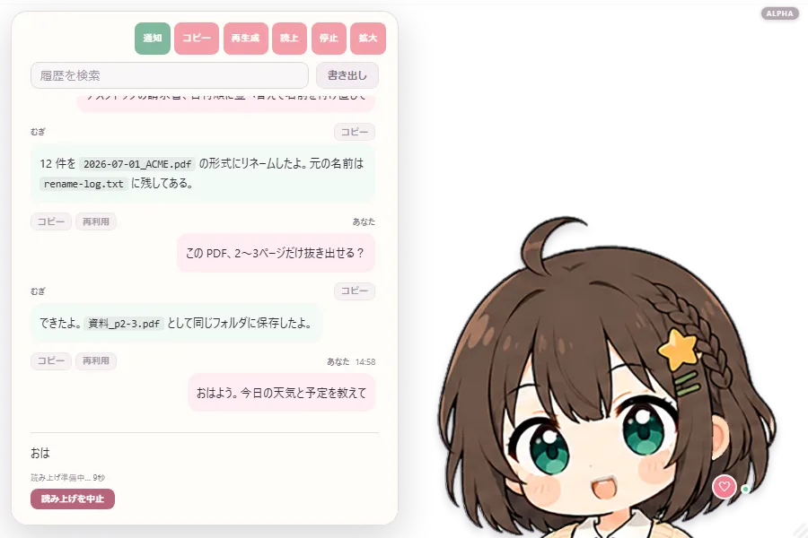
  <br />
  <sub>全画面フキダシ。履歴の検索・コピー・再利用・Markdown 書き出しができます。</sub>
</div>

### キーボード

| キー | 動き |
|---|---|
| `Enter` / `Ctrl + Enter` | 送信 |
| `Shift + Enter` | 改行 |
| `↑` `↓` | 過去の入力を呼び戻す |
| `Esc` | 入力欄を閉じる / 全画面を解除 |

**グローバルホットキー**（他のアプリを使っている最中でも効きます）

| キー | 動き |
|---|---|
| `Ctrl + Alt + P`（macOS は `⌘ + Alt + P`） | どこからでも呼び出す（前面へ出して入力欄を開く） |
| `Ctrl + Alt + H`（macOS は `⌘ + Alt + H`） | 隠す / 戻す（画面共有や作業に集中したいとき） |

設定 →「基本設定」→「詳細設定」で割り当てを変更でき、保存すると再起動なしで反映されます。欄を空にすると既定値、`off` と書くとそのキーだけ無効、
「グローバルホットキーを使う」を外すと両方とも無効になります。他のアプリが同じキーを使っていて登録できなかった場合は、
保存時にその旨を表示します。隠したまま呼び出しキーが無効になると操作できなくなるため、その状態になったときは自動で表示へ戻します。

### ファイルを渡す

ウィンドウのどこへでも（キャラクターの上でも）ドラッグ&ドロップすると添付され、入力欄が開きます。

- 画像は画像添付、文書は内容を抽出
- 共通の許可ルート内なら**実パスも伝わる**ので、PDF 抽出や PSD 変換のスキルがそのまま使える
- 許可ルート外だった場合は、通知の「許可設定を開く」から対象タブへ直接移動できる
- 複数ファイルの失敗は 1 件ずつ出さず、まとめて知らせる
- ブラウザからの URL・テキストのドロップは入力欄へ挿入

### クイック操作

入力欄の上部から、画面確認・クリップボード要約・今日の予定・できること確認・未読メール要約・Slack 最新要約をワンクリックで送れます。

音声入力の「連続」を有効にすると、その起動中だけ周囲の騒音に合わせて話し終わりを検出し、1.5秒の取消猶予後に自動送信します。返答の読み上げ後は再び聞き始め、マイクを押せば読み上げへ割り込めます。長時間無音・画面非表示では自動停止します。

<div align="center">
  
  <br />
  <sub>フキダシをクリックすると入力欄が開き、上にクイック操作が並びます。左下のボタンは音声入力。</sub>
</div>

### アクションセンター

会話の送信中 / 完了 / 失敗、日常通知、スケジュール結果をメイン画面へ集約します。直近 50 件を端末内に保持し、実行中の会話は生成中・ツール実行中でも停止、完了した依頼は一覧から再入力できます。ファイルをドロップすると、種類に応じた次操作の候補（要約・変換・比較・文字起こしなど）も出ます。

---

## ⚙️ 設定

右クリック →「**設定を開く…**」ですべて GUI から編集できます。基本設定の「まずはここから」または左のカテゴリから目的を選び、普段変更しない項目は各ページの「詳細設定」を開きます。上部には検索候補と解除ボタン、下部には未保存件数が表示され、`Ctrl` / `Cmd` + `S` でも保存できます。保存先は `app_config_dir/config.json`（個人 PC ローカル）です。

### 反映のタイミング

| 種類 | 例 | 反映 |
|---|---|---|
| 軽い設定 | 文字サイズ、常に手前、人格、自発雑談 | 保存すると**即反映** |
| 重い設定 | 叩く AI、モデル、音声（Aivis）、キャラクター | 確認画面が出て、承諾すると画面を再読込。寝姿の起動画面でキャラ・モデル・エンジン・有効な音声を準備してから通常画面へ戻る |

「あとで」を選んでも設定は保存され、次回起動時に反映されます。

### タブ構成

**基本設定** / **画面・操作** / **キャラ登録** / **キャラ選択** / **キャラの音声** / **追加機能・更新** / **AIモデル・連携** / **スキル** / **安全・許可** / **使い方** / **診断・修復** の 11 タブです。基本設定には「キャラ登録」「キャラ選択」「キャラの音声」「画面レイアウト」「使うAI」「追加機能」「困ったとき」の7入口があり、「画面・操作」では7種類の実表示プレビュー、用途、既定寸法をカードで比較できます。

- **安全・許可** — 全スキル共通のファイル・ディレクトリ・実行の許可ルートと拒否パスをまとめて設定（`C:\Windows` と `Program Files` は常に拒否）。各スキルの個別許可ルート設定は廃止し、この共通設定を参照します
- **キャラ登録** — **自分で用意した Live2D モデルや完成済みキャラクターパックを追加**できます。配布元で利用条件を確認して取得したzip／フォルダと表示名・内部IDを指定すれば、`character.json` はアプリが作成します。
- **キャラ選択** — 導入済みキャラの選択・表示名変更・人格・構図・配信設定・Live2DのSDK世代（自動／Cubism 4／Cubism 5）をまとめます。追加キャラの参照に使う内部IDは表示名を変えても維持します。削除はOSのゴミ箱へ移動し、設定・会話履歴は残します。
- **キャラの音声** — 読み上げのON/OFFと音量、選択中キャラのAivis Style IDを設定します。空欄にするとキャラクターパックの既定音声へ戻ります。初回案内は「使い方」→「初回セットアップをもう一度開く」から再表示できます。
- **追加機能・更新** — AivisとWhisperは各公式配布元から直接PicoAgent専用領域へ取得し、サイズとSHA-256を検証します。LibreOffice、PDF・画像・文書ツールは公式ページと設定手順を表示し、PicoAgentが第三者バイナリを再配布しません。オフライン時は取得を見送り、基本機能を継続します。
- **スキル** — カテゴリ見出しとジャンルチップで整理。各カードの ⚙ は既定で折りたたみ。設定不要 / 未設定 / 一部設定 / 設定済みのバッジと、承認ポリシー（低リスク / 外部読取 / 書込・変更 / 送信前確認 / 実行前確認）を表示
- **AIモデル・連携** — 選択中のプロバイダ設定だけを表示し、未使用プロバイダの API キー欄やモデル欄は畳み込みます。モデル一覧の待ち時間は基本設定の「詳細設定」から変更できます。ローカル API と MCP（外部ツール連携）もこのタブにあります
- **診断・修復** — 選択中プロバイダ、同梱エンジン、Aivis、トークン使用量、スキル実行状況を確認。製品名・バージョン、ローカル／外部通信の違い、保存データ、第三者ソフトウェアの扱いも表示します
- API キーや OAuth token が要る項目には、取得手順と公式リンクの設定ガイドを表示（チャットで「Gmail のトークンの取り方」と聞いても同じ案内が出ます）
- Gmail / Slack / Google カレンダーは保存済み設定で**接続テスト**でき、失敗時は token 未設定・権限不足・対象 ID 不一致などの原因候補も出します
- 目覚ましとタスクスケジュールは JSON 直書きではなく**専用フォーム**で編集できます

### 会話の記憶

- **会話履歴** — キャラクターごとに `app_data_dir/history-<キャラID>.json` へ保存。起動時とキャラ切替時に、そのキャラの直近の会話を文脈と履歴表示へ復元します（別キャラの口調や自己紹介が混ざりません）
- **長期メモリ** — 好み・自己情報・継続指示らしい発話だけを `app_data_dir/memory.json` に暗黙的に保存し、次回以降の会話で参照します。履歴と違って**全キャラクター共通**です。設定 →「基本設定」→「覚えたこと」で本文・覚えた日時・言及回数を確認し、不要な1件だけを削除できます
- **全部消したいとき** — 右クリック →「**表示と会話をリセット**」→「**会話履歴と覚えたことを消す**」→「**消す（元に戻せません）**」。選択中キャラの履歴と、全キャラクター共通の長期メモリを削除します。ファイルを削除できなかった場合は成功扱いにせず、画面通知と診断ログで知らせます

応答中にリセット・キャラ切替・設定反映をした場合、古い応答が戻ってきても履歴や画面へは書き戻しません。

### 主要な設定キー

よく触るものだけを載せています。**全キーの一覧は [docs/SETTINGS.md](docs/SETTINGS.md)** を参照してください。

| 用途 | 主なキー |
|---|---|
| 叩く AI | `PICOAGENT_PROVIDER` / `PICOAGENT_MODEL` |
| ローカルモデル | `PICOAGENT_LOCAL_MODEL_PRESET` / `PICOAGENT_MODEL_URL` |
| キャラクター | `PICOAGENT_CHARACTER` / `PICOAGENT_CHARACTER_OVERRIDES` / `PICOAGENT_CHARACTER_FRAMING` / `PICOAGENT_STREAM_PROFILES` / `PICOAGENT_LIVE2D_SDK_OVERRIDES` / `PICOAGENT_GAZE_TRACKING_ENABLED` / `PICOAGENT_COMPANION_MODE` / `PICOAGENT_RELATIONSHIP_MEMORY_ENABLED` / `PICOAGENT_ONBOARDING_DONE` |
| 関係性 | `PICOAGENT_RELATIONSHIP` / `PICOAGENT_RELATIONSHIP_OVERRIDES` |
| 表示 | `PICOAGENT_THEME` / `PICOAGENT_BUBBLE_FONT_PX` / `PICOAGENT_ALWAYS_ON_TOP` / `PICOAGENT_LAYOUT` / `PICOAGENT_CHARACTER_ZOOM` / `PICOAGENT_STREAM_BACKGROUND` / `PICOAGENT_STREAM_DISPLAY` |
| ホットキー | `PICOAGENT_HOTKEY_ENABLED` / `PICOAGENT_HOTKEY_SUMMON` / `PICOAGENT_HOTKEY_HIDE` |
| 音声 | `PICOAGENT_TTS_ENABLED` / `PICOAGENT_TTS_VOLUME` |
| 許可（共通） | `PICOAGENT_ALLOWED_ROOT` / `PICOAGENT_ALLOWED_PATHS` / `PICOAGENT_DENIED_PATHS` |
| ローカル操作 | `PICOAGENT_COMMAND_ENABLED` / `PICOAGENT_COMMAND_ALLOWLIST` |
| ブラウザ操作 | `PICOAGENT_BROWSER_ENABLED` / `PICOAGENT_BROWSER_ALLOWED_DOMAINS` / `PICOAGENT_BROWSER_PROFILE` |
| PC 操作 | `PICOAGENT_DESKTOP_ENABLED` / `PICOAGENT_DESKTOP_MAX_OPS_PER_MIN` |
| メモリ | `PICOAGENT_MEMORY_ENABLED` / `PICOAGENT_MEMORY_MAX_ITEMS` |
| スーパーエージェント | `PICOAGENT_SUPER_AGENT` / `PICOAGENT_SUPER_AGENT_MAX_STEPS` |
| コーディング支援 | `PICOAGENT_RIPGREP_PATH` / `PICOAGENT_TODO_PLAN` |
| プロジェクト管理 | `PICOAGENT_PROJECTS` / `PICOAGENT_ACTIVE_PROJECT` |

<details>
<summary>クラウド AI・その他の設定キー</summary>

| 用途 | 主なキー | 説明 |
|---|---|---|
| OpenAI 互換 | `OPENAI_BASE_URL` / `OPENAI_API_KEY` / `OPENAI_COMPAT_API_KEY` / `OPENAI_MODEL` | 公式キーと互換先キーは分離。使う場合だけ設定 |
| Claude | `PICOAGENT_ANTHROPIC_API_KEY` / `PICOAGENT_ANTHROPIC_MODEL` | 使う場合だけ設定 |
| DeepSeek | `PICOAGENT_DEEPSEEK_API_KEY` / `PICOAGENT_DEEPSEEK_MODEL` / `PICOAGENT_DEEPSEEK_THINKING` | 使う場合だけ設定 |
| Gemini | `PICOAGENT_GEMINI_API_KEY` / `PICOAGENT_GEMINI_MODEL` | 使う場合だけ設定 |
| xAI Grok | `PICOAGENT_XAI_API_KEY` / `PICOAGENT_XAI_MODEL` | 使う場合だけ設定 |
| Mistral | `PICOAGENT_MISTRAL_API_KEY` / `PICOAGENT_MISTRAL_MODEL` | 使う場合だけ設定 |
| Ollama | `OLLAMA_HOST` / `OLLAMA_MODEL` | 外部 Ollama を使う場合だけ設定 |
| ローカル文字起こし | `PICOAGENT_TRANSCRIBE_PROGRAM` / `PICOAGENT_TRANSCRIBE_MODEL` / `PICOAGENT_TRANSCRIBE_DIARIZE_ARGS` | 手動設定が最優先。空なら同梱 Whisper CLI を使う（サーバを立てずポートも使いません） |
| プロジェクト | `PICOAGENT_PROJECTS` / `PICOAGENT_ACTIVE_PROJECT` | 案件ごとの環境（許可ルート・AI・モデル・キャラ）と課題・記録。通常はチャットで登録・切替 |
| 保存ワークフロー | `PICOAGENT_WORKFLOWS` | 最大 8 件のスキル手順を名前付きで保存・再実行 |
| 自発雑談 | `PICOAGENT_CHATTER_ENABLED` / `PICOAGENT_CHATTER_TOPIC_MODE` | アイドル時の雑談と話題ソース |
| 目覚まし | `PICOAGENT_ALARMS` | 通常はチャットで設定。設定画面では専用フォーム |
| タスクスケジュール | `PICOAGENT_SCHEDULED_TASKS` / `PICOAGENT_SCHEDULED_TOOL_ALLOWLIST` | `kind=command` / 許可済み `kind=tool` の指定時刻タスク |
| 自力実行 | `PICOAGENT_CODE_RUNNER_ENABLED` / `PICOAGENT_CODE_RUNNER_PYTHON` | 安全な隔離実行を準備中のため、現在はモデルへ非公開 |
| 複数AI | `PICOAGENT_MULTI_AI_MODE` / `PICOAGENT_MULTI_AI_AGENTS` / `PICOAGENT_MULTI_AI_JUDGE_PROVIDER` / `PICOAGENT_MULTI_AI_JUDGE_MODEL` / `PICOAGENT_MULTI_AGENT_MAX_CONCURRENCY` | 単発・合議・分担＋統合・分担のみ、参加AIとまとめ役、最大同時数。単発以外は Pro 版の機能。まとめ役のモデルは空欄ならそのプロバイダの既定モデル。設定画面から変更 |
| サブエージェント | `PICOAGENT_SUBAGENT_MAX_DEPTH` | サブタスク分担のネスト上限 |
| 情報取得 | `PICOAGENT_WEATHER_DEFAULT_LOCATION` / `PICOAGENT_WEB_SEARCH_MAX_RESULTS` / `PICOAGENT_NEWS_SCRAPE_MAX_ITEMS` / `PICOAGENT_RSS_DEFAULT_URL` / `PICOAGENT_RESEARCH_TIMEOUT_SECS` | 各種既定値 |
| 外部連携 | 各サービスの token / 既定 ID / timeout | 使うサービスだけ設定。`PICOAGENT_GMAIL_CLEANUP_MAX_RESULTS=0` で Gmail 整理の件数上限を無制限に |

リマインダーや集中タイマーの実行状態も `config.json` に残りますが、直接編集するものではないため設定画面には出しません（チャットで追加・一覧・削除してください）。

</details>

> [!TIP]
> 各キーは環境変数としても渡せます（既定値としての参照のみ。保存先は常に `config.json`）。

### 目覚まし・スケジュール

チャットで頼むだけで設定できます。

```
「平日の7時に起こして」            → 目覚まし（声でやさしく起こします）
「アラーム一覧」「それ消して」       → 一覧・削除
「毎朝9時に git status を実行して」 → cron 風タスクスケジュール
```

- 目覚ましは鳴った後、`おきたよ！` を押すまで既定 5 分おきに再通知します（アプリ起動中のみ）
- スケジュール実行結果は `app_data_dir/schedule-runs.json` に直近 100 件保存し、通知一覧から直近 20 件を確認・再実行できます
- PCのスリープやアプリ再起動を挟んだ場合は、直近24時間の未処理分だけを追いつき実行します。時計を戻した場合は過去分を二重実行しません
- cronの「日」と「曜日」を両方指定した場合は標準cronと同じOR条件です。たとえば`0 9 1 * 1`は「毎月1日または毎週月曜の9時」に実行します。片方が`*`なら指定した側だけを条件にします
- コマンド実行は `PICOAGENT_COMMAND_ENABLED=true` を前提に、許可ルートと allowlist で守ります。未登録コマンドや許可ルート外の作業先が必要になった場合は、その場で「許可（今回だけ）」/「永続許可」/「キャンセル」を選べます

### ブラウザ操作

`web_fetch` は HTTP で取れる本文しか見えないため、**JavaScript で描画されるページ**と**ログインが必要なページ**は読めません。そこだけを実ブラウザで補います。

**有効化**: 設定画面「スキル」タブ →「ブラウザ操作」→ `PICOAGENT_BROWSER_ENABLED` を有効化（**既定は無効**）。

- インストール済みの **Chrome / Edge** を CDP（Chrome DevTools Protocol）で操作します。追加のダウンロードや Node.js は不要です
- **現在は読み取り専用**です（開く・読む・タブ一覧・閉じる）。クリックや入力はまだできません
- 既定は**専用プロファイル**で起動します。`PICOAGENT_BROWSER_PROFILE=default` にすると、ブラウザの既定プロファイル（＝ログイン済みのセッション）を使います
- CDP は `127.0.0.1` のみに公開し、PicoAgent が起動・管理していない既存のデバッグブラウザには接続しません。同じポートが使用中なら、既存タブを読む代わりに明示エラーで停止します
- 到達してよいドメインは `PICOAGENT_BROWSER_ALLOWED_DOMAINS` へ必ず指定します（空なら全拒否）。リダイレクト後と現在のタブも、ドメインと公開IPの両方を再検査し、許可外の内容や URL は返しません
- ページ本文は**信頼できない外部データ**として扱い、指示の上書きを狙う文字列を検知したら警告付きで渡します
- 長いページは打ち切らず、`offset` を指定して続きを読みます

### 安全のしくみ

- `C:\Windows` と `C:\Program Files*` 配下は編集できません
- スキル経由のファイル削除は `trash_file` で **OS のゴミ箱へ移動するだけ**。許可ルート外・許可ルートそのもの・保護ディレクトリは拒否します
- `run_command` でも `rm` / `del` / `Remove-Item` / `git clean` などの物理削除コマンドは実行しません
- 判断が分かれる場面では `ask_user` が選択肢つきで聞き返します（フキダシ下のボタンで選べます）。答えるまで作業は進みません

---

## 📊 性能要件

デスクトップに常駐し続けるアプリなので、**「軽いまま止まらない」ことを性能要件**にしています。実装済みの上限・タイムアウト・計測点は以下のとおりです。

### 動作環境の目安（ローカルモデル）

初回は軽量で連続ツール利用を検証済みの `lfm25_2_6b` を選びます。設定画面ではPCのRAMと、正確に取得できた場合だけ専用VRAMを表示し、適合候補を複数案内します。判定は起動保証ではなく、CPU実行や共有メモリを含む選択の目安です。

| プリセット | モデル | 推奨 VRAM | 推奨 RAM | ダウンロード目安 |
|---|---|---|---|---|
| `lfm25_2_6b`（既定） | LFM2.5 2.6B QAD Q4 | 4 GB | 8 GB | 約 1.59 GB |
| `small` | Gemma 4 E2B Q4 | 不要（CPU 中心でも可） | 8 GB | 約 3.1 GB |
| `balanced` | Gemma 4 E4B Q4 | 4 GB | 16 GB | 約 5.0 GB |
| `large` | Gemma 4 12B Q4 | 8 GB | 24 GB | 約 7.1 GB |

Gemma 4は既存選択を維持し、いつでも手動で選べます。ほかに次の日本語対応候補があります。

| プリセット | モデル | 推奨 VRAM | 推奨 RAM | ダウンロード目安 |
|---|---|---|---|---|
| `qwen35_4b` | Qwen3.5 4B Q4 | 4 GB | 12 GB | 約 2.7 GB |
| `qwen35_9b` | Qwen3.5 9B Q4 | 6 GB | 16 GB | 約 5.7 GB |
| `gpt_oss_20b` | OpenAI gpt-oss-20b MXFP4 | 16 GB | 32 GB | 約 12.1 GB |
| `phi4mini` | Phi-4 mini Instruct Q4 | 4 GB | 12 GB | 約 2.5 GB |

`lfm25_1_2b_jp`は1ターン目のツール呼び出しには成功しましたが、2ターン目で別ツールへ切り替えられなかったため一般候補には表示しません。既存設定との互換用に`llmjp4_8b`も利用できますが、Thinking版の思考文非表示と連続ツール利用を実エンジンで確認できていないため、新規の画面候補には表示しません。

旧版で選択したQwen 2.5／3、Llama 3.x、Mistral 7B、Phi 3.5のプリセットIDは、初回起動時に同等負荷帯の現行候補へ移行します。Claudeはモデル重みが公開されていないため、ローカルダウンロードではなくClaude APIプロバイダから利用します。

#### GPUバックエンドの対応境界

| OS / GPU | 第一候補 | 対応境界 | 失敗時 |
|---|---|---|---|
| Windows / NVIDIA | CUDA 13.3 | Turing世代以降（目安: GeForce RTX 20シリーズ以降）かつドライバー580以上 | Vulkan → CPU |
| Windows / AMD | ROCm 7.14 | 下記のAMD公式HIP Runtime対応SKUだけ | Vulkan → CPU |
| Windows / Intel（対応済み・主要訴求外） | SYCL | Intel Arc、Iris Xe、Core Ultra系で使われる`Intel Graphics`、Data Center GPU Flex／Max、Server GPU。旧UHD／HD Graphicsは対象外 | Vulkan → CPU |
| Ubuntu 24.04 LTS x64 | Vulkan | Vulkan対応GPU | CPU |
| macOS | Metal | Apple Silicon／Metal対応Mac | CPU |

CUDA／ROCm／SYCLの追加エンジンは対象GPUを確認したPCだけが取得します。固定サイズとSHA-256を照合し、実行ファイル自身が対象GPUを列挙できた場合だけ有効化します。古い／未掲載GPUを高速経路へ無理に含めず、同梱VulkanまたはCPUで動かします。UbuntuのCUDA／ROCm専用版は固定上流Releaseに配布資産がないため未対応で、Vulkanより速くなる可能性のある専用経路を現時点では使いません。

Intel SYCLは対応済みです。ただし想定利用者に占めるIntel GPUのシェアを踏まえ、主要な訴求・優先対応の対象には置きません。機能とフォールバックは維持し、推奨構成の案内はNVIDIA CUDAまたはAMD ROCmを主軸にします。

Windows ROCmの対象AMD機種（2026-08-24確認）は次のとおりです。「この番号以降」ではなく、[AMD公式HIP SDK Windows対応表](https://rocm.docs.amd.com/projects/radeon-ryzen/en/latest/docs/shared/hipsdk/reference/system-requirements.html)でRuntime対応になっている下記SKUだけを対象にします。

- Radeon RX: 6600 / 6600 XT / 6650 XT / 6700 / 6700 XT / 6750 XT / 6800 / 6800 XT / 6900 XT / 6950 XT / 7600 / 7600 XT / 7650 GRE / 7700 XT / 7800 XT / 7900 XT / 7900 XTX / 9060 / 9060 XT / 9070 / 9070 XT / 9070 GRE
- Radeon PRO: W6600 / W6800 / W7700 / W7800 / W7900 / W7900 Dual Slot、Radeon AI PRO R9700
- Ryzen APU: Ryzen AI Max Pro 380、Max／Max Pro 385、Max／Max Pro 390、Max+／Max+ Pro 395

一覧外のRadeon、型番を特定できない「AMD Radeon Graphics」、RX 6500系以前などはROCmを取得せずVulkanを使います。この一覧はllama.cpp固定版またはPicoAgent配布版を更新するたびに公式表と照合して更新します。

#### AMD APU（Radeon内蔵GPU）を使う場合

Windows版の同梱推論エンジンはVulkan対応なので、Radeon内蔵のAMD Ryzen APUでもローカルモデルを実行できます。ただしAPUは独立したVRAMではなくシステムRAMをGPUと共有するため、上表の「推奨VRAM」と「推奨RAM」を別々に足せる構成ではありません。

| 環境 | 最低目安 | 推奨 | モデルの目安 |
|---|---|---|---|
| Windows 10/11 x64＋Vulkan対応Radeon内蔵AMD APU | RAM 16 GB | RAM 32 GB以上（可能ならデュアルチャネル） | 既定の`lfm25_2_6b`、または`small` / `balanced`。`large`は共有メモリ量・帯域・機種差の影響が大きいため標準推奨外 |

- `auto` は軽量で連続ツール利用を検証済みの`lfm25_2_6b`を初回選択します。設定画面では総RAMから複数候補を案内しますが、APUの共有メモリを専用VRAMとして誤表示しません
- RAM 16 GBではOS・GPU・モデルが同じメモリを使うため、他アプリとの併用時に余裕が少なくなります。応答が極端に遅い、またはメモリ不足になる場合は `small` を選ぶか、`PICOAGENT_LOCAL_NGL=0` でCPU固定にしてください
- BIOS/UEFIのUMA Frame Buffer設定は機種ごとに異なるため必須値にはしません。変更する場合はPCメーカーの仕様を優先してください

- ディスクは上表のモデル本体に加えて、推論エンジン、選択導入したAivis／Whisper、Live2Dランタイム、外部ツールの容量が必要です。取得済み GGUF は「AIモデル・連携」タブから一覧・削除できます
- コンテキスト長は `PICOAGENT_LOCAL_CTX`（既定 `8192`）、GPU オフロードは `PICOAGENT_LOCAL_NGL`（既定 `999`=全レイヤ優先 / `0`=CPU 固定）で調整します
- クラウド AI を選んだ場合、ローカルモデルは取得も起動もしません

### 応答性・描画

| 項目 | 要件 |
|---|---|
| 生成の見え方 | 生成中は処理中表示を出し、内部設定・推論の混入検査後に回答を表示します。配信形式の長文字幕は収まる長さへ分割して時間差表示し、読み上げ時は発話ページと同期します |
| 読み上げの先行開始 | 文が確定した時点から順に音声合成へ送り、全文の生成完了を待ちません |
| アニメーション | キャラクターは単一の `requestAnimationFrame` ループで駆動。Live2D / リグ / 居眠り中もループを止めず、状態だけ切り替えます |
| 履歴表示 | 会話履歴の構築は全画面表示中のみ。履歴検索は 120ms デバウンス |
| 常駐時のポーリング | 目覚まし・スケジュール照合は 20 秒間隔、居眠り判定は 30 秒間隔。それ以外の定期処理は持ちません |
| 入力欄 | 内容に合わせて最大 180px まで自動伸縮。入力履歴は直近 40 件 |

### 上限とタイムアウト

暴走・コンテキスト超過・無応答を防ぐための固定値です。括弧内が設定キーのある項目です。

| 対象 | 値 |
|---|---|
| エージェントのツール連鎖 | 既定 5 ステップ。スーパーエージェントモードは 12 ステップ（`PICOAGENT_SUPER_AGENT_MAX_STEPS`、〜30 にクランプ）で打ち切り、最後の文面を返します |
| chat 呼び出しのリトライ | 最大 3 回・指数バックオフ（1 秒 → 2 秒）。4xx 認証エラーは即中断 |
| ツール出力 | 既定は **使用中モデルのコンテキスト長に合わせて自動決定**（`PICOAGENT_TOOL_OUTPUT_MAX_CHARS`）。ローカルは `PICOAGENT_LOCAL_CTX` の 45%（下限 1,000 文字・上限 60,000 文字）、クラウド利用時は 24,000 文字。既定の 8,192 コンテキストでは 3,686 文字に抑え、人格・履歴・回答生成の枠を残します |
| ブラウザで 1 回に読む本文 | ツール出力の上限に従う（`PICOAGENT_BROWSER_MAX_CHARS`）。**超えた分は打ち切らず `offset` で続きを読む** |
| 汎用 HTTP スキル | 20 秒（`PICOAGENT_HTTP_TIMEOUT_SECS`、3〜60） |
| モデル一覧の取得 | 15 秒（`PICOAGENT_HTTP_METADATA_TIMEOUT_SECS`、3〜60）。外向き HTTP は接続確立にも共通で 10 秒の上限 |
| コマンド実行 | 30 秒（`PICOAGENT_COMMAND_TIMEOUT_SECS`、1〜120） |
| ローカル API の 1 リクエスト | 300 秒 |
| 会話履歴 | 保存は直近 60 件、起動時に文脈へ読み込むのは直近 20 件 |
| 長期メモリ | 最大 80 件（`PICOAGENT_MEMORY_MAX_ITEMS`、10〜200）、1 件 140 文字、文脈へ差し込むのは関連度上位 24 件 |
| ツール実行トレース | 直近 200 件 |
| スケジュール実行履歴 | 直近 100 件を保存し、通知一覧から直近 20 件を確認・再実行 |

### 計測のしかた

- 右クリック →「設定を開く…」→「**診断・修復**」。同梱エンジン・Aivis・選択中プロバイダの状態、トークン使用量、スキルごとの**平均レイテンシ / 呼び出し回数 / エラー数**を確認できます
- 不具合を連絡する場合は同じ画面の「**診断情報を書き出す**」を押してください。版・環境・選択中のAI・設定・直近のログを1つのテキストにまとめてログ置き場へ保存します（**APIキー等の秘密値は「設定済み／未設定」だけ**で、値は入りません）
- 診断タブの数値は `pet_traces` コマンド（直近 200 件のスパンとツール別集計 `avgMs` / `callCount` / `errorCount`）とトークン使用量の永続集計から取っています
- 大きなファイルの取得は一時ファイルへストリームで書いてから rename で確定するため、モデル DL 中もメモリ使用量は増えません

---

## 🔌 ローカル API

外部ツールやスクリプトから、PicoAgent のエージェント（スキル込み）を Ollama のようにローカル HTTP で呼べます。

**有効化**: 設定画面「AIモデル・連携」タブ →「ローカルAPI（Ollama風）」→ 有効化して再起動（既定は無効）。

`127.0.0.1` にのみバインドし、LAN へは公開しません。`PICOAGENT_API_KEY` を設定すると `Authorization: Bearer <キー>` が必須になります。

| エンドポイント | 内容 |
|---|---|
| `GET /api/version` | バージョン情報 |
| `GET /api/tags` | 選択中モデルの一覧（Ollama の `/api/tags` 風） |
| `POST /api/chat` | `{"messages":[…]}` → エージェント応答 |
| `POST /api/generate` | `{"prompt":"…"}` → エージェント応答 |
| `POST /v1/chat/completions` | OpenAI Chat Completions 互換（既存クライアントの `base_url` 差し替えだけで使える） |
| `POST /mcp` | MCP サーバ（スキルを MCP ツールとして公開） |

```bash
# curl で
curl http://127.0.0.1:11500/api/chat -d '{"messages":[{"role":"user","content":"今日の天気は？"}]}'

# 同梱の最小 CLI で（Ollama CLI 風）
cargo xtask cli status              # 死活とバージョン
cargo xtask cli models              # モデル一覧
cargo xtask cli chat 今日の予定は？   # 1問1答（スキルも使える）
cargo xtask cli repl                # 対話モード（会話文脈を保持。exit で終了）

# Claude Code から MCP として登録
claude mcp add --transport http picoagent http://127.0.0.1:11500/mcp
```

API の会話は**ステートレス**（リクエスト内で完結）で、デスクトップのキャラ会話履歴とは混ざりません。ポートは `PICOAGENT_API_PORT`（既定 `11500`）で変更できます。

---

## 🛟 困ったとき

> まず試す: 右クリック →「設定を開く…」→「**診断・修復**」。同梱エンジン、Aivis、選択中プロバイダ、使用量、スキル実行状況をまとめて確認できます。

<details open>
<summary><b>起動・モデル</b></summary>

| 症状 | 対処 |
|---|---|
| 「モデルを準備中…」のまま | 初回のモデル DL 中です（数 GB）。ネット接続を確認。`PICOAGENT_MODEL_URL` を変えると別モデルを取得します |
| 「準備に失敗」と出る | `cargo xtask setup engine` でエンジンが入っているか、DL 元 URL が有効かを確認 |
| `cargo tauri` が見つからない | `cargo install tauri-cli --version '^2'` を実行してください |
| `cargo xtask dev` が遅い / 失敗する | 初回は Rust のコンパイルに時間がかかります。追加機能の取得は行わないため、Rust（cargo）・Tauri CLI・WebView2と表示されたコンパイルエラーを確認 |
| ビルドが `os error 32`（別のプロセスが使用中）で失敗 | 前回の `llama-server` やアプリ本体が残って同梱 DLL を掴んでいます。`cargo xtask stop` で停止（dev / build は起動前に自動停止します） |
| 起動直後に `picoagent.exe (exit code: 1)` で落ちる | 前回起動のプロセスが残って WebView の生成が競合した状態です。`cargo xtask stop` 後に再実行してください |
| macOS で背景が透過されない | `src-tauri/tauri.conf.json` の `app.macOSPrivateApi` を `true` にして再ビルド（Tauri v2 は macOS でこれが無いと透過が効きません） |

</details>

<details>
<summary><b>AI・ツールが動かない</b></summary>

| 症状 | 対処 |
|---|---|
| オンライン表示が赤い / 応答しない（Ollama 利用時） | `ollama serve` を起動。設定の `OLLAMA_HOST` も確認 |
| OpenAI が「未接続」 | 公式URLは `OPENAI_API_KEY`、それ以外の互換URLは `OPENAI_COMPAT_API_KEY` を設定画面で入力して保存 |
| ツールが呼ばれない | モデルが function calling 非対応の可能性。`qwen3:8b` などツール対応モデルを使ってください |
| 「手元の CLI エージェント」でスキルが呼ばれない | このプロバイダはプロンプトの約束事でスキルを呼ぶため、通常のプロバイダより取りこぼします。確実に使いたい依頼では `local` などへ切り替えてください |
| CLI エージェントが「空の応答」「失敗」を返す | CLI が PATH に無いか、ログインが済んでいません。`claude --version` / `codex --version` が通るか確認し、必要なら `PICOAGENT_AGENT_CLI_PATH` に実行パスを入れてください |
| Web 検索に失敗する | インターネット接続を確認。短時間の連続検索で拒否された場合は時間を置いて再試行 |
| 天気・為替・RSS に失敗する | インターネット接続、地点名、通貨コード、RSS URL を確認 |

</details>

<details>
<summary><b>ファイル・コマンドが拒否される</b></summary>

| 症状 | 対処 |
|---|---|
| `read_file` などが拒否される | 許可ルート（既定はホーム）外か、保護パス（`C:\Windows` / `Program Files`）です。設定画面「安全・許可」タブで `PICOAGENT_ALLOWED_ROOT` や追加許可ルートを設定してください |
| `run_command` が拒否される | 既定で無効です。設定で有効化し、`PICOAGENT_COMMAND_ALLOWLIST` に `program args...` のコマンド全体を追加してください（完全一致。shell は使わず program と args を分けて実行します） |
| `code_runner`（自力実行）が動かない | 任意コードを許可ルートへ閉じ込めるOSレベルの隔離実行が未実装のため、現在はモデルへ公開していません |

</details>

<details>
<summary><b>文書・画像・音声の変換</b></summary>

| 症状 | 対処 |
|---|---|
| Office ファイルの変換・PDF 出力ができない | `cargo xtask setup office` で OfficeCLI を取得（Windows は MSI の管理者権限不要展開、macOS は DMG から配置）。docx/xlsx/pptx の文字列置換は OOXML 直接編集なので OfficeCLI 不要です |
| Markdown 変換・PDF 抽出・音声前処理・文書検索の精度を上げたい | `cargo xtask setup tools` で Pandoc / ripgrep / ffmpeg / qpdf / poppler / ImageMagick を取得。OS 向け配布が無いツールは警告のみで、`apt` / `brew` で入れた PATH のツールへ自動で切り替わります（解決順は「明示設定 → 同梱 → PATH」） |
| PSD / XCF / HEIC / TIFF / WebP を扱いたい | `image_tools` スキルが ImageMagick で PNG / JPG 等へ変換します（v7 の `magick` が無ければ v6 の `convert` / `identify` へ自動切替）。PSD はレイヤー統合ビューを変換します |
| Office / PDF 操作に失敗する | 「安全・許可」タブの許可ルートと、Microsoft Office + PowerShell / LibreOffice（`soffice`）/ qpdf の実行パスを確認。Google Docs / Sheets はローカルファイルではなく専用 API スキルを使ってください |
| macOS で Aivis の取得だけ失敗する | `.7z.001` 展開用の `7z` がありません。音声なしなら起動は続行できます。`brew install p7zip` 後に `AIVIS_FORCE=1 cargo xtask setup aivis`（警告ではなくエラーにしたい場合は `AIVIS_REQUIRED=1`） |

</details>

<details>
<summary><b>外部サービス連携</b></summary>

| 症状 | 対処 |
|---|---|
| 外部サービス連携に失敗する | Slack / Gmail / Google Calendar・Docs・Drive・Sheets / GitHub / Notion / Discord / Microsoft Graph / Jira / Linear / Trello / Todoist の token、Webhook URL、OAuth scope、対象 ID を確認してください |
| SNS 連携に失敗する | X / Mastodon / Bluesky / Reddit / LinkedIn / Misskey の token、app password、投稿権限、API プラン、インスタンス URL、User-Agent を確認してください |

> 秘密値は設定画面に保存してください。ログやドキュメントへ値を書かないでください（`password` 型で申告した値は、Windows では DPAPI で暗号化、macOS ではログインキーチェーンへ預けて保存されます）。

</details>
