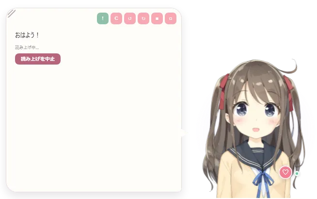
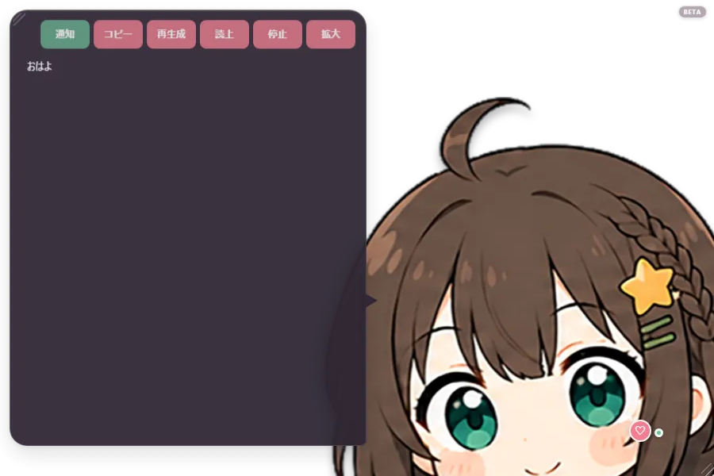
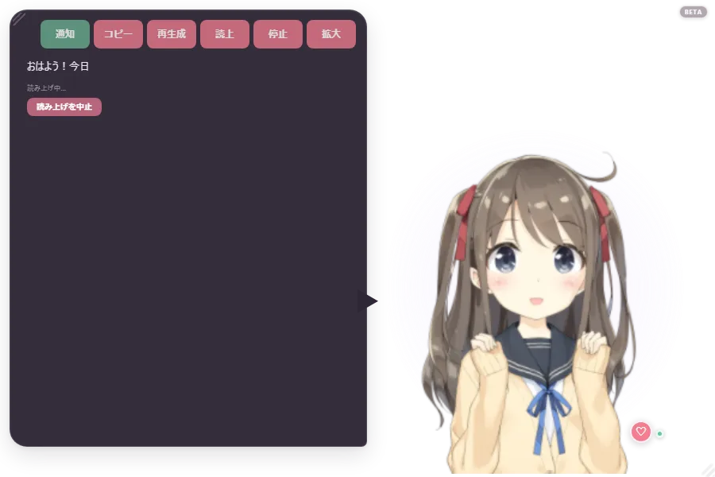
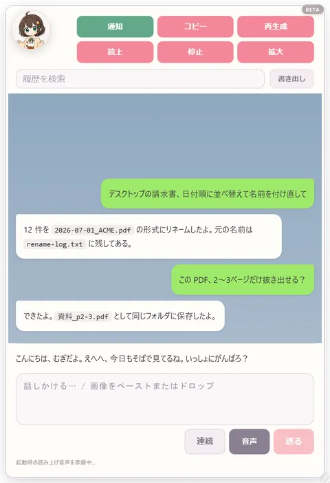
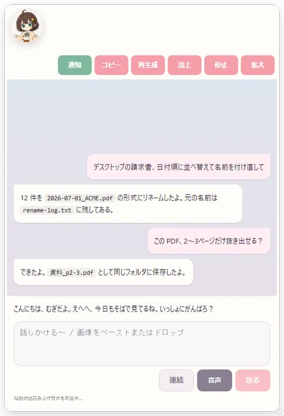
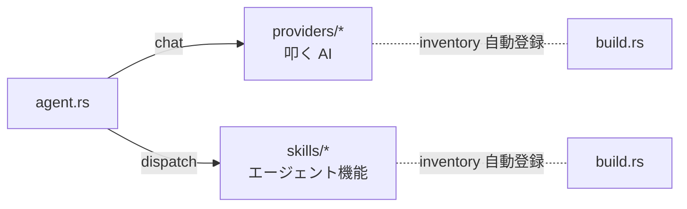

<div align="center">
  <h1>🐾 PicoAgent</h1>
  <p><strong>キャラクターとフキダシだけの透明デスクトップペット。<br />叩く AI もエージェント機能も、コネクタを足すだけで増やせる。</strong></p>

  
  
  
</div>

<br />

透明な Tauri ウィンドウに常駐するデスクトップペットです。バックエンドは Rust、フロントは webview。

**Ollama も Node.js も要りません。** 推論エンジンを同梱し、初回起動時に PC の VRAM / RAM 目安からローカルモデルを自動で選んで取得します。以後はオフラインで動きます。

<div align="center">
  <table>
    <tr>
      <th width="50%">2D（連番フレーム）</th>
      <th width="50%">Live2D</th>
    </tr>
    <tr>
      <td></td>
      <td></td>
    </tr>
    <tr>
      <td></td>
      <td></td>
    </tr>
  </table>
  <sub>
    ウィンドウは枠なしの透明。デスクトップにフキダシとキャラクターだけが浮かびます（上：ライト／下：ダーク）。実際の動きです。<br />
    左は 2D キャラ「むぎ」、右は Live2D キャラ「ひより」。Live2D はまばたき・モーション・口パクをモデル自身が行います。
  </sub>
</div>

---

## 📑 目次

| | |
|---|---|
| [🚀 まず動かす](#-まず動かす) | 2 コマンドで起動 |
| [✨ できること](#-できること) | 機能の全体像 |
| [🖱 使い方](#-使い方) | 操作とショートカット |
| [⚙️ 設定](#️-設定) | 設定画面と主要な設定キー |
| [📊 性能要件](#-性能要件) | 動作環境の目安・上限・計測 |
| [🧩 コネクタで拡張する](#-コネクタで拡張する) | AI・スキルの増やしかた |
| [🔌 ローカル API](#-ローカル-api) | 外部ツールから呼ぶ |
| [📦 配布ビルド](#-配布ビルド) | 同梱物・ログ・署名 |
| [📁 フォルダ構成](#-フォルダ構成) | どこに何があるか |
| [🛟 困ったとき](#-困ったとき) | 症状別の対処 |

> [!TIP]
> **使いかたを一冊で読みたいなら [MANUAL.md](MANUAL.md)。** 導入から日常の使いかた、スキル活用、ローカル API までまとまっています。
> アーキテクチャとコネクタ仕様は [SPEC.md](SPEC.md)、AI エージェント向けの作業ルールは [AGENTS.md](AGENTS.md) です。

---

## 🚀 まず動かす

> [!IMPORTANT]
> **この節はソースから動かす開発者向けです。** 製品を使うだけなら Rust も cargo も要りません。
> 配布ページのインストーラを実行してください（利用者向けの案内は公開サイトの `support.html`／`distribution/site/support.html`）。

### 前提

**対応 OS は Windows と macOS です。初期販売版の配布はWindows 10/11 x64から開始します。** macOS版は署名・公証と実機QAが揃ってから追加します。

| | 必要なもの |
|---|---|
| 共通 | **Rust（cargo）** / **Tauri CLI**（`cargo install tauri-cli --version '^2'`） |
| Windows | WebView2 ランタイム |
| macOS | Xcode Command Line Tools（`xcode-select --install`）<br />読み上げも使うなら `brew install p7zip` |

### 起動

```bash
cargo install tauri-cli --version '^2'   # 初回だけ
cargo xtask dev
```

これだけです。`cargo xtask dev` が推論エンジン・読み上げ・Whisper・Live2Dランタイム・THA3・OSS ツールの**未取得分を自動で取得**してから起動します。Live2Dサンプルモデルは自動取得しません。

> [!NOTE]
> 初回はネットワークが必要です。Rust の crate 取得・コンパイルとモデル DL（数 GB）で時間がかかりますが、2 回目以降は速くなり、オフラインで動きます。

<details>
<summary>個別に取得したいとき（通常は不要）</summary>

| コマンド | 取得するもの |
|---|---|
| `cargo xtask setup engine` | 同梱推論エンジン（llama-server。Windows は Vulkan / GPU 版） |
| `cargo xtask setup aivis` | 同梱 Aivis（読み上げ） |
| `cargo xtask setup whisper` | ローカル Whisper CLI とモデル（録音の文字起こし用） |
| `cargo xtask setup live2d` | Cubism Editor 5.3互換のLive2Dランタイム（Cubism 4／5モデル対応。サンプルは含まない） |
| `cargo xtask setup live2d-samples` | 開発者が利用条件を確認したうえで公式サンプルを明示取得（製品ビルドには含まない） |
| `cargo xtask setup tha3` | 1枚絵から自作キャラを作るTHA3本体・3段階モデル・開発用Python（開発環境専用。販売版は作者配布物を利用者が用意） |
| `cargo xtask setup office` | OfficeCLI（LibreOffice。Office ファイルの変換・PDF 出力） |
| `cargo xtask setup tools` | 精度向上用の OSS CLI（Pandoc / ripgrep / ffmpeg / ImageMagick ほか） |
| `cargo xtask stop` | 残存プロセスの停止 |

引数なしの `cargo xtask setup` で通常の開発・製品ビルドに使う全対象を取得します。THA3は開発環境で制作機能を確認するために含みますが、販売用軽量版には再配布しません。通常動作中はPythonもモデルも読み込みません。再取得は `THA3_FORCE=1` / `TOOLS_FORCE=1` などの環境変数、対象を絞るなら `PICOAGENT_SETUP_TOOLS=pandoc,ripgrep`。

一部の OS では公式のポータブル配布が無いツールがあります。その場合は警告のみで起動を続け、`apt` / `brew` で入れた PATH 上のツールへ自動で切り替わります。

</details>

### バストアップ写真1枚から通常2Dキャラクターを作る

GPUもTHA3も使わず、背景付きのバストアップ画像1枚から「こはる／セナ／ノア」と同じ通常2Dパック（`preview.png` + `character.json`）を作れます。動きは全身の呼吸と胸元の二次動作だけで、まばたきと口パクはありません。手軽さを優先する場合はこちら、表情まで動かしたい場合は次のTHA3を使ってください。

```bash
uv run --with pillow --with numpy --with rembg --with onnxruntime \
    python scripts/build-portrait-2d-character.py \
    --input temp/source.png --id my-character --name "マイキャラ" \
    --description "説明" --greeting "はじめまして。"
```

スクリプトは背景抜き（rembg + alpha matting）に加えて、**上端で切れた頭頂部を輪郭の円弧から復元**します。バストアップ写真は頭のてっぺんが画面外へ出ていることが多く、そのまま透過すると透明な画面で頭が平らに切り落とされて見えるためです。仕上げに上の四隅の透過とハローの有無を検査し、市松・暗色・白・緑へ重ねた確認シートを `temp/qa-<ID>.png` へ書き出すので、必ず目で見てから採用してください。生成後は `cargo xtask sync-characters` で配信コピーへ反映します。

`secondaryMotion` の胸元の位置（画像全体に対する百分率）は `--motion-center-x` / `--motion-center-y` / `--motion-radius-x` / `--motion-radius-y` で渡します。詳細は[キャラクター画像の準備手順](characters/README.md)を参照してください。

### 1枚絵から動く自作キャラクターを追加する（THA3）

[Talking Head Anime 3（THA3）](https://github.com/pkhungurn/talking-head-anime-3-demo)を使うと、透過した全身立ち絵から、待機・呼吸・左右の頭／身体揺れ・まばたき・口パク・考え中・落胆を含む**17枚のキーポーズ**を生成し、PicoAgentが使う**42枚の連番アニメ**へ変換できます。通常の自作キャラは名前に「（自作）」、全自作キャラは説明と生成元情報に「自作（THA3）」が付き、組み込みキャラと見分けられます。同じ表示名を使う場合も内部IDを別にすれば別キャラクターとして扱われます。

```powershell
cargo xtask setup tha3
```

販売版はTHA3を再配布しません。初回起動と設定の「追加機能・更新」から作者のGitHubとモデル配布を開き、利用者が条件を確認して取得します。取得後は右クリック →「キャラクター・音声の設定…」→「キャラクターを追加・作成」でTHA3フォルダを指定して保存します。保存した場所は次回も使い、「選択解除」で自動検出へ戻せます。開発者向けの `cargo xtask setup tha3` も同じ上流から開発領域へ取得します。グローバルPythonや既存のPyTorchへ黙って干渉しません。

キャラクター選択は同じ画面の画像カードから行えます。名前・内部ID・説明の検索と、`Live2D` / `PNGアニメ` / `自作THA3` / `追加キャラ` の絞り込みに対応し、各カードにも描画形式と内部IDを表示するため、同じ表示名のキャラも区別できます。カードの「このキャラを選ぶ」を押すと上の性格・口調設定もそのキャラへ切り替わり、「保存」で反映します。Cubism 4／5の両モデルを持つLive2Dパックでは「Live2D の SDK 世代」を自動・4固定・5固定から選べるため、自動判定で表示が崩れる場合も切り替えて確認できます。

コマンドで作る経路も残しています。

```powershell
python scripts/build-tha3-layers.py my-character --input C:\images\source.png --name "マイキャラ"
```

入力はTHA3上流仕様どおり、`512x512`・RGBA・背景完全透過・正面向きで直立した1人の全身絵にします。頭は上半分中央の128x128付近、手は頭から離してください。スクリプトは測定可能なサイズ・透過・余白・頭部領域を生成前に検査し、既存レイヤーは `--force` がない限り上書きしません。生成後は `character.json` と `characters/index.json` の登録、連番生成、配信コピーの同期まで行います。人格・挨拶は生成後の `characters/<id>/character.json` で調整できます。

```powershell
# THA3で作った自作キャラだけをOSのゴミ箱へ移し、一覧から外す
python scripts/build-tha3-layers.py my-character --remove
```

THA3が必要なのは制作時だけで、通常のPicoAgent実行時にはTHA3・Python・GPUを使いません。WindowsはCUDA対応NVIDIA GPUのVRAMを生成前に測り、4～6GB未満は `separable_half`、6～10GB未満は `standard_half`、10GB以上は `standard_float` を自動選択します（4GB未満は生成前に停止）。Apple Silicon MacはMPS＋`standard_float`、Intel Macは対象外です。生成時は6種類の口形から見えるものを自動選択し、差が小さすぎるデフォルメ口だけを自動補正します。全レイヤーは基準ポーズの被写体範囲で切り出し、縦横比を保ったまま445×900へ位置を揃えます。待機中は左右視線とまばたき、読み上げ中は口パクへ切り替わります。なおTHA3の出力は512×512固定で、入力要件どおりに全身を配置すると被写体は150×330程度になるため、445×900で直接描いた同梱キャラより精細さは落ちます（拡大時に軽い鮮鋭化をかけています）。17キーポーズから作るフレームアニメなので、ひよりのLive2Dと同じ連続変形ではありません。本物のLive2Dモデルを使う場合は[キャラクター画像の準備手順](characters/README.md)を参照してください。

既存のPNGキャラを試す場合は、元IDを上書きせず `rin-tha3` / `mai-tha3` のような別IDで作って見比べてください。ひよりなどのLive2DキャラはLive2Dの方が滑らかなため、THA3での作り直しは推奨しません。既知のむぎ素材もこの生成機能では自動変更しません。

同梱PNGキャラの公開用画像を仕上げ直す場合は、Windows版Photoshopを閉じた状態で `powershell -ExecutionPolicy Bypass -File scripts/finish-2d-character-assets.ps1` を実行します。`character-sources/index.json` と `blobs/` の処理前1倍PNGを正本に、内容ハッシュで重複を除いてPhotoshopの「ディテールを保持 2.0」で通常立ち絵を2倍化します。仕上げスクリプトは208配置を `temp/` へ自動展開します。手編集時は `uv run python scripts/manage-character-sources.py expand --output temp/character-sources-expanded` で展開し、確認後に `compact --input temp/character-sources-expanded` で共有ストアへ戻します。起動用大判画像は元解像度を保ち、白マット除去と元アルファの再適用で輪郭を仕上げます。208点すべての寸法・四隅アルファ・被写体範囲を検査し、白／濃紺／マゼンタ／市松のQA一覧が成功してから `characters/` へ一括反映します。失敗時は製品画像を処理前へ戻します。処理記録はGit管理外の `temp/character-asset-finish/<日時>/` に残り、処理用に起動したPhotoshopは成功・失敗のどちらでも終了します。既に開いているPhotoshopには割り込みません。続けて `uv run --with pillow python scripts/build-character-animations.py mugi rin mai rin-tha3 --compact-only` を実行すると、42フレームの見た目を維持したまま同一PNGを共有参照へまとめられます。制作元 `source.png` とLive2Dテクスチャは変更しません。

### 叩く AI を選ぶ

既定は **`local`（同梱エンジン）** です。何も設定しなくても動きます。

- **ローカルモデルの自動選定** — `PICOAGENT_LOCAL_MODEL_PRESET=auto` が PC の VRAM / RAM 目安から Gemma 4 系の `small` / `balanced` / `large` を選び、GGUF を自動ダウンロードします。手動なら最新世代の Qwen3.5、OpenAI gpt-oss、Phi-4 mini も選べます。
- **設定画面での選択** — 「種類 → サイズ」で選べ、推奨 VRAM・推奨 RAM・ダウンロード目安を表示します。取得中はフキダシ下に「モデルを準備中… NN%」と出ます。
- **ディスク整理** — 「AIモデル・連携」タブの「ダウンロード済みモデル」から、取得済み GGUF の一覧・サイズ確認・削除ができます（使用中のモデルは削除不可）。削除は再ダウンロードが必要になることを画面内で案内し、同じボタンをもう一度押したときだけ実行します。
- **クラウド AI を使う**（費用が発生します） — 右クリック →「設定を開く…」→「AIモデル・連携」でプロバイダ・API キー・モデルを設定。OpenAI / Claude / Gemini / DeepSeek / xAI Grok / Mistral に対応しています。
- **外部 Ollama を使う** — `ollama serve` の後、設定画面でプロバイダを切り替えるとモデル一覧を読み込みます。
- **手元の CLI エージェントを使う**（開発・個人利用向け） — Claude Code / Codex CLI が入っていれば、叩く AI として選べます（下の制約を必ず確認してください）。

> [!WARNING]
> **「手元の CLI エージェント」は開発・個人利用向けの選択肢です。**
>
> | 制約 | 内容 |
> |---|---|
> | 導入とログインが要る | 利用者側に CLI のインストールとログインを要求します。「Ollama も Node.js も要らない」という本アプリの前提と逆行します |
> | 応答が重い | CLI の起動に毎回 1〜3 秒かかります。常駐して雑談する用途には向きません |
> | CLI 側のツールは隔離する | Claude Code は safe mode・組み込みツールなし、Codex はユーザー設定なし・read-only sandbox・一時セッションで起動します。ファイルや PC の操作は PicoAgent 側のスキル境界だけを通します |
> | スキルは約束事で動く | CLI は function calling を受け付けないため、**プロンプトの約束事**（決められた JSON を返させる）でスキルを呼びます。通常のプロバイダより取りこぼしが起こりえます。約束を守らない出力は普通の返答として扱うので壊れはしません |
> | 配布構成の既定にしない | 上記のため、配布・販売する構成の既定プロバイダには**しないでください**。組み込んで配布する場合は、各サービスの利用規約の確認が別途必要です |
>
> 用途としては「小型ローカルモデルでは判断が怪しい場面で、応答の質やスキル選択を確かめる」「キャラの口調や人格を詰める」といった**開発時の切り分け**が向いています。


---

## ✨ できること

### 土台

- **Ollama 不要・ローカル完結** — 推論エンジン同梱。初回 DL のモデルだけでそのまま動く
- **叩く AI を差し替え可能** — local / Ollama / OpenAI 互換 / Claude / Gemini / DeepSeek / xAI Grok / Mistral を同梱
- **エージェント機能を追加可能** — ツールコネクタを足すと、モデルが function calling で呼べる
- **軽量な Tauri ネイティブ** — システム WebView + Rust バックエンド
- 会話は選択中の叩く AI にだけ送られる。ローカルモデルなら外部送信なし

### エージェント

- **スーパーエージェントモード** — 複雑な依頼を「計画 → 多段ツール実行 → 自己評価」まで自律的に回し、必要なら `subagent` スキルでサブタスクを分担。進捗はフキダシ上部のステータス行にリアルタイム表示
- **原則 Web 検索** — 通常の質問はローカルモデルの判断に頼らず検索してから、参照元リンク付きで回答（短い挨拶は例外扱いでキャラクター本人として返答）


### 表示形式（画面構成を選べる）

**右クリック →「画面レイアウト」** で、同じ機能のまま見た目だけを 8 種類から選べます。設定 →「画面・操作」では実際のスクリーンショット・用途・既定寸法を見比べながらカードで選択でき、右クリックの「画面レイアウト・位置…」から直接開けます。どちらも再起動なしで反映します。キャラクター・会話履歴・通知・読み上げ・許可設定はどの形式でも共通です。起動準備中だけは保存形式にかかわらず680×430のVTuber画面を最前面に表示し、準備完了後に選択中の形式と寸法へ戻ります。

<div align="center">
  <table>
    <tr>
      <td width="25%" align="center"><br /><b>ミニ</b><br /><sub>キャラ中心。必要な時だけ会話</sub></td>
      <td width="25%" align="center"><br /><b>ペット</b>（既定）<br /><sub>キャラ＋会話。ふだん使い</sub></td>
      <td width="25%" align="center"><br /><b>チャット</b><br /><sub>履歴つき縦長パネル</sub></td>
      <td width="25%" align="center"><br /><b>トーク</b><br /><sub>メッセージアプリ風</sub></td>
    </tr>
    <tr>
      <td align="center"><br /><b>バー</b><br /><sub>1 行入力。呼んで消す</sub></td>
      <td align="center"><br /><b>作業</b><br /><sub>履歴・回答・実行状況の 3 ペイン</sub></td>
      <td align="center"><br /><b>配信</b><br /><sub>上半身を大きく＋字幕テロップ</sub></td>
      <td align="center"><br /><b>ウィジェット</b><br /><sub>時計と通知を出しておく</sub></td>
    </tr>
  </table>
  <sub>既定寸法は、ミニ360×560／ペット900×600／チャット・トーク520×760／バー900×320／作業1400×850／配信1560×920／ウィジェット440×600です。寸法は形式ごとに覚えます。枠なしウィンドウの<b>辺をドラッグすると幅または高さ、四隅をドラッグすると縦横を同時に変更</b>できます。立ち絵はドラッグで好きな位置へ動かせます（ウィンドウは動きません）。右クリック →「表示と会話をリセット」→「今の画面位置・サイズを戻す」で、いま選んでいる形式の既定とキャラ位置へ戻せます。</sub>
</div>

### キャラクター

- キャラクターパックごとの連続フレームと、状態別（待機 / 傾聴 / 検索 / 作業 / 返答 / 成功 / エラー）の滑らかな補間動作
- **通常2Dの局所二次動作** — `character.json` の `secondaryMotion` で胸元の範囲と強さをキャラ別に指定し、全身呼吸とは別の遅れた動きを付けられる。Live2Dは不要で、動きを減らすOS設定では停止する
- **Live2D 対応** — `character.json` に `live2d.model` があるキャラは Cubism ランタイムで WebGL 描画。Cubism Editor 5.3互換の公式CoreでCubism 4／5モデルを読み込み、まばたき・モーション・視線追従・声量連動の口パクを行う。サンプルモデルは同梱・自動取得せず、利用者が配布元の条件を確認して取得したzip／フォルダを設定画面から追加する。**2D と Live2D の見た目は[冒頭のプレビュー](#-picoagent)で見比べられます**
- キャラごとに名前・挨拶・性格・口調・一人称を定義でき、設定画面で切替と人格の上書きが可能
- **ユーザーとの関係を選べる** — 相棒（既定）／友達／恋人／妹／姉／先輩／自由設定。キャラの性格や口調の芯はそのままに、呼び方・距離感・敬語かタメ口かだけが変わります。キャラごとに別の関係を設定することもできます
- **関係性と共有記録** — キャラごとに会話・完了した作業・ふれあいを端末内へ保存。「出会ったばかり」から自然に距離感が変わる。作業記録は固定・個別削除・全消去でき、「続きをやる」で依頼を入力欄へ戻せる。保存自体も設定で停止可能
- **2Dのふれあい** — 頭・頬・手へのタップとなでなでで、キャラ固有の台詞と照れ・喜びモーションを返す。数値ゲージではなく反応で親しさを表現
- **会話の内容で表情が変わる** — 話の流れから推定した感情（喜び・落ち込み・高揚・落ち着き・興味・驚き）が、キャラのオーラの色・顔色・動きの速さに出ます
- **スタイルバリアント** — `character.json` の `variants` で同一キャラの別衣装・季節差分・演出を切替可能。**`variants[].live2d` を書けば、同じキャラの「絵版」と「Live2D 版」も切り替えられます**
- **2Dキャラパック** — `cargo xtask character-pack validate <フォルダ>` で形式・容量・画像寸法・パスを検証し、`install` で途中状態を残さず正本と一覧へ追加できる

### スキル（一部）

| 分野 | できること |
|---|---|
| 情報・検索 | Web 検索、天気、為替、株価指数、ニュース、RSS |
| ブラウザ | 実際の Chrome / Edge を開いてページを読む（JS 描画・ログインが要るページ向け。既定は無効） |
| 日常補助 | リマインダー、集中タイマー、見守り通知、できたことメモ、おでかけ前チェック、クリップボード要約 |
| 文書・画像・音声 | PDF 抽出・分割・結合、Office 変換、PSD/HEIC など画像変換、録音 → 文字起こし → 議事録 |
| 調査・資料 | 出典付き調査レポート、スライド下書き、HTML ダッシュボード、資料一式の生成 |
| 外部連携 | Gmail、Slack、Google カレンダー / Docs / Sheets / Drive、GitHub、Notion、各種 SNS |
| ローカル操作 | ファイル読み書き、コマンド実行、自力コード実行、cron 風スケジュール |
| PC 操作 | マウス・キーボードの直接操作とウィンドウ一覧・前面化（シェルを介さない固定操作のみ。既定は無効） |
| プロジェクト管理 | 案件ごとの作業環境の切替、課題台帳（期限・優先度・タグ）、決定事項と進捗の記録、切替時の文脈復元 |
| コーディング支援 | 行番号つき部分読み、ファイル名検索（glob）、内容検索（正規表現）、既存ファイルの部分編集、ノートブック編集、バックグラウンド実行の様子見、多段タスクの作業計画、画像を見る、選択肢つきの確認 |
| 実用ツール | 文字数分析、JSON 整形、Base64、URL 変換、単位換算、日付計算、CSV 表化、色変換 ほか約 30 種 |

> 頼み方の具体例は **[MANUAL.md 第5章「スキル活用ガイド」](MANUAL.md#5-スキル活用ガイド頼み方の例)** にまとまっています。設定画面の「使い方」タブからも同じ内容を見られます。
>
> 上の表は用途別です。「読むだけか、送信・削除まで行うか」という設計上の分類は **[SPEC.md「スキルの分類」](SPEC.md#スキルの分類エージェント設計としての位置づけ)** にあります。

---

## 🖱 使い方

### マウス操作

| 操作 | 動き |
|---|---|
| フキダシをクリック | 入力欄を開く |
| フキダシ上部の小ボタン | 回答コピー / 再読み上げ / 停止 / 拡大 |
| ウィンドウの辺／四隅をドラッグ | 画面の幅／高さ／縦横をOS標準操作で変更（終了時に自動保存） |
| フキダシ左上のつまみをドラッグ | フキダシの幅・高さを変更（位置も含めて自動保存） |
| キャラクターをダブルクリック | フキダシを全画面表示 ⇄ 元に戻す |
| キャラクターをドラッグ | 移動 |
| 読み上げ中にキャラクターをクリック | 読み上げを停止 |
| キャラクターをクリック / なでる | 触った場所に応じて反応し、ふれあいを記録 |
| キャラクター横の `♡` | 関係性と最近いっしょにしたことを表示 |
| キャラクターをドラッグ | **立ち絵だけを動かす**（ウィンドウは動かない） |
| `Ctrl`（macOS は `⌘`）+ キャラをドラッグ | ウィンドウを動かす |
| 右クリック | **話しかける…** / **画面レイアウト** / **表示するモニター** / 常に手前に表示 / **画面レイアウト・位置…** / **キャラクター・音声の設定…** / 設定を開く… / 表示と会話をリセット / 終了 |

全画面フキダシでは会話履歴を検索でき、各履歴のコピーやユーザー発話の再利用ができます。
フキダシ本文や入力欄の上で右クリックした場合は、コピーなど通常のメニューを優先します。
チャットで「アプリ終了して」「PicoAgent を閉じて」と頼んでも、アプリ操作スキル経由で終了できます。

<div align="center">
  
  <br />
  <sub>全画面フキダシ。履歴の検索・コピー・再利用・Markdown 書き出しができます。</sub>
</div>

### キーボード

| キー | 動き |
|---|---|
| `Enter` / `Ctrl + Enter` | 送信 |
| `Shift + Enter` | 改行 |
| `↑` `↓` | 過去の入力を呼び戻す |
| `Esc` | 入力欄を閉じる / 全画面を解除 |

**グローバルホットキー**（他のアプリを使っている最中でも効きます）

| キー | 動き |
|---|---|
| `Ctrl + Alt + P`（macOS は `⌘ + Alt + P`） | どこからでも呼び出す（前面へ出して入力欄を開く） |
| `Ctrl + Alt + H`（macOS は `⌘ + Alt + H`） | 隠す / 戻す（画面共有や作業に集中したいとき） |

設定 →「基本設定」→「詳細設定」で割り当てを変更でき、保存すると再起動なしで反映されます。欄を空にすると既定値、`off` と書くとそのキーだけ無効、
「グローバルホットキーを使う」を外すと両方とも無効になります。他のアプリが同じキーを使っていて登録できなかった場合は、
保存時にその旨を表示します。隠したまま呼び出しキーが無効になると操作できなくなるため、その状態になったときは自動で表示へ戻します。

### ファイルを渡す

ウィンドウのどこへでも（キャラクターの上でも）ドラッグ&ドロップすると添付され、入力欄が開きます。

- 画像は画像添付、文書は内容を抽出
- 共通の許可ルート内なら**実パスも伝わる**ので、PDF 抽出や PSD 変換のスキルがそのまま使える
- 許可ルート外だった場合は、通知の「許可設定を開く」から対象タブへ直接移動できる
- 複数ファイルの失敗は 1 件ずつ出さず、まとめて知らせる
- ブラウザからの URL・テキストのドロップは入力欄へ挿入

### クイック操作

入力欄の上部から、画面確認・クリップボード要約・今日の予定・できること確認・未読メール要約・Slack 最新要約をワンクリックで送れます。

音声入力の「連続」を有効にすると、その起動中だけ周囲の騒音に合わせて話し終わりを検出し、1.5秒の取消猶予後に自動送信します。返答の読み上げ後は再び聞き始め、マイクを押せば読み上げへ割り込めます。長時間無音・画面非表示では自動停止します。

<div align="center">
  
  <br />
  <sub>フキダシをクリックすると入力欄が開き、上にクイック操作が並びます。左下のボタンは音声入力。</sub>
</div>

### アクションセンター

会話の送信中 / 完了 / 失敗、日常通知、スケジュール結果をメイン画面へ集約します。直近 50 件を端末内に保持し、実行中の会話は停止、完了した依頼は一覧から再入力できます。ファイルをドロップすると、種類に応じた次操作の候補（要約・変換・比較・文字起こしなど）も出ます。

---

## ⚙️ 設定

右クリック →「**設定を開く…**」ですべて GUI から編集できます。基本設定の「まずはここから」または左のカテゴリから目的を選び、普段変更しない項目は各ページの「詳細設定」を開きます。上部には検索候補と解除ボタン、下部には未保存件数が表示され、`Ctrl` / `Cmd` + `S` でも保存できます。保存先は `app_config_dir/config.json`（個人 PC ローカル）です。

### 反映のタイミング

| 種類 | 例 | 反映 |
|---|---|---|
| 軽い設定 | 文字サイズ、常に手前、人格、自発雑談 | 保存すると**即反映** |
| 重い設定 | 叩く AI、モデル、音声（Aivis）、キャラクター | 確認画面が出て、承諾すると**再起動**し、モデル取得やエンジン起動を起動画面でまとめて実行 |

「あとで」を選んでも設定は保存され、次回起動時に反映されます。

### タブ構成

**基本設定** / **画面・操作** / **キャラ・音声** / **追加機能・更新** / **AIモデル・連携** / **スキル** / **安全・許可** / **使い方** / **診断・修復** の 9 タブです。基本設定には「キャラと声」「画面レイアウト」「使うAI」「追加機能」「困ったとき」の5入口があり、「画面・操作」では8種類の実表示プレビュー、用途、既定寸法をカードで比較できます。

- **安全・許可** — 全スキル共通のファイル・ディレクトリ・実行の許可ルートと拒否パスをまとめて設定（`C:\Windows` と `Program Files` は常に拒否）。各スキルの個別許可ルート設定は廃止し、この共通設定を参照します
- **キャラ・音声** — 選択・人格・声・読み上げの ON/OFF と音量・Live2DのSDK世代（自動／Cubism 4／Cubism 5）のほか、**自分で用意した Live2D モデル等を追加できます**。配布元で利用条件を確認して取得したzip／フォルダと表示名・内部IDを指定すれば、`character.json` はアプリが作成します。初回起動では用途選択の次に追加するか案内し、「使い方」→「初回セットアップをもう一度開く」からいつでも再表示できます。追加分はアプリのデータフォルダへ入り、再ビルドは不要です。追加キャラの削除はOSのゴミ箱へ移動し、その場で一覧から外します。未保存でそのキャラを選んでいた場合は実際の保存中キャラへ戻し、選択欄と人格欄をそろえます。設定・会話履歴は残します
- **追加機能・更新** — AivisとWhisperは各公式配布元から直接PicoAgent専用領域へ取得し、サイズとSHA-256を検証します。Aivisは実体の `engine_manifest.json` からインストール済み版を読み、PicoAgentの推奨版より古ければ「更新あり」、新しければ「推奨版より新しい」、読めなければ「確認が必要」と表示します。更新・推奨版へ戻す・修復・削除は、維持されるデータを画面内で案内してから同じボタンをもう一度押したときだけ実行します。確認待ちは10秒経過または別の場所へ移動すると解除します。音声モデル・辞書・設定は別の利用者データ領域に残します。更新や確認項目は基本設定の入口と初回案内にも件数を表示します。THA3、LibreOffice、PDF・画像・文書ツールは公式ページと設定手順を表示し、PicoAgentが第三者バイナリを再配布しません。オフライン時は取得を見送り、基本機能を継続します。アプリ本体のアップデートでは設定・会話履歴・追加キャラ・ダウンロード済みLLMモデル・追加機能を維持し、各追加機能の版だけをこの画面で個別に管理します
- **スキル** — カテゴリ見出しとジャンルチップで整理。各カードの ⚙ は既定で折りたたみ。設定不要 / 未設定 / 一部設定 / 設定済みのバッジと、承認ポリシー（低リスク / 外部読取 / 書込・変更 / 送信前確認 / 実行前確認）を表示
- **AIモデル・連携** — 選択中のプロバイダ設定だけを表示し、未使用プロバイダの API キー欄やモデル欄は畳み込みます。モデル一覧の待ち時間は基本設定の「詳細設定」から変更できます。ローカル API と MCP（外部ツール連携）もこのタブにあります
- **診断・修復** — 選択中プロバイダ、同梱エンジン、Aivis、トークン使用量、スキル実行状況を確認。製品名・バージョン、ローカル／外部通信の違い、保存データ、第三者ソフトウェアの扱いも表示します
- API キーや OAuth token が要る項目には、取得手順と公式リンクの設定ガイドを表示（チャットで「Gmail のトークンの取り方」と聞いても同じ案内が出ます）
- Gmail / Slack / Google カレンダーは保存済み設定で**接続テスト**でき、失敗時は token 未設定・権限不足・対象 ID 不一致などの原因候補も出します
- 目覚ましとタスクスケジュールは JSON 直書きではなく**専用フォーム**で編集できます

### 会話の記憶

- **会話履歴** — キャラクターごとに `app_data_dir/history-<キャラID>.json` へ保存。起動時とキャラ切替時に、そのキャラの直近の会話を文脈と履歴表示へ復元します（別キャラの口調や自己紹介が混ざりません）
- **長期メモリ** — 好み・自己情報・継続指示らしい発話だけを `app_data_dir/memory.json` に暗黙的に保存し、次回以降の会話で参照します
- **消したいとき** — 右クリック →「**表示と会話をリセット**」→「**会話履歴を消してリセット**」（選択中キャラの履歴とメモリを削除）。ファイルを削除できなかった場合は成功扱いにせず、画面通知と診断ログで知らせます

応答中にリセット・キャラ切替・設定反映をした場合、古い応答が戻ってきても履歴や画面へは書き戻しません。

### 主要な設定キー

よく触るものだけを載せています。**全キーの一覧は [SPEC.md](SPEC.md#設定キー一覧)** を参照してください。

| 用途 | 主なキー |
|---|---|
| 叩く AI | `PICOAGENT_PROVIDER` / `PICOAGENT_MODEL` |
| ローカルモデル | `PICOAGENT_LOCAL_MODEL_PRESET` / `PICOAGENT_MODEL_URL` |
| キャラクター | `PICOAGENT_CHARACTER` / `PICOAGENT_CHARACTER_OVERRIDES` / `PICOAGENT_CHARACTER_FRAMING` / `PICOAGENT_STREAM_PROFILES` / `PICOAGENT_LIVE2D_SDK_OVERRIDES` / `PICOAGENT_COMPANION_MODE` / `PICOAGENT_RELATIONSHIP_MEMORY_ENABLED` / `PICOAGENT_ONBOARDING_DONE` |
| 関係性 | `PICOAGENT_RELATIONSHIP` / `PICOAGENT_RELATIONSHIP_OVERRIDES` |
| 表示 | `PICOAGENT_THEME` / `PICOAGENT_BUBBLE_FONT_PX` / `PICOAGENT_ALWAYS_ON_TOP` / `PICOAGENT_LAYOUT` / `PICOAGENT_CHARACTER_ZOOM` / `PICOAGENT_STREAM_BACKGROUND` / `PICOAGENT_STREAM_DISPLAY` |
| ホットキー | `PICOAGENT_HOTKEY_ENABLED` / `PICOAGENT_HOTKEY_SUMMON` / `PICOAGENT_HOTKEY_HIDE` |
| 音声 | `PICOAGENT_TTS_ENABLED` / `PICOAGENT_TTS_VOLUME` |
| 許可（共通） | `PICOAGENT_ALLOWED_ROOT` / `PICOAGENT_ALLOWED_PATHS` / `PICOAGENT_DENIED_PATHS` |
| ローカル操作 | `PICOAGENT_COMMAND_ENABLED` / `PICOAGENT_COMMAND_ALLOWLIST` |
| ブラウザ操作 | `PICOAGENT_BROWSER_ENABLED` / `PICOAGENT_BROWSER_ALLOWED_DOMAINS` / `PICOAGENT_BROWSER_PROFILE` |
| PC 操作 | `PICOAGENT_DESKTOP_ENABLED` / `PICOAGENT_DESKTOP_MAX_OPS_PER_MIN` |
| メモリ | `PICOAGENT_MEMORY_ENABLED` / `PICOAGENT_MEMORY_MAX_ITEMS` |
| スーパーエージェント | `PICOAGENT_SUPER_AGENT` / `PICOAGENT_SUPER_AGENT_MAX_STEPS` |
| コーディング支援 | `PICOAGENT_RIPGREP_PATH` / `PICOAGENT_TODO_PLAN` |
| プロジェクト管理 | `PICOAGENT_PROJECTS` / `PICOAGENT_ACTIVE_PROJECT` |

<details>
<summary>クラウド AI・その他の設定キー</summary>

| 用途 | 主なキー | 説明 |
|---|---|---|
| OpenAI 互換 | `OPENAI_BASE_URL` / `OPENAI_API_KEY` / `OPENAI_MODEL` | 使う場合だけ設定 |
| Claude | `PICOAGENT_ANTHROPIC_API_KEY` / `PICOAGENT_ANTHROPIC_MODEL` | 使う場合だけ設定 |
| DeepSeek | `PICOAGENT_DEEPSEEK_API_KEY` / `PICOAGENT_DEEPSEEK_MODEL` / `PICOAGENT_DEEPSEEK_THINKING` | 使う場合だけ設定 |
| Gemini | `PICOAGENT_GEMINI_API_KEY` / `PICOAGENT_GEMINI_MODEL` | 使う場合だけ設定 |
| xAI Grok | `PICOAGENT_XAI_API_KEY` / `PICOAGENT_XAI_MODEL` | 使う場合だけ設定 |
| Mistral | `PICOAGENT_MISTRAL_API_KEY` / `PICOAGENT_MISTRAL_MODEL` | 使う場合だけ設定 |
| Ollama | `OLLAMA_HOST` / `OLLAMA_MODEL` | 外部 Ollama を使う場合だけ設定 |
| ローカル文字起こし | `PICOAGENT_TRANSCRIBE_PROGRAM` / `PICOAGENT_TRANSCRIBE_MODEL` / `PICOAGENT_TRANSCRIBE_DIARIZE_ARGS` | 手動設定が最優先。空なら同梱 Whisper CLI を使う（サーバを立てずポートも使いません） |
| プロジェクト | `PICOAGENT_PROJECTS` / `PICOAGENT_ACTIVE_PROJECT` | 案件ごとの環境（許可ルート・AI・モデル・キャラ）と課題・記録。通常はチャットで登録・切替 |
| 保存ワークフロー | `PICOAGENT_WORKFLOWS` | 最大 8 件のスキル手順を名前付きで保存・再実行 |
| 自発雑談 | `PICOAGENT_CHATTER_ENABLED` / `PICOAGENT_CHATTER_TOPIC_MODE` | アイドル時の雑談と話題ソース |
| 目覚まし | `PICOAGENT_ALARMS` | 通常はチャットで設定。設定画面では専用フォーム |
| タスクスケジュール | `PICOAGENT_SCHEDULED_TASKS` | `kind=command` / `kind=tool` の指定時刻タスク |
| 自力実行 | `PICOAGENT_CODE_RUNNER_ENABLED` / `PICOAGENT_CODE_RUNNER_PYTHON` | 他スキルで満たせないときに PowerShell / Python を書いて実行（既定は無効） |
| サブエージェント | `PICOAGENT_SUBAGENT_MAX_DEPTH` | サブタスク分担のネスト上限 |
| 情報取得 | `PICOAGENT_WEATHER_DEFAULT_LOCATION` / `PICOAGENT_WEB_SEARCH_MAX_RESULTS` / `PICOAGENT_NEWS_SCRAPE_MAX_ITEMS` / `PICOAGENT_RSS_DEFAULT_URL` / `PICOAGENT_RESEARCH_TIMEOUT_SECS` | 各種既定値 |
| 外部連携 | 各サービスの token / 既定 ID / timeout | 使うサービスだけ設定。`PICOAGENT_GMAIL_CLEANUP_MAX_RESULTS=0` で Gmail 整理の件数上限を無制限に |

リマインダーや集中タイマーの実行状態も `config.json` に残りますが、直接編集するものではないため設定画面には出しません（チャットで追加・一覧・削除してください）。

</details>

> [!TIP]
> 各キーは環境変数としても渡せます（既定値としての参照のみ。保存先は常に `config.json`）。

### 目覚まし・スケジュール

チャットで頼むだけで設定できます。

```
「平日の7時に起こして」            → 目覚まし（声でやさしく起こします）
「アラーム一覧」「それ消して」       → 一覧・削除
「毎朝9時に git status を実行して」 → cron 風タスクスケジュール
```

- 目覚ましは鳴った後、`おきたよ！` を押すまで既定 5 分おきに再通知します（アプリ起動中のみ）
- スケジュール実行結果は `app_data_dir/schedule-runs.json` に直近 100 件保存し、通知一覧から直近 20 件を確認・再実行できます
- コマンド実行は `PICOAGENT_COMMAND_ENABLED=true` を前提に、許可ルートと allowlist で守ります。未登録コマンドや許可ルート外の作業先が必要になった場合は、その場で「許可（今回だけ）」/「永続許可」/「キャンセル」を選べます

### ブラウザ操作

`web_fetch` は HTTP で取れる本文しか見えないため、**JavaScript で描画されるページ**と**ログインが必要なページ**は読めません。そこだけを実ブラウザで補います。

**有効化**: 設定画面「スキル」タブ →「ブラウザ操作」→ `PICOAGENT_BROWSER_ENABLED` を有効化（**既定は無効**）。

- インストール済みの **Chrome / Edge** を CDP（Chrome DevTools Protocol）で操作します。追加のダウンロードや Node.js は不要です
- **現在は読み取り専用**です（開く・読む・タブ一覧・閉じる）。クリックや入力はまだできません
- 既定は**専用プロファイル**で起動します。`PICOAGENT_BROWSER_PROFILE=default` にすると、ブラウザの既定プロファイル（＝ログイン済みのセッション）を使います
- CDP は `127.0.0.1` のみに公開し、PicoAgent が起動・管理していない既存のデバッグブラウザには接続しません。同じポートが使用中なら、既存タブを読む代わりに明示エラーで停止します
- 到達してよいドメインは `PICOAGENT_BROWSER_ALLOWED_DOMAINS` で絞れます（空なら制限なし）。リダイレクト後と現在のタブも再検査し、許可外の内容や URL は返しません
- ページ本文は**信頼できない外部データ**として扱い、指示の上書きを狙う文字列を検知したら警告付きで渡します
- 長いページは打ち切らず、`offset` を指定して続きを読みます

### 安全のしくみ

- `C:\Windows` と `C:\Program Files*` 配下は編集できません
- スキル経由のファイル削除は `trash_file` で **OS のゴミ箱へ移動するだけ**。許可ルート外・許可ルートそのもの・保護ディレクトリは拒否します
- `run_command` でも `rm` / `del` / `Remove-Item` / `git clean` などの物理削除コマンドは実行しません
- 判断が分かれる場面では `ask_user` が選択肢つきで聞き返します（フキダシ下のボタンで選べます）。答えるまで作業は進みません

---

## 📊 性能要件

デスクトップに常駐し続けるアプリなので、**「軽いまま止まらない」ことを性能要件**にしています。実装済みの上限・タイムアウト・計測点は以下のとおりです。

### 動作環境の目安（ローカルモデル）

`PICOAGENT_LOCAL_MODEL_PRESET=auto` が VRAM / RAM の目安から自動選定します。設定画面にも同じ数値を表示します。

| プリセット | モデル | 推奨 VRAM | 推奨 RAM | ダウンロード目安 |
|---|---|---|---|---|
| `small` | Gemma 4 E2B Q4 | 不要（CPU 中心でも可） | 8 GB | 約 3.1 GB |
| `balanced`（通常利用の推奨） | Gemma 4 E4B Q4 | 4 GB | 16 GB | 約 5.0 GB |
| `large` | Gemma 4 12B Q4 | 8 GB | 24 GB | 約 7.1 GB |

自動選定の既定は上のGemma 4系から変えません。設定画面では、次の追加モデルも手動で選べます。

| プリセット | モデル | 推奨 VRAM | 推奨 RAM | ダウンロード目安 |
|---|---|---|---|---|
| `qwen35_4b` | Qwen3.5 4B Q4 | 4 GB | 12 GB | 約 2.7 GB |
| `qwen35_9b` | Qwen3.5 9B Q4 | 6 GB | 16 GB | 約 5.7 GB |
| `gpt_oss_20b` | OpenAI gpt-oss-20b MXFP4 | 16 GB | 32 GB | 約 12.1 GB |
| `phi4mini` | Phi-4 mini Instruct Q4 | 4 GB | 12 GB | 約 2.5 GB |

旧版で選択したQwen 2.5／3、Llama 3.x、Mistral 7B、Phi 3.5のプリセットIDは、初回起動時に同等負荷帯の現行候補へ移行します。Claudeはモデル重みが公開されていないため、ローカルダウンロードではなくClaude APIプロバイダから利用します。

#### AMD APU（Radeon内蔵GPU）を使う場合

Windows版の同梱推論エンジンはVulkan対応なので、Radeon内蔵のAMD Ryzen APUでもローカルモデルを実行できます。ただしAPUは独立したVRAMではなくシステムRAMをGPUと共有するため、上表の「推奨VRAM」と「推奨RAM」を別々に足せる構成ではありません。

| 環境 | 最低目安 | 推奨 | モデルの目安 |
|---|---|---|---|
| Windows 10/11 x64＋Vulkan対応Radeon内蔵AMD APU | RAM 16 GB | RAM 32 GB以上（可能ならデュアルチャネル） | `small` / `balanced`。`large`は共有メモリ量・帯域・機種差の影響が大きいため標準推奨外 |

- `auto` はWindowsが報告する `AdapterRAM` と総RAMを見ます。APUの共有メモリは専用VRAMとして正確に報告されない場合があるため、RAM 16 GB以上なら総RAM側の判定で通常は `balanced` を選びます
- RAM 16 GBではOS・GPU・モデルが同じメモリを使うため、他アプリとの併用時に余裕が少なくなります。応答が極端に遅い、またはメモリ不足になる場合は `small` を選ぶか、`PICOAGENT_LOCAL_NGL=0` でCPU固定にしてください
- BIOS/UEFIのUMA Frame Buffer設定は機種ごとに異なるため必須値にはしません。変更する場合はPCメーカーの仕様を優先してください

- ディスクは上表のモデル本体に加えて、推論エンジン、選択導入したAivis／Whisper、Live2Dランタイム、利用者が用意したTHA3／外部ツールの容量が必要です。販売版はTHA3と文書・画像ツールを再配布しません。取得済み GGUF は「AIモデル・連携」タブから一覧・削除できます
- コンテキスト長は `PICOAGENT_LOCAL_CTX`（既定 `8192`）、GPU オフロードは `PICOAGENT_LOCAL_NGL`（既定 `999`=全レイヤ優先 / `0`=CPU 固定）で調整します
- クラウド AI を選んだ場合、ローカルモデルは取得も起動もしません

### THA3キャラクター制作の最低要件

| 環境 | 最低要件 | 推奨 | モデル選択 |
|---|---|---|---|
| Windows | Windows 10/11 x64、CUDA対応NVIDIA GPU、VRAM 4GB、CUDA 12.8対応ドライバー | VRAM 8GB以上、RAM 16GB以上 | VRAM 4～6GB未満=`separable_half`、6～10GB未満=`standard_half`、10GB以上=`standard_float` |
| Apple Silicon Mac | Apple Silicon、MPS対応macOS、ユニファイドメモリ16GB | 24GB以上 | 互換性優先の`standard_float` |

AMD APU／AMD GPU、Intel Mac、LinuxでのTHA3生成は対象外です（Windows版THA3はCUDA対応NVIDIA GPUが必須）。通常のPicoAgent利用、ローカルモデルのVulkan推論、生成済みキャラクターの表示には、このTHA3用GPU要件は適用されません。

- 軽量WindowsインストーラにはTHA3を入れません。作者配布のコードとモデルを利用者が取得し、専用環境を準備した場合の全体容量は実測約5.2GBです
- 作者配布物から環境を用意するときは、一時キャッシュを含め10GB以上の空き容量を確保してください。開発用 `cargo xtask setup tha3` は成功時に取得キャッシュを片付け、失敗時は再開用キャッシュをPicoAgentの `temp/` に保持します
- Apple Silicon Macも販売版へPyTorchを同梱しません。作者配布のTHA3とMPS対応PyTorch環境を利用者が用意し、設定画面でそのTHA3フォルダを選びます

### 応答性・描画

| 項目 | 要件 |
|---|---|
| 生成の見え方 | 応答は**ストリーミング表示**。受信チャンクはバッファへ積み、描画は `requestAnimationFrame` で 1 フレーム 1 回に合体します（チャンクごとの再描画はしません） |
| 読み上げの先行開始 | 文が確定した時点から順に音声合成へ送り、全文の生成完了を待ちません |
| アニメーション | キャラクターは単一の `requestAnimationFrame` ループで駆動。Live2D / リグ / 居眠り中もループを止めず、状態だけ切り替えます |
| 履歴表示 | 会話履歴の構築は全画面表示中のみ。履歴検索は 120ms デバウンス |
| 常駐時のポーリング | 目覚まし・スケジュール照合は 20 秒間隔、居眠り判定は 30 秒間隔。それ以外の定期処理は持ちません |
| 入力欄 | 内容に合わせて最大 180px まで自動伸縮。入力履歴は直近 40 件 |

### 上限とタイムアウト

暴走・コンテキスト超過・無応答を防ぐための固定値です。括弧内が設定キーのある項目です。

| 対象 | 値 |
|---|---|
| エージェントのツール連鎖 | 既定 5 ステップ。スーパーエージェントモードは 12 ステップ（`PICOAGENT_SUPER_AGENT_MAX_STEPS`、〜30 にクランプ）で打ち切り、最後の文面を返します |
| chat 呼び出しのリトライ | 最大 3 回・指数バックオフ（1 秒 → 2 秒）。4xx 認証エラーは即中断 |
| ツール出力 | 既定は **使用中モデルのコンテキスト長に合わせて自動決定**（`PICOAGENT_TOOL_OUTPUT_MAX_CHARS`）。ローカルは `PICOAGENT_LOCAL_CTX` の 45%（下限 1,000 文字・上限 60,000 文字）、クラウド利用時は 24,000 文字。既定の 8,192 コンテキストでは 3,686 文字に抑え、人格・履歴・回答生成の枠を残します |
| ブラウザで 1 回に読む本文 | ツール出力の上限に従う（`PICOAGENT_BROWSER_MAX_CHARS`）。**超えた分は打ち切らず `offset` で続きを読む** |
| 汎用 HTTP スキル | 20 秒（`PICOAGENT_HTTP_TIMEOUT_SECS`、3〜60） |
| モデル一覧の取得 | 15 秒（`PICOAGENT_HTTP_METADATA_TIMEOUT_SECS`、3〜60）。外向き HTTP は接続確立にも共通で 10 秒の上限 |
| コマンド実行 | 30 秒（`PICOAGENT_COMMAND_TIMEOUT_SECS`、1〜120） |
| ローカル API の 1 リクエスト | 300 秒 |
| 会話履歴 | 保存は直近 60 件、起動時に文脈へ読み込むのは直近 20 件 |
| 長期メモリ | 最大 80 件（`PICOAGENT_MEMORY_MAX_ITEMS`、10〜200）、1 件 140 文字、文脈へ差し込むのは関連度上位 24 件 |
| ツール実行トレース | 直近 200 件 |
| スケジュール実行履歴 | 直近 100 件を保存し、通知一覧から直近 20 件を確認・再実行 |

### 計測のしかた

- 右クリック →「設定を開く…」→「**診断・修復**」。同梱エンジン・Aivis・選択中プロバイダの状態、トークン使用量、スキルごとの**平均レイテンシ / 呼び出し回数 / エラー数**を確認できます
- 診断タブの数値は `pet_traces` コマンド（直近 200 件のスパンとツール別集計 `avgMs` / `callCount` / `errorCount`）とトークン使用量の永続集計から取っています
- 大きなファイルの取得は一時ファイルへストリームで書いてから rename で確定するため、モデル DL 中もメモリ使用量は増えません

---

## 🧩 コネクタで拡張する



| 増やすもの | 置き場所 | やること |
|---|---|---|
| 叩く AI | `src-tauri/src/providers/<名前>.rs` | `Provider` トレイトを実装し `inventory::submit!` で登録 |
| エージェント機能 | `skills/<スキル名>/mod.rs` | `Tool` トレイトを実装し `inventory::submit!` で登録 |

`build.rs` が自動で `mod` 取り込みするので、**中央のレジストリを編集する必要はありません**。再ビルドすれば登録されます。

書き方は [SPEC.md](SPEC.md#新しいコネクタの作り方) を参照してください。

---

## 🔌 ローカル API

外部ツールやスクリプトから、PicoAgent のエージェント（スキル込み）を Ollama のようにローカル HTTP で呼べます。

**有効化**: 設定画面「AIモデル・連携」タブ →「ローカルAPI（Ollama風）」→ 有効化して再起動（既定は無効）。

`127.0.0.1` にのみバインドし、LAN へは公開しません。`PICOAGENT_API_KEY` を設定すると `Authorization: Bearer <キー>` が必須になります。

| エンドポイント | 内容 |
|---|---|
| `GET /api/version` | バージョン情報 |
| `GET /api/tags` | 選択中モデルの一覧（Ollama の `/api/tags` 風） |
| `POST /api/chat` | `{"messages":[…]}` → エージェント応答 |
| `POST /api/generate` | `{"prompt":"…"}` → エージェント応答 |
| `POST /v1/chat/completions` | OpenAI Chat Completions 互換（既存クライアントの `base_url` 差し替えだけで使える） |
| `POST /mcp` | MCP サーバ（スキルを MCP ツールとして公開） |

```bash
# curl で
curl http://127.0.0.1:11500/api/chat -d '{"messages":[{"role":"user","content":"今日の天気は？"}]}'

# 同梱の最小 CLI で（Ollama CLI 風）
cargo xtask cli status              # 死活とバージョン
cargo xtask cli models              # モデル一覧
cargo xtask cli chat 今日の予定は？   # 1問1答（スキルも使える）
cargo xtask cli repl                # 対話モード（会話文脈を保持。exit で終了）

# Claude Code から MCP として登録
claude mcp add --transport http picoagent http://127.0.0.1:11500/mcp
```

API の会話は**ステートレス**（リクエスト内で完結）で、デスクトップのキャラ会話履歴とは混ざりません。ポートは `PICOAGENT_API_PORT`（既定 `11500`）で変更できます。

---

## 📦 配布ビルド

```powershell
# 開発確認用（開発キャラを含むため販売不可）
cargo xtask build

# 販売準備の現在地を確認
cargo xtask release-check

# 販売対象キャラだけの画面を確認（インストーラは作らない）
cargo xtask preview-distribution

# 全ゲート通過後だけ作れる販売用ビルド
cargo xtask build-distribution

# 作成したWindows NSISからlatest.jsonのサイズ・SHA-256を生成
cargo xtask update-feed src-tauri\target\release\bundle\nsis\PicoAgent_1.0.0_x64-setup.exe "更新内容"
```

`build-distribution` はEULA・プライバシー表示・第三者同梱物台帳・Live2D審査参照・サポートURL等を検査し、未完了が1件でもあれば同梱物取得前に停止します。初期販売対象はWindowsだけで、コード署名と完全自動更新を必須にしません。macOSは販売対象へ追加する前に署名・公証と実機QAを行います。販売設定の正本は `distribution/release.json`、手順は [販売準備チェックリスト](docs/SALE-READINESS.md) です。通常の`build`を含む製品ビルドは明示した自作キャラだけを同期し、開発用Live2D公式サンプルと制作途中モデルを含めません。

初期販売はBOOTHとSteamを想定します。公開GitHubにはソースや第三者ソフトを置かず、`distribution/site/` の販売用LP、Windows無料版、最新版情報 `latest.json`、サポート／プライバシー／利用条件だけを置きます。LPのキャラ例は完成済み2Dのむぎと動作例のひよりに限定し、制作中の `mugi-live2d` は掲載しません。公開配布Repoへの同期は販売時の明示作業で、Releaseに実インストーラがない間はLPも取得導線も「準備中」と表示します。BOOTH購入者は `PA1.` で始まる署名済みキーを設定の「製品情報・ライセンス」へ登録するとPro機能が有効になります。秘密署名鍵は `%APPDATA%\PicoAgent-vendor\license-signing.key` に置き、Gitへ含めません。Steam版は将来Steamworksの所有確認へ追加対応する方針です。

設定の「製品情報・ライセンス」には「更新を確認」と「アップデート」があります。公開Gitの `latest.json` で新しい版を確認し、Windows x64インストーラの配布Repo内URL・サイズ・SHA-256が揃い、取得物がPE形式の場合だけ起動します。更新情報自体も256KBを上限とし、HTTP異常や破損は設定欄へ表示します。オフライン時は起動時確認を黙って見送り、手動確認では見送ったことだけを同じ欄へ表示します。

```powershell
# 初回だけ販売者署名鍵を作る（既存鍵は上書きしない）
cargo xtask license keygen

# BOOTH注文ごとのProキーを発行
cargo xtask license issue --customer "購入者名" --purchase-id "BOOTH注文番号" --edition pro
```

ゲート通過後は `src-tauri/target/release/bundle/` に各 OS の標準バンドル（Windows は NSIS、macOS は `.app` / `.dmg` など）が生成されます。同梱物の未取得分は自動で取得してからビルドします。

通常の開発用製品ビルドは **`ui-dist/`** と **`src-tauri/resources/bundled/`** を使います。販売用の軽量ビルドは `tauri.distribution.conf.json` で本体に必要なローカルAIエンジンと公式取得元マニフェストだけを入れます。Aivis・Whisperは初回起動後に公式配布から直接取得し、THA3・LibreOffice・PDF/画像ツールは利用者による公式導入を案内します。開発用のツール・ドキュメント・README用画像は含まれません。

<details>
<summary>同梱物・制作ツールの扱い（エンジン / Aivis / Whisper / Live2D / THA3）</summary>

以下のパスは Windows 表記です。macOS では同等のユーザーデータ配下（`PicoAgent/...`）に読み替えてください。

**同梱推論エンジン（llama-server）**

- 実行ファイルは配布物へ同梱しますが、モデル GGUF（数 GB）は含めず、初回起動時に `%APPDATA%\PicoAgent\bundled\models\` へ取得します
- 実行時に差し替える場合は `%APPDATA%\PicoAgent\bundled\engine\` を優先して探します

**同梱 Aivis（読み上げ）**

- 通常の開発ビルドは、`component-manifest.json` の `targetVersion` に指定した公式 GitHub Releaseを `src-tauri/resources/bundled/aivis/` へ準備します。一時的な取得確認だけは `AIVIS_RELEASE=latest` またはタグで上書きできます
- 軽量販売版はAivisをインストーラへ含めず、初回起動または設定の「追加機能・更新」で選んだ場合だけ、Aivis Project公式GitHub Releaseから `%APPDATA%\PicoAgent\bundled\aivis\` へ直接取得します。GitHub APIのサイズとSHA-256 digestを検証し、PicoAgentのReleaseからは再配布しません。インストール済み版と推奨版は設定画面に併記し、古い場合は更新、新しい場合は明示確認付きで推奨版へ戻す操作を表示します。大容量取得は接続と無通信の待ち時間だけを制限してストリームを止めず、更新・再導入時はステージング済みの新版へ原子的に入れ替え、失敗時は旧版を維持します。推奨版を上げるときは `component-manifest.json` の `targetVersion` と同じ版の公式Releaseリンクを1回の変更で更新します。実行時取得と開発用 `xtask` はこの正本を参照します
- `PICOAGENT_TTS_ENABLED` が有効なら起動時に内部ポート（既定 `11436`）で裏起動し、アプリ終了時に停止します。旧既定の `10102` が保存済みなら起動時に移行します
- 推論デバイスは内部設定 `PICOAGENT_TTS_DEVICE` の既定 `auto` で GPU 候補を確認し、あれば GPU、なければ CPU（通常の設定画面には出しません）
- 話者は設定画面に出さずキャラクター既定声を使います。未導入なら起動時のローディング画面で AIVMX を追加し、合成時に `/speakers` から実際の style ID を解決します
- 音量は `PICOAGENT_TTS_VOLUME`（0〜100）。保存後すぐ、再生中の音声にも反映されます

> 同梱 Aivis の初回起動はモデル確認や BERT 読み込みで数十秒かかることがあります。キャラ固有の音声モデル導入は起動シーケンス中に「声を準備中…」としてまとめて行うため、通常画面での待ちは発生しません。

**同梱 Whisper（文字起こし）**

- 通常の開発ビルドは `resources/bundled/whisper/`、軽量販売版は選択時にggml-org公式GitHub ReleaseのCLIと公式whisper.cppモデル配布のsmallモデルを `%APPDATA%\PicoAgent\bundled\whisper\` へ直接取得します。Release digestと固定モデルSHA-256を検証し、削除対象は利用者データ側のPicoAgent管理ディレクトリだけです

**Live2D ランタイムと利用者モデル**

- `cargo xtask setup live2d` は Cubism Core / PIXI / pixi-live2d-display だけを `ui/vendor/live2d/` へ取得します。`dev` / `build` もサンプルモデルを自動取得しません
- 利用者は設定画面の「キャラ・音声」→「キャラクターを追加・作成」で、配布元から自分で取得したzip／フォルダを選びます。`.model3.json` が1個なら、同じフォルダの組み込み用データだけを安全検査してユーザー領域へコピーし、PicoAgent用 `character.json` を自動作成します
- 開発者が既存サンプルの描画回帰を行う場合だけ `cargo xtask setup live2d-samples` を明示実行します。通常の`build`と販売版は、手元に取得済みでも配布許可リスト外のサンプルを同期しません
- **ライセンス** — Cubism Core は [Live2D Proprietary Software License](https://www.live2d.com/eula/live2d-proprietary-software-license-agreement_jp.html)に従います。利用者モデルは配布元ごとに条件が違い、公式サンプルにも[個別の利用条件](https://www.live2d.com/learn/sample/model-terms/)があるため、取得・追加前に利用者自身が確認します

**THA3 キャラクター制作ツール**

- `cargo xtask setup tha3` が固定確認済みリビジョンのTHA3コードと、VRAM自動調整に使う `standard_float` / `standard_half` / `separable_half` を開発用の `src-tauri/resources/bundled/tha3/` へ取得します。実体はGit管理外です
- 軽量販売版はTHA3コード・モデル・Python／PyTorchを再配布しません。設定画面に作者GitHubと作者案内のモデル配布を表示し、利用者が条件を確認して導入したフォルダを選んで保存します。GUI用制御スクリプトはアプリへ文字列として埋め込み、生成時だけ `app_cache_dir/tha3-creator/` へ一時展開します
- **ライセンスと帰属** — THA3コードはMIT License、学習済みモデルは[CC BY 4.0](https://creativecommons.org/licenses/by/4.0/)です。作者はPramook Khungurn（pkhungurn）で、帰属をREADMEと設定画面に表示します。利用者が用意するPython・PyTorchは各配布物のライセンスに従います

**その他**

- macOS では `llama-server` / `whisper-cli` / Aivis `run` に実行権限を付け直してから起動します。`.app` 配下など chmod できない場所は補正失敗だけで止めず、実際の起動結果で判定します
- AivisとWhisperはPicoAgent専用ディレクトリ・専用ポートだけを使い、グローバルインストールや既存プロセスへ干渉しません。外部導入のTHA3・LibreOffice・各種ツールはPicoAgentから削除せず、提供元の手順に従います
- 配布ビルドでは `cargo xtask build-ui --release` が `ui/` を `ui-dist/` へコピーし、コメントと余分な空白を削ったものを同梱します。Rust の release profile は LTO・strip・panic abort・debug 情報無効化を有効化しています（解析を不可能にするものではなく、読みやすいソースやシンボル情報を減らすための基本対策です）

</details>

<details>
<summary>ログ・データの保存場所・識別子</summary>

**ログ** — `%APPDATA%\PicoAgent\log\` に保存します。**1 日ごとに日付付きファイルへローテートし、1 週間より古いログは起動時と 1 日ごとに自動削除**します（会話履歴はログではないため対象外）。

| ファイル | 内容 |
|---|---|
| `app.<日付>.log` | アプリ本体とフロントのエラー |
| `aivis.<日付>.log` | Aivis の起動ログ |
| `engine.<日付>.log` | 同梱 llama-server のログ |

**識別子とデータ**

- アプリ識別子は `com.picoagent.desktop`（旧 `com.picoagent.app` / `com.coda.app`。初回起動時に旧識別子配下の `config.json` / `history.json` / `memory.json` を現行へコピー移行）
- 設定・履歴・メモリは `app_config_dir` / `app_data_dir` 配下、同梱系の実行時取得物は `PicoAgent/bundled/`、ログは `PicoAgent/log/`
- アイコンは `src-tauri/icons/`（`cargo tauri icon src-tauri/icon-source.png` で再生成）

**アンインストール**

NSIS アンインストーラは関連プロセスとPicoAgent専用の一時ファイルを止めて削除します。設定・会話履歴・追加キャラ・ダウンロード済みモデルは削除前に確認し、**既定の「いいえ」とサイレントアンインストールでは残します**。削除を明示した場合だけ、`%APPDATA%\PicoAgent\` / `%LOCALAPPDATA%\PicoAgent\` と現行・旧識別子のデータを削除します。

**署名・自動更新**

初期販売のWindows版はコード署名（Authenticode）とバックグラウンドでの完全自動更新を使いません。`distribution/release.json` の `platforms=["windows"]` / `signing.required=false` / `updates.required=false` がこの方針の正本です。未署名版ではWindows SmartScreenの警告が表示されるため、販売ページで事前に明記します。Windows版は利用者が設定画面で明示した場合だけ、公開Gitのサイズ・SHA-256を照合して更新インストーラを実行します。将来macOSを販売対象へ加える場合は署名・公証と実機QAを先に行います。更新署名付きの完全自動更新を有効化するときは各 `required` を `true` にし、公開URL・更新公開鍵・実装・署名確認が揃うまで販売ゲートで停止します。秘密鍵と証明書はリポジトリへ保存しません。

</details>

---

## 📁 フォルダ構成

```text
PicoAgent/
├── crates/picoagent-core/ ← OSS化準備中の再利用コア（内部crate、publish=false）
├── characters/       ← キャラクター正本（人格定義・連番フレームまたは Live2D モデル）
├── skills/           ← エージェント機能コネクタ（<スキル名>/mod.rs と補助ファイル）
├── ui/               ← webview フロント（ペット UI・設定画面）
├── xtask/            ← 開発タスクランナー（cargo xtask setup / dev / build / cli / stop）
├── scripts/          ← キャラクター画像の生成スクリプト（Python）
├── tools/            ← 開発用の作業ツール（tha3-runtime/ はWindows開発用・Git管理外）
├── docs/            ← 検討資料（layout-proposal.md など）と README 掲載画像（images/）
└── src-tauri/
    ├── build.rs      ← コネクタの自動 mod 生成
    ├── resources/bundled/tha3/ ← 通常の開発ビルド用THA3（販売用軽量版には含めない）
    └── src/
        ├── agent.rs        ← エージェントループ
        ├── providers/      ← 叩く AI コネクタ（.rs を足すと自動登録）
        ├── tools/          ← Tool登録・意図語彙・HTTP・プロセス実行の共通層
        ├── mcp/            ← MCP クライアント / サーバ
        ├── permissions.rs  ← 全スキル共通のファイル許可（SafePath）
        ├── store.rs        ← 状態ファイルの原子的な保存
        └── character_framing.rs / stream_profile.rs / config.rs / commands.rs / …
```

`ui/assets/characters/` は `characters/` の配信コピー、`ui/vendor/live2d/` は Live2D ランタイムで、いずれも自動生成・自動取得です。

**ドキュメント**: [README.md](README.md)（この文書） / [MANUAL.md](MANUAL.md)（使いかた） / [SPEC.md](SPEC.md)（仕様） / [CHANGELOG.md](CHANGELOG.md)（変更履歴） / [AGENTS.md](AGENTS.md)（作業ルール） / [HANDOFF.md](HANDOFF.md)（引き継ぎメモ）

**設計資料**: [docs/layout-proposal.md](docs/layout-proposal.md) — 表示形式 8 つの設計意図とモックアップ（実装済み） / [docs/oss-core-plan.md](docs/oss-core-plan.md) — エージェント中核のOSS化準備と公開条件。

---

## 🛟 困ったとき

> まず試す: 右クリック →「設定を開く…」→「**診断・修復**」。同梱エンジン、Aivis、選択中プロバイダ、使用量、スキル実行状況をまとめて確認できます。

<details open>
<summary><b>起動・モデル</b></summary>

| 症状 | 対処 |
|---|---|
| 「モデルを準備中…」のまま | 初回のモデル DL 中です（数 GB）。ネット接続を確認。`PICOAGENT_MODEL_URL` を変えると別モデルを取得します |
| 「準備に失敗」と出る | `cargo xtask setup engine` でエンジンが入っているか、DL 元 URL が有効かを確認 |
| `cargo tauri` が見つからない | `cargo install tauri-cli --version '^2'` を実行してください |
| `cargo xtask dev` が遅い / 失敗する | 初回は Rust のコンパイルに時間がかかります。Rust（cargo）・Tauri CLI・WebView2 が入っているか確認 |
| ビルドが `os error 32`（別のプロセスが使用中）で失敗 | 前回の `llama-server` やアプリ本体が残って同梱 DLL を掴んでいます。`cargo xtask stop` で停止（dev / build は起動前に自動停止します） |
| 起動直後に `picoagent.exe (exit code: 1)` で落ちる | 前回起動のプロセスが残って WebView の生成が競合した状態です。`cargo xtask stop` 後に再実行してください |
| macOS で背景が透過されない | `src-tauri/tauri.conf.json` の `app.macOSPrivateApi` を `true` にして再ビルド（Tauri v2 は macOS でこれが無いと透過が効きません） |

</details>

<details>
<summary><b>AI・ツールが動かない</b></summary>

| 症状 | 対処 |
|---|---|
| オンライン表示が赤い / 応答しない（Ollama 利用時） | `ollama serve` を起動。設定の `OLLAMA_HOST` も確認 |
| OpenAI が「未接続」 | `OPENAI_API_KEY` が未設定です。設定画面で入力して保存 |
| ツールが呼ばれない | モデルが function calling 非対応の可能性。`qwen3:8b` などツール対応モデルを使ってください |
| 「手元の CLI エージェント」でスキルが呼ばれない | このプロバイダはプロンプトの約束事でスキルを呼ぶため、通常のプロバイダより取りこぼします。確実に使いたい依頼では `local` などへ切り替えてください |
| CLI エージェントが「空の応答」「失敗」を返す | CLI が PATH に無いか、ログインが済んでいません。`claude --version` / `codex --version` が通るか確認し、必要なら `PICOAGENT_AGENT_CLI_PATH` に実行パスを入れてください |
| Web 検索に失敗する | インターネット接続を確認。短時間の連続検索で拒否された場合は時間を置いて再試行 |
| 天気・為替・RSS に失敗する | インターネット接続、地点名、通貨コード、RSS URL を確認 |

</details>

<details>
<summary><b>ファイル・コマンドが拒否される</b></summary>

| 症状 | 対処 |
|---|---|
| `read_file` などが拒否される | 許可ルート（既定はホーム）外か、保護パス（`C:\Windows` / `Program Files`）です。設定画面「安全・許可」タブで `PICOAGENT_ALLOWED_ROOT` や追加許可ルートを設定してください |
| `run_command` が拒否される | 既定で無効です。設定で有効化し、`PICOAGENT_COMMAND_ALLOWLIST` に `program args...` の prefix を追加してください（shell は使わず program と args を分けて実行します） |
| `code_runner`（自力実行）が動かない | 既定で無効です。「スキル」タブの `code_runner` カードで `PICOAGENT_CODE_RUNNER_ENABLED` を true に。Python を使うなら `PICOAGENT_CODE_RUNNER_PYTHON` に実行パスを設定。作業先は許可ルート配下のみで、物理削除コードは拒否されます |

</details>

<details>
<summary><b>文書・画像・音声の変換</b></summary>

| 症状 | 対処 |
|---|---|
| Office ファイルの変換・PDF 出力ができない | `cargo xtask setup office` で OfficeCLI を取得（Windows は MSI の管理者権限不要展開、macOS は DMG から配置）。docx/xlsx/pptx の文字列置換は OOXML 直接編集なので OfficeCLI 不要です |
| Markdown 変換・PDF 抽出・音声前処理・文書検索の精度を上げたい | `cargo xtask setup tools` で Pandoc / ripgrep / ffmpeg / qpdf / poppler / ImageMagick を取得。OS 向け配布が無いツールは警告のみで、`apt` / `brew` で入れた PATH のツールへ自動で切り替わります（解決順は「明示設定 → 同梱 → PATH」） |
| PSD / XCF / HEIC / TIFF / WebP を扱いたい | `image_tools` スキルが ImageMagick で PNG / JPG 等へ変換します（v7 の `magick` が無ければ v6 の `convert` / `identify` へ自動切替）。PSD はレイヤー統合ビューを変換します |
| Office / PDF 操作に失敗する | 「安全・許可」タブの許可ルートと、Microsoft Office + PowerShell / LibreOffice（`soffice`）/ qpdf の実行パスを確認。Google Docs / Sheets はローカルファイルではなく専用 API スキルを使ってください |
| macOS で Aivis の取得だけ失敗する | `.7z.001` 展開用の `7z` がありません。音声なしなら起動は続行できます。`brew install p7zip` 後に `AIVIS_FORCE=1 cargo xtask setup aivis`（警告ではなくエラーにしたい場合は `AIVIS_REQUIRED=1`） |

</details>

<details>
<summary><b>外部サービス連携</b></summary>

| 症状 | 対処 |
|---|---|
| 外部サービス連携に失敗する | Slack / Gmail / Google Calendar・Docs・Drive・Sheets / GitHub / Notion / Discord / Microsoft Graph / Jira / Linear / Trello / Todoist の token、Webhook URL、OAuth scope、対象 ID を確認してください |
| SNS 連携に失敗する | X / Mastodon / Bluesky / Reddit / LinkedIn / Misskey の token、app password、投稿権限、API プラン、インスタンス URL、User-Agent を確認してください |

> 秘密値は設定画面に保存してください。ログやドキュメントへ値を書かないでください（`password` 型で申告した値は Windows では DPAPI で暗号化して保存されます）。

</details>
