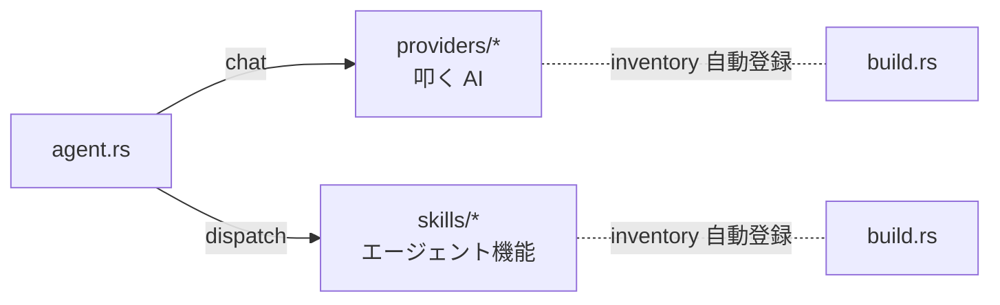

<div align="center">
  <h1>🐾 PicoAgent</h1>
  <p><strong>キャラクターとフキダシだけの透明デスクトップペット。<br />叩く AI もエージェント機能も、コネクタを足すだけで増やせる。</strong></p>

  
  
  
</div>

<br />

透明な Tauri ウィンドウに常駐するデスクトップペットです。バックエンドは Rust、フロントは webview。

**Ollama も Node.js も要りません。** 推論エンジンを同梱し、初回起動時に PC の VRAM / RAM 目安からローカルモデルを自動で選んで取得します。以後はオフラインで動きます。

<div align="center">
  <table>
    <tr>
      <th width="50%">2D（連番フレーム）</th>
      <th width="50%">Live2D</th>
    </tr>
    <tr>
      <td></td>
      <td></td>
    </tr>
    <tr>
      <td></td>
      <td></td>
    </tr>
  </table>
  <sub>
    ウィンドウは枠なしの透明。デスクトップにフキダシとキャラクターだけが浮かびます（上：ライト／下：ダーク）。実際の動きです。<br />
    左は 2D キャラ「むぎ」、右は Live2D キャラ「ひより」。Live2D はまばたき・モーション・口パクをモデル自身が行います。
  </sub>
</div>

---

## 📑 目次

| | |
|---|---|
| [🚀 まず動かす](#-まず動かす) | 2 コマンドで起動 |
| [✨ できること](#-できること) | 機能の全体像 |
| [🖱 使い方](#-使い方) | 操作とショートカット |
| [⚙️ 設定](#️-設定) | 設定画面と主要な設定キー |
| [📊 性能要件](#-性能要件) | 動作環境の目安・上限・計測 |
| [🧩 コネクタで拡張する](#-コネクタで拡張する) | AI・スキルの増やしかた |
| [🔌 ローカル API](#-ローカル-api) | 外部ツールから呼ぶ |
| [📦 配布ビルド](#-配布ビルド) | 同梱物・ログ・署名 |
| [📁 フォルダ構成](#-フォルダ構成) | どこに何があるか |
| [🛟 困ったとき](#-困ったとき) | 症状別の対処 |

> [!TIP]
> **使いかたを一冊で読みたいなら [MANUAL.md](MANUAL.md)。** 導入から日常の使いかた、スキル活用、ローカル API までまとまっています。
> アーキテクチャとコネクタ仕様は [SPEC.md](SPEC.md)、AI エージェント向けの作業ルールは [AGENTS.md](AGENTS.md) です。

---

## 🚀 まず動かす

### 前提

**対応 OS は Windows と macOS です。**

| | 必要なもの |
|---|---|
| 共通 | **Rust（cargo）** / **Tauri CLI**（`cargo install tauri-cli --version '^2'`） |
| Windows | WebView2 ランタイム |
| macOS | Xcode Command Line Tools（`xcode-select --install`）<br />読み上げも使うなら `brew install p7zip` |

### 起動

```bash
cargo install tauri-cli --version '^2'   # 初回だけ
cargo xtask dev
```

これだけです。`cargo xtask dev` が推論エンジン・読み上げ・Whisper・Live2D・THA3・OSS ツールの**未取得分を自動で取得**してから起動します。

> [!NOTE]
> 初回はネットワークが必要です。Rust の crate 取得・コンパイルとモデル DL（数 GB）で時間がかかりますが、2 回目以降は速くなり、オフラインで動きます。

<details>
<summary>個別に取得したいとき（通常は不要）</summary>

| コマンド | 取得するもの |
|---|---|
| `cargo xtask setup engine` | 同梱推論エンジン（llama-server。Windows は Vulkan / GPU 版） |
| `cargo xtask setup aivis` | 同梱 Aivis（読み上げ） |
| `cargo xtask setup whisper` | ローカル Whisper CLI とモデル（録音の文字起こし用） |
| `cargo xtask setup live2d` | Live2D ランタイムとサンプルモデル |
| `cargo xtask setup tha3` | 1枚絵から自作キャラを作るTHA3本体・3段階モデル・開発用Python（Windowsの製品ランタイムはインストール時取得） |
| `cargo xtask setup office` | OfficeCLI（LibreOffice。Office ファイルの変換・PDF 出力） |
| `cargo xtask setup tools` | 精度向上用の OSS CLI（Pandoc / ripgrep / ffmpeg / ImageMagick ほか） |
| `cargo xtask stop` | 残存プロセスの停止 |

引数なしの `cargo xtask setup` で製品へ同梱する全対象を取得します。THA3も設定画面からすぐ制作できる機能なので対象に含みますが、通常動作中はPythonもモデルも読み込みません。再取得は `THA3_FORCE=1` / `TOOLS_FORCE=1` などの環境変数、対象を絞るなら `PICOAGENT_SETUP_TOOLS=pandoc,ripgrep`。

一部の OS では公式のポータブル配布が無いツールがあります。その場合は警告のみで起動を続け、`apt` / `brew` で入れた PATH 上のツールへ自動で切り替わります。

</details>

### 1枚絵から動く自作キャラクターを追加する（THA3）

[Talking Head Anime 3（THA3）](https://github.com/pkhungurn/talking-head-anime-3-demo)を使うと、透過した全身立ち絵から、待機・呼吸・左右の頭／身体揺れ・まばたき・口パク・考え中・落胆を含む**17枚のキーポーズ**を生成し、PicoAgentが使う**42枚の連番アニメ**へ変換できます。通常の自作キャラは名前に「（自作）」、全自作キャラは説明と生成元情報に「自作（THA3）」が付き、組み込みキャラと見分けられます。同じ表示名を使う場合も内部IDを別にすれば別キャラクターとして扱われます。

```powershell
cargo xtask setup tha3
```

配布版ではWindowsインストール中に専用Python／CUDA版PyTorchをPicoAgentのTHA3領域だけへ取得するため、グローバルPythonや既存のPyTorchへ干渉しません。右クリック →「設定…」→「キャラクター」→「1枚絵からキャラクターを作成（THA3）」で、元画像・ID・表示名を指定して「キャラクターを作成」を押します。生成ログとキャンセル操作を画面内に表示し、完成したパックだけを検証後に追加キャラクター領域へ導入します。

キャラクター選択は同じ画面の画像カードから行えます。各カードに内部IDと `PNGアニメ` / `Live2D` / `自作THA3` / `追加PNG` を表示するため、同じ表示名のキャラも区別できます。カードの「このキャラを選ぶ」を押したあと「保存」で反映します。

コマンドで作る経路も残しています。

```powershell
python scripts/build-tha3-layers.py my-character --input C:\images\source.png --name "マイキャラ"
```

入力はTHA3上流仕様どおり、`512x512`・RGBA・背景完全透過・正面向きで直立した1人の全身絵にします。頭は上半分中央の128x128付近、手は頭から離してください。スクリプトは測定可能なサイズ・透過・余白・頭部領域を生成前に検査し、既存レイヤーは `--force` がない限り上書きしません。生成後は `character.json` と `characters/index.json` の登録、連番生成、配信コピーの同期まで行います。人格・挨拶は生成後の `characters/<id>/character.json` で調整できます。

```powershell
# THA3で作った自作キャラだけをOSのゴミ箱へ移し、一覧から外す
python scripts/build-tha3-layers.py my-character --remove
```

THA3が必要なのは制作時だけで、通常のPicoAgent実行時にはTHA3・Python・GPUを使いません。WindowsはCUDA対応NVIDIA GPUのVRAMを生成前に測り、4～6GB未満は `separable_half`、6～10GB未満は `standard_half`、10GB以上は `standard_float` を自動選択します（4GB未満は生成前に停止）。Apple Silicon MacはMPS＋`standard_float`、Intel Macは対象外です。生成時は6種類の口形から見えるものを自動選択し、差が小さすぎるデフォルメ口だけを自動補正します。全レイヤーは基準ポーズの被写体範囲で切り出し、縦横比を保ったまま445×900へ位置を揃えます。待機中は左右視線とまばたき、読み上げ中は口パクへ切り替わります。なおTHA3の出力は512×512固定で、入力要件どおりに全身を配置すると被写体は150×330程度になるため、445×900で直接描いた同梱キャラより精細さは落ちます（拡大時に軽い鮮鋭化をかけています）。17キーポーズから作るフレームアニメなので、ひよりのLive2Dと同じ連続変形ではありません。本物のLive2Dモデルを使う場合は[キャラクター画像の準備手順](characters/README.md)を参照してください。

既存のPNGキャラを試す場合は、元IDを上書きせず `rin-tha3` / `mai-tha3` のような別IDで作って見比べてください。ひよりなどのLive2DキャラはLive2Dの方が滑らかなため、THA3での作り直しは推奨しません。既知のむぎ素材もこの生成機能では自動変更しません。

### 叩く AI を選ぶ

既定は **`local`（同梱エンジン）** です。何も設定しなくても動きます。

- **ローカルモデルの自動選定** — `PICOAGENT_LOCAL_MODEL_PRESET=auto` が PC の VRAM / RAM 目安から Gemma 4 系の `small` / `balanced` / `large` を選び、GGUF を自動ダウンロードします。手動なら Gemma / Qwen / Llama / Mistral / Phi 系の主要プリセットも選べます。
- **設定画面での選択** — 「種類 → サイズ」で選べ、推奨 VRAM・推奨 RAM・ダウンロード目安を表示します。取得中はフキダシ下に「モデルを準備中… NN%」と出ます。
- **ディスク整理** — 「叩くAI」タブの「ダウンロード済みモデル」から、取得済み GGUF の一覧・サイズ確認・削除ができます（使用中のモデルは削除不可）。
- **クラウド AI を使う**（費用が発生します） — 右クリック →「設定…」でプロバイダ・API キー・モデルを設定。OpenAI / Claude / Gemini / DeepSeek / xAI Grok / Mistral に対応しています。
- **外部 Ollama を使う** — `ollama serve` の後、設定画面でプロバイダを切り替えるとモデル一覧を読み込みます。
- **手元の CLI エージェントを使う**（開発・個人利用向け） — Claude Code / Codex CLI が入っていれば、叩く AI として選べます（下の制約を必ず確認してください）。

> [!WARNING]
> **「手元の CLI エージェント」は開発・個人利用向けの選択肢です。**
>
> | 制約 | 内容 |
> |---|---|
> | 導入とログインが要る | 利用者側に CLI のインストールとログインを要求します。「Ollama も Node.js も要らない」という本アプリの前提と逆行します |
> | 応答が重い | CLI の起動に毎回 1〜3 秒かかります。常駐して雑談する用途には向きません |
> | CLI 側のツールは隔離する | Claude Code は safe mode・組み込みツールなし、Codex はユーザー設定なし・read-only sandbox・一時セッションで起動します。ファイルや PC の操作は PicoAgent 側のスキル境界だけを通します |
> | スキルは約束事で動く | CLI は function calling を受け付けないため、**プロンプトの約束事**（決められた JSON を返させる）でスキルを呼びます。通常のプロバイダより取りこぼしが起こりえます。約束を守らない出力は普通の返答として扱うので壊れはしません |
> | 配布構成の既定にしない | 上記のため、配布・販売する構成の既定プロバイダには**しないでください**。組み込んで配布する場合は、各サービスの利用規約の確認が別途必要です |
>
> 用途としては「小型ローカルモデルでは判断が怪しい場面で、応答の質やスキル選択を確かめる」「キャラの口調や人格を詰める」といった**開発時の切り分け**が向いています。


---

## ✨ できること

### 土台

- **Ollama 不要・ローカル完結** — 推論エンジン同梱。初回 DL のモデルだけでそのまま動く
- **叩く AI を差し替え可能** — local / Ollama / OpenAI 互換 / Claude / Gemini / DeepSeek / xAI Grok / Mistral を同梱
- **エージェント機能を追加可能** — ツールコネクタを足すと、モデルが function calling で呼べる
- **軽量な Tauri ネイティブ** — システム WebView + Rust バックエンド
- 会話は選択中の叩く AI にだけ送られる。ローカルモデルなら外部送信なし

### エージェント

- **スーパーエージェントモード** — 複雑な依頼を「計画 → 多段ツール実行 → 自己評価」まで自律的に回し、必要なら `subagent` スキルでサブタスクを分担。進捗はフキダシ上部のステータス行にリアルタイム表示
- **原則 Web 検索** — 通常の質問はローカルモデルの判断に頼らず検索してから、参照元リンク付きで回答（短い挨拶は例外扱いでキャラクター本人として返答）

### キャラクター

- キャラクターパックごとの連続フレームと、状態別（待機 / 傾聴 / 検索 / 作業 / 返答 / 成功 / エラー）の滑らかな補間動作
- **Live2D 対応** — `character.json` に `live2d.model` があるキャラは Cubism ランタイムで WebGL 描画。まばたき・モーション・視線追従・声量連動の口パクをモデル自身が行う。公式サンプルモデルを 9 体同梱（再配布条件が明示されている Free Material License の 8 体＋Epsilon。モデル実体は初回セットアップ時に取得）。**2D と Live2D の見た目は[冒頭のプレビュー](#-picoagent)で見比べられます**
- キャラごとに名前・挨拶・性格・口調・一人称を定義でき、設定画面で切替と人格の上書きが可能
- **ユーザーとの関係を選べる** — 相棒（既定）／友達／恋人／妹／姉／先輩／自由設定。キャラの性格や口調の芯はそのままに、呼び方・距離感・敬語かタメ口かだけが変わります。キャラごとに別の関係を設定することもできます
- **関係性と共有記録** — キャラごとに会話・完了した作業・ふれあいを端末内へ保存。「出会ったばかり」から自然に距離感が変わる。作業記録は固定・個別削除・全消去でき、「続きをやる」で依頼を入力欄へ戻せる。保存自体も設定で停止可能
- **2Dのふれあい** — 頭・頬・手へのタップとなでなでで、キャラ固有の台詞と照れ・喜びモーションを返す。数値ゲージではなく反応で親しさを表現
- **会話の内容で表情が変わる** — 話の流れから推定した感情（喜び・落ち込み・高揚・落ち着き・興味・驚き）が、キャラのオーラの色・顔色・動きの速さに出ます
- **スタイルバリアント** — `character.json` の `variants` で同一キャラの別衣装・季節差分・演出を切替可能。**`variants[].live2d` を書けば、同じキャラの「絵版」と「Live2D 版」も切り替えられます**
- **2Dキャラパック** — `cargo xtask character-pack validate <フォルダ>` で形式・容量・画像寸法・パスを検証し、`install` で途中状態を残さず正本と一覧へ追加できる

### スキル（一部）

| 分野 | できること |
|---|---|
| 情報・検索 | Web 検索、天気、為替、株価指数、ニュース、RSS |
| ブラウザ | 実際の Chrome / Edge を開いてページを読む（JS 描画・ログインが要るページ向け。既定は無効） |
| 日常補助 | リマインダー、集中タイマー、見守り通知、できたことメモ、おでかけ前チェック、クリップボード要約 |
| 文書・画像・音声 | PDF 抽出・分割・結合、Office 変換、PSD/HEIC など画像変換、録音 → 文字起こし → 議事録 |
| 調査・資料 | 出典付き調査レポート、スライド下書き、HTML ダッシュボード、資料一式の生成 |
| 外部連携 | Gmail、Slack、Google カレンダー / Docs / Sheets / Drive、GitHub、Notion、各種 SNS |
| ローカル操作 | ファイル読み書き、コマンド実行、自力コード実行、cron 風スケジュール |
| PC 操作 | マウス・キーボードの直接操作とウィンドウ一覧・前面化（シェルを介さない固定操作のみ。既定は無効） |
| プロジェクト管理 | 案件ごとの作業環境の切替、課題台帳（期限・優先度・タグ）、決定事項と進捗の記録、切替時の文脈復元 |
| コーディング支援 | 行番号つき部分読み、ファイル名検索（glob）、内容検索（正規表現）、既存ファイルの部分編集、ノートブック編集、バックグラウンド実行の様子見、多段タスクの作業計画、画像を見る、選択肢つきの確認 |
| 実用ツール | 文字数分析、JSON 整形、Base64、URL 変換、単位換算、日付計算、CSV 表化、色変換 ほか約 30 種 |

> 頼み方の具体例は **[MANUAL.md 第5章「スキル活用ガイド」](MANUAL.md#5-スキル活用ガイド頼み方の例)** にまとまっています。設定画面の「スキル活用ガイド」タブからも同じ内容を見られます。
>
> 上の表は用途別です。「読むだけか、送信・削除まで行うか」という設計上の分類は **[SPEC.md「スキルの分類」](SPEC.md#スキルの分類エージェント設計としての位置づけ)** にあります。

---

## 🖱 使い方

### マウス操作

| 操作 | 動き |
|---|---|
| フキダシをクリック | 入力欄を開く |
| フキダシ上部の小ボタン | 回答コピー / 再読み上げ / 停止 / 拡大 |
| フキダシ右下のつまみをドラッグ | 幅・高さを変更（位置も含めて自動保存） |
| キャラクターをダブルクリック | フキダシを全画面表示 ⇄ 元に戻す |
| キャラクターをドラッグ | 移動 |
| 読み上げ中にキャラクターをクリック | 読み上げを停止 |
| キャラクターをクリック / なでる | 触った場所に応じて反応し、ふれあいを記録 |
| キャラクター横の `♡` | 関係性と最近いっしょにしたことを表示 |
| 右クリック | 設定… / 常に手前に表示 / 会話をリセット / 終了 |

全画面フキダシでは会話履歴を検索でき、各履歴のコピーやユーザー発話の再利用ができます。
フキダシ本文や入力欄の上で右クリックした場合は、コピーなど通常のメニューを優先します。
チャットで「アプリ終了して」「PicoAgent を閉じて」と頼んでも、アプリ操作スキル経由で終了できます。

<div align="center">
  
  <br />
  <sub>全画面フキダシ。履歴の検索・コピー・再利用・Markdown 書き出しができます。</sub>
</div>

### キーボード

| キー | 動き |
|---|---|
| `Enter` / `Ctrl + Enter` | 送信 |
| `Shift + Enter` | 改行 |
| `↑` `↓` | 過去の入力を呼び戻す |
| `Esc` | 入力欄を閉じる / 全画面を解除 |

### ファイルを渡す

ウィンドウのどこへでも（キャラクターの上でも）ドラッグ&ドロップすると添付され、入力欄が開きます。

- 画像は画像添付、文書は内容を抽出
- 共通の許可ルート内なら**実パスも伝わる**ので、PDF 抽出や PSD 変換のスキルがそのまま使える
- 許可ルート外だった場合は、通知の「許可設定を開く」から対象タブへ直接移動できる
- 複数ファイルの失敗は 1 件ずつ出さず、まとめて知らせる
- ブラウザからの URL・テキストのドロップは入力欄へ挿入

### クイック操作

入力欄の上部から、画面確認・クリップボード要約・今日の予定・できること確認・未読メール要約・Slack 最新要約をワンクリックで送れます。

音声入力の「連続」を有効にすると、その起動中だけ周囲の騒音に合わせて話し終わりを検出し、1.5秒の取消猶予後に自動送信します。返答の読み上げ後は再び聞き始め、マイクを押せば読み上げへ割り込めます。長時間無音・画面非表示では自動停止します。

<div align="center">
  
  <br />
  <sub>フキダシをクリックすると入力欄が開き、上にクイック操作が並びます。左下のボタンは音声入力。</sub>
</div>

### アクションセンター

会話の送信中 / 完了 / 失敗、日常通知、スケジュール結果をメイン画面へ集約します。直近 50 件を端末内に保持し、実行中の会話は停止、完了した依頼は一覧から再入力できます。ファイルをドロップすると、種類に応じた次操作の候補（要約・変換・比較・文字起こしなど）も出ます。

---

## ⚙️ 設定

右クリック →「**設定…**」ですべて GUI から編集できます。保存先は `app_config_dir/config.json`（個人 PC ローカル）です。

### 反映のタイミング

| 種類 | 例 | 反映 |
|---|---|---|
| 軽い設定 | 文字サイズ、常に手前、人格、自発雑談 | 保存すると**即反映** |
| 重い設定 | 叩く AI、モデル、音声（Aivis）、キャラクター | 確認画面が出て、承諾すると**再起動**し、モデル取得やエンジン起動を起動画面でまとめて実行 |

「あとで」を選んでも設定は保存され、次回起動時に反映されます。

### タブ構成

**基本** / **キャラクター** / **音声** / **叩くAI** / **スキル設定** / **許可** / **スキル活用ガイド** / **診断** の 8 タブです。

- **許可** — 全スキル共通のファイル・ディレクトリ・実行の許可ルートと拒否パスをまとめて設定（`C:\Windows` と `Program Files` は常に拒否）。各スキルの個別許可ルート設定は廃止し、この共通設定を参照します
- **キャラクター** — 選択・人格・声のほか、**自分で用意した Live2D モデル等を追加できます**（zip かフォルダを選ぶだけ。追加分はアプリのデータフォルダへ入り、再ビルドは不要）
- **スキル設定** — カテゴリ見出しとジャンルチップで整理。各カードの ⚙ は既定で折りたたみ。設定不要 / 未設定 / 一部設定 / 設定済みのバッジと、承認ポリシー（低リスク / 外部読取 / 書込・変更 / 送信前確認 / 実行前確認）を表示
- **叩くAI** — 選択中のプロバイダ設定だけを表示し、未使用プロバイダの API キー欄やモデル欄は畳み込みます
- **診断** — 選択中プロバイダ、同梱エンジン、Aivis、トークン使用量、スキル実行状況を確認
- API キーや OAuth token が要る項目には、取得手順と公式リンクの設定ガイドを表示（チャットで「Gmail のトークンの取り方」と聞いても同じ案内が出ます）
- Gmail / Slack / Google カレンダーは保存済み設定で**接続テスト**でき、失敗時は token 未設定・権限不足・対象 ID 不一致などの原因候補も出します
- 目覚ましとタスクスケジュールは JSON 直書きではなく**専用フォーム**で編集できます

### 会話の記憶

- **会話履歴** — キャラクターごとに `app_data_dir/history-<キャラID>.json` へ保存。起動時とキャラ切替時に、そのキャラの直近の会話を文脈と履歴表示へ復元します（別キャラの口調や自己紹介が混ざりません）
- **長期メモリ** — 好み・自己情報・継続指示らしい発話だけを `app_data_dir/memory.json` に暗黙的に保存し、次回以降の会話で参照します
- **消したいとき** — 右クリック →「**会話をリセット**」（選択中キャラの履歴とメモリを削除）

応答中にリセット・キャラ切替・設定反映をした場合、古い応答が戻ってきても履歴や画面へは書き戻しません。

### 主要な設定キー

よく触るものだけを載せています。**全キーの一覧は [SPEC.md](SPEC.md#設定キー一覧)** を参照してください。

| 用途 | 主なキー |
|---|---|
| 叩く AI | `PICOAGENT_PROVIDER` / `PICOAGENT_MODEL` |
| ローカルモデル | `PICOAGENT_LOCAL_MODEL_PRESET` / `PICOAGENT_MODEL_URL` |
| キャラクター | `PICOAGENT_CHARACTER` / `PICOAGENT_CHARACTER_OVERRIDES` / `PICOAGENT_COMPANION_MODE` / `PICOAGENT_RELATIONSHIP_MEMORY_ENABLED` / `PICOAGENT_ONBOARDING_DONE` |
| 関係性 | `PICOAGENT_RELATIONSHIP` / `PICOAGENT_RELATIONSHIP_OVERRIDES` |
| 表示 | `PICOAGENT_THEME` / `PICOAGENT_BUBBLE_FONT_PX` / `PICOAGENT_ALWAYS_ON_TOP` |
| 音声 | `PICOAGENT_TTS_ENABLED` / `PICOAGENT_TTS_VOLUME` |
| 許可（共通） | `PICOAGENT_ALLOWED_ROOT` / `PICOAGENT_ALLOWED_PATHS` / `PICOAGENT_DENIED_PATHS` |
| ローカル操作 | `PICOAGENT_COMMAND_ENABLED` / `PICOAGENT_COMMAND_ALLOWLIST` |
| ブラウザ操作 | `PICOAGENT_BROWSER_ENABLED` / `PICOAGENT_BROWSER_ALLOWED_DOMAINS` / `PICOAGENT_BROWSER_PROFILE` |
| PC 操作 | `PICOAGENT_DESKTOP_ENABLED` / `PICOAGENT_DESKTOP_MAX_OPS_PER_MIN` |
| メモリ | `PICOAGENT_MEMORY_ENABLED` / `PICOAGENT_MEMORY_MAX_ITEMS` |
| スーパーエージェント | `PICOAGENT_SUPER_AGENT` / `PICOAGENT_SUPER_AGENT_MAX_STEPS` |
| コーディング支援 | `PICOAGENT_RIPGREP_PATH` / `PICOAGENT_TODO_PLAN` |
| プロジェクト管理 | `PICOAGENT_PROJECTS` / `PICOAGENT_ACTIVE_PROJECT` |

<details>
<summary>クラウド AI・その他の設定キー</summary>

| 用途 | 主なキー | 説明 |
|---|---|---|
| OpenAI 互換 | `OPENAI_BASE_URL` / `OPENAI_API_KEY` / `OPENAI_MODEL` | 使う場合だけ設定 |
| Claude | `PICOAGENT_ANTHROPIC_API_KEY` / `PICOAGENT_ANTHROPIC_MODEL` | 使う場合だけ設定 |
| DeepSeek | `PICOAGENT_DEEPSEEK_API_KEY` / `PICOAGENT_DEEPSEEK_MODEL` / `PICOAGENT_DEEPSEEK_THINKING` | 使う場合だけ設定 |
| Gemini | `PICOAGENT_GEMINI_API_KEY` / `PICOAGENT_GEMINI_MODEL` | 使う場合だけ設定 |
| xAI Grok | `PICOAGENT_XAI_API_KEY` / `PICOAGENT_XAI_MODEL` | 使う場合だけ設定 |
| Mistral | `PICOAGENT_MISTRAL_API_KEY` / `PICOAGENT_MISTRAL_MODEL` | 使う場合だけ設定 |
| Ollama | `OLLAMA_HOST` / `OLLAMA_MODEL` | 外部 Ollama を使う場合だけ設定 |
| ローカル文字起こし | `PICOAGENT_TRANSCRIBE_PROGRAM` / `PICOAGENT_TRANSCRIBE_MODEL` / `PICOAGENT_TRANSCRIBE_DIARIZE_ARGS` | 手動設定が最優先。空なら同梱 Whisper CLI を使う（サーバを立てずポートも使いません） |
| プロジェクト | `PICOAGENT_PROJECTS` / `PICOAGENT_ACTIVE_PROJECT` | 案件ごとの環境（許可ルート・AI・モデル・キャラ）と課題・記録。通常はチャットで登録・切替 |
| 保存ワークフロー | `PICOAGENT_WORKFLOWS` | 最大 8 件のスキル手順を名前付きで保存・再実行 |
| 自発雑談 | `PICOAGENT_CHATTER_ENABLED` / `PICOAGENT_CHATTER_TOPIC_MODE` | アイドル時の雑談と話題ソース |
| 目覚まし | `PICOAGENT_ALARMS` | 通常はチャットで設定。設定画面では専用フォーム |
| タスクスケジュール | `PICOAGENT_SCHEDULED_TASKS` | `kind=command` / `kind=tool` の指定時刻タスク |
| 自力実行 | `PICOAGENT_CODE_RUNNER_ENABLED` / `PICOAGENT_CODE_RUNNER_PYTHON` | 他スキルで満たせないときに PowerShell / Python を書いて実行（既定は無効） |
| サブエージェント | `PICOAGENT_SUBAGENT_MAX_DEPTH` | サブタスク分担のネスト上限 |
| 情報取得 | `PICOAGENT_WEATHER_DEFAULT_LOCATION` / `PICOAGENT_WEB_SEARCH_MAX_RESULTS` / `PICOAGENT_NEWS_SCRAPE_MAX_ITEMS` / `PICOAGENT_RSS_DEFAULT_URL` / `PICOAGENT_RESEARCH_TIMEOUT_SECS` | 各種既定値 |
| 外部連携 | 各サービスの token / 既定 ID / timeout | 使うサービスだけ設定。`PICOAGENT_GMAIL_CLEANUP_MAX_RESULTS=0` で Gmail 整理の件数上限を無制限に |

リマインダーや集中タイマーの実行状態も `config.json` に残りますが、直接編集するものではないため設定画面には出しません（チャットで追加・一覧・削除してください）。

</details>

> [!TIP]
> 各キーは環境変数としても渡せます（既定値としての参照のみ。保存先は常に `config.json`）。

### 目覚まし・スケジュール

チャットで頼むだけで設定できます。

```
「平日の7時に起こして」            → 目覚まし（声でやさしく起こします）
「アラーム一覧」「それ消して」       → 一覧・削除
「毎朝9時に git status を実行して」 → cron 風タスクスケジュール
```

- 目覚ましは鳴った後、`おきたよ！` を押すまで既定 5 分おきに再通知します（アプリ起動中のみ）
- スケジュール実行結果は `app_data_dir/schedule-runs.json` に直近 100 件保存し、通知一覧から直近 20 件を確認・再実行できます
- コマンド実行は `PICOAGENT_COMMAND_ENABLED=true` を前提に、許可ルートと allowlist で守ります。未登録コマンドや許可ルート外の作業先が必要になった場合は、その場で「許可（今回だけ）」/「永続許可」/「キャンセル」を選べます

### ブラウザ操作

`web_fetch` は HTTP で取れる本文しか見えないため、**JavaScript で描画されるページ**と**ログインが必要なページ**は読めません。そこだけを実ブラウザで補います。

**有効化**: 設定画面「スキル設定」タブ →「ブラウザ操作」→ `PICOAGENT_BROWSER_ENABLED` を有効化（**既定は無効**）。

- インストール済みの **Chrome / Edge** を CDP（Chrome DevTools Protocol）で操作します。追加のダウンロードや Node.js は不要です
- **現在は読み取り専用**です（開く・読む・タブ一覧・閉じる）。クリックや入力はまだできません
- 既定は**専用プロファイル**で起動します。`PICOAGENT_BROWSER_PROFILE=default` にすると、ブラウザの既定プロファイル（＝ログイン済みのセッション）を使います
- CDP は `127.0.0.1` のみに公開し、PicoAgent が起動・管理していない既存のデバッグブラウザには接続しません。同じポートが使用中なら、既存タブを読む代わりに明示エラーで停止します
- 到達してよいドメインは `PICOAGENT_BROWSER_ALLOWED_DOMAINS` で絞れます（空なら制限なし）。リダイレクト後と現在のタブも再検査し、許可外の内容や URL は返しません
- ページ本文は**信頼できない外部データ**として扱い、指示の上書きを狙う文字列を検知したら警告付きで渡します
- 長いページは打ち切らず、`offset` を指定して続きを読みます

### 安全のしくみ

- `C:\Windows` と `C:\Program Files*` 配下は編集できません
- スキル経由のファイル削除は `trash_file` で **OS のゴミ箱へ移動するだけ**。許可ルート外・許可ルートそのもの・保護ディレクトリは拒否します
- `run_command` でも `rm` / `del` / `Remove-Item` / `git clean` などの物理削除コマンドは実行しません
- 判断が分かれる場面では `ask_user` が選択肢つきで聞き返します（フキダシ下のボタンで選べます）。答えるまで作業は進みません

---

## 📊 性能要件

デスクトップに常駐し続けるアプリなので、**「軽いまま止まらない」ことを性能要件**にしています。実装済みの上限・タイムアウト・計測点は以下のとおりです。

### 動作環境の目安（ローカルモデル）

`PICOAGENT_LOCAL_MODEL_PRESET=auto` が VRAM / RAM の目安から自動選定します。設定画面にも同じ数値を表示します。

| プリセット | モデル | 推奨 VRAM | 推奨 RAM | ダウンロード目安 |
|---|---|---|---|---|
| `small` | Gemma 4 E2B Q4 | 不要（CPU 中心でも可） | 8 GB | 約 3.1 GB |
| `balanced`（通常利用の推奨） | Gemma 4 E4B Q4 | 4 GB | 16 GB | 約 5.0 GB |
| `large` | Gemma 4 12B Q4 | 8 GB | 24 GB | 約 7.1 GB |

- ディスクは上表のモデル本体に加えて、同梱物（推論エンジン・Aivis・Whisper・Live2D・THA3・OSS ツール）の取得分が必要です。取得済み GGUF は「叩くAI」タブから一覧・削除できます
- コンテキスト長は `PICOAGENT_LOCAL_CTX`（既定 `8192`）、GPU オフロードは `PICOAGENT_LOCAL_NGL`（既定 `999`=全レイヤ優先 / `0`=CPU 固定）で調整します
- クラウド AI を選んだ場合、ローカルモデルは取得も起動もしません

### THA3キャラクター制作の最低要件

| 環境 | 最低要件 | 推奨 | モデル選択 |
|---|---|---|---|
| Windows | Windows 10/11 x64、CUDA対応NVIDIA GPU、VRAM 4GB、CUDA 12.8対応ドライバー | VRAM 8GB以上、RAM 16GB以上 | VRAM 4～6GB未満=`separable_half`、6～10GB未満=`standard_half`、10GB以上=`standard_float` |
| Apple Silicon Mac | Apple Silicon、MPS対応macOS、ユニファイドメモリ16GB | 24GB以上 | 互換性優先の`standard_float` |

Intel MacとLinuxでのTHA3生成は対象外です。通常のPicoAgent利用や生成済みキャラクターの表示には、このGPU要件は適用されません。

- Windowsインストーラへ入るTHA3本体・3モデル・取得ブートストラップは実測約0.85GBです。インストール中にCUDA版PyTorch約2.7GBを追加取得し、展開後のTHA3全体は実測約5.2GBです
- 新規インストール時は一時キャッシュを含め10GB以上、更新で旧ランタイムを保持しながら入れ替える場合は15GB以上の空き容量を確保してください。成功・失敗のどちらでも取得キャッシュを片付けます
- Apple Silicon MacはOS別PyTorchをアプリへ同梱します。最終容量はPyTorch配布物の版で変わるため、ビルド時に `src-tauri/resources/bundled/tha3/` の実測値を確認してください

### 応答性・描画

| 項目 | 要件 |
|---|---|
| 生成の見え方 | 応答は**ストリーミング表示**。受信チャンクはバッファへ積み、描画は `requestAnimationFrame` で 1 フレーム 1 回に合体します（チャンクごとの再描画はしません） |
| 読み上げの先行開始 | 文が確定した時点から順に音声合成へ送り、全文の生成完了を待ちません |
| アニメーション | キャラクターは単一の `requestAnimationFrame` ループで駆動。Live2D / リグ / 居眠り中もループを止めず、状態だけ切り替えます |
| 履歴表示 | 会話履歴の構築は全画面表示中のみ。履歴検索は 120ms デバウンス |
| 常駐時のポーリング | 目覚まし・スケジュール照合は 20 秒間隔、居眠り判定は 30 秒間隔。それ以外の定期処理は持ちません |
| 入力欄 | 内容に合わせて最大 180px まで自動伸縮。入力履歴は直近 40 件 |

### 上限とタイムアウト

暴走・コンテキスト超過・無応答を防ぐための固定値です。括弧内が設定キーのある項目です。

| 対象 | 値 |
|---|---|
| エージェントのツール連鎖 | 既定 5 ステップ。スーパーエージェントモードは 12 ステップ（`PICOAGENT_SUPER_AGENT_MAX_STEPS`、〜30 にクランプ）で打ち切り、最後の文面を返します |
| chat 呼び出しのリトライ | 最大 3 回・指数バックオフ（1 秒 → 2 秒）。4xx 認証エラーは即中断 |
| ツール出力 | 既定は **使用中モデルのコンテキスト長に合わせて自動決定**（`PICOAGENT_TOOL_OUTPUT_MAX_CHARS`）。ローカルは `PICOAGENT_LOCAL_CTX` の 45%（下限 1,000 文字・上限 60,000 文字）、クラウド利用時は 24,000 文字。既定の 8,192 コンテキストでは 3,686 文字に抑え、人格・履歴・回答生成の枠を残します |
| ブラウザで 1 回に読む本文 | ツール出力の上限に従う（`PICOAGENT_BROWSER_MAX_CHARS`）。**超えた分は打ち切らず `offset` で続きを読む** |
| 汎用 HTTP スキル | 20 秒（`PICOAGENT_HTTP_TIMEOUT_SECS`、3〜60） |
| コマンド実行 | 30 秒（`PICOAGENT_COMMAND_TIMEOUT_SECS`、1〜120） |
| ローカル API の 1 リクエスト | 300 秒 |
| 会話履歴 | 保存は直近 60 件、起動時に文脈へ読み込むのは直近 20 件 |
| 長期メモリ | 最大 80 件（`PICOAGENT_MEMORY_MAX_ITEMS`、10〜200）、1 件 140 文字、文脈へ差し込むのは関連度上位 24 件 |
| ツール実行トレース | 直近 200 件 |
| スケジュール実行履歴 | 直近 100 件を保存し、通知一覧から直近 20 件を確認・再実行 |

### 計測のしかた

- 右クリック →「設定…」→「**診断**」タブ。同梱エンジン・Aivis・選択中プロバイダの状態、トークン使用量、スキルごとの**平均レイテンシ / 呼び出し回数 / エラー数**を確認できます
- 診断タブの数値は `pet_traces` コマンド（直近 200 件のスパンとツール別集計 `avgMs` / `callCount` / `errorCount`）とトークン使用量の永続集計から取っています
- 大きなファイルの取得は一時ファイルへストリームで書いてから rename で確定するため、モデル DL 中もメモリ使用量は増えません

---

## 🧩 コネクタで拡張する



| 増やすもの | 置き場所 | やること |
|---|---|---|
| 叩く AI | `src-tauri/src/providers/<名前>.rs` | `Provider` トレイトを実装し `inventory::submit!` で登録 |
| エージェント機能 | `skills/<スキル名>/mod.rs` | `Tool` トレイトを実装し `inventory::submit!` で登録 |

`build.rs` が自動で `mod` 取り込みするので、**中央のレジストリを編集する必要はありません**。再ビルドすれば登録されます。

書き方は [SPEC.md](SPEC.md#新しいコネクタの作り方) を参照してください。

---

## 🔌 ローカル API

外部ツールやスクリプトから、PicoAgent のエージェント（スキル込み）を Ollama のようにローカル HTTP で呼べます。

**有効化**: 設定画面「基本」タブ →「ローカル API（Ollama風）」→ 有効化して再起動（既定は無効）。

`127.0.0.1` にのみバインドし、LAN へは公開しません。`PICOAGENT_API_KEY` を設定すると `Authorization: Bearer <キー>` が必須になります。

| エンドポイント | 内容 |
|---|---|
| `GET /api/version` | バージョン情報 |
| `GET /api/tags` | 選択中モデルの一覧（Ollama の `/api/tags` 風） |
| `POST /api/chat` | `{"messages":[…]}` → エージェント応答 |
| `POST /api/generate` | `{"prompt":"…"}` → エージェント応答 |
| `POST /v1/chat/completions` | OpenAI Chat Completions 互換（既存クライアントの `base_url` 差し替えだけで使える） |
| `POST /mcp` | MCP サーバ（スキルを MCP ツールとして公開） |

```bash
# curl で
curl http://127.0.0.1:11500/api/chat -d '{"messages":[{"role":"user","content":"今日の天気は？"}]}'

# 同梱の最小 CLI で（Ollama CLI 風）
cargo xtask cli status              # 死活とバージョン
cargo xtask cli models              # モデル一覧
cargo xtask cli chat 今日の予定は？   # 1問1答（スキルも使える）
cargo xtask cli repl                # 対話モード（会話文脈を保持。exit で終了）

# Claude Code から MCP として登録
claude mcp add --transport http picoagent http://127.0.0.1:11500/mcp
```

API の会話は**ステートレス**（リクエスト内で完結）で、デスクトップのキャラ会話履歴とは混ざりません。ポートは `PICOAGENT_API_PORT`（既定 `11500`）で変更できます。

---

## 📦 配布ビルド

```bash
cargo xtask build
```

`src-tauri/target/release/bundle/` に各 OS の標準バンドル（Windows は NSIS、macOS は `.app` / `.dmg` など）が生成されます。`cargo xtask dev` と同じく、同梱物の未取得分は自動で取得してからビルドします。

配布物に入るのは **`ui/` を写した `ui-dist/`** と **`src-tauri/resources/bundled/`** の2つだけです。開発用のツール・ドキュメント・README 用の画像（`tools/` `docs/` `scripts/` `xtask/`）は含まれません。この範囲は設計ガード（`src-tauri/src/bundle_scope.rs`）がテストで固定しているので、うっかり広がることはありません。

<details>
<summary>同梱物・制作ツールの扱い（エンジン / Aivis / Whisper / Live2D / THA3）</summary>

以下のパスは Windows 表記です。macOS では同等のユーザーデータ配下（`PicoAgent/...`）に読み替えてください。

**同梱推論エンジン（llama-server）**

- 実行ファイルは配布物へ同梱しますが、モデル GGUF（数 GB）は含めず、初回起動時に `%APPDATA%\PicoAgent\bundled\models\` へ取得します
- 実行時に差し替える場合は `%APPDATA%\PicoAgent\bundled\engine\` を優先して探します

**同梱 Aivis（読み上げ）**

- 公式 GitHub Releases から既定 `1.2.0` を `src-tauri/resources/bundled/aivis/` へ展開します（更新時は `AIVIS_RELEASE=latest` またはタグを指定）
- 配布後に見つからない場合は、初回の読み上げ時に `%APPDATA%\PicoAgent\bundled\aivis\` へ自動取得・展開します（展開に `7z` / `7za` / `tar` のいずれかが必要。macOS の `.7z.001` は `brew install p7zip`）
- `PICOAGENT_TTS_ENABLED` が有効なら起動時に内部ポート（既定 `11436`）で裏起動し、アプリ終了時に停止します。旧既定の `10102` が保存済みなら起動時に移行します
- 推論デバイスは内部設定 `PICOAGENT_TTS_DEVICE` の既定 `auto` で GPU 候補を確認し、あれば GPU、なければ CPU（通常の設定画面には出しません）
- 話者は設定画面に出さずキャラクター既定声を使います。未導入なら起動時のローディング画面で AIVMX を追加し、合成時に `/speakers` から実際の style ID を解決します
- 音量は `PICOAGENT_TTS_VOLUME`（0〜100）。保存後すぐ、再生中の音声にも反映されます

> 同梱 Aivis の初回起動はモデル確認や BERT 読み込みで数十秒かかることがあります。キャラ固有の音声モデル導入は起動シーケンス中に「声を準備中…」としてまとめて行うため、通常画面での待ちは発生しません。

**同梱 Whisper（文字起こし）**

- `resources/bundled/whisper/` だけに配置し、アンインストール時も PicoAgent 管理下のディレクトリだけを削除します
- whisper.cpp の GitHub Releases は macOS 向けの CLI 単体バイナリを配布していないため、この環境では警告のみで文字起こしなしの起動を続行します（必須にするなら `WHISPER_REQUIRED=1`、`WHISPER_ASSET` で代替アセット指定、または手動ビルドした `whisper-cli` を配置）

**Live2D ランタイムとサンプルモデル**

- `cargo xtask setup live2d` が Cubism Core / PIXI / pixi-live2d-display を `ui/vendor/live2d/` へ、公式サンプルモデル 7 体（ひより / Haru / まお / レン / ライス / わんこ / Epsilon）を `characters/<id>/live2d/` へ取得します（`LIVE2D_FORCE=1` で再取得）。各サンプルの `preview.jpg` はローディング画面と設定画面アイコンに使います。**1 体取得できなくても他の取得は続き**、プレビューが取れなかった場合は代替画像で表示します
- **ライセンス** — Cubism Core は [Live2D Proprietary Software License](https://www.live2d.com/eula/live2d-proprietary-software-license-agreement_jp.html)、サンプルモデルは [Live2D Free Material License](https://www.live2d.com/eula/live2d-free-material-license-agreement_jp.html) の条件で利用してください。再配布条件があるためリポジトリにはコミットしません（`.gitignore` 済）

**THA3 キャラクター制作ツール**

- `cargo xtask setup tha3` が固定確認済みリビジョンのTHA3コードと、VRAM自動調整に使う `standard_float` / `standard_half` / `separable_half` を `src-tauri/resources/bundled/tha3/` へ取得します。実体はGit管理外ですが製品配布対象です
- WindowsはNSISの約2GB上限を避けるため、製品ランタイムをインストーラへ埋め込みません。インストール後フックが同梱uvを使い、Python 3.11とCUDA版PyTorchを `$INSTDIR/resources/bundled/tha3/runtime/` だけへ原子的に取得します。グローバルPython・PATH・既存CUDA/PyTorch・共有ポートは変更しません。取得失敗時もPicoAgent本体の導入は完了し、THA3作成欄だけがランタイム不足になります
- 開発用Windowsランタイムは製品へ混ざらない `tools/tha3-runtime/` に置きます。Apple Silicon MacはMPS版PyTorchを `resources/bundled/tha3/runtime/` へ同梱します。GUI用制御スクリプトはアプリへ文字列として埋め込み、生成時だけ `app_cache_dir/tha3-creator/` へ一時展開します
- **ライセンスと帰属** — THA3コードはMIT License、学習済みモデルは[CC BY 4.0](https://creativecommons.org/licenses/by/4.0/)です。作者はPramook Khungurn（pkhungurn）で、重みの再配布に伴う帰属をREADME、同梱上流LICENSE／README、設定画面に表示します。同梱Python・PyTorchは各配布物に含まれるライセンスに従います

**その他**

- macOS では `llama-server` / `whisper-cli` / Aivis `run` に実行権限を付け直してから起動します。`.app` 配下など chmod できない場所は補正失敗だけで止めず、実際の起動結果で判定します
- Aivisなど既存の同梱物もPicoAgent専用ディレクトリ・専用ポートだけを使い、グローバルインストールや既存プロセスへ干渉しません。THA3の大容量CUDAランタイムはインストール時取得へ分離し、NSIS圧縮は生成安定性を優先して `zlib` にしています
- 配布ビルドでは `cargo xtask build-ui --release` が `ui/` を `ui-dist/` へコピーし、コメントと余分な空白を削ったものを同梱します。Rust の release profile は LTO・strip・panic abort・debug 情報無効化を有効化しています（解析を不可能にするものではなく、読みやすいソースやシンボル情報を減らすための基本対策です）

</details>

<details>
<summary>ログ・データの保存場所・識別子</summary>

**ログ** — `%APPDATA%\PicoAgent\log\` に保存します。**1 日ごとに日付付きファイルへローテートし、1 週間より古いログは起動時と 1 日ごとに自動削除**します（会話履歴はログではないため対象外）。

| ファイル | 内容 |
|---|---|
| `app.<日付>.log` | アプリ本体とフロントのエラー |
| `aivis.<日付>.log` | Aivis の起動ログ |
| `engine.<日付>.log` | 同梱 llama-server のログ |

**識別子とデータ**

- アプリ識別子は `com.picoagent.desktop`（旧 `com.picoagent.app` / `com.coda.app`。初回起動時に旧識別子配下の `config.json` / `history.json` / `memory.json` を現行へコピー移行）
- 設定・履歴・メモリは `app_config_dir` / `app_data_dir` 配下、同梱系の実行時取得物は `PicoAgent/bundled/`、ログは `PicoAgent/log/`
- アイコンは `src-tauri/icons/`（`cargo tauri icon src-tauri/icon-source.png` で再生成）

**アンインストール**

NSIS アンインストーラは関連プロセスを停止後、`%APPDATA%\PicoAgent\` / `%LOCALAPPDATA%\PicoAgent\`、現行・旧識別子の設定・キャッシュ、専用一時ディレクトリを削除します。Aivis 子プロセスの `APPDATA` / `LOCALAPPDATA` は `%APPDATA%\PicoAgent\aivis-userdata\` へ向けているため、Aivis のモデル・辞書・キャッシュも対象に含まれます。

**署名・自動更新**

コード署名（Authenticode）と自動更新（`tauri-plugin-updater`）は、リリース時に鍵・証明書を用意して有効化します（現状は未設定）。

</details>

---

## 📁 フォルダ構成

```text
PicoAgent/
├── characters/       ← キャラクター正本（人格定義・連番フレームまたは Live2D モデル）
├── skills/           ← エージェント機能コネクタ（<スキル名>/mod.rs と補助ファイル）
├── ui/               ← webview フロント（ペット UI・設定画面）
├── xtask/            ← 開発タスクランナー（cargo xtask setup / dev / build / cli / stop）
├── scripts/          ← キャラクター画像の生成スクリプト（Python）
├── tools/            ← 開発用の作業ツール（tha3-runtime/ はWindows開発用・Git管理外）
├── docs/images/      ← README 掲載画像（tools/screenshots で生成）
└── src-tauri/
    ├── build.rs      ← コネクタの自動 mod 生成
    ├── resources/bundled/tha3/ ← 配布するTHA3本体・モデル（Windowsランタイムはインストール時取得）
    └── src/
        ├── agent.rs        ← エージェントループ
        ├── providers/      ← 叩く AI コネクタ（.rs を足すと自動登録）
        ├── tools/          ← Tool トレイト・レジストリ・プロセス実行の共通層
        ├── mcp/            ← MCP クライアント / サーバ
        ├── permissions.rs  ← 全スキル共通のファイル許可（SafePath）
        ├── store.rs        ← 状態ファイルの原子的な保存
        └── config.rs / commands.rs / …
```

`ui/assets/characters/` は `characters/` の配信コピー、`ui/vendor/live2d/` は Live2D ランタイムで、いずれも自動生成・自動取得です。

**ドキュメント**: [README.md](README.md)（この文書） / [MANUAL.md](MANUAL.md)（使いかた） / [SPEC.md](SPEC.md)（仕様） / [CHANGELOG.md](CHANGELOG.md)（変更履歴） / [AGENTS.md](AGENTS.md)（作業ルール）

---

## 🛟 困ったとき

> まず試す: 右クリック →「設定…」→「**診断**」タブ。同梱エンジン、Aivis、選択中プロバイダ、使用量、スキル実行状況をまとめて確認できます。

<details open>
<summary><b>起動・モデル</b></summary>

| 症状 | 対処 |
|---|---|
| 「モデルを準備中…」のまま | 初回のモデル DL 中です（数 GB）。ネット接続を確認。`PICOAGENT_MODEL_URL` を変えると別モデルを取得します |
| 「準備に失敗」と出る | `cargo xtask setup engine` でエンジンが入っているか、DL 元 URL が有効かを確認 |
| `cargo tauri` が見つからない | `cargo install tauri-cli --version '^2'` を実行してください |
| `cargo xtask dev` が遅い / 失敗する | 初回は Rust のコンパイルに時間がかかります。Rust（cargo）・Tauri CLI・WebView2 が入っているか確認 |
| ビルドが `os error 32`（別のプロセスが使用中）で失敗 | 前回の `llama-server` やアプリ本体が残って同梱 DLL を掴んでいます。`cargo xtask stop` で停止（dev / build は起動前に自動停止します） |
| 起動直後に `picoagent.exe (exit code: 1)` で落ちる | 前回起動のプロセスが残って WebView の生成が競合した状態です。`cargo xtask stop` 後に再実行してください |
| macOS で背景が透過されない | `src-tauri/tauri.conf.json` の `app.macOSPrivateApi` を `true` にして再ビルド（Tauri v2 は macOS でこれが無いと透過が効きません） |

</details>

<details>
<summary><b>AI・ツールが動かない</b></summary>

| 症状 | 対処 |
|---|---|
| オンライン表示が赤い / 応答しない（Ollama 利用時） | `ollama serve` を起動。設定の `OLLAMA_HOST` も確認 |
| OpenAI が「未接続」 | `OPENAI_API_KEY` が未設定です。設定画面で入力して保存 |
| ツールが呼ばれない | モデルが function calling 非対応の可能性。`qwen3:8b` などツール対応モデルを使ってください |
| 「手元の CLI エージェント」でスキルが呼ばれない | このプロバイダはプロンプトの約束事でスキルを呼ぶため、通常のプロバイダより取りこぼします。確実に使いたい依頼では `local` などへ切り替えてください |
| CLI エージェントが「空の応答」「失敗」を返す | CLI が PATH に無いか、ログインが済んでいません。`claude --version` / `codex --version` が通るか確認し、必要なら `PICOAGENT_AGENT_CLI_PATH` に実行パスを入れてください |
| Web 検索に失敗する | インターネット接続を確認。短時間の連続検索で拒否された場合は時間を置いて再試行 |
| 天気・為替・RSS に失敗する | インターネット接続、地点名、通貨コード、RSS URL を確認 |

</details>

<details>
<summary><b>ファイル・コマンドが拒否される</b></summary>

| 症状 | 対処 |
|---|---|
| `read_file` などが拒否される | 許可ルート（既定はホーム）外か、保護パス（`C:\Windows` / `Program Files`）です。設定画面「許可」タブで `PICOAGENT_ALLOWED_ROOT` や追加許可ルートを設定してください |
| `run_command` が拒否される | 既定で無効です。設定で有効化し、`PICOAGENT_COMMAND_ALLOWLIST` に `program args...` の prefix を追加してください（shell は使わず program と args を分けて実行します） |
| `code_runner`（自力実行）が動かない | 既定で無効です。「スキル設定」タブの `code_runner` カードで `PICOAGENT_CODE_RUNNER_ENABLED` を true に。Python を使うなら `PICOAGENT_CODE_RUNNER_PYTHON` に実行パスを設定。作業先は許可ルート配下のみで、物理削除コードは拒否されます |

</details>

<details>
<summary><b>文書・画像・音声の変換</b></summary>

| 症状 | 対処 |
|---|---|
| Office ファイルの変換・PDF 出力ができない | `cargo xtask setup office` で OfficeCLI を取得（Windows は MSI の管理者権限不要展開、macOS は DMG から配置）。docx/xlsx/pptx の文字列置換は OOXML 直接編集なので OfficeCLI 不要です |
| Markdown 変換・PDF 抽出・音声前処理・文書検索の精度を上げたい | `cargo xtask setup tools` で Pandoc / ripgrep / ffmpeg / qpdf / poppler / ImageMagick を取得。OS 向け配布が無いツールは警告のみで、`apt` / `brew` で入れた PATH のツールへ自動で切り替わります（解決順は「明示設定 → 同梱 → PATH」） |
| PSD / XCF / HEIC / TIFF / WebP を扱いたい | `image_tools` スキルが ImageMagick で PNG / JPG 等へ変換します（v7 の `magick` が無ければ v6 の `convert` / `identify` へ自動切替）。PSD はレイヤー統合ビューを変換します |
| Office / PDF 操作に失敗する | 「許可」タブの許可ルートと、Microsoft Office + PowerShell / LibreOffice（`soffice`）/ qpdf の実行パスを確認。Google Docs / Sheets はローカルファイルではなく専用 API スキルを使ってください |
| macOS で Aivis の取得だけ失敗する | `.7z.001` 展開用の `7z` がありません。音声なしなら起動は続行できます。`brew install p7zip` 後に `AIVIS_FORCE=1 cargo xtask setup aivis`（警告ではなくエラーにしたい場合は `AIVIS_REQUIRED=1`） |

</details>

<details>
<summary><b>外部サービス連携</b></summary>

| 症状 | 対処 |
|---|---|
| 外部サービス連携に失敗する | Slack / Gmail / Google Calendar・Docs・Drive・Sheets / GitHub / Notion / Discord / Microsoft Graph / Jira / Linear / Trello / Todoist の token、Webhook URL、OAuth scope、対象 ID を確認してください |
| SNS 連携に失敗する | X / Mastodon / Bluesky / Reddit / LinkedIn / Misskey の token、app password、投稿権限、API プラン、インスタンス URL、User-Agent を確認してください |

> 秘密値は設定画面に保存してください。ログやドキュメントへ値を書かないでください（`password` 型で申告した値は Windows では DPAPI で暗号化して保存されます）。

</details>
