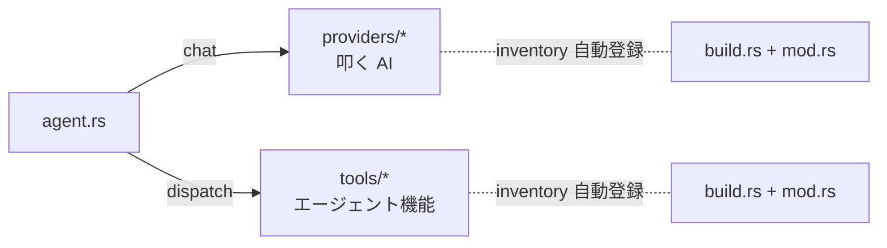

<div align="center">
  <h1>🐾 PicoAgent</h1>
  <p><strong>叩く AI とエージェント機能をコネクタで拡張できる、キャラクター + フキダシだけの透明デスクトップペット</strong></p>

  
  
  
</div>

<br />

> 透明な Tauri ウィンドウに常駐するデスクトップペット。バックエンドは Rust、フロントは webview。**Ollama 不要** — 推論エンジンを同梱し、初回起動時に PC のVRAM/RAM目安からローカルモデルを自動選定して取得します。**叩く AI（LLM バックエンド）** と **エージェント機能（ツール）** を、決まったフォルダへコネクタを足すだけで差し替え・追加できます。

---

## 📑 目次

- [🚀 クイックスタート](#-クイックスタート)
- [✨ 特徴](#-特徴)
- [🧩 コネクタの仕組み](#-コネクタの仕組み)
- [🖱 使い方](#-使い方)
- [⚙️ 設定](#️-設定)
- [📦 製品ビルド（配布）](#-製品ビルド配布)
- [📁 フォルダ構成](#-フォルダ構成)
- [🛟 トラブルシューティング](#-トラブルシューティング)

> [!NOTE]
> アーキテクチャ・コネクタ仕様の詳細は **[SPEC.md](SPEC.md)**、AI エージェント向け作業ルールは **[AGENTS.md](AGENTS.md)** を参照してください。

---

## 🚀 クイックスタート

前提: **Rust（cargo）** と **Node.js ≥ 20**。Windows は WebView2 ランタイム、macOS は Xcode Command Line Tools（`xcode-select --install`）が必要です。macOS で同梱 Aivis を事前取得する場合は `brew install p7zip`。**Ollama は不要**です。

```powershell
npm install
npm run setup:engine   # 同梱推論エンジン(llama-server、Windows は Vulkan/GPU 版)を取得
npm run setup:whisper  # ローカルWhisper CLI とモデルを取得（録音文字起こしを使う場合）
npm run setup:live2d   # Live2D ランタイムとサンプルモデル「ひより」を取得（npm run dev でも自動実行）
npm run dev
```

- 既定の叩く AI は **`local`（同梱エンジン）**。初回起動時に `PICOAGENT_LOCAL_MODEL_PRESET=auto` が PC のVRAM/RAM目安から Gemma 4 系の `small` / `balanced` / `large` を選び、対応する GGUF を自動ダウンロードします。以後はオフラインで動作します。手動選択では Gemma / Qwen / Llama / Mistral / Phi 系の主要 GGUF プリセットも選べます。設定画面ではローカルモデルを「種類 → サイズ」で選択でき、推奨VRAM・推奨RAM・ダウンロード目安を表示します。ダウンロード中はキャラクターの吹き出し下に「モデルを準備中… NN%」と表示され、モデル変更時は必要なモデルを取得して同梱エンジンを再起動します。設定画面の「叩くAI」タブには「ダウンロード済みモデル」セクションがあり、取得済み GGUF を一覧・サイズ確認し、使わないモデルを削除してディスクを空けられます（使用中のモデルは削除できません）。
- Ollama を使いたい場合は `ollama serve` 後に右クリック →「設定…」でプロバイダを切り替えます（任意）。Ollama 選択時はローカルのモデル一覧を読み込み、モデル欄から選べます。

> [!NOTE]
> 初回の `npm run dev` / `npm run build` は Rust の crate 取得・コンパイルで時間がかかります（ネットワーク必須）。モデル DL も初回のみネットが必要です。

OpenAI / Claude / Gemini / DeepSeek / xAI Grok / Mistral などのクラウド系の叩く AI を使う場合（費用が発生します）は、起動後に右クリック →「設定…」でプロバイダ、API キー、モデルを設定します。主要プロバイダは「叩くAI」タブ内でモデルを「種類 → サイズ」から選べます。

---

## ✨ 特徴

- **Ollama 不要・ローカル完結** — 推論エンジン同梱、初回 DL の gemma4 でそのまま動く（既定 `local`）。
- **叩く AI を差し替え可能** — local / Ollama / OpenAI 互換 / Claude / Gemini / DeepSeek / xAI Grok / Mistral を同梱。コネクタを足せば他社 AI にも切替できる。
- **エージェント機能を追加可能** — ツールコネクタを足すと、モデルが function calling で呼び出せる。
- **スーパーエージェントモード** — 設定でONにすると、複雑な依頼を計画→多段ツール実行→自己評価まで自律的に回し、必要なら `subagent` スキルでサブタスクを分担する。計画と実行ステップ、実行中のツールはフキダシ上部のステータス行にリアルタイム表示する。
- **原則Web検索** — 通常の質問ではローカルモデルの判断に頼らずWeb検索してから参照元のハイパーリンク付きで回答する。短い挨拶は検索に引っ張られないよう例外扱いし、キャラクター本人として返す。
- **設定画面ですべて設定** — 右クリック →「設定…」で叩く AI・モデル・接続先・API キー・ツール設定などを GUI 編集。軽い設定は保存で即反映、叩く AI・モデル・音声・キャラクターなど重い設定は確認のうえ再起動して起動画面でまとめて反映。
- **軽量な Tauri ネイティブ** — システム WebView を使い、Rust バックエンドで動作。
- キャラクターパックごとの連続フレームと状態別の滑らかな補間動作（待機 / 考え中 / 返答 / エラー）。
- **Live2D キャラクター対応** — `character.json` に `live2d.model`（`.model3.json`）を持つキャラは Cubism ランタイムで WebGL 描画し、まばたき・モーション・視線追従・声量連動の口パクをモデル自身が行う。サンプルとして Live2D 公式モデルの「ひより」「Haru」「Epsilon」を同梱（`npm run setup:live2d` で取得）。
- キャラクターごとに名前・挨拶・性格・口調・一人称を定義でき、設定画面でキャラ選択と人格の上書きが可能。
- 会話は選択中の叩く AI にのみ送られる。ローカル Ollama を使えば外部送信なし。

---

## 🧩 コネクタの仕組み



- **叩く AI を増やす**: `src-tauri/src/providers/` に `Provider` トレイトを実装した `.rs` を置き、`inventory::submit!` で登録。
- **エージェント機能を増やす**: プロジェクト直下の `skills/<スキル名>/mod.rs` に `Tool` トレイトを実装し、`inventory::submit!` で登録。

`build.rs` が `.rs` を自動で `mod` 取り込みし、再ビルドで**自動登録**されます（`mod.rs` 編集不要）。書き方は [SPEC.md](SPEC.md#新しいコネクタの作り方) を参照。

---

## 🖱 使い方

- フキダシをクリック: 入力欄を開く
- フキダシ上部の小ボタン: 回答コピー・再読み上げ・停止・拡大
- フキダシ右下のつまみをドラッグ: フキダシの幅・高さを変更（位置も含めて自動保存）
- キャラクターをダブルクリック: フキダシを全画面表示／元に戻す（`Esc` でも解除）
- 全画面フキダシ: 会話履歴を検索し、各履歴のコピーやユーザー発話の再利用が可能
- 読み上げ中に「読み上げを中止」またはキャラクターをクリック: 読み上げを停止
- `Enter` または `Ctrl + Enter`: 送信 / `Shift + Enter`: 改行 / `↑` `↓`: 過去の入力を呼び戻す / `Esc`: 入力欄を閉じる
- 入力欄上部のクイック操作: 画面確認・クリップボード要約・今日の予定・できること確認をワンクリックで送信
- キャラクターをドラッグ: 移動
- 右クリック: **設定…**・**常に手前に表示**・**PicoAgent を終了**（フキダシ本文や入力欄の上ではコピーなど通常メニューを優先）。チャットで「アプリ終了して」「PicoAgent を閉じて」のように頼んでも、アプリ操作スキル経由で終了できます。

---

## ⚙️ 設定

右クリック →「**設定…**」で設定ウィンドウを開き、すべての設定を編集できます。設定は `app_config_dir/config.json`（個人 PC ローカル）に保存されます。文字サイズ・常に手前・人格・自発雑談などの軽い設定は保存すると即反映します。**叩く AI・モデル・音声（Aivis）・キャラクターの切り替えなど重い設定は、保存時に「再起動して反映します」の確認画面が出て、承諾すると再起動し、モデル取得やエンジン起動を起動画面（ローディング）でまとめて行います**（フキダシに「準備中…」を出さないため）。この再起動相当の反映では設定ウィンドウを閉じ、古い設定画面を残しません。「あとで」を選んでも設定は保存され、次回起動時に反映されます。

会話履歴は**キャラクターごと**に `app_data_dir/history-<キャラクターID>.json`（個人 PC ローカル）へ保存され、起動時とキャラクター切替時にそのキャラの直近の会話を文脈と全画面フキダシの履歴表示へ復元します（再起動やキャラ切替をまたいで直近の話を踏まえて話し、別キャラの口調・自己紹介が混ざりません）。さらに、好み・自己情報・継続指示らしい発話だけを暗黙的な長期メモリとして `app_data_dir/memory.json` に保存し、次回以降の会話で参照します。履歴（選択中キャラ分）とメモリを消したいときは右クリック →「**会話をリセット**」を選びます。応答中にリセット・キャラ切替・設定反映をした場合、古い応答は戻ってきても履歴や画面へ書き戻しません。

目覚まし時計は、チャットで「**平日の7時に起こして**」「土日の朝8時、繰り返しで」のように頼むと設定できます（声でやさしく起こします）。一覧・削除も「アラーム一覧」「その目覚ましを消して」で操作でき、設定画面の「スキル」タブからも編集できます。鳴った後は `おきたよ！` を押すまで既定5分おきに再通知します。アプリ起動中のみ鳴ります。

日常補助として、「**15分後に洗濯物を取り込むって教えて**」のようなリマインダー、「**25分集中タイマー**」「**1時間おきに作業を見守って**」、おでかけ前チェック、できたことメモ、クリップボード要約も使えます。クイック操作には未読メール要約、Slack最新要約、予定確認もあり、保存済みの Gmail / Slack / Googleカレンダー設定を使って読み取りから要約まで頼めます。Gmail はラベル一覧、ラベル付け/解除、アーカイブ、既読/未読化、検索条件に一致するゴミメールのゴミ箱移動にも対応し、検索条件ベースの整理/掃除は preview 後に `confirm=true` で実行します。整理/掃除の既定件数上限は `PICOAGENT_GMAIL_CLEANUP_MAX_RESULTS` で変更でき、`0` で無制限にできます。会議系では「**会議の録音を開始して**」「**音声を文字起こしして**」「**話者分類つきで議事録にして**」のように頼むと、共通ワークスペース配下の `meetings/YYYY-MM-DD/` に日付つきWAVを保存し、設定したローカルWhisper系コマンドで文字起こしし、同じ録音名に対応する議事録Markdownを作れます。スキル一覧では既存音声の文字起こしは「音声文字起こし」、録音から議事録までのまとまった会議作業は「会議記録」として表示します。調査系では「**AIスライド生成サービスを出典付きで調査してレポートにして**」のように頼むと、複数観点のWeb検索を束ねて Markdown の調査レポートを作成し、保存時は1ページ要約、HTMLダッシュボード、スライド下書き、出典CSV/JSONも許可ルート配下へまとめて出力できます。「**Gensparkみたいに資料一式を作って**」のように頼むと、brief、deck、sheet、共有HTMLページ、エージェント実行計画、プロンプト集、チェックリストを同じフォルダへ生成できます。「**Genspark風の機能を全部やって**」では、Deep Research、AI Slides、AI Sheets、AI Docs、Sparkpage、Autopilot、AI Drive、Meeting Notes、Multi-Agent、AI Browser計画の10系統をまとめて生成します。さらに、文字数分析、JSON整形、Base64、URL変換、単位換算、日付計算、CSV表化、色変換など30種類のローカル実用ツールも設定なしで使えます。操作系の依頼はWeb検索よりローカルスキルを優先します。

cron 風のタスクスケジューラも使えます。「**毎朝9時に git status を実行して**」「**平日18時に天気スキルを実行して**」のようにチャットで登録でき、設定画面の「スキル設定」タブでも専用フォームから `PICOAGENT_SCHEDULED_TASKS` を編集できます。実行結果は `app_data_dir/schedule-runs.json` に直近100件保存し、メイン画面の通知一覧では直近20件を確認・再実行できます。コマンド実行は `run_command` と同じく `PICOAGENT_COMMAND_ENABLED=true` を前提に、許可ルートと allowlist で守ります。チャット中に未登録コマンドや許可ルート外 cwd が必要になった場合は、その場で「許可」（今回だけ）/「永続許可」（設定へ保存）/「キャンセル」を選べます。スキル実行は `kind=tool` として `tool_name` / `tool_args` を保存します。`C:\Windows` と `C:\Program Files*` 配下は編集不可です。スキル経由のファイル削除は `trash_file` でOSのゴミ箱へ移動するだけにし、許可ルート外、許可ルートそのもの、保護ディレクトリは拒否します。`run_command` でも `rm` / `del` / `Remove-Item` / `git clean` などの物理削除コマンドは実行しません。

設定画面の項目は「基本」「キャラクター」「音声」「叩くAI」「スキル設定」「許可」「スキル活用ガイド」「診断」のタブで構成されます。「許可」タブでは、全スキル共通のファイル/ディレクトリ/実行の許可ルート（`PICOAGENT_ALLOWED_ROOT` ほか）と拒否パスをまとめて設定できます（`C:\Windows` と `Program Files` は常に拒否）。各スキルの個別許可ルート設定は廃止し、この共通設定を参照します。キャラクター一覧には小さな顔アイコンを表示します。診断タブでは選択中プロバイダ、同梱エンジン、Aivis、トークン使用量、スキル実行状況を確認できます。スキル活用ガイドでは区分・できること・頼み方例を一覧でき、ジャンル（日常／検索・情報／ファイル・実行／連携／SNS・投稿／文書／その他）のチップで絞り込めます。スキル設定は日常・検索/情報・連携などのカテゴリ見出しで整理され、同じジャンルチップで絞り込めます。各スキルカードの設定（⚙）は既定で折りたたまれ、カードをクリックすると開きます。APIキー・OAuth token・Webhook URL が必要な項目には、取得手順と公式リンクをまとめた設定ガイドを表示します。チャットで「Gmail のトークンの取り方」「OpenAI APIキーはどこ」のように聞いた場合も同じ内容を案内します。各スキルカードには設定不要/未設定/一部設定/設定済みの状態バッジと承認ポリシー（低リスク、外部読取、書込/変更、送信前確認、実行前確認）を表示します。Gmail / Slack / Googleカレンダーは保存済み設定で接続テストでき、失敗時は token 未設定・権限不足・対象ID不一致・接続問題などの原因候補も表示します。目覚ましとタスクスケジュールは JSON 直書きではなく専用フォームで編集できます。叩くAIタブは現在選択中のプロバイダ設定だけを表示し、未使用プロバイダのAPIキー欄やモデル欄は畳み込みます。下表は区分（基本／音声／叩くAI／スキル名）ごとにまとめています。使うスキルの欄だけ見れば十分です。

#### 主要設定

README では、ユーザーが直接触ることが多い設定だけを用途別に載せます。全キーの正確な一覧と内部保存値は [SPEC.md](SPEC.md#設定キー一覧) を参照してください。

| 用途 | 主なキー | 説明 |
|---|---|---|
| 叩くAI | `PICOAGENT_PROVIDER` / `PICOAGENT_MODEL` | 使用するプロバイダとモデル。既定は同梱ローカルエンジンの `local` |
| ローカルモデル | `PICOAGENT_LOCAL_MODEL_PRESET` / `PICOAGENT_MODEL_URL` | 同梱エンジンで使うモデルプリセットやカスタムGGUF URL |
| ローカル文字起こし | `PICOAGENT_TRANSCRIBE_PROGRAM` / `PICOAGENT_TRANSCRIBE_MODEL` / `PICOAGENT_TRANSCRIBE_DIARIZE_ARGS` | Whisper系ローカルコマンド、モデル、話者分類オプション。手動設定が最優先、空なら PicoAgent 管理下の `resources/bundled/whisper/` に置いた同梱Whisper CLIを使う。同梱Whisperはサーバを立てずポートを使わない |
| OpenAI互換 | `OPENAI_BASE_URL` / `OPENAI_API_KEY` / `OPENAI_MODEL` | OpenAI互換プロバイダを使う場合だけ設定 |
| Claude | `PICOAGENT_ANTHROPIC_API_KEY` / `PICOAGENT_ANTHROPIC_MODEL` | Claude プロバイダを使う場合だけ設定 |
| DeepSeek | `PICOAGENT_DEEPSEEK_API_KEY` / `PICOAGENT_DEEPSEEK_MODEL` / `PICOAGENT_DEEPSEEK_THINKING` | DeepSeek プロバイダを使う場合だけ設定 |
| Gemini | `PICOAGENT_GEMINI_API_KEY` / `PICOAGENT_GEMINI_MODEL` | Gemini プロバイダを使う場合だけ設定 |
| xAI Grok | `PICOAGENT_XAI_API_KEY` / `PICOAGENT_XAI_MODEL` | xAI Grok プロバイダを使う場合だけ設定 |
| Mistral | `PICOAGENT_MISTRAL_API_KEY` / `PICOAGENT_MISTRAL_MODEL` | Mistral プロバイダを使う場合だけ設定 |
| Ollama | `OLLAMA_HOST` / `OLLAMA_MODEL` | 任意で外部 Ollama を使う場合だけ設定 |
| キャラクター | `PICOAGENT_CHARACTER` / `PICOAGENT_CHARACTER_OVERRIDES` | 使用キャラとキャラ別の口調・人格上書き |
| 表示 | `PICOAGENT_THEME` / `PICOAGENT_BUBBLE_FONT_PX` / `PICOAGENT_ALWAYS_ON_TOP` | 表示テーマ（既定はシステム設定に追従）、フキダシ文字サイズ、常に手前表示 |
| 音声 | `PICOAGENT_TTS_ENABLED` / `PICOAGENT_TTS_VOLUME` | Aivis 読み上げ、キャラボイス音量。デバイス・ポート・話者IDは内部既定値を使い、通常の設定画面には出しません |
| メモリ | `PICOAGENT_MEMORY_ENABLED` / `PICOAGENT_MEMORY_MAX_ITEMS` | 会話から好みや継続指示を暗黙的に覚えるか |
| スーパーエージェント | `PICOAGENT_SUPER_AGENT` / `PICOAGENT_SUPER_AGENT_MAX_STEPS` / `PICOAGENT_SUBAGENT_MAX_DEPTH` | 計画→実行・自己評価・サブエージェント分担を強化する自律モード。ON にするとループ上限が上がり、進捗（計画・実行ステップ・実行中ツール）をフキダシ上部のステータス行に表示する |
| 自発雑談 | `PICOAGENT_CHATTER_ENABLED` / `PICOAGENT_CHATTER_TOPIC_MODE` | アイドル時の雑談と話題ソース |
| 目覚まし | `PICOAGENT_ALARMS` | 設定画面では専用フォームで編集。通常はチャットで設定 |
| タスクスケジュール | `PICOAGENT_SCHEDULED_TASKS` | `kind=command` / `kind=tool` の指定時刻タスク。設定画面では専用フォームで編集。通常はチャットで設定 |
| 許可（共通） | `PICOAGENT_ALLOWED_ROOT` / `PICOAGENT_ALLOWED_PATHS` / `PICOAGENT_DENIED_PATHS` | 全スキル共通のファイル/ディレクトリ/実行の許可ルート・拒否パス。設定画面の「許可」タブで編集。`C:\Windows` と `Program Files` は常に拒否 |
| ローカル操作 | `PICOAGENT_COMMAND_ENABLED` / `PICOAGENT_COMMAND_ALLOWLIST` | コマンド実行（run_command）の有効化と許可コマンド prefix。許可ルートは共通「許可」を参照 |
| 自力実行 | `PICOAGENT_CODE_RUNNER_ENABLED` / `PICOAGENT_CODE_RUNNER_PYTHON` | 他スキルで満たせないときに PowerShell/Python のコードを書いて実行する code_runner の有効化と Python パス。既定は無効 |
| 情報取得 | `PICOAGENT_WEATHER_DEFAULT_LOCATION` / `PICOAGENT_WEB_SEARCH_MAX_RESULTS` / `PICOAGENT_NEWS_SCRAPE_MAX_ITEMS` / `PICOAGENT_RSS_DEFAULT_URL` / `PICOAGENT_RESEARCH_TIMEOUT_SECS` | 天気・検索・ニュース取得・RSS・調査レポートなどの既定値 |
| 外部連携 | 各サービスの token / 既定ID / timeout / Gmail整理上限 | Slack、Gmail、Google、GitHub、Notion、SNS などは使うサービスだけ設定。`PICOAGENT_GMAIL_CLEANUP_MAX_RESULTS=0` で Gmail 整理/掃除の件数上限を無制限にできる |

リマインダー、集中タイマー、できたことメモなどの実行状態は内部保存値として `config.json` に残りますが、通常ユーザーが直接編集するものではないため設定画面には出しません。チャット操作で追加・一覧・削除してください。

> [!TIP]
> 各キーは環境変数としても渡せます（既定値としての参照のみ。保存先は常に `config.json`）。

---

## 📦 製品ビルド（配布）

```powershell
npm run setup:engine   # 同梱エンジンを resources/bundled/engine へ取得（未取得の場合）
npm run setup:whisper  # 同梱Whisperを resources/bundled/whisper へ取得（録音文字起こしを使う場合）
npm run setup:live2d   # Live2D ランタイムとサンプルモデルを取得（未取得の場合）
npm run build
```

`src-tauri/target/release/bundle/` に各 OS の標準バンドル（Windows は NSIS、macOS は `.app` / `.dmg` など）が生成されます。`npm run dev` / `npm run build` は起動前に同梱エンジン、Aivis、Whisper CLI、Live2D ランタイム＋サンプルモデルを確認し、未取得なら `src-tauri/resources/bundled/` 配下の各専用ディレクトリへ取得してから Tauri を起動します。macOS / Linux で Aivis の `.7z.001` 展開に `7z` / `7za` が無い場合、音声同梱の事前取得だけを警告扱いにして起動を続行します（音声を必須にする場合は `AIVIS_REQUIRED=1 npm run setup:aivis`）。同梱Whisperは `resources/bundled/whisper/` だけに配置し、アンインストール時も PicoAgent 管理下の同梱ディレクトリと一時ディレクトリだけを削除します。Aivis 同梱により Windows インストーラの入力データが大きいため、NSIS 圧縮は生成安定性を優先して `zlib` にしています。

macOS / Linux では、取得・コピーした `llama-server` / `whisper-cli` / Aivis `run` に実行権限を付け直してから起動します。`.app` 配下など実行時に chmod できない場所は補正失敗だけで止めず、実際の起動結果で判定します。

配布ビルドでは `scripts/build-ui-dist.mjs --release` が `ui/` を `ui-dist/` へコピーし、HTML/CSS のコメントと余分な空白、JS の空行・行頭行末空白を削ったものを `frontendDist` として同梱します。Rust 側の release profile は LTO・strip・panic abort・debug 情報無効化を有効化しています。これは解析を不可能にするものではありませんが、配布物から読みやすいソースやシンボル情報を減らすための基本対策です。

#### Live2D ランタイムとサンプルモデル

- **取得**: `npm run setup:live2d` が Cubism Core / PIXI / pixi-live2d-display を `ui/vendor/live2d/` へ、Live2D 公式サンプルモデル「ひより」「Haru」「Epsilon」を `characters/<id>/live2d/` へダウンロードします（`LIVE2D_FORCE=1` で再取得）。各サンプルの `preview.jpg` はローディング画面と設定画面アイコンに使います。
- **ライセンス**: Cubism Core は [Live2D Proprietary Software License](https://www.live2d.com/eula/live2d-proprietary-software-license-agreement_jp.html)、サンプルモデルは [Live2D Free Material License](https://www.live2d.com/eula/live2d-free-material-license-agreement_jp.html) の条件で利用してください。再配布条件があるため、これらのファイルはリポジトリへコミットしません（`.gitignore` 済）。

> [!NOTE]
> 以下のパスはいずれも Windows 表記です。macOS / Linux では同等のユーザーデータ配下（`PicoAgent/...`）に読み替えてください。

#### 同梱推論エンジン（llama-server）

- 実行ファイルは配布物へ同梱しますが、モデル GGUF（数 GB）は含めず、初回起動時に `%APPDATA%\PicoAgent\bundled\models\` へ取得します。
- `llama-server` を実行時配置で差し替える場合は `%APPDATA%\PicoAgent\bundled\engine\` を優先して探します。

#### 同梱 Aivis（読み上げ）

- **取得**: 公式 GitHub Releases から既定 `1.2.0` の実行ファイル一式を `src-tauri/resources/bundled/aivis/` へ展開します（手動実行は `npm run setup:aivis`、更新時は `AIVIS_RELEASE=latest` またはタグを指定）。
- **配布**: このフォルダは `tauri.conf.json` の `bundle.resources` 対象なので配布物に含まれます（巨大ファイルやライセンス確認が必要な実体は Git には含めません）。配布後に見つからない場合は、初回の読み上げ起動時に同じリリースを `%APPDATA%\PicoAgent\bundled\aivis\` へ自動取得・展開します（展開には `7z` / `7za` / `tar` のいずれかを使用。macOS の `.7z.001` は `brew install p7zip` で `7z` を入れてください）。
- **起動**: `PICOAGENT_TTS_ENABLED` が有効ならアプリ起動時に内部ポート（既定 `11436`）で裏起動します。旧既定の `10102` が保存済みなら起動時に `11436` へ移行します。アプリが起動した子プロセスは終了時に停止します。
- **推論デバイス**: 内部設定 `PICOAGENT_TTS_DEVICE` の既定 `auto` で起動前に GPU 候補を確認し、候補があれば GPU、なければ CPU で起動します。通常の設定画面には表示しません。
- **話者（speaker ID）**: 通常の設定画面には表示せず、キャラクター既定声を使います。`りん` は既定で AivisHub の「るな」（モデル UUID `4f281e78-eba6-495a-8e50-5c322d02b5b1`、話者 UUID `aa63d66e-92fe-499e-9e0d-15dad4a61d0d`、スタイル名「ノーマル」）、`まい` は AivisHub の「まい」（モデル UUID `e9339137-2ae3-4d41-9394-fb757a7e61e6`、話者 UUID `41b7785f-35cc-4089-a360-dd8a63da5e75`、スタイル名「ノーマル」）を使います。Live2D キャラも同様に、`ひより` は「まお」、`はる` は「花音」、`イプシロン` は「コハク」（いずれも AivisHub・スタイル名「ノーマル」）を既定声に使います。未導入なら起動シーケンスのローディング画面で AIVMX を AivisSpeech Engine へ追加し、合成時は `/speakers` から実際の style ID を解決します。
- **音量**: `PICOAGENT_TTS_VOLUME`（0〜100）でフロント再生時のキャラボイス音量を調整します。設定保存後すぐ反映し、再生中の音声にも効きます。

> [!NOTE]
> 同梱 Aivis の初回起動はモデル確認や BERT 読み込みで数十秒かかることがあります。キャラクター固有の AivisHub 音声モデルは起動シーケンス中に「声を準備中…」として導入するため、導入待ちは通常画面ではなくローディング画面に集約されます。

#### ログ

`%APPDATA%\PicoAgent\log\` にまとめて保存します。**1 日ごとに日付付きファイル（例 `app.2026-06-28.log`）へローテートし、1 週間より古いログは起動時と 1 日ごとに自動削除します**（会話履歴はログではないため対象外）。

| ファイル（`<日付>` は `YYYY-MM-DD`） | 内容 |
|---|---|
| `app.<日付>.log` | アプリ本体とフロントのエラー |
| `aivis.<日付>.log` | Aivis の起動ログ（起動失敗時は末尾がエラー表示に含まれる） |
| `engine.<日付>.log` | 同梱 llama-server のログ |

#### 識別子・データ・署名

- アプリ識別子は `com.picoagent.desktop`（旧 `com.picoagent.app` / `com.coda.app`。初回起動時に旧識別子配下の `config.json` / `history.json` / `memory.json` を現行へコピー移行）。設定・履歴・メモリは `app_config_dir` / `app_data_dir` 配下、同梱系の実行時取得物は `PicoAgent/bundled/`、ログは `PicoAgent/log/` に保存します。アイコンは `src-tauri/icons/`（`npx tauri icon src-tauri/icon-source.png` で再生成）。
- NSIS アンインストーラは関連プロセスを停止後、`%APPDATA%\PicoAgent\` / `%LOCALAPPDATA%\PicoAgent\`、現行・旧識別子の設定・キャッシュ、専用一時ディレクトリを削除します。Aivis 子プロセスの `APPDATA` / `LOCALAPPDATA` は `%APPDATA%\PicoAgent\aivis-userdata\` へ向けるため、Aivis のモデル・辞書・キャッシュもアンインストール対象に含まれます。
- コード署名（Authenticode）・自動更新（`tauri-plugin-updater`）はリリース時に鍵・証明書を用意して有効化します（現状は未設定）。

---

## 📁 フォルダ構成

```text
20_PicoAgent/
├── characters/          ← キャラクター正本（index.json・人格定義・連番フレームまたは Live2D モデル）
├── skills/              ← エージェント機能（スキル）コネクタ（<スキル名>/mod.rs と補助ファイルを同梱）
├── ui/                  ← webview フロント（picoagent.js シム・ペット UI・設定画面）
│                          ※ assets/characters/ は characters/ の配信コピー、vendor/live2d/ は Live2D ランタイム（いずれも自動取得・生成）
├── src-tauri/
│   ├── Cargo.toml / build.rs / tauri.conf.json / capabilities / icons
│   └── src/
│       ├── main.rs / lib.rs / commands.rs / menu.rs
│       ├── config.rs / agent.rs / message.rs
│       ├── providers/   ← 叩く AI コネクタ（.rs を足すと自動登録）
│       └── tools/mod.rs ← スキルの Tool トレイト・レジストリ本体
├── scripts/             ← fetch-engine.mjs / sync-characters.mjs / build-character-animations.py
├── README.md / SPEC.md / CHANGELOG.md / AGENTS.md / CLAUDE.md
```

---

## 🛟 トラブルシューティング

- **「モデルを準備中…」のまま** → 初回のモデル DL 中（数 GB）。ネット接続を確認。`PICOAGENT_MODEL_URL` を変えると別モデルを取得。
- **「準備に失敗」と出る** → `npm run setup:engine` でエンジンが入っているか、DL 元 URL が有効か確認。
- **原因を切り分けたい** → 右クリック →「設定…」→「診断」で同梱エンジン、Aivis、選択中プロバイダ、使用量、スキル実行状況を確認。
- **オンライン表示が赤い / 応答しない（Ollama 利用時）** → `ollama serve` を起動。設定の `OLLAMA_HOST` も確認。
- **AIプロバイダで OpenAI が「未接続」** → `OPENAI_API_KEY` 未設定。設定画面で入力して保存。
- **ツールが呼ばれない** → モデルが function calling 非対応の可能性。`qwen3:8b` などツール対応モデルを使う。
- **`read_file` などファイル操作が拒否される** → 許可ルート（既定はホーム）外、または保護パス（`C:\Windows` / `Program Files`）。設定画面の「許可」タブで `PICOAGENT_ALLOWED_ROOT` や追加許可ルートを設定するか、許可ルート配下のパスを指定。
- **Web検索に失敗する** → インターネット接続を確認。短時間の連続検索で拒否された場合は、時間を置いて再試行。
- **天気・為替・RSSに失敗する** → インターネット接続、地点名、通貨コード、RSS URL を確認。
- **外部サービス連携に失敗する** → Slack / Gmail / Google Calendar / Google Docs / Google Drive / Google Sheets / GitHub / Notion / Discord / Microsoft Graph / Jira / Linear / Trello / Todoist の各 token、Webhook URL、OAuth scope、対象IDを確認。秘密値は設定画面に保存し、ログやドキュメントへ値を書かない。
- **SNS連携に失敗する** → X / Mastodon / Bluesky / Reddit / LinkedIn / Misskey の token、app password、投稿権限、APIプラン、インスタンスURL、User-Agent を確認。
- **Office/PDF 操作に失敗する** → 共通「許可」タブの許可ルート（`PICOAGENT_ALLOWED_ROOT` ほか）、Microsoft Office + PowerShell、LibreOffice（`soffice`）、qpdf の実行ファイルパスを確認。Google Docs/Sheets はローカルファイルではなく専用APIスキルを使う。
- **`code_runner`（自力実行）が動かない** → 既定で無効。設定画面の「スキル設定」タブの `code_runner` カードで `PICOAGENT_CODE_RUNNER_ENABLED` を true にする。Python を使う場合は `PICOAGENT_CODE_RUNNER_PYTHON` に実行パスを設定。作業先は共通「許可」タブの許可ルート配下のみ。物理削除コードは拒否される。
- **`run_command` が拒否される** → 既定では無効。設定で有効化し、`PICOAGENT_COMMAND_ALLOWLIST` に実行したい `program args...` の prefix を追加する。shell は使わず `program` と `args` を分けて実行する。
- **`npm run dev` が遅い / 失敗する** → 初回は Rust のコンパイルに時間がかかります。Rust（cargo）と WebView2 が入っているか確認。
- **macOS で Aivis の取得だけ失敗する** → `.7z.001` 展開用の `7z` が無い状態です。音声なしの起動は続行できます。読み上げも使う場合は `brew install p7zip` 後に `AIVIS_FORCE=1 npm run setup:aivis` を実行してください。失敗を警告ではなくエラーにしたい場合は `AIVIS_REQUIRED=1` を付けます。
- **ビルドが `os error 32`（別のプロセスが使用中）で失敗する** → 前回の `llama-server` やアプリ本体が残って同梱 DLL を掴んでいる状態。`npm run dev` / `npm run build` は Tauri 起動前に `scripts/stop-stale.mjs` を同期実行して残存プロセスを停止する。macOS / Linux ではプロセス名完全一致と PicoAgent 管理下の Aivis `run` だけを対象にする。手動で止めたいときは `npm run stop`。
- **`npm run dev` 起動直後に `picoagent.exe (exit code: 1)` で落ちる** → 前回起動の `picoagent.exe`（とその WebView2 子プロセス）が残ったまま新インスタンスが起動し、WebView の生成が一時的に競合した状態。`npm run dev` は残存プロセスを停止後、実際に消えるまで待ってから Tauri を起動する。手動停止は `npm run stop`。
