<div align="center">

<h1>🐾 PicoAgent</h1>

<p><strong>ローカルで完結する、キャラクター型 AI エージェント。</strong><br />
透明ウィンドウに常駐するデスクトップペットへ、<b>75 種のスキル</b>と<b>9 系統の叩く AI</b> をぶら下げた Rust / Tauri 製の常駐アプリです。<br />
叩く AI もエージェント機能もコネクタを足すだけで増え、1 体で決めきれない依頼は複数の AI へ合議・分担させられます。</p>


<table>
  <tr>
    <th width="50%">2D / 2.5D</th>
    <th width="50%">Live2D</th>
  </tr>
  <tr>
    <td></td>
    <td></td>
  </tr>
</table>
<sub>枠なしの透明ウィンドウ。デスクトップにフキダシとキャラクターだけが浮かびます。実際の動きです。</sub>

**[公式ページ・Windowsアルファ版ダウンロード](https://benybeny777.github.io/PicoAgent-Distribution/)**

</div>

> [!NOTE]
> このREADMEは開発版 `main` の説明です。マージ済みの機能が公開インストーラーに入っているとは限りません。公開中の版と変更点は公式ページを見てください。
> アルファ版は Pro 対象を含む全機能を試用でき、正式リリースでは Free／Pro の制限を有効にします。

## 3 行で

- **ローカルAIを同梱。** 初回起動時にPCのVRAM／RAMからモデルを選んで取得し、以後はオフラインでも動きます。Ollama やクラウドAIにも切り替えられます。
- **叩く AI は差し替え式。** `local` / Ollama / OpenAI 互換 / Claude / Gemini / DeepSeek / xAI Grok / Mistral / 手元の CLI エージェントの 9 系統。2〜8 体へ**合議・分担**させて 1 つの答えにまとめることもできます。
- **75種の機能を会話から実行。** Web検索、PC操作、画像・動画生成、文書処理、業務サービス連携まで、必要なツールをAIが選んで組み合わせます。

## 📑 目次

| | |
|---|---|
| [🚀 まず動かす](#-まず動かす) | 前提、起動、追加機能の取得、叩く AI の選択 |
| [✨ できること](#-できること) | エージェント・表示形式・ゲーム・キャラクター・スキル |
| [🎭 キャラクター](#-キャラクター) | 同梱キャラと Live2D の見た目、モーション対応、原画からの作成 |
| [🏗 しくみ](#-しくみ) | 設計の要点、アーキテクチャ、技術スタック |
| [🖱 使い方](#-使い方) | マウス・キーボード・ホットキー・ファイル受け渡し |
| [⚙️ 設定](#️-設定) | 設定画面、会話の記憶、保存場所、主要な設定キー |
| [📊 性能要件](#-性能要件) | 動作環境の目安、GPU 対応、上限とタイムアウト |
| [🔌 ローカル API](#-ローカル-api) | Ollama 風 / OpenAI 互換 / MCP |
| [🛟 困ったとき](#-困ったとき) | 症状別の対処 |

> [!TIP]
> 使いかたを通して読むなら **[MANUAL.md](MANUAL.md)**。仕様は [SPEC.md](SPEC.md)、全設定キーは [docs/SETTINGS.md](docs/SETTINGS.md)、開発・配布は [docs/DEVELOPMENT.md](docs/DEVELOPMENT.md)、残作業は [docs/TASKS.md](docs/TASKS.md)、AI エージェント向けの作業ルールは [AGENTS.md](AGENTS.md) です。

---

## 🚀 まず動かす

> [!IMPORTANT]
> **この節はソースから動かす開発者向けです。** 製品を使うだけなら、配布ページのインストーラを実行してください（Rust も cargo も要りません）。

```bash
git lfs pull                              # clone 直後の 1 回だけ
cargo install tauri-cli --version '^2'    # 初回だけ
cargo xtask dev
```

Windows ならリポジトリ直下の **`PicoAgentを起動.bat`** をダブルクリックしても同じです。起動中に開く黒い画面は PicoAgent を終了するまで閉じないでください。

開発起動とインストールした通常版は、完全に分かれています。開発起動の設定・会話履歴・追加キャラ・モデル・音声などは `%APPDATA%\PicoAgent-Dev\`（macOS / Linux は利用者データ領域の `PicoAgent-Dev/`）へ保存し、同梱物はリポジトリの `src-tauri/resources/bundled/` だけを使います。通常版は `%APPDATA%\PicoAgent\` とインストール先だけを使い、リポジトリの中身は読みません。どちらも、自分の場所に無いものを別の場所から探して使うことはしません。開発用の保存先はリポジトリの外にあるので、worktree や clone を作り直してもモデルなどの取得は最初の1回だけです。開発起動の前には残っているPicoAgentを止めるため、起動中の通常版も終了します。

### 前提

**対応 OS は Windows、macOS、Ubuntu Linux 24.04 LTS x64 です。** 販売版の配布は Windows 10/11 x64 から始め、macOS と Linux の一般配布は署名方針と実機QAが揃ってから行います。

| | 必要なもの |
|---|---|
| 共通 | **Rust 1.88以上（cargo）** / **Tauri CLI**（`cargo install tauri-cli --version '^2'`） / **Git LFS**（clone後に`git lfs pull`） |
| Windows | WebView2 ランタイム |
| macOS | Xcode Command Line Tools（`xcode-select --install`）。読み上げも使うなら `brew install p7zip` |
| Ubuntu Linux 24.04 x64 | 下記のパッケージ |

<details>
<summary>Ubuntu で必要なパッケージ</summary>

AppImage の音声に使う GStreamer は `base` と `good` だけを入れます（再配布条件の異なる `ugly` は入れません）。

```bash
sudo apt-get update
sudo apt-get install -y build-essential pkg-config curl ca-certificates git git-lfs \
  libgtk-3-dev libwebkit2gtk-4.1-dev libsoup-3.0-dev librsvg2-dev \
  libayatana-appindicator3-dev libasound2-dev libxdo-dev libclang-dev \
  libxcb1-dev libxrandr-dev libdbus-1-dev libpipewire-0.3-dev \
  libwayland-dev libegl-dev libgbm-dev patchelf squashfs-tools \
  gstreamer1.0-plugins-base gstreamer1.0-plugins-good
```

</details>

### 起動と検証

`cargo xtask dev` は、残存プロセスの停止・キャラクター同期・UI生成だけを行う**最小の開発起動**です。数GBの追加取得はしません。選択中の追加キャラや Live2D を読み込めない場合は、別キャラへ切り替えず、キャラなしの診断画面で理由を表示します。

| コマンド | 用途 |
|---|---|
| `cargo xtask verify` | PR 前の一括ローカル検証（書式・静的解析・テスト・JS 構文・画面の契約テスト・Git 差分）。途中で失敗しても最後まで実行し、失敗一覧を出す |
| `cargo xtask sync-characters` / `cargo xtask build-ui` | キャラクターまたはUIの生成物だけを更新（差分同期。全部作り直すときは `--force`） |
| `cargo xtask stop` | 残ったプロセスを停止（本体・同梱エンジンと、撮影ツールの `node`、PicoAgent 専用プロファイルのブラウザだけ。無関係な `node` や普段のブラウザは止めない） |

キャラクターだけを見たいときは **`キャラクター確認画面を開く.bat`** から、独自2.5D・MMD・登録済み Live2D を選べます。

### 追加機能を取得する（使うものだけ）

AIモデルなど数GBの取得は `setup` を明示したときだけ行います。取得済みなら以後はオフラインでも起動できます。

| コマンド | 取得するもの |
|---|---|
| `cargo xtask setup engine` | 同梱推論エンジン（llama-server。Windows は Vulkan / GPU 版） |
| `cargo xtask setup aivis` | 読み上げ（Aivis） |
| `cargo xtask setup whisper` | ローカル Whisper CLI とモデル（録音の文字起こし） |
| `cargo xtask setup live2d` | Cubism 4／5 モデル対応の Live2D ランタイム（サンプルモデルは含まない） |
| `cargo xtask setup mmd` | MMD のローカル描画ランタイム（Node.js と npm が必要。モデルは含まない） |
| `cargo xtask setup live2d-samples` | 利用条件を確認した開発者だけが公式サンプルを取得（製品ビルドには含まない。未取得でも `dev` / `build` は通る） |
| `cargo xtask setup office` | OfficeCLI（LibreOffice。Office ファイルの変換・PDF 出力） |
| `cargo xtask setup tools` | 精度向上用の OSS CLI（Pandoc / ripgrep / ffmpeg / ImageMagick ほか） |

- 全部必要なときだけ `cargo xtask setup all`。引数なしの `cargo xtask setup` は、不要な大容量取得を防ぐため実行しません
- 再取得は `TOOLS_FORCE=1` などの環境変数、対象を絞るなら `PICOAGENT_SETUP_TOOLS=pandoc,ripgrep`
- `cargo xtask build` も追加機能を取得しない軽量構成です。Aivis・Whisper・Office・外部CLIまで含めるときだけ `cargo xtask build-full`
- Ubuntu の配布確認は `cargo xtask setup engine` のあと `cargo xtask build --bundles deb,appimage`
- 公式のポータブル配布が無いツールは警告だけ出し、`apt` / `brew` で入れた PATH 上のツールを使います

### 叩く AI を選ぶ

既定は **`local`（同梱エンジン）** で、何も設定しなくても動きます。

- **ローカルモデル** — 初回は連続ツール利用を検証済みの LFM2.5 2.6B QAD Q4（約1.59GB）を選びます。設定画面「AIモデル」には実PCのRAMと、正確に取れた場合だけ専用VRAMを表示し、日本語対応の LFM2.5・Gemma 4・Qwen3.5・gpt-oss・Phi-4 mini を候補として案内します。利用者が選んだモデルは自動で変えません
- **GPU** — Windows は NVIDIA で `CUDA → Vulkan → CPU`、AMD で `ROCm → Vulkan → CPU`、Intel で `SYCL → Vulkan → CPU` の順に起動確認します。Ubuntu は Vulkan、macOS は Metal を使います
- **ディスク整理** — 「AIモデル」の「ダウンロード済みモデル」から一覧・サイズ確認・削除（使用中は削除不可。同じボタンを2回押したときだけ削除）
- **クラウド AI**（費用が発生します） — 右クリック →「設定を開く…」→「AIモデル」でプロバイダ・API キー・モデルを設定。OpenAI / Claude / Gemini / DeepSeek / xAI Grok / Mistral に対応
- **外部 Ollama** — `ollama serve` の後、設定画面でプロバイダを切り替えるとモデル一覧を読み込みます
- **手元の CLI エージェント** — Claude Code / Codex CLI が入っていれば、そのまま叩く AI として選べます。「アプリのデフォルト」なら各CLIの設定に従います

<details>
<summary>「手元の CLI エージェント」の動きかた</summary>

| 項目 | 内容 |
|---|---|
| 必要なもの | CLI のインストールとログイン（利用者側で先に用意） |
| 応答速度 | CLI の起動に毎回 1〜3 秒。ひと言の雑談より、まとまった依頼向き |
| セッション | 応答ごとにCLIは終了しますが、同じ会話では Claude Code の `session_id`／Codex の `thread_id` で再開します。別会話・別キャラ・設定変更・中断・失敗では新しく始めます。形式不明の `custom` CLI は単発です |
| ツールの境界 | Claude Code は safe mode・組み込みツールなし、Codex はユーザー設定なし・read-only sandbox で起動。ファイルや PC の操作は PicoAgent 側のスキル境界だけを通ります |
| スキルの呼び出し | CLI は function calling を受け付けないため、決められた JSON を返させる約束事でスキルを呼びます。通常のプロバイダより取りこぼしがありえます |
| 配布時の扱い | 利用者側の導入とログインが前提なので、配布・販売する構成の既定プロバイダにはしないでください |

</details>

---

## ✨ できること

### エージェント

- **スーパーエージェントモード** — 複雑な依頼を「計画 → 多段ツール実行 → 自己評価」まで自律的に回し、必要なら `subagent` スキルでサブタスクを分担。進捗はフキダシ上部のステータス行に表示
- **原則 Web 検索** — 通常の質問は検索してから参照元リンク付きで回答（短い挨拶はキャラクター本人として返答）
- **マルチAI合議・分担**（Pro 版の機能） — 複数の AI へ同じ質問を送ってまとめ役が統合したり、仕事を割り振ったりできます。AIごとにモデルと「担当の希望」を指定でき、空欄なら自動で割り振ります

| `PICOAGENT_MULTI_AI_MODE` | 動き |
|---|---|
| `single`（既定） | 選んだ叩く AI が 1 体で答える |
| `consensus` | 同じ質問を参加 AI 全員へ送り、まとめ役が 1 つの回答へ統合する |
| `collaborate` | まとめ役が仕事を割り振り、結果を 1 つへ統合する |
| `divide` | 割り振った結果を統合せず、AI ごとに並べて返す |

参加 AI は 2〜8 件。同梱ローカル AI 同士は直列、その他は `PICOAGENT_MULTI_AGENT_MAX_CONCURRENCY` まで並行実行します。単発より応答時間と API 利用量が増えます。

### 表示形式

画面上端へカーソルを合わせるとメニューが現れ、**「表示」**から画面レイアウトを直接切り替え、**「配置」**からOBS風の直接編集、**「キャラ選択」**と**「設定」**から各設定画面、**「遊ぶ」**からゲームを開けます。どれも再起動なしで反映します。

<div align="center">
  <table>
    <tr>
      <td width="25%" align="center"><br /><b>ミニ</b><br /><sub>キャラ中心。必要な時だけ会話</sub></td>
      <td width="25%" align="center">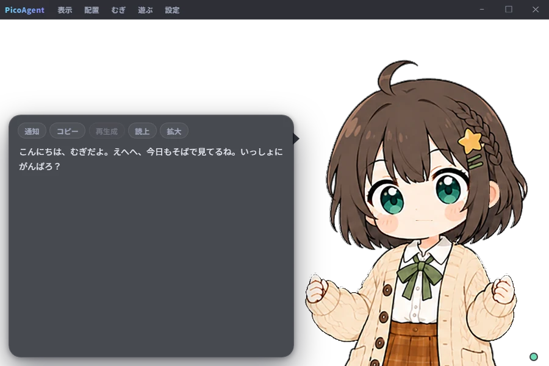<br /><b>ペット</b>（既定）<br /><sub>キャラ＋会話。ふだん使い</sub></td>
    </tr>
    <tr>
      <td align="center">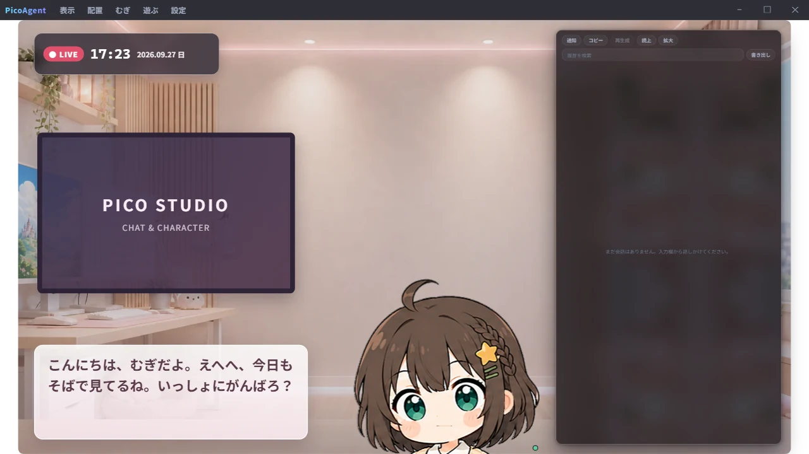<br /><b>配信</b><br /><sub>フルHD背景＋胸上キャラ＋字幕</sub></td>
    </tr>
  </table>
</div>

- 既定寸法はミニ360×560／ペット900×600／配信1920×1080。寸法は形式ごとに覚えます。以前の形式の保存値も保持します
- ウィンドウの辺をドラッグすると幅または高さ、四隅で縦横を変更。キャラをドラッグするとウィンドウが動きます
- 上端の「配置」から調整枠を出し、移動つまみと四隅で位置・大きさを変えられます。確定した矩形だけをキャラごと・表示形式ごとに保存します。配信ソースも同じ画面で組み合わせられます
- 起動準備中はウィンドウを出さず、キャラ・ローカルAI・音声・最初の挨拶が揃ってから表示します。準備が長いときに呼び出しホットキーを押すと、進捗と起動ログの待ち画面が出ます

### 人間だとバレるな（AIものまねゲーム）

「遊ぶ」から始める一人用ゲームです。AI疑惑をかけられた人間として、監査AIの試験に**AIのふりで**答え続け、信用度（100から開始）が0になるまでの点数で称号が決まります。お題は12種類から毎問引き直し、難易度は やさしい／ふつう／むずかしい の3段階。記録はこの端末だけに保存し、会話履歴・長期メモリには入りません。詳しいルールは [MANUAL.md](MANUAL.md) を見てください。

### ローカル画像入力

Gemma 4 E2Bに画像を添付し、写真の説明、画像内の文字の読み取り、スクリーンショットの相談ができます。`cargo xtask setup local-vision` で約0.99GBの追加資産を導入し、AIモデル設定で「ローカル画像入力」を有効にしてください。通常チャットとゲーム操作で同じモデル・資産を共有し、ゲームプレイの有効化は不要です。画像生成・画像編集は別機能です。細かな文字や数値の精度は実画像で確認してください。

### ゲームプレイ（Windows・初期実装）

PicoAgentへ「トルネコを1手進めて」と依頼すると、ローカル画像対応LLMで画面認識・1操作選択・結果確認を行う専用スキルです。既定では無効で、対象ウィンドウ名と確認済みキーの設定が必要です。Gemma 4 E2B用の画像認識追加資産（約0.99GB）は `cargo xtask setup local-vision` で明示導入します。停止ボタン、依頼ごとの上限、前面確認を通し、不明な認識や画面変化で止まります。**実ゲームでの安定動作、1フロア探索、連続録画は未確認・未実装です。** 手順は[ゲームプレイの準備](MANUAL.md#ゲームプレイの準備windows)を参照してください。

### キャラクター

- **独自2.5D** — LocalVTuberStudio の `lvs-anime25d-v1` schema 3 を変換せず読み、原寸の分離パーツで瞬き・呼吸・視線・髪揺れ・腕寄せを連続描画。Aivis の母音時間から口の形を「あ・い・う・え・お」で分けます
- **Live2D** — Cubism 4／5 モデルを WebGL 描画し、まばたき・モーション・口パクを行います。モデルは同梱せず、利用者が配布元の条件を確認して取得したものを設定画面から追加します
- **MMD** — 手元の PMX 2.0／ZIP／フォルダを「キャラ登録」から追加。ダウンロードフォルダの単一モデル候補を探して選ぶこともできます。元モデルを加工せず、待機姿勢・ポーズ・表情・瞬き・口パクをローカル描画します（剛体物理は対象外）
- **人格と関係** — 名前・挨拶・性格・口調・一人称をキャラごとに定義。関係（相棒／友達／恋人／妹／姉／先輩／自由設定）を選ぶと、性格の芯はそのままに呼び方・距離感だけが変わります
- **関係性と共有記録** — 会話・完了した作業・ふれあいを端末内へ保存。作業記録は固定・削除でき、「続きをやる」で依頼を入力欄へ戻せます
- **ふれあいと感情** — 頭・頬・手へのタップで反応し、話の流れから推定した感情がオーラの色・顔色に出ます
- **バリアント** — `character.json` の `variants` で別衣装や、同じキャラの「絵版」と「Live2D 版」を切り替えられます

### スキル（一部）

| 分野 | できること |
|---|---|
| 情報・検索 | Web検索・ページ取得、ローカル文書検索、天気、為替、株価指数、ニュース、RSS、出典付き調査 |
| ブラウザ | 実際の Chrome / Edge を開いてページを読む（JS 描画・ログインが要るページ向け。既定は無効） |
| 日常補助 | リマインダー、集中タイマー、見守り通知、できたことメモ、おでかけ前チェック、クリップボード要約 |
| 文書・画像・音声 | PDF抽出・分割・結合、Office編集・変換、PSD/HEICなど画像変換、画像生成、動画出力、録音 → 文字起こし → 議事録 |
| 調査・資料 | 出典付き調査レポート、スライド下書き、HTML ダッシュボード、資料一式の生成 |
| 外部連携 | Gmail、Slack、Discord、Google Workspace、Microsoft Graph、GitHub、Notion、Jira、Linear、Trello、Todoist、各種SNS、汎用HTTP API |
| ローカル操作 | ファイル読み書き、コマンド実行、cron 風スケジュール |
| PC 操作 | マウス・キーボード操作とウィンドウ一覧・前面化（既定は無効。ウィンドウ操作は Windows のみ） |
| プロジェクト管理 | 案件ごとの作業環境の切替、課題台帳、決定事項と進捗の記録 |
| 自作AIスキル | `SKILL.md` に手順を書き、チャットから作成・更新・利用（再起動不要） |
| コーディング支援 | 部分読み、ファイル名・内容検索、部分編集、ノートブック編集、作業計画、画像を見る、選択肢つきの確認 |
| 実用ツール | 文字数分析、JSON 整形、Base64、URL 変換、単位換算、日付計算、CSV 表化、色変換 ほか約 30 種 |

頼み方の例は [MANUAL.md「スキル活用ガイド」](MANUAL.md#5-スキル活用ガイド頼み方の例)、読むだけか送信・削除まで行うかの分類は [SPEC.md「スキルの分類」](SPEC.md#スキルの分類エージェント設計としての位置づけ) にあります。

<details>
<summary>Markdownで自分のAIスキルを追加する</summary>

「週報を成果・課題・次の予定の3項目にまとめるAIスキルを作って」とチャットで頼むと、`app_config_dir/user-skills/<名前>/SKILL.md` を作ります。外部エディタで UTF-8 の `SKILL.md` を置いても、次の会話から使えます。

```markdown
---
name: weekly-report
description: 作業メモを週報の三項目へ整理する
when_to_use: 週報、進捗報告、今週の成果を頼まれたとき
metadata:
  tags: 週報, 進捗
---

成果、残った課題、次の予定の順に簡潔にまとめる。
事実が足りない項目は推測せず「未確認」と書く。
```

Markdownスキルは手順をモデルへ渡すだけで、任意コードや新しい権限は追加しません。ファイル操作・外部送信・コマンド実行は既存の75種のToolを使い、それぞれの許可と確認に従います（`allowed-tools` からも実行権限は得られません）。使える項目は `name`・`description`・`when_to_use`・`metadata.tags`・`disable-model-invocation` と Agent Skills 互換の `license`・`compatibility`・`allowed-tools`。最大32件です。

</details>

---

## 🎭 キャラクター

<div align="center">
  <table>
    <tr>
      <th width="50%">2D / 2.5D</th>
      <th width="50%">Live2D</th>
    </tr>
    <tr>
      <td></td>
      <td></td>
    </tr>
    <tr>
      <td></td>
      <td></td>
    </tr>
  </table>
  <sub>上：ライト／下：ダーク。左は同梱キャラ「むぎ」、右は Live2D「ひより」。</sub>

  <h3>同梱キャラクター（7体）</h3>
  <table>
    <tr>
      <td align="center"><br /><br /><sub><b>むぎ</b></sub></td>
      <td align="center"><br /><br /><sub><b>りん</b></sub></td>
      <td align="center">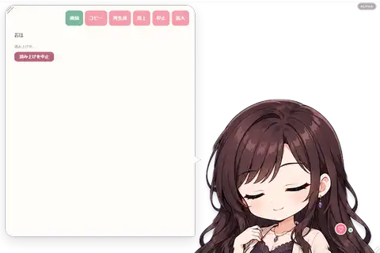<br /><br /><sub><b>まい</b></sub></td>
      <td align="center"><br />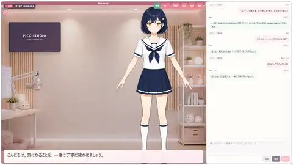<br /><sub><b>あおい</b></sub></td>
    </tr>
    <tr>
      <td align="center"><br /><br /><sub><b>セナ</b></sub></td>
      <td align="center">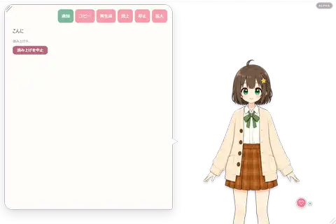<br />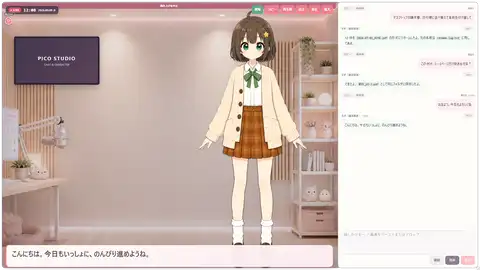<br /><sub><b>むぎ（通常頭身）</b></sub></td>
      <td align="center"><br />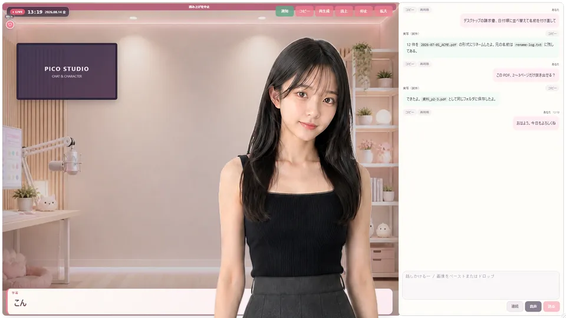<br /><sub><b>実写テスト</b></sub></td>
      <td></td>
    </tr>
  </table>
  <sub>各キャラの上が通常表示、下が配信表示。「おはよう。今日もよろしくね」への返事で、音声同期の口パク → 考え中 → 待機を実際に動かして撮影しています。</sub>

  <details>
    <summary><strong>Live2D動作例（非同梱）</strong></summary>
  <table>
    <tr>
      <td align="center"><br /><br /><sub><b>ひより</b></sub></td>
      <td align="center"><br /><br /><sub><b>はる</b></sub></td>
      <td align="center">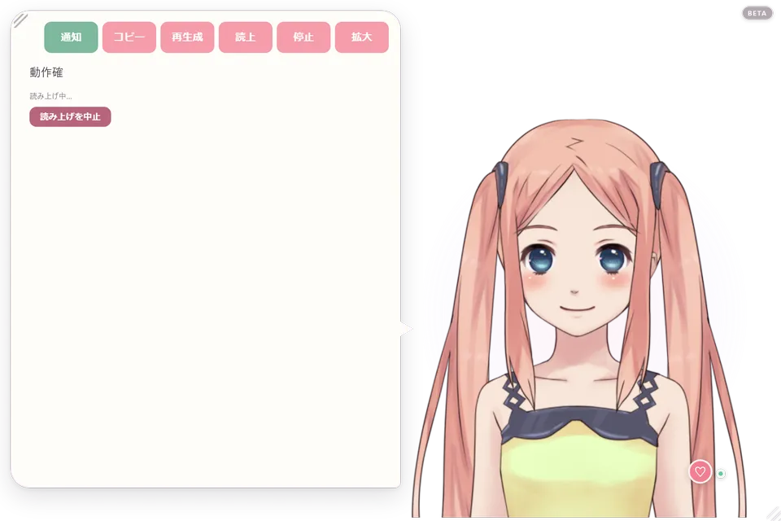<br />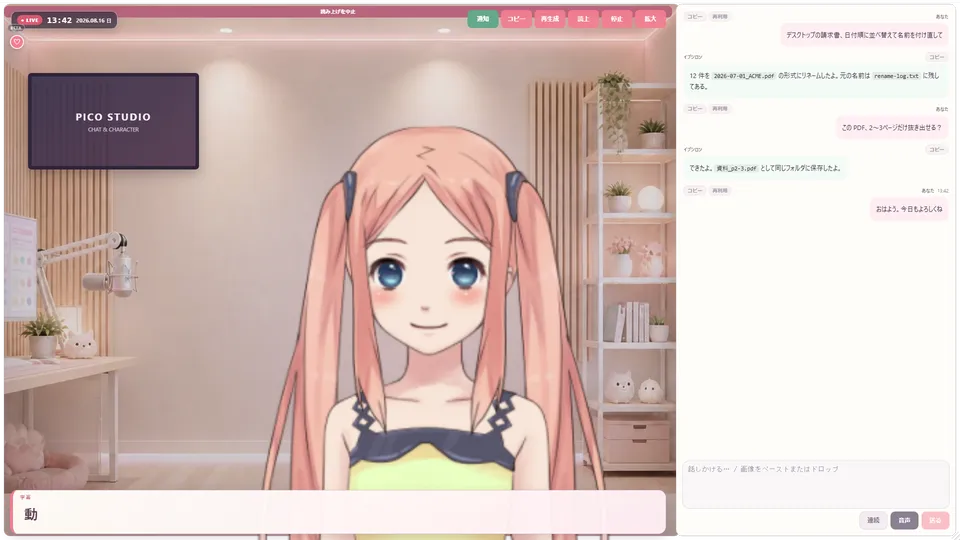<br /><sub><b>イプシロン</b></sub></td>
    </tr>
    <tr>
      <td align="center"><br />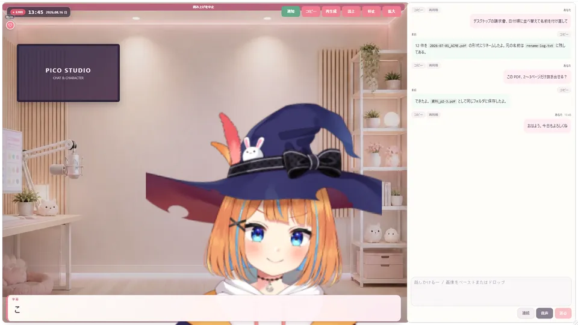<br /><sub><b>まお</b></sub></td>
      <td align="center"><br /><br /><sub><b>ライス</b></sub></td>
      <td align="center">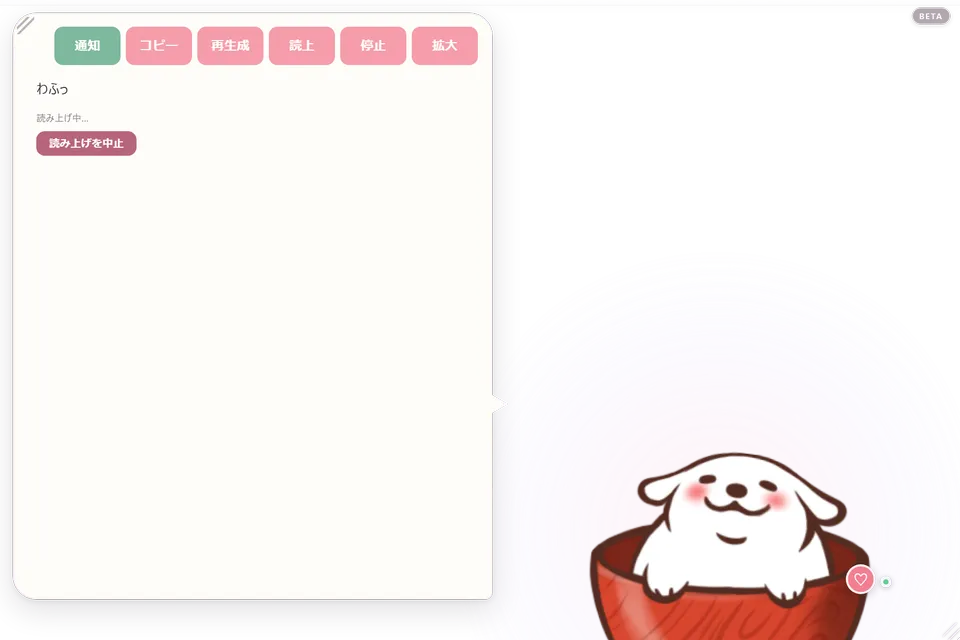<br /><br /><sub><b>わんこ</b></sub></td>
    </tr>
  </table>
  <sub>Live2D のランタイムとモデルは配布に含めないため、<code>cargo xtask setup live2d</code> で取得した環境でだけ表示できます。</sub>
  </details>
</div>

### モーション対応

`◎` は専用素材またはモデルパラメータ、`○` は共通の状態モーションです。

| キャラクター | 形式 | 状態動作 | まばたき | 口パク | 視線 | 感情表情 | 胸元二次動作 |
|---|---|---:|---:|---:|---:|---:|---:|
| むぎ / むぎ（通常頭身） / りん / まい / セナ / あおい | LocalVTuberStudio系2.5D | ○ | ◎ | ◎ | ◎ | ○ | ○ |
| 実写・物理演算テスト | 独自2.5D | ○ | ◎ | ◎ | ◎ | ○ | ◎（8領域） |
| ひより / はる / イプシロン / まお / わんこ | Live2D | ◎ | ◎ | ◎ | ◎ | モデル動作 | モデル物理 |
| ライス | Live2D | ◎ | ◎ | 無効 | ◎ | モデル動作 | モデル物理 |

- 口パクは実際の音声再生に合わせて動き、ミュート中と音量0では口を閉じます（ライスはモデル設定により口パク無効）
- 低頭身は上半身、長身・実写と構図調整済み Live2D は胸上が初期構図。チャット／バーの小型アイコンは首上を表示します。利用者が追加した Live2D は顔を切らないよう全身から始めます
- OS の省モーション設定では呼吸・揺れ・待機動作を止め、口・表情・まばたきだけを動かします。WebGL を使えない環境では利用可能な差分絵で表示します
- 生成由来の素材の品質はキャラごとに異なり、ひより相当の Live2D 品質を保証するものではありません

描画方式は [メッシュ変形リグ設計](docs/MESH-RIG.md)、画像の追加・再生成は [キャラクター画像の追加・再生成手順](docs/CHARACTER-ASSET-WORKFLOW.md) を見てください。

### 原画からキャラクターを作る（テスト機能）

同梱7体は、キャラごとの専用コードではなく同じパイプラインで1枚の立ち絵から作った自己完結パックです。制作時だけローカルGPUモデルを使い、表示時は完成済みのPNGパーツを共通の描画層で動かします。

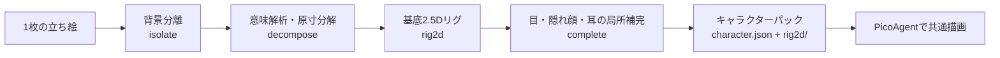

設定「キャラ作成（テスト）」で原画を選ぶと4工程を実行し、完成後は「動作を確認」で原画と本番描画を並べて確かめてから反映します。途中で失敗しても直前の公開済みの版を保ちます。操作は [MANUAL.md「原画からキャラクターを作る」](MANUAL.md#原画からキャラクターを作る)、残る品質課題は [未完了タスク](docs/TASKS.md#picoagent内キャラクター作成テスト機能) にあります。

| 利用条件・目安 | 内容 |
|---|---|
| 対応環境 | Windows 10/11 x64（CUDA対応NVIDIA GPU、またはAMD公式のWindows向けROCm対応GPU）、または Apple Silicon Mac（Intel Mac は対象外）。空き容量85GB以上 |
| 初回導入 | 「追加機能・更新」で約77GBの管理ランタイムを選んで導入 |
| 生成時間 | RTX 5060 Laptop GPU で既知原画1体あたり約77分（取得時間を除く。原画とPCで変わる） |
| 品質 | テスト機能。工程が完走しても品質合格ではなく、腕を閉じたときに元の腕輪郭が細く残る課題があります。反映前に透過表示と腕の開閉を確認してください |

---

## 🏗 しくみ

| 設計の要点 | |
|---|---|
| **ローカル完結が既定** | 会話は選択中の叩く AI にだけ送られ、`local` なら外部送信なし。録音の文字起こしも端末内（Whisper） |
| **コネクタで増える** | ツールコネクタを足すとモデルが function calling で呼べる。設定項目は `config_schema()` で申告すれば設定画面に並ぶ |
| **安全側の既定** | 許可ルート制、削除は OS のゴミ箱、物理削除コマンドは拒否。PC 操作・ブラウザ操作・ローカル API・MCP は既定 OFF |
| **常駐前提の性能** | 描画は単一 `requestAnimationFrame` ループ。定期処理は目覚まし照合20秒と居眠り判定30秒だけ |


| 領域 | 採用技術 | 役割 |
|---|---|---|
| デスクトップアプリ | Tauri 2、Rust、WebView2 | ウィンドウ、設定、権限制御、推論プロセスの管理 |
| UI | HTML、CSS、JavaScript | 会話・設定・配信表示（製品のビルドと起動に Node.js は使わない） |
| 2D/2.5D描画 | PIXI.js 6.5.10、独自メッシュリグ | 透過PNGパーツを連続変形して口・目・視線・髪・身体を動かす |
| Live2D表示 | Cubism Core、pixi-live2d-display | 利用者が権利を持つ Cubism 4／5 モデルを表示（モデルは同梱しない） |
| ローカル会話AI | llama.cpp、GGUF | 会話モデルをローカル推論する |
| 音声 | whisper.cpp、AivisSpeech | ローカル文字起こしと読み上げ。母音時間を口パクへ渡す |
| キャラクター制作 | Python 3.12、PyTorch、Grounding DINO、SAM 2.1、ComfyUI、Qwen-Image-Edit | 立ち絵の解析・部位分解・局所補完 |
| ローカル画像・動画生成 | Qwen Image Edit、Wan 2.2 5B、Krea 2 Turbo、LTX 2.5 ほか | 任意導入。モデルごとの条件と未確認事項は [管理モデル](docs/models.md) |
| ビルド・検証 | Cargo、`cargo xtask`、Playwright | セットアップ、同期、ビルド、テスト、実画面キャプチャの入口を1つに集める |

アーキテクチャとコネクタ仕様の正本は [SPEC.md](SPEC.md) です。

---

## 🖱 使い方

### マウス

| 操作 | 動き |
|---|---|
| フキダシをクリック | 入力欄を開く |
| フキダシ上部の小ボタン | 回答コピー / 再読み上げ / 停止 / 拡大 |
| ウィンドウの辺／四隅をドラッグ | 幅／高さ／縦横を変更（自動保存） |
| 「配置」→キャラの移動つまみ／四隅 | キャラの位置／大きさを変更して保存。編集中はホイールでも大きさを変更 |
| キャラクターをドラッグ | ウィンドウを移動 |
| 読み上げ中にキャラクターをクリック | 読み上げを停止 |
| キャラクターをクリック / なでる | 触った場所に応じて反応 |
| キャラクター横の `♡` | 関係性と最近いっしょにしたことを表示 |
| 画面上端 →「配置」 | その形式のキャラ・チャット・配信要素を動かし、表示を切り替える |
| 右クリック | 場所を問わず共通のネイティブメニュー。選択文字・入力欄・リンク・キャラの操作だけ先頭に追加 |

全画面フキダシでは会話履歴の検索・コピー・再利用・Markdown 書き出しができます。フキダシ本文や入力欄でも同じ右クリックメニューが開き、必要なコピー・貼り付け項目を先頭に追加します。チャットで「アプリ終了して」と頼んでも終了できます。

<div align="center">
  
</div>

### キーボード

| キー | 動き |
|---|---|
| `Enter` / `Ctrl + Enter` | 送信 |
| `Shift + Enter` | 改行 |
| `↑` `↓` | 過去の入力を呼び戻す |
| `Esc` | 入力欄を閉じる / 全画面を解除 |
| `Ctrl + Alt + P`（macOS は `⌘ + Alt + P`） | どこからでも呼び出す（他のアプリを使っていても効く） |
| `Ctrl + Alt + H`（macOS は `⌘ + Alt + H`） | 隠す / 戻す |

ホットキーは 設定 →「画面・操作」→「操作」で変更でき、保存すると再起動なしで反映します。空欄で既定値、`off` でそのキーだけ無効。他のアプリと重なって登録できなかったときは保存時に知らせます。隠したまま呼び出しキーが無効になった場合は、自動で表示へ戻します。

### ファイルを渡す

ウィンドウのどこへでもドラッグ&ドロップすると添付され、入力欄が開きます。

- 画像は画像添付、文書は内容を抽出。許可ルート内なら実パスも伝わるので、PDF 抽出や PSD 変換がそのまま使えます
- 許可ルート外なら、通知の「許可設定を開く」から設定へ移れます
- ブラウザからの URL・テキストのドロップは入力欄へ挿入します

### クイック操作・音声入力・アクションセンター

<div align="center">
  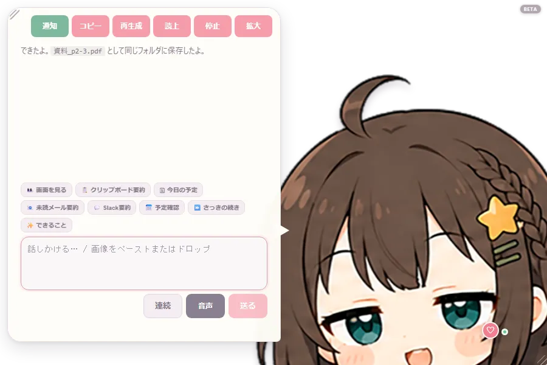
</div>

- **クイック操作** — 入力欄の上から、画面確認・クリップボード要約・今日の予定・さっきの続き・できること確認をワンクリックで送れます。メール・Slack・カレンダーの要約は、その連携を設定したときだけ並びます
- **音声入力の「連続」** — 話し終わりを検出し、1.5秒の取消猶予のあと自動送信します（猶予中の Escape で取消）。読み上げ後は再び聞き始め、長い無音や画面非表示で止まります
- **アクションセンター** — 会話の送信中／完了／失敗、日常通知、スケジュール結果を集め、直近50件を保持します。実行中の依頼は手順ごとの状態と経過時間を表示し、「停止」で中断できます。ファイルをドロップすると次の操作（要約・変換・比較・文字起こしなど）も提案します

---

## ⚙️ 設定

右クリック →「**設定を開く…**」ですべて画面から編集できます。設定画面はメイン画面と同じテーマで表示され、左の分類から選ぶか上部の検索で項目を探せます。狭いウィンドウでは分類を横へスクロールできます。下部に未保存件数が出て、`Ctrl` / `Cmd` + `S` でも保存できます。

「画面・操作」の**UIモード**は「可愛い」（既定）と「かっこいい」から選べます。ローズ色と丸いパネル、シアン色と引き締まったパネルを、設定・メイン画面へまとめて反映します。キャラや表示形式を変えずに切り替えられます。

| 見出し | タブ |
|---|---|
| よく使う | **基本設定**（主要な入口、会話と記憶、覚えたこと） / **画面・操作**（レイアウト・テーマ・文字サイズ・配信表示・ホットキー） |
| キャラクター | **キャラ選択** / **キャラの音声** / **キャラ登録**（自分の Live2D・キャラクターパックの追加） / **キャラ作成（テスト）** |
| AI・機能 | **AIモデル** / **スキル・連携**（外部サービス・MCP・ローカルAPI） / **追加機能・更新**（アプリの更新確認を含む） |
| 安全・サポート | **安全・許可**（全スキル共通の許可ルートと拒否パス） / **使い方** / **診断・修復** |

- 文字サイズ・人格などの軽い設定は保存すると即反映。叩く AI・モデル・音声・キャラクターは確認のあと画面を読み込み直し、準備が揃ってから戻ります（「あとで」なら次回起動時）
- 配信チャットの文字サイズは「画面・操作」で18〜48pxから選べます。ペット・ミニの会話文字とは別に保存し、変更はすぐ画面へ反映します。
- 会話パネルの「Aa」（またはパネル上で Ctrl+ホイール、Ctrl + + / - / 0）でも、その場で文字サイズを変えられます。
- タイトルバーは既定で隠れていて、画面の上端へポインタを寄せると出ます。タイトルバーの 📌 を押すと常に表示します。
- API キーや token が要る項目には取得手順と公式リンクを表示し、Gmail / Slack / Google カレンダーは**接続テスト**で原因候補まで出します
- 目覚ましとタスクスケジュールは JSON を直接書かず、専用フォームで編集できます

### 会話の記憶

- **会話履歴** — キャラクターごとに `app_data_dir/history-<キャラID>.json` へ保存し、起動時とキャラ切替時にそのキャラの会話を戻します
- **長期メモリ** — 好み・自己情報・継続指示を保存し、標準のEmbeddingGemma 2で言い換えにも対応した意味検索を行います（全キャラ共通）。初回にモデルと専用Python環境を公式配布元から取得し、標準はGPU優先、GPU非対応構成はCPUです。「基本設定」で検索をCPUへ切り替えられ、「覚えたこと」で確認・1件ずつ削除できます
- **全部消したいとき** — 右クリック →「**表示と会話をリセット**」→「**会話履歴と覚えたことを消す**」→「**消す（元に戻せません）**」。削除できなかった場合は成功扱いにせず知らせます

応答中にリセット・キャラ切替・設定反映をした場合、古い応答が戻ってきても履歴や画面へは書き戻しません。

### データの保存場所（Windows）

`%LOCALAPPDATA%` と `%APPDATA%` はエクスプローラーのアドレス欄へそのまま入力できます。

```text
%LOCALAPPDATA%\PicoAgent\               アプリ本体（既定の導入先）
├── picoagent.exe                     実行ファイル（付属UI・基本キャラを内蔵）
├── uninstall.exe                     アンインストーラー
└── resources\
    ├── component-manifest.json       追加機能の管理情報
    └── bundled\                      同梱ランタイム（エンジン、音声エンジン）

%APPDATA%\PicoAgent\                   設定・利用者データ・管理ランタイム
├── config.json                      設定・キャラ別の声/背景/配置
├── history-<キャラID>.json           キャラ別の会話履歴
├── memory.json                      記憶データ
├── relationship-<キャラID>.json      キャラ別の関係性データ
├── characters\<キャラID>\            登録した追加キャラ
├── bundled\models\                  ダウンロードしたローカルAIモデル
├── cache\                           再生成できる取得キャッシュ
├── log\                             実行ログ
├── browser-profile\                 アプリ専用ブラウザープロファイル
├── webview\                         アプリ画面専用のWebViewデータ
└── aivis-userdata\                   音声エンジンと音声モデル（*.aivmx）
```

更新・再インストールでは設定や登録キャラを保持します。アンインストール時に「ユーザーデータを削除」で「いいえ」を選ぶと、設定・履歴・キャラ・音声モデルを残します。バックアップはアプリを終了してから `%APPDATA%\PicoAgent\` を保存してください。

### 主要な設定キー

よく触るものだけです。**全キーは [docs/SETTINGS.md](docs/SETTINGS.md)** にあります。各キーは環境変数でも渡せますが、既定値として参照するだけで保存先は常に `config.json` です。

| 用途 | 主なキー |
|---|---|
| 叩く AI | `PICOAGENT_PROVIDER` / `PICOAGENT_MODEL` / `PICOAGENT_LOCAL_MODEL_PRESET` |
| キャラクター | `PICOAGENT_CHARACTER` / `PICOAGENT_CHARACTER_OVERRIDES` / `PICOAGENT_RELATIONSHIP` |
| 表示 | `PICOAGENT_THEME` / `PICOAGENT_LAYOUT` / `PICOAGENT_BUBBLE_FONT_PX` / `PICOAGENT_ALWAYS_ON_TOP` / `PICOAGENT_TITLE_BAR_PINNED` |
| 音声 | `PICOAGENT_TTS_ENABLED` / `PICOAGENT_TTS_VOLUME` |
| 許可（共通） | `PICOAGENT_ALLOWED_ROOT` / `PICOAGENT_ALLOWED_PATHS` / `PICOAGENT_DENIED_PATHS` |
| コマンド実行 | `PICOAGENT_COMMAND_ENABLED` / `PICOAGENT_COMMAND_ALLOWLIST` |
| ブラウザ操作 | `PICOAGENT_BROWSER_ENABLED` / `PICOAGENT_BROWSER_ALLOWED_DOMAINS` |
| PC 操作 | `PICOAGENT_DESKTOP_ENABLED` |
| 複数AI | `PICOAGENT_MULTI_AI_MODE` / `PICOAGENT_MULTI_AI_AGENTS` |

### 目覚まし・スケジュール

```
「平日の7時に起こして」            → 目覚まし（声でやさしく起こします）
「アラーム一覧」「それ消して」       → 一覧・削除
「毎朝9時に git status を実行して」 → cron 風タスクスケジュール
```

- 目覚ましは `おきたよ！` を押すまで既定5分おきに再通知します（アプリ起動中のみ）
- スリープや再起動を挟んだ場合は、直近24時間の未処理分だけを実行します。時計を戻しても二重実行しません
- cron の「日」と「曜日」を両方指定すると標準 cron と同じ OR 条件です（`0 9 1 * 1` は毎月1日または毎週月曜の9時）
- コマンド実行は `PICOAGENT_COMMAND_ENABLED=true` が前提で、許可ルートと allowlist で守ります。足りない許可はその場で「今回だけ」「永続許可」「キャンセル」から選べます

### ブラウザ操作

`web_fetch` では読めない **JavaScript で描画されるページ**と**ログインが必要なページ**だけを、実ブラウザで補います。設定「スキル・連携」→「ブラウザ操作」で有効にします（**既定は無効**）。

- インストール済みの **Chrome / Edge** を CDP で操作します。**現在は読み取り専用**です（開く・読む・タブ一覧・閉じる）
- 常に `%APPDATA%\PicoAgent\browser-profile\` の専用プロファイルで起動し、普段のブラウザの履歴・Cookie・ログインを共有しません
- 到達してよいドメインを `PICOAGENT_BROWSER_ALLOWED_DOMAINS` に指定します（空なら全拒否）。リダイレクト後も再検査します
- ページ本文は信頼できない外部データとして扱い、指示の上書きを狙う文字列には警告を付けます。長いページは `offset` で続きを読みます

### 安全のしくみ

- `C:\Windows` と `C:\Program Files*` 配下は編集できません
- スキル経由のファイル削除は **OS のゴミ箱へ移動するだけ**です。`run_command` でも `rm` / `del` / `Remove-Item` / `git clean` などの物理削除は実行しません
- 判断が分かれる場面では `ask_user` が選択肢つきで聞き返し、答えるまで作業を進めません

---

## 📊 性能要件

常駐し続けるアプリなので、**「軽いまま止まらない」こと**を性能要件にしています。

### 動作環境の目安（ローカルモデル）

判定は起動保証ではなく、CPU実行や共有メモリを含む選択の目安です。

| プリセット | モデル | 推奨 VRAM | 推奨 RAM | ダウンロード目安 |
|---|---|---|---|---|
| `lfm25_2_6b`（既定） | LFM2.5 2.6B QAD Q4 | 4 GB | 8 GB | 約 1.59 GB |
| `small` | Gemma 4 E2B Q4 | 不要（CPU 中心でも可） | 8 GB | 約 3.1 GB |
| `balanced` | Gemma 4 E4B Q4 | 4 GB | 16 GB | 約 5.0 GB |
| `large` | Gemma 4 12B Q4 | 8 GB | 24 GB | 約 7.1 GB |
| `qwen35_4b` | Qwen3.5 4B Q4 | 4 GB | 12 GB | 約 2.7 GB |
| `qwen35_9b` | Qwen3.5 9B Q4 | 6 GB | 16 GB | 約 5.7 GB |
| `gpt_oss_20b` | OpenAI gpt-oss-20b MXFP4 | 16 GB | 32 GB | 約 12.1 GB |
| `phi4mini` | Phi-4 mini Instruct Q4 | 4 GB | 12 GB | 約 2.5 GB |

- 最小構成は RAM 8 GB・GPU なし。通常の推奨は RAM 16 GB・VRAM 4 GB です
- コンテキスト長は `PICOAGENT_LOCAL_CTX`（既定 `32768`）、GPU オフロードは `PICOAGENT_LOCAL_NGL`（既定 `999`=全レイヤ / `0`=CPU 固定）で調整します
- ディスクにはモデル本体に加え、推論エンジン、Aivis（約0.8GB＋音声モデル）、選んだ追加機能の容量が要ります
- クラウド AI を選んだ場合、ローカルモデルは取得も起動もしません

#### GPU の対応境界（ローカルAI）

| OS / GPU | 第一候補 | 対応境界 | 失敗時 |
|---|---|---|---|
| Windows / NVIDIA | CUDA 13.4 | Turing世代以降（目安: GeForce RTX 20シリーズ以降）かつドライバー580以上 | Vulkan → CPU |
| Windows / AMD | ROCm 10.0 | 下記の AMD 公式 ROCm 10.0 Windows 対応機種だけ | Vulkan → CPU |
| Windows / Intel | SYCL | Intel Arc、Iris Xe、Core Ultra 系の `Intel Graphics`、Data Center GPU Flex／Max、Server GPU（旧UHD／HD Graphicsは対象外） | Vulkan → CPU |
| Ubuntu 24.04 LTS x64 | Vulkan | Vulkan対応GPU | CPU |
| macOS | Metal | Apple Silicon／Metal対応Mac | CPU |

CUDA／ROCm／SYCL の追加エンジンは対象GPUを確認したPCだけが取得し、サイズとSHA-256を照合したうえで、実行ファイルが対象GPUを認識できた場合だけ使います。Ubuntu の CUDA／ROCm 専用版は上流に配布資産がないため未対応です。画像・動画・キャラクター生成（ComfyUI／PyTorch）の対応GPUは別の表で判定します（[管理モデル](docs/models.md#gpuバックエンドとモデルの関係)）。

<details>
<summary>Windows ROCm の対象 AMD 機種（2026-10-08確認）</summary>

[AMD公式 ROCm 10.0.0 互換表](https://rocm.docs.amd.com/en/docs-10.0.0/compatibility/compatibility-matrix.html)で Windows 11 対応になっている次の機種だけを対象にします（「この番号以降」ではありません）。

- Radeon RX: 7600 / 7700 / 7700 XT / 7800 XT / 7900 GRE / 7900 XT / 7900 XTX / 9050 / 9060 / 9060 XT / 9060 XT LP / 9070 / 9070 XT / 9070 GRE
- Radeon PRO: W7700 / W7800 / W7800 48GB / W7900 / W7900 Dual Slot、Radeon AI PRO R9600D / R9700 / R9700S

ROCm 10.0 で RX 6000 系・Radeon PRO W6000 系（RDNA2）と RX 7600 XT／7650 GRE は Windows 対応表から外れたため、これらは Vulkan を使います。Ryzen AI 系 APU も公式表には載っていますが、Windows が返す GPU 名（例: 「AMD Radeon(TM) 8060S Graphics」）から機種を特定できないため、現状は Vulkan を使います。一覧外の Radeon、型番を特定できない「AMD Radeon Graphics」なども Vulkan を使います。この一覧は llama.cpp 固定版または配布版を更新するたびに公式表と照合します。

</details>

<details>
<summary>AMD APU（Radeon内蔵GPU）を使う場合</summary>

APU は独立したVRAMではなくシステムRAMをGPUと共有するため、上表の「推奨VRAM」と「推奨RAM」を足せる構成ではありません。

| 環境 | 最低目安 | 推奨 | モデルの目安 |
|---|---|---|---|
| Windows 10/11 x64＋Vulkan対応Radeon内蔵AMD APU | RAM 16 GB | RAM 32 GB以上（可能ならデュアルチャネル） | 既定の `lfm25_2_6b`、または `small` / `balanced`（`large` は標準推奨外） |

- RAM 16 GB では OS・GPU・モデルが同じメモリを使うため、他アプリとの併用時に余裕が少なくなります。遅い・メモリ不足のときは `small` か `PICOAGENT_LOCAL_NGL=0`（CPU固定）にしてください
- BIOS/UEFI の UMA Frame Buffer 設定は機種ごとに異なるため必須値にはしません

</details>

### 応答性・描画

| 項目 | 要件 |
|---|---|
| 生成の見え方 | 生成中は処理中表示を出し、内部設定の混入を検査してから回答を表示します。配信形式の長文字幕は収まる長さへ分けて読み上げと同期します |
| 読み上げの先行開始 | 文が確定した順に音声合成へ送り、全文の生成完了を待ちません |
| アニメーション | 単一の `requestAnimationFrame` ループで駆動し、状態だけを切り替えます |
| 履歴表示 | 会話履歴は全画面表示中だけ組み立てます。履歴検索は 120ms デバウンス |
| 常駐時のポーリング | 目覚まし・スケジュール照合は20秒、居眠り判定は30秒間隔。それ以外の定期処理は持ちません |
| 入力欄 | 最大180pxまで自動伸縮。入力履歴は直近40件。送らずに閉じた書きかけは24時間だけ保存します |

### 上限とタイムアウト

暴走・コンテキスト超過・無応答を防ぐ固定値です。括弧内は設定キーのある項目です。

| 対象 | 値 |
|---|---|
| エージェントのツール連鎖 | 既定5ステップ。スーパーエージェントモードは12ステップ（`PICOAGENT_SUPER_AGENT_MAX_STEPS`、〜30） |
| chat 呼び出しのリトライ | 最大3回・指数バックオフ（1秒 → 2秒）。4xx 認証エラーは即中断 |
| ツール出力 | 使用中モデルのコンテキスト長から自動決定（`PICOAGENT_TOOL_OUTPUT_MAX_CHARS`）。ローカルは `PICOAGENT_LOCAL_CTX` の45%（1,000〜60,000文字）、クラウドは24,000文字 |
| ブラウザで1回に読む本文 | ツール出力の上限に従い、超えた分は `offset` で続きを読む（`PICOAGENT_BROWSER_MAX_CHARS`） |
| 汎用 HTTP スキル | 20秒（`PICOAGENT_HTTP_TIMEOUT_SECS`、3〜60） |
| モデル一覧の取得 | 15秒（`PICOAGENT_HTTP_METADATA_TIMEOUT_SECS`、3〜60）。外向き HTTP の接続確立は共通で10秒まで |
| コマンド実行 | 30秒（`PICOAGENT_COMMAND_TIMEOUT_SECS`、1〜120） |
| ローカル API の1リクエスト | 300秒 |
| 会話履歴 | 保存は直近60件、起動時に文脈へ読み込むのは直近20件 |
| 長期メモリ | 最大80件（`PICOAGENT_MEMORY_MAX_ITEMS`、10〜200）、1件140文字、文脈へ入れるのは関連度上位24件 |
| ツール実行トレース / スケジュール実行履歴 | 直近200件 / 直近100件（通知一覧から直近20件を確認・再実行） |

### 計測のしかた

- 右クリック →「設定を開く…」→「**診断・修復**」で、同梱エンジン・Aivis・選択中プロバイダの状態、トークン使用量、スキルごとの平均レイテンシ／呼び出し回数／エラー数を確認できます
- 不具合を連絡するときは同じ画面の「**診断情報を書き出す**」を押してください。版・環境・設定・直近のログを1つのテキストにまとめます（APIキー等は「設定済み／未設定」だけで、値は入りません）

---

## 🔌 ローカル API

外部ツールやスクリプトから、PicoAgent のエージェント（スキル込み）を Ollama のようにローカル HTTP で呼べます。設定「スキル・連携」→「ローカルAPI（Ollama風）」で有効にして再起動します（既定は無効）。

`127.0.0.1` にだけ開き、LAN へは公開しません。`PICOAGENT_API_KEY` を設定すると `Authorization: Bearer <キー>` が必須になります。

| エンドポイント | 内容 |
|---|---|
| `GET /api/version` | バージョン情報 |
| `GET /api/tags` | 選択中モデルの一覧（Ollama 風） |
| `POST /api/chat` | `{"messages":[…]}` → エージェント応答 |
| `POST /api/generate` | `{"prompt":"…"}` → エージェント応答 |
| `POST /v1/chat/completions` | OpenAI Chat Completions 互換（`base_url` の差し替えだけで使える） |
| `POST /mcp` | MCP サーバ（スキルを MCP ツールとして公開） |

```bash
# curl で
curl http://127.0.0.1:11500/api/chat -d '{"messages":[{"role":"user","content":"今日の天気は？"}]}'

# 同梱の最小 CLI で
cargo xtask cli status              # 死活とバージョン
cargo xtask cli models              # モデル一覧
cargo xtask cli chat 今日の予定は？   # 1問1答（スキルも使える）
cargo xtask cli repl                # 対話モード（exit で終了）

# Claude Code から MCP として登録
claude mcp add --transport http picoagent http://127.0.0.1:11500/mcp
```

API の会話はリクエスト内で完結し、デスクトップのキャラ会話履歴とは混ざりません。ポートは `PICOAGENT_API_PORT`（既定 `11500`）で変えられます。

---

## 🛟 困ったとき

> まず試す: 右クリック →「設定を開く…」→「**診断・修復**」。同梱エンジン、Aivis、選択中プロバイダ、使用量、スキル実行状況をまとめて確認できます。

<details open>
<summary><b>起動・モデル</b></summary>

| 症状 | 対処 |
|---|---|
| 「モデルを準備中…」のまま | 初回のモデル取得中です（数 GB）。ネット接続を確認してください。`PICOAGENT_MODEL_URL` を変えると別モデルを取得します |
| 「準備に失敗」と出る | `cargo xtask setup engine` でエンジンが入っているか、取得元 URL が有効かを確認 |
| `cargo tauri` が見つからない | `cargo install tauri-cli --version '^2'` を実行 |
| `cargo xtask dev` が遅い / 失敗する | 初回は Rust のコンパイルに時間がかかります。Rust・Tauri CLI・WebView2 と、表示されたコンパイルエラーを確認 |
| ビルドが `os error 32`（別のプロセスが使用中）で失敗 | 前回の `llama-server` やアプリ本体が残っています。`cargo xtask stop` で停止（dev / build は起動前に自動で停止します） |
| 起動直後に `picoagent.exe (exit code: 1)` で落ちる | 前回のプロセスが残って WebView の生成が競合しています。`cargo xtask stop` 後に再実行 |
| macOS で背景が透過されない | `src-tauri/tauri.conf.json` の `app.macOSPrivateApi` を `true` にして再ビルド |

</details>

<details>
<summary><b>AI・ツールが動かない</b></summary>

| 症状 | 対処 |
|---|---|
| 応答しない（Ollama 利用時） | `ollama serve` を起動し、設定の `OLLAMA_HOST` を確認 |
| OpenAI が「未接続」 | 公式URLは `OPENAI_API_KEY`、それ以外の互換URLは `OPENAI_COMPAT_API_KEY` を設定画面で入力して保存 |
| ツールが呼ばれない | モデルが function calling 非対応の可能性があります。ツール対応モデルを使ってください |
| 「手元の CLI エージェント」でスキルが呼ばれない | 約束事でスキルを呼ぶため取りこぼしがあります。確実に使いたい依頼は `local` などへ切り替えてください |
| CLI エージェントが「空の応答」「失敗」を返す | `claude --version` / `codex --version` が通るか、ログイン済みかを確認。必要なら `PICOAGENT_AGENT_CLI_PATH` に実行パスを入れてください |
| Web 検索に失敗する | インターネット接続を確認。短時間の連続検索で拒否された場合は時間を置いて再試行 |
| 天気・為替・RSS に失敗する | インターネット接続、地点名、通貨コード、RSS URL を確認 |

</details>

<details>
<summary><b>ファイル・コマンドが拒否される</b></summary>

| 症状 | 対処 |
|---|---|
| `read_file` などが拒否される | 許可ルート（既定はホーム）外か、保護パスです。設定「安全・許可」で `PICOAGENT_ALLOWED_ROOT` や追加許可ルートを設定してください |
| `run_command` が拒否される | 既定で無効です。有効にして、`PICOAGENT_COMMAND_ALLOWLIST` に `program args...` のコマンド全体を追加してください（完全一致。shell は使いません） |
| `code_runner`（自力実行）が動かない | OS レベルの隔離実行が未実装のため、現在はモデルへ公開していません |

</details>

<details>
<summary><b>文書・画像・音声の変換</b></summary>

| 症状 | 対処 |
|---|---|
| Office ファイルの変換・PDF 出力ができない | `cargo xtask setup office` で OfficeCLI を取得。docx/xlsx/pptx の文字列置換は OfficeCLI 不要です |
| 変換・検索の精度を上げたい | `cargo xtask setup tools` で Pandoc / ripgrep / ffmpeg / qpdf / poppler / ImageMagick を取得（解決順は「明示設定 → 同梱 → PATH」） |
| PSD / XCF / HEIC / TIFF / WebP を扱いたい | `image_tools` スキルが ImageMagick で PNG / JPG 等へ変換します（PSD はレイヤー統合ビュー） |
| Office / PDF 操作に失敗する | 「安全・許可」の許可ルートと、Office / LibreOffice（`soffice`）/ qpdf の実行パスを確認。Google Docs / Sheets は専用スキルを使ってください |
| macOS で Aivis の取得だけ失敗する | `.7z.001` 展開用の `7z` がありません。`brew install p7zip` 後に `AIVIS_FORCE=1 cargo xtask setup aivis` |

</details>

<details>
<summary><b>外部サービス連携</b></summary>

| 症状 | 対処 |
|---|---|
| 外部サービス連携に失敗する | 各サービスの token、Webhook URL、OAuth scope、対象 ID を確認してください |
| SNS 連携に失敗する | token、app password、投稿権限、API プラン、インスタンス URL を確認してください |

> 秘密値は設定画面に保存し、ログやドキュメントへ書かないでください（Windows では DPAPI、macOS ではログインキーチェーンで保護して保存します）。

</details>

### キャラの声・人格の学習（開発版・Windows）

「キャラ作成」から音声・動画ファイルやYouTube URLを渡し、声の学習候補と人格の編集可能な草稿を作れます。声は品質検査と複数文の試聴、人格は根拠の確認後に設定へ反映します。現在の管理導入はNVIDIA GPU搭載のWindows向けで、必要な環境・モデルは明示操作でだけ取得します。手順と対象素材は[利用マニュアル](MANUAL.md#声人格を素材から作るwindows)を参照してください。

この学習機能の文字起こしはGPUが既定です。CPUも手動で選べます。GPU不足や推論失敗をCPUへ自動で切り替えることはありません。
