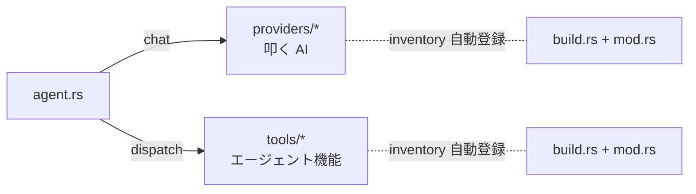

<div align="center">
  <h1>🐾 PicoAgent</h1>
  <p><strong>叩く AI とエージェント機能をコネクタで拡張できる、キャラクター + フキダシだけの透明デスクトップペット</strong></p>

  
  
  
</div>

<br />

> 透明な Tauri ウィンドウに常駐するデスクトップペット。バックエンドは Rust、フロントは webview。**Ollama 不要** — 推論エンジンを同梱し、初回起動時に PC のVRAM/RAM目安からローカルモデルを自動選定して取得します。**叩く AI（LLM バックエンド）** と **エージェント機能（ツール）** を、決まったフォルダへコネクタを足すだけで差し替え・追加できます。

---

## 📑 目次

- [🚀 クイックスタート](#-クイックスタート)
- [✨ 特徴](#-特徴)
- [🧩 コネクタの仕組み](#-コネクタの仕組み)
- [🖱 使い方](#-使い方)
- [⚙️ 設定](#️-設定)
- [📦 製品ビルド（配布）](#-製品ビルド配布)
- [📁 フォルダ構成](#-フォルダ構成)
- [🛟 トラブルシューティング](#-トラブルシューティング)

> [!NOTE]
> アーキテクチャ・コネクタ仕様の詳細は **[SPEC.md](SPEC.md)**、AI エージェント向け作業ルールは **[AGENTS.md](AGENTS.md)** を参照してください。

---

## 🚀 クイックスタート

前提: **Rust（cargo）** と **Node.js ≥ 20**、Windows は WebView2 ランタイム。**Ollama は不要**です。

```powershell
npm install
npm run setup:engine   # 同梱推論エンジン(llama-server、Windows は Vulkan/GPU 版)を取得
npm run dev
```

- 既定の叩く AI は **`local`（同梱エンジン）**。初回起動時に `PICOAGENT_LOCAL_MODEL_PRESET=auto` が PC のVRAM/RAM目安から Gemma 4 系の `small` / `balanced` / `large` を選び、対応する GGUF を自動ダウンロードします。以後はオフラインで動作します。追加プリセットとして `qwen3` も選べます。設定画面ではローカルモデルを「種類 → サイズ」で選択できます。ダウンロード中はキャラクターの吹き出し下に「モデルを準備中… NN%」と表示され、モデル変更時は必要なモデルを取得して同梱エンジンを再起動します。
- Ollama を使いたい場合は `ollama serve` 後に右クリック →「設定…」でプロバイダを切り替えます（任意）。Ollama 選択時はローカルのモデル一覧を読み込み、モデル欄から選べます。

> [!NOTE]
> 初回の `npm run dev` / `npm run build` は Rust の crate 取得・コンパイルで時間がかかります（ネットワーク必須）。モデル DL も初回のみネットが必要です。

OpenAI / Claude / Gemini / DeepSeek / xAI Grok / Mistral などのクラウド系の叩く AI を使う場合（費用が発生します）は、起動後に右クリック →「設定…」でプロバイダ、API キー、モデルを設定します。主要プロバイダは「叩くAI」タブ内でモデルを「種類 → サイズ」から選べます。

---

## ✨ 特徴

- **Ollama 不要・ローカル完結** — 推論エンジン同梱、初回 DL の gemma4 でそのまま動く（既定 `local`）。
- **叩く AI を差し替え可能** — local / Ollama / OpenAI 互換 / Claude / Gemini / DeepSeek / xAI Grok / Mistral を同梱。コネクタを足せば他社 AI にも切替できる。
- **エージェント機能を追加可能** — ツールコネクタを足すと、モデルが function calling で呼び出せる。
- **原則Web検索** — 通常の質問ではローカルモデルの判断に頼らずWeb検索してから参照元のハイパーリンク付きで回答する。短い挨拶は検索に引っ張られないよう例外扱いし、キャラクター本人として返す。
- **設定画面ですべて設定** — 右クリック →「設定…」で叩く AI・モデル・接続先・API キー・ツール設定などを GUI 編集。軽い設定は保存で即反映、叩く AI・モデル・音声・キャラクターなど重い設定は確認のうえ再起動して起動画面でまとめて反映。
- **軽量な Tauri ネイティブ** — システム WebView を使い、Rust バックエンドで動作。
- キャラクターパックごとの連続フレームと状態別の滑らかな補間動作（待機 / 考え中 / 返答 / エラー）。
- キャラクターごとに名前・挨拶・性格・口調・一人称を定義でき、設定画面でキャラ選択と人格の上書きが可能。
- 会話は選択中の叩く AI にのみ送られる。ローカル Ollama を使えば外部送信なし。

---

## 🧩 コネクタの仕組み



- **叩く AI を増やす**: `src-tauri/src/providers/` に `Provider` トレイトを実装した `.rs` を置き、`inventory::submit!` で登録。
- **エージェント機能を増やす**: プロジェクト直下の `skills/<スキル名>/mod.rs` に `Tool` トレイトを実装し、`inventory::submit!` で登録。

`build.rs` が `.rs` を自動で `mod` 取り込みし、再ビルドで**自動登録**されます（`mod.rs` 編集不要）。書き方は [SPEC.md](SPEC.md#新しいコネクタの作り方) を参照。

---

## 🖱 使い方

- フキダシをクリック: 入力欄を開く
- フキダシ上部の小ボタン: 回答コピー・再読み上げ・停止・拡大
- フキダシ右下のつまみをドラッグ: フキダシの幅・高さを変更（位置も含めて自動保存）
- キャラクターをダブルクリック: フキダシを全画面表示／元に戻す（`Esc` でも解除）
- 読み上げ中にキャラクターをクリック: 読み上げを停止
- `Enter`: 送信 / `Shift + Enter`: 改行 / `Esc`: 入力欄を閉じる
- キャラクターをドラッグ: 移動
- 右クリック: **設定…**・**常に手前に表示**・**PicoAgent を終了**（フキダシ本文や入力欄の上ではコピーなど通常メニューを優先）

---

## ⚙️ 設定

右クリック →「**設定…**」で設定ウィンドウを開き、すべての設定を編集できます。設定は `app_config_dir/config.json`（個人 PC ローカル）に保存されます。文字サイズ・常に手前・人格・自発雑談などの軽い設定は保存すると即反映します。**叩く AI・モデル・音声（Aivis）・キャラクターの切り替えなど重い設定は、保存時に「再起動して反映します」の確認画面が出て、承諾すると再起動し、モデル取得やエンジン起動を起動画面（ローディング）でまとめて行います**（フキダシに「準備中…」を出さないため）。「あとで」を選んでも設定は保存され、次回起動時に反映されます。

会話履歴は**キャラクターごと**に `app_data_dir/history-<キャラクターID>.json`（個人 PC ローカル）へ保存され、起動時とキャラクター切替時にそのキャラの直近の会話を文脈と全画面フキダシの履歴表示へ復元します（再起動やキャラ切替をまたいで直近の話を踏まえて話し、別キャラの口調・自己紹介が混ざりません）。さらに、好み・自己情報・継続指示らしい発話だけを暗黙的な長期メモリとして `app_data_dir/memory.json` に保存し、次回以降の会話で参照します。履歴（選択中キャラ分）とメモリを消したいときは右クリック →「**会話をリセット**」を選びます。

目覚まし時計は、チャットで「**平日の7時に起こして**」「土日の朝8時、繰り返しで」のように頼むと設定できます（声でやさしく起こします）。一覧・削除も「アラーム一覧」「その目覚ましを消して」で操作でき、設定画面の「スキル」タブからも編集できます。鳴った後は `おきたよ！` を押すまで既定5分おきに再通知します。アプリ起動中のみ鳴ります。

日常補助として、「**15分後に洗濯物を取り込むって教えて**」のようなリマインダー、「**25分集中タイマー**」「**1時間おきに作業を見守って**」、おでかけ前チェック、できたことメモ、クリップボード要約も使えます。操作系の依頼はWeb検索よりローカルスキルを優先します。

cron 風のタスクスケジューラも使えます。「**毎朝9時に git status を実行して**」「**平日18時に天気スキルを実行して**」のようにチャットで登録でき、設定画面の「スキル」タブでも `PICOAGENT_SCHEDULED_TASKS` を編集できます。コマンド実行は `run_command` と同じく `PICOAGENT_COMMAND_ENABLED=true` を前提に、許可ルートと allowlist で守ります。チャット中に未登録コマンドや許可ルート外 cwd が必要になった場合は、その場で「許可」または「キャンセル」を求め、許可された1回だけ実行します。スキル実行は `kind=tool` として `tool_name` / `tool_args` を保存します。`C:\Windows` と `C:\Program Files*` 配下は編集不可です。

設定画面の項目は「基本」「キャラクター」「音声」「叩くAI」「スキル」のタブで構成されます。スキル一覧は日常・検索/情報・連携などのカテゴリタブで整理され、各コネクタが申告した設定も自動で増えます。下表は区分（基本／音声／叩くAI／スキル名）ごとにまとめています。使うスキルの欄だけ見れば十分です。

#### 主要設定

README では、ユーザーが直接触ることが多い設定だけを用途別に載せます。全キーの正確な一覧と内部保存値は [SPEC.md](SPEC.md#設定キー一覧) を参照してください。

| 用途 | 主なキー | 説明 |
|---|---|---|
| 叩くAI | `PICOAGENT_PROVIDER` / `PICOAGENT_MODEL` | 使用するプロバイダとモデル。既定は同梱ローカルエンジンの `local` |
| ローカルモデル | `PICOAGENT_LOCAL_MODEL_PRESET` / `PICOAGENT_MODEL_URL` | 同梱エンジンで使うモデルプリセットやカスタムGGUF URL |
| OpenAI互換 | `OPENAI_BASE_URL` / `OPENAI_API_KEY` / `OPENAI_MODEL` | OpenAI互換プロバイダを使う場合だけ設定 |
| Claude | `PICOAGENT_ANTHROPIC_API_KEY` / `PICOAGENT_ANTHROPIC_MODEL` | Claude プロバイダを使う場合だけ設定 |
| DeepSeek | `PICOAGENT_DEEPSEEK_API_KEY` / `PICOAGENT_DEEPSEEK_MODEL` / `PICOAGENT_DEEPSEEK_THINKING` | DeepSeek プロバイダを使う場合だけ設定 |
| Gemini | `PICOAGENT_GEMINI_API_KEY` / `PICOAGENT_GEMINI_MODEL` | Gemini プロバイダを使う場合だけ設定 |
| xAI Grok | `PICOAGENT_XAI_API_KEY` / `PICOAGENT_XAI_MODEL` | xAI Grok プロバイダを使う場合だけ設定 |
| Mistral | `PICOAGENT_MISTRAL_API_KEY` / `PICOAGENT_MISTRAL_MODEL` | Mistral プロバイダを使う場合だけ設定 |
| Ollama | `OLLAMA_HOST` / `OLLAMA_MODEL` | 任意で外部 Ollama を使う場合だけ設定 |
| キャラクター | `PICOAGENT_CHARACTER` / `PICOAGENT_CHARACTER_OVERRIDES` | 使用キャラとキャラ別の口調・人格上書き |
| 表示 | `PICOAGENT_BUBBLE_FONT_PX` / `PICOAGENT_ALWAYS_ON_TOP` | フキダシ文字サイズ、常に手前表示 |
| 音声 | `PICOAGENT_TTS_ENABLED` / `PICOAGENT_TTS_DEVICE` / `PICOAGENT_TTS_SPEAKER` / `PICOAGENT_TTS_VOLUME` | Aivis 読み上げ、デバイス、話者、音量 |
| メモリ | `PICOAGENT_MEMORY_ENABLED` / `PICOAGENT_MEMORY_MAX_ITEMS` | 会話から好みや継続指示を暗黙的に覚えるか |
| 自発雑談 | `PICOAGENT_CHATTER_ENABLED` / `PICOAGENT_CHATTER_TOPIC_MODE` | アイドル時の雑談と話題ソース |
| 目覚まし | `PICOAGENT_ALARMS` | 設定画面では専用フォームで編集。通常はチャットで設定 |
| タスクスケジュール | `PICOAGENT_SCHEDULED_TASKS` | `kind=command` / `kind=tool` の指定時刻タスク。通常はチャットで設定 |
| ローカル操作 | `PICOAGENT_COMMAND_ENABLED` / `PICOAGENT_COMMAND_ROOT` / `PICOAGENT_COMMAND_ALLOWLIST` | コマンド実行・スケジュール実行の安全境界 |
| ファイル操作 | `PICOAGENT_WORKSPACE_ROOT` / `PICOAGENT_TOOLS_ROOT` / `PICOAGENT_DOCUMENT_ROOT` | ファイル・Office/PDF 操作の許可ルート |
| 情報取得 | `PICOAGENT_WEATHER_DEFAULT_LOCATION` / `PICOAGENT_WEB_SEARCH_MAX_RESULTS` / `PICOAGENT_RSS_DEFAULT_URL` | 天気・検索・RSS などの既定値 |
| 外部連携 | 各サービスの token / 既定ID / timeout | Slack、Gmail、Google、GitHub、Notion、SNS などは使うサービスだけ設定 |

リマインダー、集中タイマー、できたことメモなどの実行状態は内部保存値として `config.json` に残りますが、通常ユーザーが直接編集するものではないため設定画面には出しません。チャット操作で追加・一覧・削除してください。

> [!TIP]
> 各キーは環境変数としても渡せます（既定値としての参照のみ。保存先は常に `config.json`）。

---

## 📦 製品ビルド（配布）

```powershell
npm run setup:engine   # 同梱エンジンを resources/bundled/engine へ取得（未取得の場合）
npm run build
```

`src-tauri/target/release/bundle/` に Windows インストーラ（NSIS）が生成されます。`npm run dev` / `npm run build` は起動前に同梱エンジンと Aivis を確認し、未取得なら `src-tauri/resources/bundled/` へ取得してから Tauri を起動します。Aivis 同梱によりインストーラの入力データが大きいため、NSIS 圧縮は生成安定性を優先して `zlib` にしています。

> [!NOTE]
> 以下のパスはいずれも Windows 表記です。macOS / Linux では同等のユーザーデータ配下（`PicoAgent/...`）に読み替えてください。

#### 同梱推論エンジン（llama-server）

- 実行ファイルは配布物へ同梱しますが、モデル GGUF（数 GB）は含めず、初回起動時に `%APPDATA%\PicoAgent\bundled\models\` へ取得します。
- `llama-server` を実行時配置で差し替える場合は `%APPDATA%\PicoAgent\bundled\engine\` を優先して探します。

#### 同梱 Aivis（読み上げ）

- **取得**: 公式 GitHub Releases から既定 `1.2.0` の実行ファイル一式を `src-tauri/resources/bundled/aivis/` へ展開します（手動実行は `npm run setup:aivis`、更新時は `AIVIS_RELEASE=latest` またはタグを指定）。
- **配布**: このフォルダは `tauri.conf.json` の `bundle.resources` 対象なので配布物に含まれます（巨大ファイルやライセンス確認が必要な実体は Git には含めません）。配布後に見つからない場合は、初回の読み上げ起動時に同じリリースを `%APPDATA%\PicoAgent\bundled\aivis\` へ自動取得・展開します（展開には `7z` / `7za` / `tar` のいずれかを使用）。
- **起動**: `PICOAGENT_TTS_ENABLED` が有効ならアプリ起動時に `127.0.0.1:<PICOAGENT_TTS_PORT>`（既定 `11436`）で裏起動します。旧既定の `10102` が保存済みなら起動時に `11436` へ移行します。アプリが起動した子プロセスは終了時に停止します。
- **推論デバイス**: `PICOAGENT_TTS_DEVICE` で `auto` / `cpu` / `gpu` を選べます。`auto` は起動前に GPU 候補を確認し、Windows では NVIDIA / Radeon・Vega・Graphics 表記の AMD APU・表示アダプタ / Intel 系の表示アダプタを候補とし、候補があれば `--use_gpu`、なければ `--no-use_gpu` で起動します（AMD CPU だけの環境は GPU 候補にしません）。固定したい場合は設定画面で明示指定します。
- **話者（speaker ID）**: キャラクターごとに設定画面の「キャラクター」タブで指定でき、未指定なら共通の `PICOAGENT_TTS_SPEAKER` を使います。ただし `りん` は既定で AivisHub の「るな」（モデル UUID `4f281e78-eba6-495a-8e50-5c322d02b5b1`、話者 UUID `aa63d66e-92fe-499e-9e0d-15dad4a61d0d`、スタイル名「ノーマル」）、`まい` は AivisHub の「まい」（モデル UUID `e9339137-2ae3-4d41-9394-fb757a7e61e6`、話者 UUID `41b7785f-35cc-4089-a360-dd8a63da5e75`、スタイル名「ノーマル」）を使います。未導入なら起動シーケンスのローディング画面で AIVMX を AivisSpeech Engine へ追加し、合成時は `/speakers` から実際の style ID を解決します。
- **音量**: `PICOAGENT_TTS_VOLUME`（0〜100）でフロント再生時のキャラボイス音量を調整します。設定保存後すぐ反映し、再生中の音声にも効きます。

> [!NOTE]
> 同梱 Aivis の初回起動はモデル確認や BERT 読み込みで数十秒かかることがあります。キャラクター固有の AivisHub 音声モデルは起動シーケンス中に「声を準備中…」として導入するため、導入待ちは通常画面ではなくローディング画面に集約されます。

#### ログ

`%APPDATA%\PicoAgent\log\` にまとめて保存します。**1 日ごとに日付付きファイル（例 `app.2026-06-28.log`）へローテートし、1 週間より古いログは起動時と 1 日ごとに自動削除します**（会話履歴はログではないため対象外）。

| ファイル（`<日付>` は `YYYY-MM-DD`） | 内容 |
|---|---|
| `app.<日付>.log` | アプリ本体とフロントのエラー |
| `aivis.<日付>.log` | Aivis の起動ログ（起動失敗時は末尾がエラー表示に含まれる） |
| `engine.<日付>.log` | 同梱 llama-server のログ |

#### 識別子・データ・署名

- アプリ識別子は `com.picoagent.desktop`（旧 `com.picoagent.app` / `com.coda.app`。初回起動時に旧識別子配下の `config.json` / `history.json` / `memory.json` を現行へコピー移行）。設定・履歴・メモリは `app_config_dir` / `app_data_dir` 配下、同梱系の実行時取得物は `PicoAgent/bundled/`、ログは `PicoAgent/log/` に保存します。アイコンは `src-tauri/icons/`（`npx tauri icon src-tauri/icon-source.png` で再生成）。
- NSIS アンインストーラは関連プロセスを停止後、`%APPDATA%\PicoAgent\` / `%LOCALAPPDATA%\PicoAgent\`、現行・旧識別子の設定・キャッシュ、専用一時ディレクトリを削除します。Aivis 子プロセスの `APPDATA` / `LOCALAPPDATA` は `%APPDATA%\PicoAgent\aivis-userdata\` へ向けるため、Aivis のモデル・辞書・キャッシュもアンインストール対象に含まれます。
- コード署名（Authenticode）・自動更新（`tauri-plugin-updater`）はリリース時に鍵・証明書を用意して有効化します（現状は未設定）。

---

## 📁 フォルダ構成

```text
20_PicoAgent/
├── characters/          ← キャラクター正本（index.json・人格定義・連番フレーム）
├── skills/              ← エージェント機能（スキル）コネクタ（<スキル名>/mod.rs と補助ファイルを同梱）
├── ui/                  ← webview フロント（picoagent.js シム・ペット UI・設定画面）
│                          ※ assets/characters/ は characters/ の配信コピー（自動生成）
├── src-tauri/
│   ├── Cargo.toml / build.rs / tauri.conf.json / capabilities / icons
│   └── src/
│       ├── main.rs / lib.rs / commands.rs / menu.rs
│       ├── config.rs / agent.rs / message.rs
│       ├── providers/   ← 叩く AI コネクタ（.rs を足すと自動登録）
│       └── tools/mod.rs ← スキルの Tool トレイト・レジストリ本体
├── scripts/             ← fetch-engine.mjs / sync-characters.mjs / build-character-animations.py
├── README.md / SPEC.md / CHANGELOG.md / AGENTS.md / CLAUDE.md
```

---

## 🛟 トラブルシューティング

- **「モデルを準備中…」のまま** → 初回のモデル DL 中（数 GB）。ネット接続を確認。`PICOAGENT_MODEL_URL` を変えると別モデルを取得。
- **「準備に失敗」と出る** → `npm run setup:engine` でエンジンが入っているか、DL 元 URL が有効か確認。
- **オンライン表示が赤い / 応答しない（Ollama 利用時）** → `ollama serve` を起動。設定の `OLLAMA_HOST` も確認。
- **AIプロバイダで OpenAI が「未接続」** → `OPENAI_API_KEY` 未設定。設定画面で入力して保存。
- **ツールが呼ばれない** → モデルが function calling 非対応の可能性。`qwen3:8b` などツール対応モデルを使う。
- **`read_file` が拒否される** → 許可ルート（既定はホーム）外。`PICOAGENT_TOOLS_ROOT` を設定するか、ルート配下のパスを指定。
- **Web検索に失敗する** → インターネット接続を確認。短時間の連続検索で拒否された場合は、時間を置いて再試行。
- **天気・為替・RSSに失敗する** → インターネット接続、地点名、通貨コード、RSS URL を確認。
- **外部サービス連携に失敗する** → Slack / Gmail / Google Calendar / Google Docs / Google Drive / Google Sheets / GitHub / Notion / Discord / Microsoft Graph / Jira / Linear / Trello / Todoist の各 token、Webhook URL、OAuth scope、対象IDを確認。秘密値は設定画面に保存し、ログやドキュメントへ値を書かない。
- **SNS連携に失敗する** → X / Mastodon / Bluesky / Reddit / LinkedIn / Misskey の token、app password、投稿権限、APIプラン、インスタンスURL、User-Agent を確認。
- **Office/PDF 操作に失敗する** → `PICOAGENT_DOCUMENT_ROOT` の許可ルート、Microsoft Office + PowerShell、LibreOffice（`soffice`）、qpdf の実行ファイルパスを確認。Google Docs/Sheets はローカルファイルではなく専用APIスキルを使う。
- **`run_command` が拒否される** → 既定では無効。設定で有効化し、`PICOAGENT_COMMAND_ALLOWLIST` に実行したい `program args...` の prefix を追加する。shell は使わず `program` と `args` を分けて実行する。
- **`npm run dev` が遅い / 失敗する** → 初回は Rust のコンパイルに時間がかかります。Rust（cargo）と WebView2 が入っているか確認。
- **ビルドが `os error 32`（別のプロセスが使用中）で失敗する** → 前回の `llama-server` やアプリ本体が残って同梱 DLL を掴んでいる状態。`npm run dev` / `npm run build` は Tauri 起動前に `scripts/stop-stale.mjs` を同期実行して残存プロセスを停止する。手動で止めたいときは `npm run stop`。
- **`npm run dev` 起動直後に `picoagent.exe (exit code: 1)` で落ちる** → 前回起動の `picoagent.exe`（とその WebView2 子プロセス）が残ったまま新インスタンスが起動し、WebView の生成が一時的に競合した状態。`npm run dev` は残存プロセスを停止後、実際に消えるまで待ってから Tauri を起動する。手動停止は `npm run stop`。
