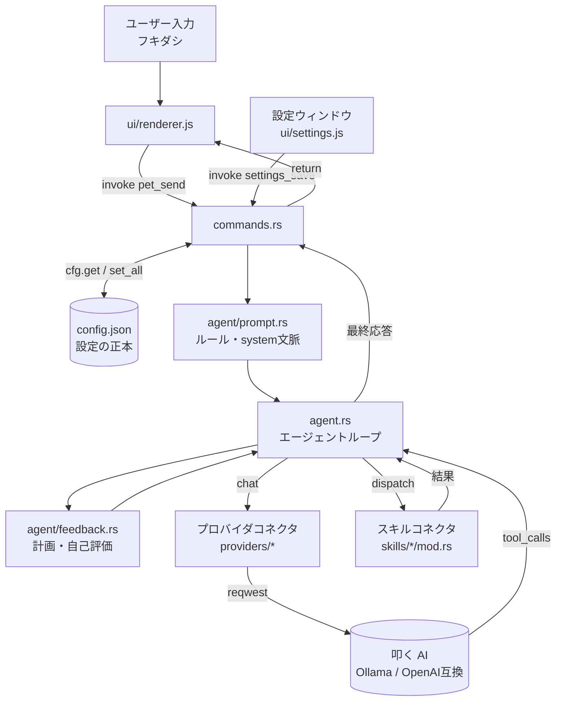

# PicoAgent 仕様書

PicoAgent（コネクタ駆動デスクトップペット / Tauri）の現行仕様の正本。起動・セットアップは [README.md](README.md)、全設定キーは [docs/SETTINGS.md](docs/SETTINGS.md)、作業ルールは [AGENTS.md](AGENTS.md) を参照する。

## 📑 目次

- [概要](#概要)
- [システム構成](#システム構成)
- [メッセージ正規形](#メッセージ正規形コネクタ間の共通言語)
- [エージェントループ](#エージェントループagentrs)
- [プロバイダコネクタ](#プロバイダコネクタsrc-taurisrcproviders)
- [スキル（ツール）コネクタ](#スキルツールコネクタ)
- [新しいコネクタの作り方](#新しいコネクタの作り方)
- [設定（config と設定画面）](#設定config-と設定画面)
- [外部インターフェース（ローカルAPI / MCP）](#外部インターフェースローカルapi--mcp)
- [フロント連携と製品化](#フロント連携と製品化)
- [MMDキャラクター](#mmdキャラクター)

---

## 概要

透明な **Tauri** ウィンドウに常駐する、キャラクターとフキダシだけのデスクトップペット。バックエンドは Rust（`src-tauri/`）、フロントは webview（`ui/`）。「叩く AI（LLM バックエンド）」と「エージェント機能（ツール）」をコネクタとして拡張できる。

| 構成要素 | 正本 |
|---|---|
| 叩く AI | プロバイダコネクタ（`src-tauri/src/providers/`）。**既定は `local`（同梱 llama-server）**で Ollama とは独立して動く |
| エージェント機能 | スキル（ツール）コネクタ。本体はプロジェクト直下の `skills/<スキル名>/mod.rs`、トレイトは `src-tauri/src/tools/mod.rs`。モデルが function calling で呼ぶ |
| キャラクター | `characters/index.json` と各 `character.json`。`cargo xtask sync-characters` が `ui/assets/characters/` へ差分同期する。制作専用の `expression-patches/`、`live2d-src/`、通常2Dの正本 `layers/*.png`、`mesh-rig/source/` は配信コピーへ含めず、実行用 lossless WebP だけを残す |
| 関係性 | `relationship.rs` がキャラ別の `app_data_dir/relationship-<キャラクターID>.json` へ会話・完了作業・ふれあい・共有した出来事を原子的に保存する。数値は内部更新だけに使い、UIとsystem文脈では段階名と最近の出来事だけを扱う |
| 中核 | エージェントループ（`src-tauri/src/agent.rs`） |

- **中断**: 停止要求は生成ストリーム、再試行待機、並列ツール実行と競合させて即時に反映する。中断したツール呼び出しにも同じ `tool_call_id` の中断結果を補い、履歴の対応を崩さない。画面側は停止要求から `CANCEL_RELEASE_MS`（8秒）待っても送信が返らなければ、その送信を中断扱いにして待機表示・入力・再送を戻す（応答の来ない接続で固まったまま復帰できなくなるのを防ぐ）。
- **予約の追いつき**: `last_checked_minute` から現在分までを調べ、スリープ・再起動中の未処理分は直近24時間を上限に実行する。時計が巻き戻っても過去予定を二重実行しない。
- **復号不能シークレット**: 設定画面では暗号文を入力値として表示せず、空欄と理由を示す。再入力しないまま保存した場合は既存暗号文を保持する。

---

## システム構成



製品内部のエージェント構成は、名前だけの空の層を作らず、状態の所有者と副作用で分ける。

| 責務 | 実装正本 | 境界 |
|---|---|---|
| ルール | `agent/prompt.rs` | 基本system prompt、キャラ人格、利用者が選んだ関係、長期メモリ、関係性文脈を一定順序で合成する。通常の再構築と「新しい会話」は同じ `agent::prompt::compose()` を通す |
| スキル | `src-tauri/src/tools/mod.rs` / `skills/<名前>/` / `user_skills.rs` | Rust Toolは候補選択、schema、許可判定、実行、副作用を持つ。利用者のSKILL.mdは指示だけを持ち、既存Toolの境界内で使う |
| メモリ | `memory.rs` / `history.rs` / `relationship.rs` | 全キャラ共通の長期メモリ、キャラ別会話履歴、キャラ別関係性を別の保存単位で持つ |
| フィードバックループ | `agent/feedback.rs` / `agent.rs` | 前者は任意の計画生成と自己評価、後者は `chat → tool_calls → 結果 → chat` の実行ループ |
| 実行中イベント | `agent.rs` / `commands.rs` | 進捗、ツール実行、承認待ち、画面通知を発生元から送る。外部拡張用の共通hook契約は無いため `hooks` 層は作らない |

基本ルールは、利用者が明示した関係プリセットを上書きしない（家族呼びは既定では禁止し、「妹」「姉」を選んだ場合だけ関係差分を人格の後ろへ足す）。「新しい会話」でも関係差分・長期メモリ・関係性文脈を落とさない。

### 登録と状態

- コネクタは **`inventory` でコンパイル時自動登録**する。`build.rs` が `src/providers/*.rs` とルートの `skills/<スキル名>/mod.rs` を走査して `#[path] pub mod` を生成するため、中央の `mod.rs` 編集は不要。
- 登録済みプロバイダ／スキルとツールスキーマは `OnceLock` でプロセス内に1度だけ作って再利用する。
- `AppState`（`commands.rs`）が選択中プロバイダ・モデル・会話履歴・直近の自発雑談・感情状態（`emotion::EmotionState`）を持つ。感情はユーザー発話と返答のキーワードから `emotion::update()` で更新し、`pet:emotion` でフロントへ通知する（`renderer.js` がキャラの `dataset.emotion` / `dataset.energyLevel` へ反映）。
- `crates/picoagent-core` は Tauri・OS・製品設定に依存しない非公開の内部共通crate（`publish = false`）で、正規形メッセージとUTF-8安全処理を持つ。`src-tauri/src/{message,text}.rs` はコアを再公開し、設計ガードは `guard_scan::all_sources()` でコアのソースも走査する。逐次UTF-8デコードは不完全な末尾を次のチャンクまで保持し、不正なバイト列を置換する。処理済み領域はチャンクごとに一度だけ除く。

### 挨拶

`hi` / `こんにちは` などの短い挨拶は `agent::simple_greeting_answer()` がプロバイダを呼ばず直接返す。返す一言は `pet_set_character_profile` が受け取った `character.json` の `greeting` を使い、無い場合だけ既定文にする。時間帯は挨拶自体が指していればそれに合わせ、時間帯を含まない挨拶は実時刻（5〜10時=朝 / 11〜16時=昼 / それ以外=夜）で決める。朝・夜は先頭の挨拶語だけを差し替えて二重挨拶を避ける。挨拶経路へ内部指示を混ぜず（小型モデルが禁止事項そのものを説明・読み上げるため）、履歴には原文と自然な短文だけを残す。

### 表示形式とウィンドウ

- 表示形式は `layout.rs` が担当する。`PICOAGENT_LAYOUT` 1キーで `mascot` / `pet` / `chat` / `bar` / `workspace` / `stream` / `widget` の7形式を切り替え、`styles.css` が `<main id="petApp" data-layout="…">` を見て配置を変える。`chat` は青灰色の壁紙と左右の白／緑吹き出しを持つLINE風表示。**HTML の要素はどの形式でも同じ**で、描画・履歴・アクションセンター・読み上げ・音声入力・添付・許可判定は共通のまま使う。バックエンドの仕事は「選択中の形式」と「ウィンドウ寸法」の2つだけ。
- 切替は設定画面「画面・操作」の実表示プレビューカード、右クリック「画面レイアウト」、上端メニューから行う。上端メニューの「表示」は `pet_layout_menu` で同じ形式一覧（選択中にチェック）と「画面レイアウト・位置…」をボタン直下へ出す。右クリックは `layout::select()`、設定保存は `remember_current_size()` → 設定保存 → `apply()` の順に処理し、どちらも切替前の寸法を `PICOAGENT_WINDOW_LAYOUTS` へ覚えてから次の形式の寸法を当てる。画面外へ出た場合は `pull_back_on_screen()` が戻す。
- キャラの通常ドラッグはOS標準のウィンドウ移動とする。構図の標準は、通常2Dが上半身 `upper`、長身・実写・Live2Dが胸上 `bust`。Live2Dはモデル別の `live2d.scale` / `offsetY` で胸上へ調整済みなので、未保存時にPNG向け `bust` 倍率を重ねず `upper=1.55` を基準倍率にする。`PICOAGENT_CHARACTER_FRAMING` はキャラIDと表示形式ごとに `zoom` / `x` / `y` / `preset` を持ち、表示側は `#characterView` に `translate(--char-x, --char-y) scale(--char-zoom)` を当てて中の `img` の待機モーションと干渉させない。 設定の構図プレビューは本体の標準ペット形式の拡大補正1.32を位置にも適用し、ドラッグはその逆変換で保存座標へ戻す。
- 配置編集（上端メニュー「配置」・右クリック「配置を直接調整」）の位置と倍率は `PICOAGENT_LAYOUT_PLACEMENTS` 1キーへ保存する。フキダシ・入力欄・履歴・画面内ディスプレイは表示形式ごと、立ち絵は `characters` の下にキャラクターID×表示形式で持つ。正規化は `layout_placements::normalize()` が正本で、未知の形式・対象・不正値を落とし、倍率は0.25〜4.0、位置は±20000pxへ丸める。保存は確定時（保存・閉じる・表示形式／キャラ切替・リセット）だけ `pet_save_layout_placements` で行い、ドラッグ中は書かない。読み込みは `pet_init` の `layoutPlacements`。
- 設定画面には表示モニターの手動指定を置かず、メインウィンドウの `current_monitor()`（未確定時だけ主画面）の中央へ出す。メインが「常に手前」（既定有効）なら設定ウィンドウにも同じ `always_on_top` を当てる（macOSでは揃えないと設定画面が背後へ回り込み操作できない）。右クリックの「常に手前」は開いている設定ウィンドウにも同時に適用する。
- `beta-full` 付きのアルファ配布だけ、全形式に小型の `ALPHA` バッジを出す。実行時は起動初期化が返す `betaBuild` で決め（既定は `hidden`）、配信UI生成時も `build-ui` がアルファ指定以外（`dev` / `build` / `build-distribution`）では `ui-dist/index.html` からバッジの記述を取り除く。記述は `ui/index.html` の1箇所だけで、xtask のテストが記述と除去結果を双方向で検査する。バッジは `pointer-events:none` で、通常形式は右上、配信形式はステージ左上へ置く。
- アルファ版は Cargo feature `beta-full` を付けた `cargo xtask build-beta` だけが Pro 対象スキルを試用可能にし、製品情報に `ALPHA` と全機能試用中であることを返す。通常 `build` と `build-distribution` は署名済みライセンスによる Free／Pro 判定を維持する。

### ホットキー・計測

- グローバルホットキーは `hotkey.rs`（`tauri-plugin-global-shortcut`）。起動時と設定保存時に `apply()` が全解除してから張り直す。呼び出しキーはウィンドウを表示・最小化解除・前面化してから `pet:hotkey`（payload `"summon"`）を送り、`renderer.js` が居眠りを解除して入力欄を開く。隠すキーは表示中なら `hide()`、隠れていれば呼び出しと同じ動作。**呼び出しキーが登録できていない状態で隠れたままにはしない**（`apply()` が表示へ戻す）。終了時は `release()` で全解除する。空欄は既定値、片方だけ止めるときは `off`。
- `Tracer`（`tracer.rs`）はツール実行ごとのレイテンシを直近200件保持し、`pet_traces` がスナップショットとツール別集計（平均レイテンシ・呼び出し回数・エラー数）を返す。
- `usage.rs` はトークン使用量を `app_data_dir/usage.json` へ保存し、`pet_usage` が今月のプロバイダ／モデル別集計と全期間累計を返す。90日より古いレコードは削除する。`app_data_dir` を取れない場合は一時領域へ逃げず、空集計で会話を続けて診断ログへ記録する。

### 会話履歴と長期メモリ

- 設定の正本は `config.rs`（`app_config_dir/config.json`）。コネクタは `cfg.get()` で都度読むため再起動なしに反映する。
- 会話履歴は `history.rs` がキャラ別に `app_data_dir/history-<キャラクターID>.json` へ保存する。`pet_send` のたびに文脈を圧縮して保存し、起動時に末尾20件を文脈へ戻す。途中の tool 呼び出し／結果は順序破綻を避けるため残さない。
  - 保存先取得や既存ファイルの読み取りに失敗したら空履歴で進まず、エラーを返す。JSON破損時は退避に成功した場合だけ空履歴で続け、退避できなければ上書きを止める。
  - **保存を止めている状態は `pet_init` の `historySaveBlocked` で返し、起動時に画面へ知らせる**。起動後に保存できなくなった場合も `pet:notice`（`kind=background_failure`・`key`・`ok`）を送り、フロントは通知一覧へ積まず `notifyBackgroundFailure` で原因ごとに1度だけ知らせる。復旧したら `ok=true` で印を落とす。
  - 圧縮は2段階。① `maybe_summarize_context()` がsystemを含む推定トークン量（日本語 ×2・ASCII ÷4）が予算の70%を超えたら古い40%をLLMで要約し、system内の自動要約1ブロックを置き換える（失敗時は元の会話を保持）。② `compacted_conversation()` が予算超過分を古い順に削る（最低2件は残す）。予算は local なら `PICOAGENT_LOCAL_CTX` の75%（1,500〜24,000トークン）、コンテキスト長を取れないプロバイダは6,000トークン。
  - `AppState.character_id` が文脈の持ち主キャラを持ち、`pet_set_character_profile` でキャラが変わったら文脈を捨てて切替先の履歴を戻す。`AppState.conversation_epoch` はリセット・キャラ切替・設定再初期化で進み、応答中だった `pet_send` / `pet_send_image` / `pet_idle_chatter` / 承認待ちコマンドが後から完了しても、開始時のキャラIDまたは世代と違えば書き戻さない。
- 長期メモリは `memory.rs` が `app_data_dir/memory.json` に保存する（**全キャラクター共通**）。自己情報・好み・継続指示らしい文だけを保守的に抽出し、起動時と設定変更時に system 文脈へ短く差し込む。`context_for_query(app, cfg, query)` がバイグラムのジャカード係数で発話に近い項目を優先し、閾値0.05以下なら全件を使う。
  - 設定「基本設定」→「覚えたこと」は本文・`updated_at`・`hits` を一覧し、分類・本文・最終更新日時が一致する1件だけを `store::lock_state("memory.json")` の中で削除する。削除後は `AppState.memory_context` と system を即時更新し、削除前の世代の応答の書き戻しを拒否する。
  - 人格やプロンプトの変更（`reset_conversation`）では会話の流れを保つ。右クリック「表示と会話をリセット」→「会話履歴と覚えたことを消す」→「消す（元に戻せません）」（`clear_conversation_and_history`）は、選択中キャラの履歴ファイルと長期メモリの削除が両方成功してから文脈・直近雑談を消して `pet:reset` を通知する。失敗時は成功扱いにせず、エラー通知と診断ログを残す。

---

## メッセージ正規形（コネクタ間の共通言語）

`agent.rs` はプロバイダ固有のワイヤ形式を知らない。正規形は `crates/picoagent-core/src/message.rs` が持ち（アプリ内は `src-tauri/src/message.rs` 経由）、各プロバイダが自分の API 形式と相互変換する。

| role | 形（serde） |
|---|---|
| system / user | `{ role, content, images?: [base64 data URL, ...] }` |
| assistant | `{ role:"assistant", content, tool_calls?: [{ id, name, arguments(Value) }] }` |
| tool（結果） | `{ role:"tool", tool_call_id, name, content }` |

- `arguments` は **`serde_json::Value`（オブジェクト）** で持つ（OpenAI の JSON 文字列はプロバイダ内で変換）。
- Ollama は tool 結果を位置・名前で扱うため `tool_call_id` を無視する（正規形には残す）。
- `images` はマルチモーダル入力（省略可）。OpenAI 互換では user の `content` を `[{type:"text",...}, {type:"image_url",...}]` へ変換する。`usage` は `#[serde(skip)]` の一時フィールドで、返ったトークン数を持つ。
- **スクリーンショット**: `pet_capture_screen` が主モニタを `xcap` で直接キャプチャし、PNG base64 data URL で返す（外部コマンドは使わない）。Windows / macOS / Linux 対応で、Linux は X11 と Wayland／PipeWire を持ち、OSの許可やポータルが拒否・未提供なら理由付きエラーを返す。対象外OSはビルドを保つスタブ。取得と変換は `spawn_blocking` で行う。フロントは「画面を見て」などの発話を検出して `pet_capture_screen` → `pet_send_image` へ切り替える。
- **インライン画像**: `appendLinkedText()` が `` をフキダシ内の `` として表示する。

### 手元の CLI エージェント（`providers/agent_cli.rs`）

Claude Code / Codex CLI を非対話（`claude -p` / `codex exec`）で呼び、テキスト応答を受け取る。CLI の導入とログインは利用者側で行い、配布構成の既定にはしない。

- **セッション**: プロセスは応答ごとに終了するが、通常会話では Claude の `session_id`／Codex の `thread_id` をアプリ起動中だけ保持し、同じキャラクター・会話世代・人格・CLI種類／パス／引数の間は明示IDで再開する。人格は基本system・キャラ設定・相棒モードだけから作る安定した文面で、検索連動の長期メモリやプロジェクト文脈は鍵に含めない（含めると毎ターン別セッションになる）。
  - 履歴全体を再送せず、最後の assistant 発話より後の差分だけを送る。差分が空になる呼び出し（自己評価の再生成など）だけは全文へ戻す。
  - 鍵に含めない可変の system 文脈（長期メモリ・プロジェクト文脈・関係性文脈）は、前回そのセッションへ渡した内容と変わったターンだけ『前提の更新』として先頭へ足す。送信済みの system はセッションIDと同じ寿命で持つ。
  - 別会話、キャラ変更、人格またはCLI設定の変更、中断、CLI失敗、構造化応答の解析失敗ではIDを捨てて新しく始める。`--last` は外部の別セッションを誤再開しうるため使わず、返ったIDが要求IDと違えば文脈喪失としてエラーにする。IDは永続化しない。
  - stdout に混ざる更新案内などの非JSON行は読み飛ばす。
  - マルチAIでは候補ごとに独立セッションを作り、同じ候補のツールループ内だけ共有する。まとめ役は1回の依頼に限って分担計画と最終統合を同じセッションでつなぐ。形式の分からない `custom` は単発。API・Ollama・内蔵 local は `messages` 自体が文脈なので外部セッションIDを重ねない。
- **モデル**: `claude` / `codex` は各CLIのアプリ既定、`claude:<モデル>` / `codex:<モデル>` は明示選択。既定時は `CLAUDE_CONFIG_DIR`（未設定なら `~/.claude`）の `settings.json`、`CODEX_HOME`（未設定なら `~/.codex`）の `config.toml` からモデルだけを毎回読み、Codex は選択中profileのmodelを優先する。追加引数のモデル指定は既定時だけ優先し、明示選択時は置き換える。設定ファイルやmodelが無ければモデル引数を省く。既定設定の破損・読取失敗はエラーで止める。
  - 候補は Claude の opus/sonnet/haiku と設定値、Codex の `models_cache.json` の公開候補（visibility=list）と設定値から作り、設定画面の一覧更新で読み直す。候補取得の失敗はCLIごとに隔離してログへ残す。一覧から消えた保存済み選択は勝手に置き換えない。モデル選択または外部既定値が変わったら通常会話のセッションを作り直す。
  - 通常は `PICOAGENT_AGENT_CLI_KIND`、マルチAIでは候補のモデル欄の `claude` / `codex` で呼び分ける。`PICOAGENT_AGENT_CLI_PATH` と `PICOAGENT_AGENT_CLI_ARGS` は `PICOAGENT_AGENT_CLI_KIND` と一致する種類にだけ使う（片方のCLIへもう片方の引数を渡さない）。
- **権限**: Claude は safe mode かつ組み込みツールなし、Codex はユーザー設定なし・read-only sandbox で起動し、**CLI 自身のツールから PicoAgent の権限境界を迂回させない**。プロンプトは引数として渡し、シェルは経由しない。
- **ツール呼び出し**: CLI は OpenAI 形式を受け付けないため、使えるスキル（名前・説明・引数キーだけ）を渡し、「ツールを使うときは `{"tool":..,"args":..}` だけを返す」と指示してその JSON を `tool_calls` へ変換する。コードフェンスや前後の文を剥がして最初の JSON オブジェクトだけを見る。**JSON でない出力は通常の返答**とし、**一覧に無いツール名は採用しない**。初回または単発CLIでは会話を役割ラベル付きで1本に畳み、長すぎる場合は古い方から落とす。

---

## エージェントループ（`agent.rs`）

`run(cfg, provider, model, messages, max_steps = 5, app = None) -> Result<String>`。`messages` は `&mut Vec<Message>` を破壊的に伸ばす。

1. **公開前検査**: `provider.chat_stream()` の生チャンクはターン内部だけで受け、画面・音声・履歴へ直接出さない。完成した assistant へ `strip_reasoning`、内部資料除去、全 system／private 文脈との一致、設定説明調の検査を行い、合格した同一本文だけを `pet:stream_chunk`、戻り値、TTS、履歴へ commit する。汚染時は生回答を捨てて利用者原文だけで1回再生成し、再び不合格なら固定安全文にする。tool_calls 用の中間 assistant は本文を空にする。
   - **照合元（非公開文脈）は呼び出し側任せにしない。** `agent::prompt::compose()` が人格 system を組み立てた時点で `agent::remember_private_context()` へ登録し、`guard_public_answer()` は呼び出し側の文脈と登録済みの人格の**両方**を照合する。画面側（`ui/renderer.js`）は表示・読み上げの直前で削り直さない（除去は受け口の1か所だけが持つ）。
   - **公開検査を通らない経路を機械検査する。** `agent::guard` のテストが、`provider.chat*()` の戻り値を公開検査へ通さずに使う箇所を落とす。画面・音声・履歴の本文にならない用途（会話要約、サブエージェントのツール結果、後段で検査する再生成）は呼び出しの直前へ `// 非公開利用: 理由` を書く。実行計画（`feedback::planning_step`）は画面へ出るので同じ検査を通す。
   - 配信形式の長文字幕は実DOMの収容寸法で複数ページへ分け、TTS有効時はページ単位の発話、無効時は文字量に応じた時間差で順に表示する。
   - **話題ガード（`topic_guard.rs`）**: ホロライブ等の公式キャラクター対策として、AIを使わない決定的な照合で会話を止める。一覧はコード内の定数で、設定・外部ファイルから変更も無効化もできない（全キャラで常に有効）。常に止める語（中の人・前世の名前・身バレ・卒業理由・性的な語など）と、主語の直後 `SUBJECT_GAP`（6文字）以内に来たときだけ止める一般語（前世・本名・彼氏・「卒業する」・炎上・契約解除・年収・宗教など）の2段で持つ。主語は入力なら相手を指す語（あなた・君など）、出力なら自分を指す語（私・僕など）、どちらでもホロライブ・VTuberを指す語。人を指す主語は直後が助詞・読点・対象語のときだけ主語と見なす（「私立」を拾わない）。照合前に空白・区切り記号を除き、全角英数を半角・小文字へ揃える。番号回答を選択肢の本文へ展開した場合も、要約・複数AI・履歴保存より前に再照合する。入力は `pet_send` / `pet_send_image` の入口で止めて固定の返答 `BLOCKED_REPLY` を返し、止めた発話は履歴へ残さない。ローカルAPI・予定実行など他の入口は `agent::run` の先頭で同じ照合を行う。ゲーム採点は回答を採点AIへ送らずエラーにする。出力は `guard_public_answer()` の最後で照合し、当たれば再生成せず `BLOCKED_REPLY` へ差し替える。記録するのは分類名だけで、発話本文はログへ残さない。半角カタカナ・ひらがな書き換え・当て字は照合しない。
2. `tool_calls` が無ければ、その `content` を最終応答として返す。
3. `tool_calls` があれば全呼び出しを `futures::future::join_all()` で**並列実行**し、結果を `tool` メッセージとして積んで 1 に戻る。
4. `max_steps` を超えたら打ち切り、最後の文面を返す。
5. 各 chat 呼び出しは `chat_with_retry()` で最大3回・指数バックオフ（1秒→2秒）で再試行する（4xx 認証エラーは即中断）。
6. 返ったトークン使用量（`Message.usage`）を `usage::record()` で `app_data_dir/usage.json` に保存する。
7. ツール実行は `Tracer::start_span()` で計測し、`Tracer::record()` で直近200件を持つ。
8. ツール出力は `PICOAGENT_TOOL_OUTPUT_MAX_CHARS`（既定 `auto`＝local はコンテキスト長の45%〔1,000〜60,000文字〕、クラウドは24,000文字）で打ち切る。`tools::check_injection()` でプロンプトインジェクションの試行を検査し、検知時は警告付きで包む。**同じ検査を添付ファイルの抽出本文**（`commands.rs` の `mark_untrusted_if_injection`）と**先回り実行が差し込む本文**（`agent.rs` の `mark_untrusted_tool_output`）にも通す。引数 JSON の解析失敗（`_raw`）はツールを呼ばずエラー文字列を返して再試行させる（`dispatch_or_error()`）。
9. `PICOAGENT_PLANNING_ENABLED` または `PICOAGENT_SUPER_AGENT` が有効で、質問が複雑（120文字超・疑問符2個以上・手順系の語）なら、`provider.chat_with_options(json_mode=true)` でサブタスクへ分解し（`planning_step()`）、system 追記として付けてからループへ進む。
10. `PICOAGENT_SELF_EVAL_ENABLED` または `PICOAGENT_SUPER_AGENT` が有効で、最終応答が短すぎる（8文字未満）か拒否パターンを含むなら、`provider.chat()` で1回再生成する（`self_improve()`。失敗時は元の応答）。
11. **スーパーエージェントモード（`PICOAGENT_SUPER_AGENT=true`）**: 計画・自己評価を有効にし、トップレベルの `max_steps` を `PICOAGENT_SUPER_AGENT_MAX_STEPS`（既定12、〜30）へ上げる。計画開始・計画内容・「考え中…」・「考え直しています…」・「ツールを実行中: …」を `pet:agent_status` で送る（内部ループの現在値と上限は出さない）。ツールの実行有無・対象・成否は文言から推測させず、`pet:agent_activity` の `started` / `completed` / `waiting` と `tools` / `failedTools` で通知する。
12. **ネスト深さ**: `run()` は `tokio::task_local!` の `AGENT_DEPTH` をタスクごとに増やす。`subagent` は深さが `PICOAGENT_SUBAGENT_MAX_DEPTH`（既定2）以上ならネストを拒否する。プロセス全体のカウンターにしないので、並行する兄弟AIを相互にネスト扱いしない。計画・自己評価はトップレベル（深さ1）だけで行う。

### 先回り実行

通常の質問では、ローカルモデルの `tool_calls` 対応に頼らず、最初の `chat()` より前に必要なスキルを直接実行する。

- **Web検索**は事実確認・最新情報・定義などを要するときだけ（`should_web_search`：明示依頼、または「最新/ニュース/価格/誰/いつ/とは…」等のマーカー）。明示依頼には、Webを指す語（「webで/ネットで/ウェブで/インターネット/ググ」）と調べる動作（「検索/調べ/しらべ/探」）が揃う言い回しも含める。依頼の言い回しを除くと話題が残らない場合は、`Tool::intent_invocation_in_conversation()` へ渡る直前の利用者発話（新しい順に最大3件）から話題を最大2件補う（補い方は `web_search` 側が持つ）。
- 雑談・感想・相談（「むぎかわいい」「ありがとう」「自己紹介して」等）と短い挨拶では検索せず、キャラ本人として返す。小型モデルが実行していない作業を「今から調べる」と約束しないよう、`agent::prompt::base` で毎回禁止する。
- 一般ニュースの要約依頼（「今日のニュース」「ニュース教えて」「今日の出来事」、「ニューす」等の表記ゆれを含む）は、Google News / Yahoo!ニュースのHTMLを対象にした `news_scrape` を先に実行し、見出しベースで要約させる。
- 天気（`is_weather_query` → `weather`）、為替（`currency_query` が通貨を読めたとき → `currency_rates`）、市場指数（`market_query` → `market_indices`）は**先に実行して整形済み出力（天気アイコン・スパークライン等）をそのまま返す**（小型モデルがチャートを再現できないため）。為替は文中の通貨と「推移/チャート」「N日」から `base`/`symbols`/`chart`/`days` を組み立てる。スキル直行応答も assistant 発話として履歴へ保存する。
- 代表的なリマインダー・集中タイマー・見守り・できたことメモ、クリップボード要約、おでかけ前チェック、出典付き調査レポートもスキルを先に実行する。その他のローカル操作系の依頼では、明示的な検索依頼がない限り事前検索を省き、スキル利用を優先させる指示を足す。
- 検索結果は外部の信頼できない参考データとして区切って付け、結果内の指示に従わないよう明記する。検索失敗もモデルへ渡して利用者へ明示させる。
- **出典**: 参照元は Markdown リンクで回答させ、フキダシは Markdown リンクと通常URLを安全なDOMリンクへ変換する。事前検索後の回答に参照元が1件も無い場合だけ、取得した見出し付きリンクを最大5件 `参考:` として末尾へ添える（未使用URLを全件足さない）。ニュース取得後に本文の無い約束だけの返答（80文字以下で、URLも取得済み見出しも含まない）が返ったら、取得済みリンクを最大5件返す。
- **読み上げ除外**: URL は `speech_text` とフロントの読み上げ前処理で除外する。`speech_text` は RSSダンプ行、スパークラインのブロック文字、絵文字も除く。
- **見出しの深掘り**: 直前の回答のニュース見出しを名前または「2番目」のような番号で指して詳しく尋ねたら、一覧を取り直さずその見出しのURL本文を `web_fetch` で取得して答える。見出しが複数あるときに「このニュース」だけでは対象を決めず、モデルへ委ねる。見出しが1件でも、直前の回答を指す語（「この」「さっき」「記事」など）があるときだけ引き継ぐ。記事本文は信頼できない外部資料として分け、記事中の指示に従わない。

---

## プロバイダコネクタ（`src-tauri/src/providers/`）

`Provider` トレイトを実装し、`inventory::submit!` で登録する。

```rust
#[async_trait]
pub trait Provider: Send + Sync {
    fn id(&self) -> &'static str;
    fn label(&self) -> &'static str;
    fn config_schema(&self) -> Vec<Field> { Vec::new() }
    fn default_model(&self, cfg: &Config) -> String;
    async fn list_models(&self, cfg: &Config) -> anyhow::Result<Vec<String>>;
    async fn is_up(&self, cfg: &Config) -> bool;  // 接続不可・キー無は false に正規化してよい
    async fn chat(&self, cfg: &Config, model: &str, messages: &[Message], tools: &[Value]) -> anyhow::Result<Message>;
    // 既定実装は chat() の完了後に on_chunk を1回呼ぶ。openai.rs / local.rs は OpenAI 互換 SSE（stream_chat を共用）、
    // ollama.rs は /api/chat の NDJSON をオーバーライドで受信し、on_chunk を逐次呼ぶ。
    async fn chat_stream(&self, cfg: &Config, model: &str, messages: &[Message], tools: &[Value], on_chunk: Arc<dyn Fn(String) + Send + Sync>) -> anyhow::Result<Message>;
    // 既定実装は chat() へ委譲（json_mode は無視）。openai.rs は response_format: json_object を付ける。
    async fn chat_with_options(&self, cfg: &Config, model: &str, messages: &[Message], tools: &[Value], json_mode: bool) -> anyhow::Result<Message>;
}
inventory::submit! { ProviderReg { make: || Box::new(MyProvider) } }
```

接続先・APIキー・モデルは各メソッド内で `cfg.get()` から都度読む（再起動なしに反映するため）。`on_chunk` は async_trait の Send 境界のため `Arc<dyn Fn(String) + Send + Sync>` で渡す。

### 同梱プロバイダ

| id | 叩く先 | 接続条件・主な候補 |
|---|---|---|
| `local`（既定） | 同梱 llama-server `/v1/chat/completions` | エンジン同梱＋モデル取得済（`engine.rs` が管理） |
| `ollama` | ローカル Ollama `/api/chat` | `ollama serve` 起動 |
| `openai` | OpenAI 互換 `/chat/completions` | 公式URLは `OPENAI_API_KEY`、互換URLは `OPENAI_COMPAT_API_KEY`。候補は `gpt-5.5` / `gpt-5.4` / `gpt-5.4-mini`（既定） / `gpt-5.4-nano` |
| `anthropic` | Anthropic Messages API `/messages` | `PICOAGENT_ANTHROPIC_API_KEY`。候補は `claude-opus-4-8` / `claude-sonnet-4-6` / `claude-haiku-4-5` |
| `deepseek` | DeepSeek `/chat/completions` | `PICOAGENT_DEEPSEEK_API_KEY`。候補は `deepseek-v4-flash` / `deepseek-v4-pro`（互換用に `deepseek-chat` / `deepseek-reasoner`） |
| `gemini` | Gemini の OpenAI 互換 `/v1beta/openai/chat/completions` | `PICOAGENT_GEMINI_API_KEY` |
| `xai` | xAI `/chat/completions` | `PICOAGENT_XAI_API_KEY`。候補は `grok-4.3` / `grok-build-0.1` |
| `mistral` | Mistral `/chat/completions` | `PICOAGENT_MISTRAL_API_KEY`。Medium / Small / Large / Ministral 系 |

- キーが未設定のクラウドプロバイダは `is_up()=false`。
- `openai` は `OPENAI_BASE_URL` を変えれば任意の OpenAI 形式ゲートウェイへつながる。`OPENAI_API_KEY` は HTTPS の `api.openai.com:443` にだけ送る。
- `anthropic` は正規形とツール呼び出しを `tool_use` / `tool_result` content block へ相互変換する。
- `deepseek` / `gemini` / `xai` / `mistral` / `local` は `openai.rs` の `to_wire`/`from_wire` を再利用する。`PICOAGENT_DEEPSEEK_THINKING` が有効なら V4 系へ `thinking: {type:"enabled"}` を付ける。`gemini` と `local` は tools 付きで失敗したら tools 無しで1度だけ再試行する。
- `local` は送信直前に `normalize_for_local` で役割を正規化する（Gemma 等のテンプレートは user 始まりの厳密な交互を要求し、崩れると 400「Conversation roles must alternate」になるため）。system は先頭へ集約し、先頭の純 assistant は除き、連続する同 role の user/assistant は連結する。tool 呼び出しを含むメッセージはそのまま通す。

### 同梱推論エンジン（`engine.rs`）

`local` のために llama.cpp の `llama-server` を同梱して使う。プリセットのモデルは量子化済みGGUFに限る（Gemma 4／Qwen3.5／Phi-4 mini／LFM2.5 1.2B日本語が Q4_K_M、LFM2.5 2.6B が QAD Q4_0、gpt-oss-20b が MXFP4）。利用者が明示する `custom` URL は対象外。

- **取得**: エンジン本体（`llama-server` + ggml DLL）はリポジトリに含めず、`cargo xtask setup engine`（`bundled::fetch_engine`）で `src-tauri/resources/bundled/engine/` に取得する。llama.cpp 安定版 v0.2.0 が対応付けた `b10566` を正本とし、Windows・Ubuntu は Vulkan、macOS は Metal の資産名と固定SHA-256を GitHub digest と実体の両方へ照合する。配置後は `picoagent-engine.json` へタグ・資産名・SHA-256を残し、一致しない既存配置は取り直す。`LLAMACPP_ASSET` で資産を変えるときは `LLAMACPP_SHA256` も必須。`tauri.conf.json` の `bundle.resources` で同梱する。
- **起動**（既定が `local` のとき `engine::ensure_and_start` を非同期実行）:
  1. **モデル選定**: `PICOAGENT_LOCAL_MODEL_PRESET` が未設定か `auto` なら、連続ツール利用を検証済みの LFM2.5 2.6B QAD 版を選んで `PICOAGENT_MODEL` と一緒に `config.json` へ保存する。保存できなければ理由を画面へ出して起動を止める。利用者が明示保存したプリセットは変えない。LFM2.5 1.2B と LLM-jp-4 8B Thinking は互換用に残すだけで、新規候補に出さない（前者は2ターン目で別ツールへ切り替えられず、後者は思考文の非表示と連続ツール利用が未確認）。`custom` だけは `PICOAGENT_MODEL_URL` を直接使う。同じ工程で `PICOAGENT_LOCAL_CTX` も、保存値と環境変数が無い場合だけ既定32,768を保存する（既存の保存値は上書きしない）。
  2. **取得**: GGUF が利用者データの `PicoAgent/bundled/models/` に無ければ、プリセットURLまたは `PICOAGENT_MODEL_URL` からストリーミング取得する（`engine:status {phase:"download", percent}`）。数GBのSHA-256照合を行う間だけ `engine:status {phase:"verify"}` を出す。古い保存名の削除は、廃止済みプリセット（`RETIRED_MODEL_FILES`）と**選択中プリセットの古い保存名だけ**に限る（別プリセットとして持っている実体を巻き込まない）。
  3. **GPU**: Windows は実GPUを判定し、Turing以降かつドライバー580以上の NVIDIA は `CUDA 13.3 → Vulkan → CPU`、AMD 公式 HIP Runtime 対応機種は `ROCm 7.14 → Vulkan → CPU`、Intel Arc／Iris Xe／Core Ultra 系の `Intel Graphics`／Data Center Flex・Max／Server GPU は `SYCL → Vulkan → CPU` の順に起動する。それ以外は専用方式を取得せず Vulkan から始める。
     - 追加配布物は対象GPUの確認後だけ取得し、固定サイズ・SHA-256・安全な展開・`--list-devices` の実認識を通ったステージングだけを原子的に有効化する。取得前に、異常終了で残ったステージング・退避フォルダを回収する。導入済みの実認識に成功して再取得しない場合も、その方式の終了済み退避先だけを回収する。入れ替えと戻しの両方に失敗したら退避先を含む理由を返す。追加方式が失敗しても同梱 Vulkan へ戻る。管理導入済みの CUDA／ROCm／SYCL は共通 Vulkan 版より先に解決し、起動候補が1件も無い場合だけ未導入エラーにする。
     - `PICOAGENT_LOCAL_NGL=0` は追加取得せず CPU 固定を優先する。AMD／Intel の対応境界は llama.cpp 固定版または配布版を更新するたびに各社公式表で確かめる。
     - 同じ版・ABI・ハッシュの Python 本体と wheel は `bundled/python` の共通環境へ1度だけ導入する。CUDA の版や ABI が違うネイティブ配布物は互換性境界ごとに分ける。
  4. **起動**: `llama-server` は `PicoAgent/bundled/engine/`、`resources/bundled/engine/`、`resources/engine/`、開発時の `src-tauri/resources/bundled/engine/` / `src-tauri/resources/engine/` の順に探す。`cargo xtask dev` / `cargo xtask build` は事前に `bundled::fetch_engine` で同梱配置を確認してから Tauri を起動する。
     - `llama-server -m <model> --host 127.0.0.1 --port <PICOAGENT_LOCAL_PORT> -c <PICOAGENT_LOCAL_CTX> -ngl <PICOAGENT_LOCAL_NGL> --jinja` を起動する（Windows は CREATE_NO_WINDOW）。`PICOAGENT_LOCAL_GPU_DEVICE`（`Vulkan1` / `CUDA0` など）は、名前が示すバックエンドと起動候補が一致するときだけ `--device <値>` を足す。
     - Qwen3.5 だけは内部推論を発話へ混ぜないよう `--chat-template-kwargs {"enable_thinking":false} --reasoning-budget 0` を足す。
     - 既定の同梱ビルドは Vulkan 版で、`-ngl 999` により全レイヤを GPU へ載せる（非対応環境では CPU へ落ちる）。`/health` が 200 になったら `engine:status {phase:"ready"}`。同じポートに既存の `llama-server` が残っていれば、`/v1/models` のモデルIDが要求中の GGUF と一致するときだけ再利用し、違えばエラーにして停止を促す。
- 子プロセスは `RunEvent::Exit` で止める（`engine::stop`）。状態は `engine_status` でも取れる。
- **設定画面**: 「モデル」欄（`PICOAGENT_MODEL`）でプリセットを選ぶと `local::model_url` が取得URLへ反映する。「AIモデル」は設定読込時だけ RAM を取得し、Windows NVIDIA では `nvidia-smi` で専用VRAM総量も取る（WMI `AdapterRAM` は uint32 で飽和するため使わない。NVIDIA 以外の VRAM は不明表示にして RAM で判定）。macOS は統合メモリとして RAM で、Ubuntu は `/proc/meminfo` で判定する。候補カードと系列／サイズ選択は `groupedModelField.setValue()` を共通入口にする。`settings_save` はローカル関連の変更（`PICOAGENT_MODEL` / `PICOAGENT_LOCAL_MODEL_PRESET` / `PICOAGENT_MODEL_URL` など）を再起動対象とし、再起動後に `ensure_and_start` を行う。

### AivisSpeech Engine 連携（`aivis.rs` / `pet_speak`）

`PICOAGENT_TTS_ENABLED` が有効なら、回答を AivisSpeech Engine の `/audio_query` → `/synthesis` へ渡して WAV を作り、フロントで再生する。`/synthesis` へ渡す `volumeScale` は0.72以下に制限して約3dBの余裕を残す（0dBでのクリップ防止）。音声再生中だけ会話アニメーションを保つ。起動時・キャラ変更時の挨拶（`greeting`）も同じ経路で読み上げる。

- **接続先**: 既定は PicoAgent 管理下の Aivis だけを使い、`http://127.0.0.1:<PICOAGENT_TTS_PORT>`（既定 `11436`）へつなぐ。同じポートの管理外プロセスを暗黙に再利用しない。`PICOAGENT_TTS_ENDPOINT` にこのPC上のHTTP URLを明示したときだけ、別途起動した VOICEVOX 互換 API へつなぎ、そのプロセスやモデルには触れない。デバイス・内蔵ポート・speaker ID は通常UIに出さない内部設定。`pet_speak` 時点で `/version` が未応答なら ready まで待つ。
- **再生**: `pet_speak` が返す WAV を `Blob` / `Audio` で再生するため、CSP は `media-src 'self' blob: data:` を許可する。`PICOAGENT_TTS_VOLUME`（0〜100）は二乗カーブ（1%は実効ゲイン0.0001）でキャラ音声とゲーム効果音の共通マスター音量にし、`pet:ui` で再生中の音声にも即時反映する。ゲームの「消音」は効果音だけを追加で止める。再生失敗はステータスへ出す。
- **デバイス**: `PICOAGENT_TTS_DEVICE` が `gpu` なら `--use_gpu`、`cpu` なら `--no-use_gpu`。`auto` は起動前に GPU 候補（Windows では NVIDIA / Radeon・Vega・Graphics 表記の AMD / Intel 系の表示アダプタ。AMD CPU だけは候補にしない）を見て決める。
- **準備**: 初回合成は話者モデルのロードに時間がかかるため HTTP タイムアウトは180秒。キャラ固有の AivisHub モデルは `pet_prepare_voice_model` で起動シーケンス中に導入する。読み上げ有効時は非表示の準備画面で「声を準備中…」を出し、Aivis起動・モデル導入・最初の挨拶音声の合成まで終えてから通常画面へ移る。失敗はログだけにせず診断案内を残す。
- **起動画面との関係**: `aivis_status`（`{ enabled, up }`）を起動時のキャラ描画ゲートに使う。準備画面でキャラの描画と会話履歴を戻し、ローカルAIの取得・照合・起動も同じ画面で待つ（初回セットアップ未完了なら待たずに案内を出す）。`ready` までは送信ボタンとクイック操作を無効にし、`error` は診断・修復へ進む理由として常時表示する。一時表示が終わっても空欄にせず、保持中の準備・失敗理由へ戻す。TTS 有効なら起動時の挨拶も合成してから通常画面へ戻し、復帰後に再生する（`prepareSpeech` → `playPreparedSpeech`）。準備が長引いても、フロントは `pet_init` が渡す間隔で `pet_boot_progress` を送り続ける。
- **配置**: 実行ファイルは利用者データの `PicoAgent/bundled/aivis/` から起動する。同梱配置 `resources/bundled/aivis/` は起動元にせず、初回にコピーして使う（同梱側の `run.exe` が新しければ起動前に上書き）。配布対象版は `component-manifest.json` の `targetVersion` を正本とし、実行時取得と `office::fetch_aivis` が同じ値を読む。手動は `cargo xtask setup aivis`、取得確認だけは `AIVIS_RELEASE=latest` やタグで上書きできる。同梱が無ければ同じ公式リリースを実行時に取得して展開する（`7z` / `7za` / `tar`。macOS の `.7z.001` は p7zip が必要。事前取得で `7z` が無ければ警告だけにし、必須にするなら `AIVIS_REQUIRED=1`）。
  - 大容量取得は接続30秒・受信無通信120秒の上限を持ち、全体時間では打ち切らない。再導入と同梱版更新は固有のステージングへ展開・検査し、旧版を退避してから原子的に入れ替え、失敗時は戻す。停止した管理中プロセスは、読み上げ有効時だけ再起動する。
  - 非 Windows ではコピー・展開後と起動直前に `run` の実行権限を補正する（`.app` 配下など chmod できないものは spawn の結果で判定）。配布物では `tauri.conf.json` の `bundle.resources` で `resources/bundled/**/*` を同梱する。
- **専用プロファイル**: Aivis 子プロセスの `USERPROFILE` / `HOME` / `APPDATA` / `LOCALAPPDATA` を `PicoAgent/aivis-userdata/profile/` へ向け、モデル・辞書・キャッシュを利用者データ内へ閉じ込める。LibreOffice は `PicoAgent/office-profile/`、生成用 Python・ComfyUI は `PicoAgent/generation-runtime-data/`、ブラウザ操作は `PicoAgent/browser-profile/` だけを使う。
- **話者**: 選択中キャラの `PICOAGENT_TTS_CHARACTER_OVERRIDES[characterId].speaker` を優先し、無ければ `default_character_tts_voice` のキャラ別既定声、対象外キャラだけ共通の `PICOAGENT_TTS_SPEAKER` を使う。組み込みキャラは、むぎ=`まお・あまあま`、りん=`るな・ノーマル`、まい=`まい・ノーマル`、あおい=`まお・おちつき`、ひより=`まお・ふつー`、はる=`花音・ノーマル`、イプシロン=`コハク・せつなめ`、まお=`まお・おちつき`、ライス=`阿井田 茂・Calm`、わんこ=`TANAKA・Happy`。
  - `pet_prepare_voice_model` と `pet_speak` は、話者 UUID が `/speakers` に無ければモデル UUID の AIVMX を `/aivm_models/install` で導入し、`/speakers` から話者 UUID＋スタイル名で**実 style ID を実行時に解決**する（global style ID は導入時に決まるためハードコードせず、`styleId` 定数は解決失敗時の予備）。利用者が明示した speaker はそのまま使う。
- アプリが起動した子プロセスだけを `RunEvent::Exit` で止め、利用者が手動起動していた Aivis には触らない。

### ログ

- 実行時ログは利用者データの `PicoAgent/log/` にまとめる（Windows 例: `%APPDATA%\PicoAgent\log\`）。アプリ本体とフロントのエラーは `app`、Aivis の stdout/stderr は `aivis`、llama-server は `engine` へ追記する（`app.<日付>.log` / `engine.<日付>.log` / `aivis.<日付>.log`）。
- バックエンドのパニックは `std::panic::set_hook`、フロントは大域 `error`/`unhandledrejection`、`window.picoagent` の `invoke` ラッパ、Tauriイベントの購読・コールバック・解除、WebAudio 等の非同期解放失敗で捕捉し、文脈付きで `app` へ記録する。
- 起動時の更新確認はオフライン・タイムアウトだけを正常な見送りとし、通信異常・フィード解析失敗は `app` へ残す。ログ保存先そのものを取れない場合に限り、一時領域へ退避して stderr にも理由を出す。
- 1日ごとに日付付きファイル（`app.<YYYY-MM-DD>.log` など。`log_paths::dated_name`）へ分け、1週間（`LOG_RETAIN_DAYS=7`）保持する。起動時と1日ごとのタイマーで `prune_old_logs` が古い `.log` を消す。**会話履歴（`history-<キャラID>.json`）はログではないので対象外。**
- Aivis が起動直後に終了したり ready 待ちがタイムアウトしたら、当日の `aivis` ログ末尾をエラー文字列に含めて返す。

### 同梱Whisper CLI（`meeting_recorder`）

録音の文字起こしは whisper.cpp の `whisper-cli` を CLI 実行で使う。常駐サーバを立てずポートも使わないので、利用者が起動している別のWhisperサーバとは競合しない。

- 実行ファイルとモデルはリポジトリに含めない。開発版は `cargo xtask setup whisper` で `src-tauri/resources/bundled/whisper/` に、軽量販売版は公式 Release と公式モデル配布から利用者データ側へ取得する。
- `PICOAGENT_TRANSCRIBE_PROGRAM` / `PICOAGENT_TRANSCRIBE_MODEL` が設定されていれば手動導入物を最優先し、空のときだけ同梱物を使う。
- 文字起こしごとに1回だけ起動し、完了・失敗・タイムアウト（`PICOAGENT_TRANSCRIBE_TIMEOUT_SECS`）で終える。標準入力は使わない。
- `diarize=true` のときだけ `PICOAGENT_TRANSCRIBE_DIARIZE_ARGS`（既定は tinydiarize の `-tdrz`）を足す。精度とマーカー形式はローカル実装とモデルに依存する。
- 設定画面から消せるのは利用者データ側の管理領域だけで、手動導入物や開発用同梱物は消さない。

### 初回セットアップと追加機能（`components.rs`）

初回セットアップはLive2D追加案内の1画面だけとする。取得を代行できる任意機能は Whisper だけで、1件のために選択画面を挟まない。画面末尾に「音声入力・Office変換・PDF／画像／文書ツールは設定 → 追加機能・更新から導入できます」の一行だけを置く。相棒の用途は初回に質問せず、未設定なら `both`（暮らしと作業の両方）を保存する。「使い方」から案内を再表示しても、変更済みの用途・履歴・設定・追加済みキャラは消さない。

音声読み上げ（Aivis）は選択肢にせず、初回起動で自動導入する（選択式にすると多くの利用者が声の出ない状態で使い始めるため）。取得は案内表示も操作も待たせず裏で進め、導入全体が成功した場合だけ `PICOAGENT_TTS_ENABLED=true` を保存する。進捗は専用の画面を作らず起動画面の状態表示（`setStatus`）へ出し、通常画面へ戻ったあとはステータス行へ流す。ローカルモデルの取得中はそちらを優先して表示する。導入済み・取得不能・オフラインでは自動導入せず、失敗は理由と再導入先（設定 → 追加機能・更新）を出す。設定画面からの導入・更新では既存の読み上げON/OFFを変えない。

- **版の表示**: Aivis は導入先の `engine_manifest.json` の版と `component-manifest.json` の `targetVersion` を比べ、「更新あり」「推奨版より新しい」「確認が必要」を出す。版確認の失敗はログへ残し、他の機能の表示は続ける。配布対象版と公式 Release リンクが一致しなければ状態取得を失敗させる。更新・確認件数は設定タブと基本設定の入口へ出す。
- **操作**: 更新・推奨版への復帰・修復・削除は、維持または削除されるデータを画面内に示す二段階操作（10秒経過またはフォーカス移動で解除）。進捗は共通の部品で工程名と経過時間を出し、総量が分かれば実数パーセント、分からなければ不定バーにする。導入・更新・修復・削除はバックエンドの共通ロックで直列化する。`PicoAgent/aivis-userdata/` の音声モデル・辞書・設定には触れない。
- **中断からの復旧**: 起動時と導入・削除の前に、導入操作と同じ排他の中で終了済みプロセスの途中データを処理する。単体更新の退避先（追加機能の `.backup-<id>-<pid>`、Aivis の `.backup-aivis-<pid>-<連番>`）は本体が無ければ旧版を戻し、あれば消す。Aivisは復元に成功してから後続の退避先を消し、復元失敗だけを理由に別の旧版を捨てない。共通Pythonとキャラ作成基盤の組更新は、片方だけ配置済みなら両方を旧版へ戻し、両方配置済みなら新版を維持する。復元に失敗したときは判断に必要な途中データを残し、導入・削除を続行しない。新版を配置できた後に旧版の掃除だけ失敗しても導入は成功として扱い、残りは次回片付ける。
  - NVFP4専用生成環境の`media-runtime-old`だけが残った場合は、利用者が導入を再実行したときに取得・空き容量検査より先に本体へ戻して実行検証する。実行できなければ退避先へ戻して停止し、既存本体がある場合は旧版で上書きしない。同意・対応環境の確認を省略せず、起動時に任意機能の取得を始めない。
- **取得元**: 第三者ソフトウェアを PicoAgent の Release へ再アップロードしない。`component-manifest.json` は `version=2` / `policy=direct-upstream`、公式取得元表示、管理対象の `targetVersion` だけを持つ。`installMode=managed`（Aivis、Whisper、生成基盤と選んだモデル）は各公式配布元から `PicoAgent/bundled/<id>/` へ直接取得し、GitHub Release API のサイズと SHA-256 digest、固定モデルの SHA-256、HTTPS、上限サイズ、zip slip、展開容量を検査してから原子的に入れ替える。`installMode=external`（LibreOffice、Pandoc、FFmpeg、qpdf、Poppler、ImageMagick、ripgrep）は公式ページを表示するだけで、外部導入物を削除しない。
- **生成基盤**: 共有 Python 3.12 と ComfyUI を `character-maker` で管理し、Qwen 画像編集にも使う。Wan と LTX 0.9.8 は `video-wan`／`video-ltx` の別コンポーネント。Krea 2／LTX 2.5（`krea-2-turbo-nvfp4`、`ltx-2.5-nvfp4`）は Python 本体だけを再利用し、`media-runtime` へ独立 venv と ComfyUI を置く。対象は Windows x64・CUDA 13・演算能力12以上・VRAM 8GB以上・RAM 32GB以上で、8GBでの実動作保証ではない。利用条件と GPU・RAM・空き容量・権限を取得前に確かめ、条件不足を非量子化モデルへの切替などで回避しない。低VRAMでは CPU 退避・タイル復号・小さい既定寸法を使い、補間拡大はしない。共通 Python 未導入なら取得前に止め、共通 Python を含む基盤は追加モデルより先に削除できない。確認状態は [管理モデル](docs/models.md) を参照。
- **オフライン**: 起動時確認は黙って見送り、明示操作では同じ画面内に「オフラインのため見送り」と出す（エラー画面・モーダル・フキダシは出さない）。

---

## スキル（ツール）コネクタ

本体はプロジェクト直下の `skills/<スキル名>/mod.rs`、`Tool` トレイトとレジストリは `src-tauri/src/tools/mod.rs`。スキル専用の補助モジュール・スクリプト・テンプレート・少量の静的アセットは同じ `skills/<スキル名>/` に置く。外部依存クレートは `src-tauri/Cargo.toml` に集め（`crates/picoagent-core` だけは自身の最小依存を持つ）、スキル配下にはそのスキル専用のラッパーやスクリプトだけを置く。

```rust
#[async_trait]
pub trait Tool: Send + Sync {
    fn name(&self) -> &'static str;
    fn label(&self) -> &'static str;
    fn description(&self) -> String;
    fn parameters(&self) -> Value;            // JSON Schema
    fn examples(&self) -> Vec<&'static str> { Vec::new() }
    fn intent_keywords(&self) -> &'static [&'static str] { &[] }
    fn intent_priority(&self) -> i32 { 0 }
    fn intent_invocation(&self, text: &str) -> Option<IntentInvocation> { None }
    fn config_schema(&self) -> Vec<Field> { Vec::new() }
    async fn run(&self, cfg: &Config, args: Value) -> String;  // 失敗もエラー文字列で返す
}
inventory::submit! { ToolReg { make: || Box::new(MyTool) } }
```

- `tools::build_schemas()` が `{ type:"function", function:{name,description,parameters} }` の配列を作る。`tools::dispatch(cfg, name, args)` が実行を仲介し、未登録ツールもエラー文字列で返す。出力は `PICOAGENT_TOOL_OUTPUT_MAX_CHARS` を超えた分を切る。スキル実体・名前インデックス・schema は `OnceLock` でキャッシュする。
- **候補の渡し方**: `tools::schemas_for_conversation(cfg, text, 直前の発話)` が schema を組み立てる。**どのスキルを使うかはモデルが判断する**ので、キーワードに一致しないという理由で外さず、収まる限り全スキルを渡す（一致だけに絞ると「今日の天気は？」→「神奈川県でよろー」のように2ターン目で語が変わったとき weather が消える）。
  - 並び順（収まらない場合に何を先に積むか）は「一致あり → `intent_priority()` → 一致語の長さ → 名前」。一致判定に使う過去発話の件数は `PICOAGENT_TOOL_CONTEXT_TURNS`（既定5、`0` ですべて）。候補判定の語彙は各 `Tool::intent_keywords()`、優先度は `intent_priority()` が正本。`tools::all()` はスキル名順で、リンク順に依存しない。
  - 定義は説明も引数の説明も削らない（削ると引数を組み立てられない）。全定義は約48,000文字あるので、ローカルではコンテキスト長の35%（1トークン約3文字換算、下限4,000文字）を予算として並び順に積む。クラウドは全件渡す。定義1件の文字数は起動後に1度だけ数える。`dispatch` は全スキルを呼べるので、内部スキルや明示呼び出しは影響を受けない。
- **先回り実行**: 各 `Tool::intent_invocation()` が引数と `IntentHandling` を返す。`Direct` は整形済み出力をそのまま返し、`Material` は結果を内部資料としてモデルへ差し込む。`agent.rs` は登録済みスキルを同じ優先順で走査して最初の一致を実行するだけで、スキル名・引数・分岐順を持たない（`run_command`／`ask_user`／`view_image` の制御マーカー解釈だけはループ本体の責務）。資料差し込みの長文プロンプトは `skills/<スキル名>/prompts/*.md` を `include_str!` で同梱する（ニュース要約、クリップボード、Web検索、時刻未指定リマインダー）。中央ルート表が空であること、`agent.rs` にスキル名と長文プロンプトが無いこと、代表発話の割当先・引数・直接返却／資料差し込みの別を設計ガードで検査する。
- **HTTP**: 標準的な外向きHTTPは `tools::http::client()` の接続プールを共有し、待ち時間は `tools::http::timeout()` で範囲を揃える。共有クライアントは接続確立に10秒の上限を持つ（本文には掛からないのでストリーミングを妨げない）。モデル一覧のような短い問い合わせは `tools::http::metadata_timeout()`（`PICOAGENT_HTTP_METADATA_TIMEOUT_SECS`。設定「AIモデル」→「使うAI」→「AIの詳細設定」）で全体にも上限を付ける。専用構築が必要なコネクタの個別builderは、要求全体timeout、または接続timeout＋無通信timeoutを必須とし、設計ガードが全スキル・バックエンドを検査する。
- `build.rs` は `skills/` 配下を再帰的に `cargo:rerun-if-changed` へ登録するので、補助ファイルの変更もビルドに反映される。

#### 利用者追加のMarkdownスキル

`user_skill` は `app_config_dir/user-skills/<name>/SKILL.md` を実行時に管理・適用する Tool で、チャットから `list` / `show` / `create` / `update` / `use` を呼べる。外部エディタでの追加・変更も、`commands.rs` が各ターンの system へ短い索引を入れ直し、本文は `use` 時だけ読む。初回 system を作る `agent/prompt.rs` も同じ索引を使う。

- 必須 frontmatter は `name` と `description`、本文がAIへの手順。交換用に `license`、`compatibility`、`metadata`、`allowed-tools` を保持し、候補選択には `when_to_use` と `metadata.tags` を使う。`disable-model-invocation: true` は自動索引から外すが、名前指定の `use` は許す。`allowed-tools` は希望をモデルへ示すだけで、Tool登録・設定・許可・確認を増やさない。
- `name` は英小文字始まりの英小文字・数字・ハイフンで64文字以内。最大32件、タグ12個、1ファイル24KB、本文16,000文字。UTF-8以外、シンボリックリンク、フォルダ名と `name` の不一致、未知・重複 frontmatter、上限超過はエラー。作成・更新は `store::lock_state("user-skills")` で直列化して `store::write_atomic()` で保存する。壊れた既存ファイルは上書きせず、一覧に警告を出す。
- Markdownスキルは実行コードでも動的Tool定義でもない。`user_skill` は本文を tool 結果として返すだけで、別Toolを直接 dispatch しない。モデルが改めて登録済みToolを呼ぶため、ファイル許可、外部送信確認、コマンド承認、Proライセンス、出力上限、インジェクション検査を迂回できない。任意名のスキルは静的キーワードで選べないので、`user_skill` の小さな schema は常に候補へ含める。

LLMによる候補生成・隔離検証・版管理を加える未実装の設計は [LLMスキル開発設計](docs/GENERATED-SKILLS.md) にある。

#### 作業フォルダのAGENTS.md（案件ごとの作法）

`project_rules.rs` は、共通許可ルート（`PICOAGENT_ALLOWED_ROOT`）直下の `AGENTS.md` をその案件の作法として system へ載せる。`project` スキルが案件ごとに許可ルートを切り替えるので、**プロジェクトを切り替えると作法も切り替わる**。専用の設定キーは持たない。

- 読むのは直下1枚だけ。`agent/prompt.rs` の `base()` が毎ターン読み直すので、外部で書き換えても再起動なしで反映する。無い・空・読めない場合は作法なしで続ける。本文は16,000文字までで、超えたら末尾を落として「以降は未読です」と本文中で伝える。64,000バイトを超えるファイルは読まずにエラーにする。
- **本文は「利用者の指示」ではなく「フォルダに置かれていた文章」として扱う。** 外部から取得したリポジトリのこともあるため、上位の system ルール・確認手順・ファイル許可・外部送信制限・ライセンス制限を上書きできないことを注入時に毎回明示する（SKILL.md と同じ扱い）。
- **自動追記**: 会話で強く言い渡された作法は、`PICOAGENT_PROJECT_RULES_AUTO_CAPTURE=true` のときだけ追記する（**既定は無効**。Gitへ乗ることの多い利用者のファイルを書き換えるため）。判定は「強調の合図（必ず・絶対・二度と・今後は・毎回・常に・例外なく・禁止など）」と「続けて守れる指示の形（〜して・〜すること・〜しないで・〜禁止など）」の**両方**を必要とし、疑問・伝聞・仮定・URL・コードを含む文は除く。文の割り方は `memory::split_sentences()` を共有する。
- 追記は `## PicoAgentが自動で追記した作法` の見出し配下へ日付つき1行で足し、手書き部分には触らない。同じ内容は二度書かない。追記したことは `pet:notice`（`kind=project_rule`）で出し、「取り消し」（`pet_project_rule_undo`）でその行だけを消せる（見出しごとは消さない）。
- 読み書きは `project` スキルの `rules_show` / `rules_save`。`rules_save` は全文の置き換えで、`store::write_atomic()` で書く。

### スキルの分類（エージェント設計としての位置づけ）

実行能力を持つスキルの正体は **function calling のツール定義**（`name` / `description` / `parameters` の JSON Schema / `run()`）で、MCP のツール定義と同じ層にある。利用者の SKILL.md は `user_skill` が読む指示データで、単独の実行能力は持たない。README のスキル一覧は利用者向けの用途別の分類なので、設計上の位置づけはこちらで見る。

分類は**役割**と**副作用の強さ**（MCP の `readOnlyHint` / `destructiveHint` に相当）の2軸で、副作用は「そのスキルが持つ最も強い操作」で判定する。

| 役割 | 副作用 | 本数 | スキル |
|---|---|---|---|
| **Retrieval**（外部知識の検索・取得） | read-only | 10 | `web_search` `web_fetch` `browser_control` `doc_search` `rss_feed` `news_scrape` `weather` `currency_rates` `market_indices` `time` |
| **Read**（手元の状態の読み取り） | read-only | 5 | `read_file` `clipboard_text` `glob_files` `grep_search` `view_image` |
| **Action**（メッセージ送信） | write | 9 | `gmail` `slack` `discord` `x_twitter` `mastodon` `misskey` `bluesky` `reddit` `linkedin` |
| **Action**（SaaS の読み書き） | write | 13 | `github` `jira` `linear` `notion` `todoist` `trello` `google_calendar` `google_docs` `google_sheets` `google_drive` `google_tasks` `microsoft_graph` `ai_drive` |
| **Action**（ファイル生成・変換） | write | 9 | `ms_office` `document_convert` `pdf_tools` `image_tools` `image_generate` `comfyui` `meeting_recorder` `whisper_transcribe` `notebook_edit` |
| **Action**（資料一式の生成） | write | 3 | `genspark_suite` `spark_workspace` `artifact_pipeline` |
| **Action**（汎用の出入り口） | write | 3 | `http_api` `workspace_files` `edit_file` |
| **Destructive / 高リスク** | destructive | 6 | `trash_file` `run_command` `command_job` `code_runner` `app_control` `desktop_control` |
| **State**（アプリ内の永続状態） | write | 9 | `alarm` `reminder` `focus_timer` `task_scheduler` `praise_log` `todo_plan` `project` `user_skill` `job_center` |
| **Computation**（純粋計算） | read-only | 1 | `productivity_tools` |
| **Orchestration**（多段実行・組み立て） | 呼び先に従う | 6 | `subagent` `workflow` `daily_briefing` `research_report` `chitchat` `ask_user` |

- **Destructive** は安全のしくみ側で別扱いになる。`run_command` は allowlist 一致のみ、`command_job` は `run_command` が起動したジョブの様子見と停止のみ（起動はできない）、`code_runner` は最終手段、`trash_file` はゴミ箱への移動、`app_control` はアプリ自身の終了、`desktop_control` は固定のマウス・キーボード操作。
- **Orchestration** の副作用は呼び先で決まる。`workflow` は手順を保存する点で State も兼ね、`research_report` は検索と Markdown 書き出しを兼ねる。`chitchat` は `agent_callable=false` の内部スキルで、モデルには見せずアプリが直接 `dispatch` する。
- **Action（SaaS の読み書き）** の大半は一覧取得と作成の両方を持ち、`gmail` のアーカイブ・既読化のように既存状態を変える操作も含む。
- **コーディングエージェント系**（`read_file` `glob_files` `grep_search` `edit_file` `notebook_edit` `todo_plan`、`run_command` の `background` と `command_job`）は、Claude Code / Codex の Read / Glob / Grep / Edit / NotebookEdit / TodoWrite / バックグラウンド実行に相当し、組で使う。`edit_file` / `notebook_edit` は `workspace_files` と同じロック・取り消し履歴を共有するので、`workspace_files` の `undo` で戻せる。
- **`view_image` と `ask_user` はマーカー方式でループと連携する。** ツールが内部プロトコルのマーカー文字列を返し、`agent.rs` が解釈する。`view_image` は画像付き user メッセージを差し込んで続け、`ask_user` は `run_command` の承認カードと同じくループを止めて質問を返す。マーカーは設定キーではないので `doc_sync` の `NOT_CONFIG_KEYS` に理由付きで登録する。`ask_user` は聞かないとやり直しになる場面専用で、既定値で進められることや調べれば分かることには使わない。
- **プロジェクト管理は `project` 1本。** 1つの `Project` レコードが環境（許可ルート・追加許可パス・AI・モデル・キャラクター）と課題・記録を持ち、`switch` で全部が一緒に切り替わる。`todo_plan` は「いま取りかかっている手順」、`project` の課題は「残っている案件のやること」を持つ。

### 多重起動の防止

**PicoAgent は同時に1つしか動かさない**（`tauri-plugin-single-instance`）。2つ目の起動は、既存ウィンドウを「表示 → 最小化解除 → 前面化」して終了する（`window_surface::surface_main_window`）。`store::lock_state` はプロセス内 Mutex で、`config.json` / `memory.json` / `usage.json` / `schedule-runs.json` / `history-<キャラID>.json` はどれも全体を読んで全体を書き戻すため、2つ動くと片方の保存が古いスナップショットで上書きされる。スケジュールの二重実行と、エンジン・ローカルAPIのポート衝突も防ぐ。

### キャラクターの追加（ユーザー導入）

同梱キャラは `ui-dist/assets/characters/` としてビルド時に実行ファイルへ焼き込まれるため、実行時には増減できない。**追加したキャラは `PicoAgent/characters/<id>/` に置く**（`user_characters.rs`）。webview へは asset プロトコル（`convertFileSrc`）で読ませ、`tauri.conf.json` の `app.security.assetProtocol.scope` を `$DATA/PicoAgent/characters/**` に限る（`protocol-asset` フィーチャが必要）。保存先を取れない場合はカレントディレクトリへ逃げず、一覧・導入・削除をエラーにする。

**CSP** は `tauri.conf.json` の値が正本。

| ディレクティブ | 許可 | 理由 |
|---|---|---|
| `default-src` | `'self' asset: http://asset.localhost` | 同梱UIと許可範囲内の利用者アセット |
| `script-src` | `'self'`、`'unsafe-eval'`、`'wasm-unsafe-eval'` | `'unsafe-eval'` は Live2D 描画層の PIXI 6.5.10（`ui/vendor/live2d/pixi.min.js`）が WebGL の同期関数を `new Function` で作るためだけに残す。`'wasm-unsafe-eval'` は Cubism Core の WASM 用。`'unsafe-inline'` は無く、インライン `<script>` は動かない |
| `style-src` | `'self' 'unsafe-inline'` | 既存のインライン・動的スタイル |
| `img-src` | `'self' data: asset: http://asset.localhost` | 同梱画像・添付・利用者キャラ |
| `media-src` | `'self' blob: data: asset: http://asset.localhost` | 音声 Blob と許可アセット |

PicoAgent 自身と Git 管理するベンダの JavaScript は `eval()`／`Function` コンストラクタを使わず、`bundle_scope::guard` が追加を拒否する。

- **導入**: 設定「キャラ登録」で zip またはフォルダを選ぶ。選択は `settings_character_pick` が Rust 側の `tauri-plugin-dialog` で行い、パスだけを返す。完成済みパックは `settings_character_install`、利用者が取得した生の Live2D は `settings_character_install_live2d`。
  - 生の Live2D は `.model3.json` を再帰的に探し、1個だけならその親フォルダをコピーして `character.json` を自動生成する。0個または複数なら拒否する。公式サンプルを含むモデル実体をアプリが代理取得・再配布しない。
  - 「zip を開くとモデル名のフォルダが1つ」という配布形は1階層だけ潜って `character.json` を探す（複数なら拒否）。
  - 「一時フォルダへ展開/複製 → 検証 → `rename` で確定」の順で、検証を通らないものを導入先へ残さない。zip は `enclosed_name()` で zip slip を拒否し、件数・総量・1ファイルサイズを展開しながら検査する。
  - GUI生成・導入・削除は同じ `user-characters` 状態ロックで直列化する。
  - 異常終了で残った途中データ（`.installing-*` / `.updating-*`）は一覧取得と更新の前に片付け、更新中の退避先 `.update-backup-*` は元の場所が空いていれば戻し、新版があれば消す。新版を配置できた後に旧版の掃除だけ失敗しても更新は成功として扱う。
- **ID**: **英数字・ハイフン・アンダースコアだけの64文字以内**。判定は `character_pack::is_valid_id()` の1箇所で、導入・削除・構図保存・配信設定・関係性はすべてこれを通す。同梱キャラと**同じidのパックは導入を拒否する**（一覧は同梱側を優先するため選べなくなる）。判定は配信物 `assets/characters/index.json` を `asset_resolver` から読み、読めない構成では設定画面の事前検査に任せる。
- **名前変更**: 追加キャラの表示名だけを変えられる（`settings_character_rename`）。内部IDとフォルダ名は変えない。自動生成した挨拶・人格の定型文だけを新しい名前へ追従させ、利用者が書いた文には触れない。再保存はキーの並びを保つ（`serde_json` の `preserve_order`）。
- **削除**: OS のゴミ箱へ移す。保存中の選択キャラを消すときは先に `PICOAGENT_CHARACTER` を既定へ戻し、ゴミ箱移動が失敗したら、自分が設定した既定値のままである場合だけ元へ戻す。成功応答は実際の保存中キャラを返す。設定画面は削除中の変更と保存を止め、キャラ切替キューの完了を待って一覧・選択欄・人格欄・保存スナップショットを更新する。設定・会話履歴は消さない。
- **一覧**: フロントが同梱の `index.json` と `pet_user_characters` の追加分を突き合わせ、同じ id は同梱側を優先する。
- **Live2D の案内**: ランタイム取得は `cargo xtask setup live2d` と製品 `build` に限り、`cargo xtask dev` はネットワーク取得しない。サンプル取得は `cargo xtask setup live2d-samples` の明示操作に限る。製品ビルドは `distribution/release.json` の配布許可リストだけを同期する。初回案内では、公式サンプル配布ページから本人が利用条件を確認して取得する導線、取得済み zip／フォルダの追加、後回しを選ばせ、追加時は `character-add` で「キャラ登録」を開く。`pet_show_onboarding` は設定ウィンドウを隠してメインへ `pet:show-onboarding` を送る。

**検証規則の正本は `src-tauri/src/character_pack.rs` 1本**。`cargo xtask character-pack` は同じファイルを `#[path]` で取り込み、`user_characters::guard` が CLI 側への規則のコピーを検出する。Live2D は `model3.json` の `FileReferences` が指すファイルの実在まで確かめる。参照は「拡張子を持つ文字列」で拾うので、`Moc` / `Textures` / `Motions` / `Expressions` の形の違いに影響されない。

### RAG との関係

**スキルの仕組み自体は RAG ではなく tool use** である。RAG が検索した文書をプロンプトへ足す読み取り専用の手法なのに対し、スキルは副作用を持ちうる関数である。そのうえで、上表の **Retrieval 群は RAG のリトリーバに相当**し、「原則 Web 検索」は運用として RAG である（小型のローカルモデルの知識不足を検索で補う）。

長期メモリ（`memory.rs`）も構造は RAG に近いが、**埋め込みベクトルは使わず、文字バイグラムの Jaccard 係数＋言及回数のボーナス**で絞る。埋め込みモデルを同梱しない割り切りで、日本語の短文には効くが言い換えには弱い。

### 同梱ツール

同梱 OSS CLI（Pandoc / ripgrep / ffmpeg / qpdf / Poppler / ImageMagick）は、`tools::fetch_all` を `cargo xtask setup tools` または製品 `build` の前処理から実行して `src-tauri/resources/bundled/tools/` へ取得する（`cargo xtask dev` は取得しない。再取得は `TOOLS_FORCE=1`、対象を絞るなら `PICOAGENT_SETUP_TOOLS=pandoc,ripgrep`）。各スキルは `PICOAGENT_*_PATH` の明示設定 → 同梱 → PATH の順に実行ファイルを解決する。

外部サービス連携の共通の安全策: 秘密値（token・API key・webhook・app password）は設定から都度読み、出力しない。本文・件数・サイズに上限を持ち、timeout を付ける。以下の表では個別の事項だけを書く。

#### 情報・検索

| name | 機能 | 安全策 |
|---|---|---|
| `get_time` | 現在の日付・時刻・日本語の曜日（任意で IANA タイムゾーン、`chrono-tz`）。ローカルの現在日時だけを尋ねる質問は検索より優先する。期間・予定・地域指定・複合依頼は通常のツール選択へ渡す | 副作用なし |
| `weather` | Open-Meteo による現在天気・日別予報を天気アイコン＋気温スパークライン（時間別/日別）で表示。保存地点を優先し、未設定時だけHTTPSのIP位置情報から現在地を概算。「天気サイトを探して」はWeb検索へ譲る | APIキー不要、自動位置は無効化可 |
| `currency_rates` | Frankfurter API による為替レート・換算・推移スパークライン（`chart=true` / `days`） | APIキー不要 |
| `market_indices` | Yahoo Finance chart API による日経平均・TOPIX・NYダウ・NASDAQ・S&P500 と推移スパークライン | APIキー不要、User-Agent 指定 |
| `news_scrape` | Google News / Yahoo!ニュースのHTMLから最新の見出し候補を取得。一般ニュースの要約で先に使う | 対象ドメインを限定、HTML 1MB上限、件数上限、User-Agent 指定 |
| `rss_feed` | RSS/Atom の最新記事取得 | 各リダイレクト先を含む公開HTTP(S)宛先検査、DNS解決先固定、最大5回、1MB上限 |
| `web_search` | 検索結果のタイトル・URL・概要。事実確認・最新情報・明示依頼では回答前に先回り実行 | 検索語500文字、1〜8件、待ち時間3〜60秒、応答32KB |
| `web_fetch` | 指定URLの本文取得 | http/https のみ、許可ドメイン設定、応答64KB。取得内容は信頼できない外部データとして扱う |
| `browser_control` | 実ブラウザ（Chrome / Edge）を CDP で操作してページを読む（JS 描画・ログインが要るページ向け） | 既定無効。CDP は127.0.0.1限定かつ自分が起動した子だけを操作、http/https のみ、許可ドメインは入力時・リダイレクト後・再読込時に検査、専用プロファイル、読み取り専用（open / read / pages / close）。内容は `check_injection` を通す |
| `research_report` | 複数観点のWeb検索を束ねて出典付きMarkdownレポートを作る。`save=true` または `save_path` 指定で保存し、そのときは既定で `.brief.md`、`.dashboard.html`、`.slides.md`、`.sources.csv`、`.sources.json` も作る | 検索待ち3〜60秒、観点最大6件、各5件、レポート96KB、保存は共通許可ルート配下の `.md` のみ |
| `clipboard_text` | クリップボードのテキストを要約・返信文・TODO化の素材として返す | `arboard` で OS API を直接使う。`PICOAGENT_CLIPBOARD_MAX_CHARS` で制限 |

#### ファイル・コーディング

どれも共通許可ルート（`PICOAGENT_ALLOWED_ROOT` / `PICOAGENT_ALLOWED_PATHS`）と `permissions::fs` に限り、`..` やリンク経由のルート外を拒否する。

| name | 機能 | 個別の安全策 |
|---|---|---|
| `read_file` | 行番号つきで読む（`offset` / `limit`） | ファイル4MB・既定800行（最大2000）・1行800文字・出力128KB。続きの `offset` を案内する |
| `view_image` | 画像をモデルへ見せる（png / jpg / gif / webp / bmp、最大3枚） | 1枚4MB。ツール結果には画像を載せず、`agent.rs` が画像付き user メッセージを差し込む（OpenAI 互換は `image_url`、Ollama は `images`、Anthropic は image ブロック）。非対応モデルでは無視される旨を結果に書く |
| `glob_files` | glob パターン（`**/*.rs` など）でパス一覧（既定は更新の新しい順） | シンボリックリンク／ジャンクションを辿らない。深さ12・走査20,000件・表示既定100件（最大500）。`node_modules` / `target` / `.git` など生成物と隠しフォルダを除く |
| `grep_search` | 正規表現で内容検索し、一致行・一致ファイル・件数を返す（`output_mode`） | 同梱 ripgrep → PATH。無ければ内蔵走査（固定文字列一致）に落ち、その旨を先頭に書く。1ファイル2MB・深さ12・走査5,000件・1行400文字・表示既定60行（最大300）、30秒 |
| `workspace_files` | 一覧、読込、書込、追記、フォルダ作成、情報取得、直前変更の取り消し | 変更はプロセス内で直列化。`write` / `append` は `preview=true` で無変更確認でき、成功した直近20件を1件1MBまでメモリに持つ。`undo` は実行時点の許可を再検証してから戻し、新規ファイルはゴミ箱へ移す。再起動後は取り消せない |
| `edit_file` | 既存ファイルの一部を厳密一致で置換（`edits` で複数箇所） | 既存ファイルのみ、512KB、1回20件。一致0件と（`replace_all` なしの）複数一致はエラーで、1件でも失敗したら全件書かない。`preview=true` 可。ロックと取り消し履歴は `workspace_files` と共有 |
| `notebook_edit` | Jupyter ノートブック（.ipynb）をセル単位で読み・差し替え・挿入・削除 | `.ipynb` のみ、8MB・1セル128KB・500セル。書き換えたコードセルの `outputs` / `execution_count` を消す。`delete` は `confirm=true`。実行はしない。取り消し履歴は `workspace_files` と共有 |
| `trash_file` | 既存ファイル/フォルダをOSのゴミ箱へ移す | 物理削除なし。許可ルートそのもの・ルート外・Windows/Program Files 配下は拒否。`confirm=true` がなければ preview のみ |
| `ms_office` | OfficeCLI と OOXML 直接編集による Word/Excel/PowerPoint の文字列置換・PDF出力 | 同梱または明示設定した OfficeCLI |
| `document_convert` | OfficeCLI / Pandoc による Office・PDF・文書変換 | 同梱または明示設定した変換エンジン |
| `pdf_tools` | qpdf / Poppler による PDF 情報・本文抽出・ページ抽出・結合・回転・線形化 | 同梱または明示設定したCLI |

#### 実行・操作

| name | 機能 | 安全策 |
|---|---|---|
| `run_command` | 許可ルート内でローカルコマンドを実行。`background=true` で完了を待たずに起動して job_id を返す | 既定無効、`PICOAGENT_COMMAND_ALLOWLIST` の完全一致のみ、shell 不使用、stdin 無効、出力32KB。`rm` / `del` / `Remove-Item` / `git clean` など物理削除は拒否。`background` も同じ許可判定を通り、承認カード経由の実行は同期のみ |
| `command_job` | `background=true` のジョブの一覧・途中出力・停止 | 起動はできない。`PICOAGENT_COMMAND_ENABLED` が必要。同時4件、保持出力64KB（古い側から破棄）、終了済み20件。`output` は前回の続きだけを返す。停止は `kill` 後に `wait` で回収し、`RunEvent::Exit` で全ジョブを止める |
| `code_runner` | 安全な隔離実行を準備中の内部機能 | OSレベルのサンドボックスが無いため `agent_callable=false`。設定を有効にしてもモデルへ公開しない |
| `desktop_control` | マウス・キーボード操作（クリック・ドラッグ・文字入力・キー送出・スクロール）とウィンドウ一覧・前面化 | 既定無効、**シェルを介さない固定 action のみ**、座標の画面内チェック、入力2,000文字、1分あたりの操作回数上限。ウィンドウ操作は Windows のみ。Linux は X11 またはデスクトップ環境の許可範囲で動き、Wayland が拒否したらエラー |
| `app_control` | PicoAgent 自身の終了（「アプリ終了して」「PicoAgent を閉じて」） | 結果の `PICOAGENT_APP_QUIT_REQUESTED` をバックエンドが検出し、フロントが短く表示してから `pet_quit` で `app.exit(0)`。単なる「終了」はタイマー等と混ざるので、アプリ名または文脈を含む依頼だけ |
| `ask_user` | 判断が分かれる点を2〜4個の選択肢つきで確認する | マーカーでループを止め、質問と選択肢を返す（フロントは選択肢ボタンを出す）。次の発話が番号・全角番号・ラベル一致なら選択肢名へ寄せ、それ以外は自由記述として渡す。質問300文字・ラベル40文字・説明120文字 |

#### 生活・状態

| name | 機能 | 安全策・保存先 |
|---|---|---|
| `alarm` | 声で起こす目覚まし。add/list/remove/clear/enable/disable、時刻(HH:MM)・曜日・繰り返し・スヌーズ分数 | `crate::alarm` 経由で `PICOAGENT_ALARMS`。発火はフロントの20秒ポーリングが `pet_alarm_wake` を呼ぶ（詳細は[目覚まし](#目覚まし)） |
| `task_scheduler` | 指定時刻または cron 風5フィールドで、許可済みコマンドまたは別スキルを定期実行 | 定義は `PICOAGENT_SCHEDULED_TASKS`、最終実行・確認分は内部キー `PICOAGENT_SCHEDULED_TASK_STATE`。バックエンド常駐タスクが30秒ごとに確認し、結果をログ・`app_data_dir/schedule-runs.json`・`pet:notice` へ送る |
| `reminder` | 指定時刻または数分後に声で知らせる | `PICOAGENT_DAILY_EVENTS`。フロントの `pet_daily_events` ポーリングで通知 |
| `focus_timer` | 集中タイマーと作業見守り（終了時または指定間隔ごと） | `PICOAGENT_DAILY_EVENTS`。見守りは `repeat_minutes` で繰り返す |
| `praise_log` | できたこと・進捗を保存して振り返る | `PICOAGENT_PRAISE_LOG`、最大100件 |
| `daily_briefing` | おでかけ前チェック（天気と控えている通知） | `weather` を内部で呼ぶ |
| `todo_plan` | 多段タスクの作業計画（set / list / complete / add / clear）。完了すると次の手順が着手中になる | `PICOAGENT_TODO_PLAN`、名前付きロック、20件・1件200文字。読み取り失敗時は空一覧で上書きせずエラー |
| `project` | 案件ごとの環境（許可ルート・追加許可パス・AI・モデル・キャラ）の登録・切替・解除と、課題台帳・記録（メモ・決定事項・進捗） | `PICOAGENT_PROJECTS`、選択IDは `PICOAGENT_ACTIVE_PROJECT`、名前付きロック。50件、課題200件・記録200件、タイトル120文字・記録300文字・タグ5個。`due` は `YYYY-MM-DD`（または `due_in_days`）以外を拒否。`forget` / `task_remove` / `note_remove` は `confirm=true` が必要で、`forget` のプレビューに消える件数を出す。記録は上限でも古いものを自動削除しない。解除でファイルは消さない。許可ルートは次のスキル実行から、AI・モデル・キャラは再起動後に反映。`rules_show` / `rules_save` は許可ルート直下の `AGENTS.md` を読み書きする。保存データは `id` 以外を `#[serde(default)]` にする |
| `workflow` | 最大8件のスキル手順を名前付きで保存して順に再実行 | `PICOAGENT_WORKFLOWS`、名前付きロック。登録時にツールの存在と引数形式を検証し、自身の再帰登録を禁止。エラーで後続を止め、各スキルの許可・確認・上限はそのまま |
| `productivity_tools` | 文字数分析、JSON整形、Base64、URL変換、単位換算、日付計算、CSV→Markdown表、HEX/RGB変換など約30種 | 外部通信なし、入力20,000文字 |

#### 資料・生成

| name | 機能 | 安全策 |
|---|---|---|
| `spark_workspace` | brief、deck、sheet、共有HTML、実行計画、プロンプト集、チェックリストの資料一式 | 保存は共通許可ルート配下、入力24,000文字、外部通信なし |
| `genspark_suite` | Deep Research、AI Slides、AI Sheets、AI Docs、Sparkpage、Autopilot、AI Drive、Meeting Notes、Multi-Agent、AI Browser計画の10系統を同じフォルダに生成 | 保存は共通許可ルート配下、入力32,000文字、外部通信なし |
| `artifact_pipeline` | 調査または指定本文から HTML、編集可能な DOCX/XLSX/PPTX、PDF を一式生成し、任意で AI Drive 転送へつなぐ | 永続ジョブで実行。Office形式は最小OOXMLを直接生成、PDFはLibreOffice必須、クラウド送信は事前確認必須 |
| `ai_drive` | 共通許可ルート内の `PicoAgent-AI-Drive` をローカル正本にし、Google Drive／OneDrive／macOS の iCloud Drive と明示的に送受信 | 1ファイル50MB。Google／OneDriveは送信直前に10MBずつ読み直して送り、再試行時は新しいアップロードセッションを作る。iCloudはOS同期フォルダへ原子的保存。送信前確認、セッションURL非永続化、401は認証待ち、削除は伝播しない |
| `job_center` | AI Drive転送と成果物生成の永続ジョブの一覧・表示・再試行・キャンセル | `app_data_dir/durable-jobs.json` をロック＋原子的保存。起動時に実行中を待機へ戻して再開。画面の `pet_durable_jobs` / `pet_durable_job_retry` / `pet_durable_job_cancel` も同じ正本を使う |
| `comfyui_generate` | 管理下の ComfyUI を処理ごとに所有し、Qwen Image Edit、Wan 2.2 TI2V 5B、LTX-Video 0.9.8 2B FP8 を実行して完成品を `generated-media/` へ原子的に保存してから止める | Qwen は入力画像があれば編集、無ければ文章から新規生成（既定、512×512）。「画像を作って」などの明示依頼は `intent_invocation` で直接実行（優先度110。入力画像・添付・動画・パスを含む発話はモデルへ任せる）。ポートはOSが選ぶ空きポート（固定番号はWindowsの予約範囲と衝突する）。`generated-media/` の画像は asset protocol で表示し、`pet_open_generated_media` で既定アプリを開く（同フォルダ直下の画像・動画だけ）。幅・高さは32の倍数、フレームは8n+1へ正規化。共通プロセス層の2時間上限、失敗は原因を返して即停止し途中物を回収、キャラ補完と共通GPUロック、未導入時は追加機能へ案内 |
| `image_generate` | OpenAI DALL-E 3 による画像生成。URL を `` でインライン表示 | `OPENAI_API_KEY` 必須、90秒 |
| `meeting_recorder` | マイク録音、既存音声の文字起こし、議事録Markdown生成（`action`）。`diarize=true` で話者分類の引数を渡す | 既定保存先は共通許可ルート配下の `meetings/YYYY-MM-DD/`（別の場所は `PICOAGENT_ALLOWED_PATHS` に足して絶対パス指定）。手動設定 → 同梱 Whisper CLI の順（[同梱Whisper CLI](#同梱whisper-climeeting_recorder)）。外部APIなし |
| `whisper_transcribe` | 既存音声のローカル文字起こし（表示名「音声文字起こし」） | 同上 |

#### 連携・オーケストレーション

| name | 機能 | 個別の安全策 |
|---|---|---|
| `slack_send_message` | Bot token または Incoming Webhook で送信。Bot token では認証テストとチャンネル履歴も | 本文4000文字、履歴20件 |
| `gmail_message` | 一覧・本文・ラベル一覧・ラベル付け/解除・アーカイブ・既読/未読化・ゴミ箱移動・送信・下書き作成 | 既定は下書き。検索条件ベースの cleanup は preview 後に `confirm=true`。完全削除ではなく Gmail のゴミ箱移動。件数上限は `PICOAGENT_GMAIL_CLEANUP_MAX_RESULTS`（0で無制限） |
| `google_calendar` / `google_docs` / `google_drive` / `google_sheets` / `google_tasks` | 予定一覧・作成 / 文書作成・本文抽出・追記・置換（`batchUpdate`） / 検索・メタデータ・テキスト作成 / 範囲読込・更新・追記 / タスクリスト・一覧・作成・完了 | OAuth access token |
| `microsoft_graph` | Outlook メール送信、予定一覧/作成、Teams チャンネル送信 | OAuth access token |
| `github_issue` / `notion` / `jira` / `linear` / `trello` / `todoist` | Issue 一覧・作成 / ページ検索・DBページ作成 / 課題検索・作成 / Issue 一覧・作成 / カード一覧・作成 / タスク一覧・作成・完了 | GitHub の作成は token 必須 |
| `discord_send_message` | Webhook で送信 | 本文2000文字 |
| `x_twitter` / `mastodon` / `bluesky` / `reddit` / `linkedin` / `misskey` | 投稿・検索・タイムライン等 | X 280文字、Bluesky 300文字（identifier/app password でセッション作成）、Reddit は User-Agent 設定 |
| `http_api` | 個別スキルのない SaaS や Webhook への汎用 HTTP 呼び出し | 許可ドメイン必須、任意 Bearer/API key |
| `subagent` | 単独委譲と、複数AIの `consensus`（同じ質問を統合）/ `collaborate`（割り振って統合）/ `divide`（個別に返す） | `agents` ごとに provider / model / 任意の focus（2〜8件）。まとめ役 judge も別指定でき、`persona` に選択中キャラの人格を渡すと本人の口調で返す。候補は宣言順に並べる。local 候補は直列、その他は最大同時数まで並行。AppHandle は渡さず、`AGENT_DEPTH` と最大深さ（既定2）で再帰を制限。`agent::cancel_flag()` の中断は分担計画・統合の通信中にも効く（`agent::cancel_while` に一本化）。計画と統合には直前の会話文脈を渡し、失敗・JSON不正・件数不一致では重複実行へ逃げず理由を返して止める |
| `chitchat` | アイドル時の自発雑談の指示文を返す内部スキル（`agent_callable=false`） | `pet_idle_chatter` 経由で使う（詳細は[自発雑談](#自発雑談)） |

---

## 新しいコネクタの作り方

- **叩く AI を増やす**: `src-tauri/src/providers/<名前>.rs` に `Provider` を実装して `inventory::submit!` し、`chat()` 内で正規形と相手の API 形式を変換する。再ビルドすると設定画面のプロバイダ一覧に現れる。本書の同梱プロバイダ表と `docs/SETTINGS.md` を更新し、利用者が日常的に触る項目だけ README と MANUAL にも足す。
- **エージェント機能を増やす**: `skills/<スキル名>/mod.rs` に `Tool` を実装して `inventory::submit!` する。副作用があるなら境界（タイムアウト・件数上限）を設ける。再ビルドするとスキーマが自動でモデルへ渡る。本書の同梱ツール表とスキル分類表を更新する。

どちらも中央の **`mod.rs` の編集は不要**。設定値が要るなら `config_schema()` で申告すれば設定画面に項目が並ぶ。手順の詳細は `.agents/skills/add-picoagent-connector/SKILL.md`。

---

## 設定（config と設定画面）

全設定キーの一覧は [docs/SETTINGS.md](docs/SETTINGS.md) が正本で、キーの追加・変更・削除は一覧と `doc_sync::guard` を同じPRで同期する。本書は保存・反映の機構だけを定める。

### 設定の正本（`config.rs`）

- 優先順位: **永続ファイル `app_config_dir/config.json` > 環境変数 > ハードコード既定値**。空文字は「未設定」とみなして env → 既定値へ落とす。
- API: `load(path)` / `get(key, fallback)` / `get_bool(key, fallback)` / `get_all()` / `set_all(patch)`。
- `Field` は `{ key, label, type:"text"|"password"|"textarea"|"checkbox", placeholder }`。

### 設定画面（右クリック →「設定を開く…」）

`ui/settings.{html,css,js}` の独立 Tauri ウィンドウで、`window.picoagent.settings.*` → `commands.rs` の `settings_load` / `settings_list_models` / `settings_save` で構成する。生成は GUI イベントを塞がないワーカースレッドで行って表示失敗を返し、非表示で作ってメイン画面と同じモニターへ置いてから表示する。同じ WebView2 保存領域を共有する設定画面・キャラ確認画面は、メイン画面の `additionalBrowserArgs` を正本として起動オプションを揃える。

**タブ**: 基本設定（`basic`） / 画面・操作（`display`） / キャラ選択（`character`） / キャラの音声（`voice`） / キャラ登録（`character-register`） / キャラ作成（テスト）（`character-maker`） / AIモデル（`providers`） / スキル・連携（`tools`） / 追加機能・更新（`components`） / 安全・許可（`permissions`） / 使い方（`skillguide`） / 診断・修復（`diagnostics`）の12タブ。`character-add` 入口は `settings_tab()` と `activateSettingsTab()` の両方が `character-register` へ読み替える。導入済みスキル・キャラ一覧と各コネクタの `config_schema()` を動的に描画するので、コネクタを足すと設定項目も増える。

- **保存と競合**: 実際に変更したキーと、読み込んだ時点の値ごとの版だけを保存コマンドへ渡す。バックエンドは同じ原子的保存ロック内で版を照合し、別経路で更新済みなら保存せず競合キーを返す。画面は最新設定を読み直して入力中の差分を載せ直す。スケジュールの `last_run_minute` / `last_checked_minute` は内部キー `PICOAGENT_SCHEDULED_TASK_STATE` が持ち、予約定義や設定画面の保存対象から分ける。
- **未保存の扱い**: AIサービスを切り替えて非表示にした設定の未保存入力は、DOM とは別の草稿に持って再表示・保存へ引き継ぐ。未保存変更があればフッターの「変更を戻す」を有効にして変更行を薄く強調し、押すと最後に読み込んだ／保存した設定スナップショットから再描画して、キャラ上書き・音声上書き・目覚ましJSON・草稿を含めて未保存状態だけを捨てる。復号不能な秘密の未入力は非表示でも保持指定として扱う。
- **検索**: ヘッダーの検索で設定キー・ラベル・プロバイダ・スキル名・キャラ名/説明をタブ横断で絞り込み、一致するタブ／セクション／カードだけを出す（入力値は変えない）。変更頻度の低い項目は `<details class="advanced-group">` に畳み、検索中は一致した中身だけを開く。
- **非同期の反映**: モデル一覧は要求世代と入力要素の一致を確かめてから反映し、古い応答や一覧待機中の手入力を上書きしない。画像選択・モニター移動は同じ操作群を排他にし、完了・取消・失敗のどの経路でもボタンを戻す。`ui/picoagent.js` は Tauri イベント購読の解除関数を一元管理し、同じ進捗イベントの再購読はキーごとに1本だけを有効にする（遅れて完了した古い購読が新しい解除関数を上書きしない）。
- 狭幅では状態表示をフッターの独立行にし、保存・取り消しボタンの幅を保つ。

各タブ:

- **画面・操作**: `build-ui` が README 撮影で検証した7形式の WebP を配信アセットへコピーし、用途・既定寸法・選択中状態とカード表示する。カードのIDと既定寸法は `layout::tests` が `LAYOUTS` と突き合わせる。
- **キャラ選択**: 一覧は `assets/characters/index.json` と各 `character.json` から、表示名・内部ID・説明・描画形式バッジ（`PNGアニメ` / `Live2D` / `追加PNG`）と、idle 先頭フレーム（無ければ `boot.sleeping`、それも無ければ `_preview-placeholder.png`）の丸アイコンを出す。表示名・内部ID・説明の検索と `Live2D` / `PNGアニメ` / `追加キャラ` のフィルターで候補件数を出す。使用中カードは「選択中」の無効表示にし、他のカードの「このキャラを選ぶ」で `PICOAGENT_CHARACTER` と人格・口調の編集対象を切り替える（反映は保存時）。人格欄はマニフェスト既定値と異なる場合だけ `PICOAGENT_CHARACTER_OVERRIDES` へ保存する。
- **キャラの音声**: キャラ別の Aivis Style ID を `PICOAGENT_TTS_CHARACTER_OVERRIDES` へ保存し、空欄でパック既定へ戻す。
- **AIモデル**: 選択中プロバイダの設定だけを表示し、未使用プロバイダの欄は DOM にも作らない。保存時は既存設定を土台に表示中の入力だけを上書きする。一覧は `local` を先頭に、その他はラベル順。「使うAI」の「モデル」欄は Ollama のローカルモデル一覧と `agent_cli` 専用で、その他は「AIサービスごとの設定」で種類・サイズの2段セレクトから選び、保存時に `PICOAGENT_MODEL` へも同期する。Ollama は `settings_list_models` で `/api/tags` を読み、選択を `PICOAGENT_MODEL` と `OLLAMA_MODEL` の両方へ入れる。
  - 「ダウンロード済みモデル」は `pet_list_downloaded_models`（`app_data_dir/bundled/models` 配下の `.gguf` をファイル名・サイズ・対応プリセット名・使用中フラグ付きで列挙）と `pet_delete_downloaded_model` で管理する。削除はモデルディレクトリ配下の `.gguf` だけで、パストラバーサルと使用中モデルを拒否する（管理下の取得物なのでゴミ箱ではなく削除で容量を空ける）。再取得が必要になることを `aria-live` のステータスへ出し、同じボタンの二度目の操作だけで実行する（ブラウザ標準のダイアログは使わない）。
- **スキル・連携**: `settings_load` の各ツールの `name` / `label` / `description` / `configSchema` をカテゴリ見出し付きで並べ、「設定不要」「未設定」「一部設定」「設定済み」の状態バッジと、`approvalPolicy()` による承認ポリシー（送信前確認・実行前確認・書込/変更・外部読取・低リスク）を出す。`config_schema()` を持つカードは ⚙ 付きのアコーディオンでその場に開く。APIキー・OAuth token・Webhook URL が要る項目には取得手順・貼り付け先・公式リンクの折りたたみガイドを出す（チャットで尋ねても `agent.rs` の固定ガイドが同等の手順を返す）。Gmail / Slack / Googleカレンダーは `settings_test_tool` で接続テストでき、`diagnose_tool_test()` が token 未設定・401・403・404・timeout・接続失敗を原因候補として示す。`alarm` と `task_scheduler` は `settings-schedules.js` の専用フォームで JSON 保存値を組み立てる。
- **使い方**: 各ツールの `name` / `label` / `description` / `examples` から、区分・できること・頼み方例を横断表示する。
- **診断・修復**: `engine_status` / `aivis_status` / `pet_usage` / `pet_traces` を読み、選択中プロバイダ・同梱エンジン・Aivis・今月/累計トークン使用量・直近スキル実行の件数/平均遅延/エラー数をカードで出す。`settings_load.product` の製品名・版・識別子、通信境界、保存データ、第三者ソフトウェアの扱いも出す。取得失敗はカード単位のエラー表示に留める。
  - 「診断情報を書き出す」（`settings_export_diagnostics`）は、版・OS・選択中のAI・設定・当日 `app.log` の末尾200行を1つのテキストにまとめて `PicoAgent/log/diagnostics.<日付>.<時刻>.txt` へ保存し、パスを返す（日付を `.` 区切りにするのは `log_paths::prune_old_logs()` の7日保持へ乗せるため）。**`password` 型のキーと `secret::is_secret_key()` に当たるキーは値を出さず「（設定済み）」「（未設定）」だけにし、ログ中の秘密値も伏せる**。本文は `diagnostics::build_report()` が正本で、単体テストで固定する。自動送信と会話履歴の同梱はしない。**起動失敗の案内画面（`boot_screen`）のログ末尾も `commands::redacted_log_tail()` で同じく伏せる。**

### 反映のタイミング

保存は `config.set_all()` で行い、「軽い設定は即反映」「重い設定は再初期化して反映」に分ける。

- **即反映**: システムプロンプト・長期メモリ・テーマ・常に手前・フキダシの見た目・自発雑談・同一キャラの人格上書き・グローバルホットキー・コネクタ固有設定（`cfg.get()` 都度読み）。`pet:ui` で実行中へ反映する。ホットキーは `hotkey::apply()` が張り直し、登録できなかったキーがあれば `settings_save` が `hotkeyWarning` を返してステータスへ出す。
- **再初期化して反映**: `PICOAGENT_PROVIDER` / `PICOAGENT_MODEL` / `PICOAGENT_MODEL_URL` / `PICOAGENT_LOCAL_MODEL_PRESET` / `PICOAGENT_LOCAL_PORT` / `PICOAGENT_LOCAL_CTX` / `PICOAGENT_LOCAL_NGL` / `PICOAGENT_LOCAL_GPU_DEVICE` / `PICOAGENT_TTS_ENABLED` / `PICOAGENT_TTS_DEVICE` / `PICOAGENT_TTS_PORT` / `PICOAGENT_CHARACTER` が実際に変わったら、`settings_save` は `{ requiresRestart: true }` を返し、実行中の状態には触らない。設定画面が確認を出し、承諾されたら `restart_app` を呼ぶ。
  - `restart_app` は **プロセス再起動（`app.restart()`）をしない**（`tauri dev` の配信サーバが落ちて接続拒否になるため）。バックエンドを起動シーケンス相当に再初期化し（選択キャラの履歴を読み直し、`restartEngine` / `restartAivis` に応じて変わった部分だけ停止→再起動）、設定ウィンドウを閉じてからメインへ `pet:reload` を送る。
  - 「あとで」を選んでも設定は保存済みで、次回起動時に反映する。
- **起動シーケンス**: 非表示の準備画面のままキャラと履歴を読み込む。ローカルAIなら `waitForEngineReady` がモデル取得・照合・起動を完了または明示的な失敗まで監視する。**初回セットアップ未完了（`onboardingDone=false`）のときだけ待たずに画面を返す**（監視は続け、未準備の間は送信を止めて理由を出す）。読み上げ有効なら Aivis・音声モデル・最初の挨拶音声も準備してから通常画面へ移る。
  - 待ち時間: 選択プロバイダの疎通確認3秒、キャラ一覧・定義・PNGレイヤー・Live2Dランタイム4秒、Live2Dモデルは候補ごとに8秒。バックエンドの起動監視は、フロントの読込開始を12秒、開始後は進捗通知の2分の無通信を失敗とし、正常な取得は生存通知で何分でも続ける。通知間隔はしきい値の1/4（1〜10秒）をバックエンドが決めて `pet_init` で渡す。
  - 選択キャラの読込失敗時はキャラを隠し、別キャラへ置き換えず診断を表示する。AIまたは音声の準備失敗時は通常画面へ理由を残す。
  - 起動完了後の「準備できた」系の文は、必要ならフキダシ本文として出して読み上げる。挨拶が出る場合は挨拶を優先し、重ねない。

---

## 外部インターフェース（ローカルAPI / MCP）

**agent（ループ）/ skills（内蔵ツール）/ mcp（外部相互運用）** の3層で、`mcp` は外部との境界だけを持つ。

### ローカル HTTP API（`api_server.rs`）

- 既定で無効（`PICOAGENT_API_ENABLED`）。有効時だけ `127.0.0.1:<PICOAGENT_API_PORT>` にバインドする。`PICOAGENT_API_KEY` を設定すると全エンドポイントで `Authorization: Bearer` が必須。
- **127.0.0.1 限定だけではブラウザ経由の攻撃を防げない**（悪意あるページの fetch が、応答は読めなくても実行の副作用だけを起こせる）。そのため **`Origin` ヘッダ付きは既定で 403**（CLI / MCP クライアントは Origin を付けない）、**ボディ付きは `Content-Type: application/json` 以外を 415**（CORS プリフライトを避ける単純リクエストを拒否）。例外は `PICOAGENT_API_ALLOWED_ORIGINS` に列挙する。
- 依存を足さない最小 HTTP/1.1 実装（tokio `TcpListener`）。ボディ1MB・リクエスト300秒・ヘッダ16KB。宣言された `Content-Length` まで本文が届く前に接続が閉じたら実行しない。不正 JSON は HTTP 400（`/mcp` は JSON-RPC `-32700`）。
- エンドポイント: `GET /api/version`・`GET /api/tags`（Ollama 風）、`POST /api/chat`・`POST /api/generate`、`POST /v1/chat/completions`（OpenAI 互換。`stream` 要求には全文単一チャンクの SSE）、`POST /mcp`。
- 会話はリクエスト内で完結する**ステートレス**設計で、デスクトップの履歴・キャラ文脈とは混ざらない。スキルは使える。
- 付属 CLI は `cargo xtask cli status/models/chat/ask/repl`（接続先は `PICOAGENT_API_PORT` / `PICOAGENT_API_KEY` 環境変数）。

### MCP（`mcp/{mod,client,server}.rs`）

JSON-RPC 2.0、プロトコルバージョン `2024-11-05`。

- **サーバ側**: `POST /mcp` が `initialize` / `tools/list` / `tools/call` / `ping` に応答し、`agent_callable` なスキルを公開する。**公開していないスキルは `tools/call` でも拒否する**。「エラー」始まりの結果は `isError: true` へ写す。通知（id なし）には本文なしの 202。Claude Code からは `claude mcp add --transport http picoagent http://127.0.0.1:11500/mcp` で登録できる。
- **クライアント側**: `PICOAGENT_MCP_SERVERS` の stdio サーバを起動時に spawn し、`initialize` → `tools/list` の結果を `mcp__<サーバ名>__<ツール名>` として登録する。`tools::schemas_for_text` が候補へ加え、`tools::dispatch` が `mcp__` 接頭辞をクライアントへ回して `tools/call` へ中継する。応答の読み取りは**1行8MBで打ち切る**。tokio の `read_line` はキャンセル安全でないため、タイムアウト・I/O 失敗後はその接続を切って再利用しない。`RunEvent::Exit` で全子プロセスを止める。

---

## フロント連携と製品化

### キャラクター作成（テスト）

設定「キャラ作成（テスト）」は `isolate → decompose → rig2d → complete` を順に実行し、完成検査済みの `lvs-anime25d-v1` schema 3 だけを追加キャラクターへ反映する。完成カードの「動作を確認」は Windows 標準枠の別ウィンドウで原画と `ui/mesh-rig.js` の本番描画を並べ、瞬き・片目・視線・5母音・表情・動作・腕を操作する。表示中の不変世代は Reader lease で保持し、閉じたら解放する。

- **起動時の回収**: 設定、原画、manifest、現行公開世代、反映済みキャラ、導入済みモデルを残し、WebViewキャッシュ、解析、分解レイヤー、基底リグ、補完入力、失敗した一時実行、旧公開世代を消す。未完成キャラの工程はすべて pending へ戻し、原画から作り直す。
- **描画キャッシュ**: WebView・ブラウザプロファイルのGPU・シェーダキャッシュ（`GPUCache`・`GrShaderCache`・`ShaderCache` 等）は、Live2D・MMD・メッシュの初回描画を速くするため起動時に消さない。画面が WebGL の初期化失敗（エラー文に WebGL／シェーダ／GPU を含むもの）または描画面の消失（`webglcontextlost`）を検出したときだけ `pet_request_gpu_cache_reset` で予約し、次回起動時の `startup_cleanup::run()` が消す。素材不足など GPU と無関係な失敗では消さない。削除に失敗した場合は予約を維持して次回再試行し、対象の削除と予約解除が完了した場合だけ成功を記録する。
- **対応環境**: Windows 10/11 x64 と Apple Silicon Mac（Intel Mac は対象外）。初回導入前に85GB以上の空きを求める（実測配置は約77GB）。Python 3.12 は `bundled/python` の共通1環境だけを使い、ComfyUI とモデルは `bundled/character-maker` へ置いて利用者の既存環境を参照しない。
- **バックエンド選択**: 取得開始前にGPUの素性（ベンダー・型番・専用VRAM・共有メモリ・ユニファイドメモリ）から1つだけ選ぶ。CUDA対応 NVIDIA は CUDA 版 PyTorch、AMD 公式の Windows 向け ROCm 対応GPUは ROCm 版、Apple Silicon は MPS（Metal）版。対応表にない AMD、Intel GPU、Intel Mac、GPUなしでは生成ランタイムも大容量モデルも取得せず理由を出す。DirectML、ZLUDA、非公式 ROCm ビルドは使わない。CUDA 版と ROCm 版を同じ環境へ同時に入れない。
  - 導入時の GPU 種別・バックエンド・PyTorch 版・CUDA／ROCm 版を `install.json` へ記録し、GPU交換後に不一致のバックエンドを再利用しない。ROCm は import、`torch.cuda.is_available()`、`torch.version.hip`、デバイス名、最小テンソル演算の実検査を通った場合だけ有効にする。モデル重みと workflow は CUDA／ROCm で共有する。
  - Apple Silicon は専用VRAMの判定を流用せず、ユニファイドメモリの総量とモデルごとの必要メモリで判定する。MPS で実機確認していないモデルは対応と表示しない。
- **省メモリ再試行**: ComfyUI は専用VRAMが十進16GB未満、共有メモリ、または VRAM 量を取れない場合に `--lowvram` で起動する。通常起動でGPUメモリ不足になったときだけ、ComfyUI と子孫プロセス・途中出力を回収したうえで、同じ入力・seed・モデル・workflow・出力先のまま `--lowvram` で1回だけ再実行する。MPS では `--lowvram` を使わず、メモリ不足でも再試行しない。

### キャラクターの描画

#### 独自2.5D（メッシュリグ）

- 表情・口・発話連動の二次動作の正規描画は `ui/mesh-rig.js`。`character.json` の `meshRig.rig` でリグJSONを指定する。同梱2Dキャラ7体は `lvs-anime25d-v1` schema 3 で、LocalVTuberStudio が出力した原寸PNGとシーングラフを変換せず読む。同梱SDむぎは `characters/mugi/rig2d/rig.json`、通常頭身むぎは `characters/mugi-normal-lvs/mesh-rig/rig.json` と各参照PNGを直接使い、キャラ固有の変換コードを持たない。`single-sheet-grid-v1` と `layered-grid-v2` は追加パック互換用に読む。詳細は [メッシュリグ設計](docs/MESH-RIG.md)。
- 左右別の閉眼、`MouthOpenY × MouthForm`、表情、腕寄せ、髪の被覆補完、全身と頭部の小角度動作を同じ描画器へ渡す。両形式が共通の発話状態を更新し、固定表情の開口は胸の駆動へ混ぜない。腕寄せでは、`scene_residual` に残った可動腕の原位置を腕素材のアルファと解像度比例の余白で除き、輪郭残像を出さない。
- 笑顔・困り顔・考え顔・照れは口、眉、頬染めで表現し、表情選択だけでは目を閉じない。目の開閉はまばたき・片目操作・睡眠動作だけが担う。
- 開いた口が描かれたLVS原画は、任意の`meshRig.mouthMode: "source-open"`で原画の口内色・輪郭を使って局所的に開閉する。SDむぎで採用し、人工的な歯・舌・空洞は足さない。実測した口領域だけを変形し、元位置の口を肌パッチで消してから描画する。未指定は従来の上下唇分割方式を維持し、未対応の指定値は読み込みエラーにする。
- `secondary_motion_version: 1` があれば周波数・減衰比・強さを検証し、最大10ms刻みの減衰ばねで髪全体を頭へ遅延追従させる。
- 旧リグの任意 `anchors` は、原画SHAを照合した DINO/SAM 解析から生成して `facialLandmarksSource` へ出自を記録する。測定した口以外を開口差分へ含めない。
- 透明余白ではなく `contentBox` を基準に3%の上端安全余白を付け、原画寸法の違うキャラを切り替えても表示寸法を変えない。
- `prefers-reduced-motion` ではメッシュを出したまま受動的な呼吸・揺れ・待機動作を初期姿勢へ固定し、口・表情・まばたきだけを更新する。非表示、仮眠、chat／bar では描画 ticker を止め、WebGL または資産読込の失敗時だけ利用可能な差分絵へ戻す。Live2D 定義と併存する場合は Live2D を優先する。
- メッシュが休止するチャット／バーでは、リグの有無と差分画像の有無を分けて判定する。差分画像がなければ `animations.idle`、未指定なら `preview.png` を使う（原画が `source.png` のパックは idle へ明示する）。LVS の顔座標があれば同じ原画座標で首上アイコンを切り出し、保存ズームを小型の丸枠へ重ねない。

#### 構図と解像度

- 通常2Dの構図倍率は、285×315px の合成面を `transform: scale()` で引き伸ばさず要素の実寸へ反映し、高解像度の原画を最終表示寸法へ直接縮小描画する。
- メッシュの配信構図は PIXI 内部で胸上へ切り替え、canvas の縦横比を保つ。`native-full` は内部倍率1と全身表示を保つ。表示上限は原画の可視画素と描画バッファの小さい方をDPIで割り、resize 時に更新する。
- 非配信のメッシュ（通常／マスコット／作業／ウィジェット）は枠高100%・幅auto・上端基準で等比率に収め、保存済みズームを保つ。小窓へ285×315pxの内部キャンバスや固定398pxをそのまま置いて顔・頭頂が欠ける経路を使わない。
- 2D立ち絵は `data-render-kind="2d"` の形式別補正で透明余白ぶんを拡大し、Live2Dのモデル別倍率には重ねない。

#### Live2D

- **ランタイム**: `pixi-live2d-display 0.4.0` / PIXI 6.5.10 と公式の世代別 Core を組み合わせる。SDK 5 モデルは Core 6（Cubism 5.3形式）、SDK 4 モデルは Core 5 で読む（Cubism 5.3用 Core ではひよりの口 ArtMesh が消えるため統一しない）。`cargo xtask setup live2d` は版付きURLから両方を取得して SHA-256 を照合する。PIXI 6 は `cargo xtask setup pixi` が `ui/vendor/pixi/` へ、Cubism Core と pixi-live2d-display は `bundled::fetch_live2d_runtime` が `ui/vendor/live2d/` へ取得し、モデル選択時だけ遅延読み込みする。
- **定義**: `character.json` に `live2d` を持つキャラは Cubism ランタイムで WebGL 描画する（`animations` は省略可。`live2d.model` か `animations.idle` のどちらかが必須）。`live2d` は `model`（キャラフォルダ相対の `.model3.json`）、`models`（`{ "sdk":"4"|"5", "path":"...model3.json" }` の配列。自動時は定義順に試す）、`motions`（idle / thinking / talking / sad → モーショングループ名）、`lipSyncParam`（省略時はモデルの `Groups: LipSync` 先頭IDを自動検出）、`lipSync`（`false` で口パク無効）、`scale`（既定1）、`offsetY`（既定0）を持つ。複数世代は `PICOAGENT_LIVE2D_SDK_OVERRIDES` で自動／Cubism 4固定／Cubism 5固定を切り替える。
- **倍率と寸法**: モデル別の `scale` / `offsetY` が上半身表示へ調整済みなので、共通の `PICOAGENT_CHARACTER_ZOOM` は既定 `1.55` を基準1倍として差分だけを重ねる。論理描画は表示形式にかかわらず 285×315 で行い（chat / bar の小さい枠を初期化寸法にすると `offsetY` で全描画がキャンバス外へ出るため）、アイコン形式は同じキャンバスを CSS で縮小して顔を円形に切り出す。backing buffer は表示倍率とモニターDPIに応じて確保し、低解像度キャンバスを拡大しない。構図は `layoutFraming[形式]`、chat/bar の `iconFraming`、基底設定の順に選び、未指定の `scale` / `offsetX` / `offsetY` は基底設定を使う。
- 公式サンプルモデルは自動取得・製品同梱しない（開発者が条件確認後に `cargo xtask setup live2d-samples` を明示した場合だけ Git 管理外で取得）。モデル同梱音声は TTS と重ねず、`PIXI.live2d.config.sound = false` で鳴らさない。`build-character-animations.py` は Live2D キャラを飛ばす。
- `characters/*/live2d/` は再配布条件のため Git 管理外。宣言したモデルが**1つも無い**キャラは「未取得」として同期対象と生成先 `index.json` から外し（既定キャラだった場合は残った先頭へ寄せる）、同期は成功させる（clone 直後でも `dev` / `build` が `ui-dist/` を作れるようにする）。**一部だけ**欠けている場合は壊れているので失敗させる。

#### キャラクターパックの形式

- `characters/index.json` に `{ id, name, manifest }` を足し、各フォルダへ `character.json` と実行画像を置く（`ui/assets/characters/` へは `cargo xtask sync-characters` が同期）。画像の標準構成と制作手順は `characters/README.md`。
- `character.json` は `name`、`description`、`greeting`、`persona`、`animations` を持ち、任意で `assetVersion` と `boot.sleeping`（居眠り表示だけに使い、起動準備中は出さない）を持つ。人格には性格・口調・一人称・ユーザーの呼び方・追加指示を定義できる。
- 正本の `assetVersion` は制作上の版として残し、同期時はキャラ素材全体の内容ハッシュから作った版へ置き換える（画像差し替え後の古いキャッシュを防ぐ）。
- 同梱通常2Dの共通フル仕様は `motionProfile=full` で、基本、半目／閉じ目、閉口／開口、左右視線、喜び／悲しみの9レイヤーを必須にし、同期時に不足を拒否する。高精細な立ち絵と顔差分を優先するものは `animationQualityMode=sharp-expression` を指定する。実行レイヤーは `runtimeLayers`（名前→相対パス）で指定し、同梱パックは `runtimeLayerEncoding=webp-lossless-v1`、実行フレームは `frameEncoding=webp-lossless-v1` を宣言する。`runtimeLayers` の無い追加パックは `layers/<名前>.png` を読む。
- 各アニメーションは `frames`、`fps`、`motion` と、連番フォルダ `path` または画像配列 `framePaths` のどちらかを持つ（`framePaths` は同じ画像を複数の状態・コマで共有する）。任意の `frameDurations`（ミリ秒配列）で、まばたきや口パクなど均等 `fps` だと不自然なフレームだけ表示時間を変えられる。フロントは起動直後に待機フレームを全件先読みし、残りの状態もアイドル時間にキャッシュする。キャラ切替時は旧キャラの先読み参照を解放する。
- `secondaryMotion` は通常2Dの一部分へ遅れを伴う二次動作を付ける（`type=bust`、`centerX` / `centerY`、`radiusX` / `radiusY`〔画像全体に対する百分率〕、`strength`、周期秒 `duration`）。対象外を複製しない羽根付きマスクで合成し、Live2D・小型顔アイコン・動きを減らすOS設定では使わない。
- `interactions.reactions`（`head` / `cheek` / `hand` の反応台詞）と `variants`（`id` / `name` / 任意の `root` / `animations` / `live2d`）を持てる。`root` も `animations` も `live2d` も無い項目はオーラ色だけが変わる「スタイル」。**`variants[].live2d` で同じキャラの「絵版」と「Live2D 版」を切り替えられる**（`live2d: false` でその variant だけフレーム表示）。表示中の定義は `resolveLive2dConfig()` が variant → キャラ本体の順で解決し、モーション写像・口パク設定・`alwaysAnimate` もそこから引く。意味状態（傾聴・検索・作業・成功・照れ・心配）は、専用素材が無ければ待機・思考・返答・落胆素材で代用する。
- **実行画像の世代**: 同梱通常2Dの実行フレームは `frameGeneration=<復号画素の内容ハッシュ>` と `frames/<frameGeneration>/*.webp` の単一世代に封入し、全 `framePaths` はその世代だけを、`runtimeLayers` は `runtime-layers/*.webp` を参照する。生成時は各 WebP を読み直して変換元PNGと寸法・RGBAの完全一致を検査し、新世代を完成させて manifest を原子的に保存してから旧世代を消す。フレームは手で編集せず、`scripts/build-character-animations.py` でレイヤー差分から作り直す（一時的な `animations/` 連番は残さない）。
- **同期**: `cargo xtask sync-characters` は配信先へ触る前に全同梱通常2Dの複数世代・世代外参照・WebP実体と制作正本を検査する。サイズと更新日時が同じファイルはコピーを省き、正本にない配信先ファイルだけを消し、変更キャラだけ内容版を計算し直す。`--force` のときだけ全部作り直す。制作正本 `layers/*.png` は配信対象から外す。`sharp-expression` の実行画像が縦1800pxを超える場合は、1780×3600以上の制作正本を変えず、配信コピーだけを縦1800px上限・Lanczos3・lossless WebP で作り、配信 manifest の `deliveryImages` へ方式・上限・正本SHA-256を記録する（一致する画像は次回作り直さない。変換は最大4並列で、検証済み一時ファイルから原子的に置き換える）。Live2D は定義した各SDKモデルの `.model3.json` 一式の存在を同期前に検証し、選んだSDKモデル内だけでテクスチャとモーションを解決する。
- **パックの検証と導入**: `cargo xtask character-pack validate <フォルダ>` は ID・必須表示定義・variants・ふれあい台詞・パック内相対アセット、シンボリックリンク、許可拡張子、ファイル数、総容量、単体容量、画像寸法を検証する。`install` は仮フォルダでコピー後に検証し、同名IDを上書きせず `characters/<id>/` と `characters/index.json` へ原子的に足し、同期までのどこかで失敗したら一覧・正本・配信コピーを導入前へ戻す。

### 人格・関係性・感情

- **人格と挨拶**: 選択中キャラの人格と挨拶は `pet_set_character_profile`（`characterId` / `profile` / `greeting`）で受け取り、人格は system へ足し、挨拶は短い挨拶への直接応答に使う（`こんにちは` / `こんにちわ` / `こんちは` / `こんちわ` などの表記揺れも直接返す）。通常会話の発話へ「これは雑談」「Web検索不要」のような内部ルーティング指示を足さない（軽量モデルがそれを説明してしまうため、回答方針は system に一元化する）。既定プロンプトは、挨拶・自己紹介でアプリ説明ではなくキャラ本人として名乗ることを優先する。キャラ別の上書きは `PICOAGENT_CHARACTER_OVERRIDES`。
- **人格プロンプトの混入除去**: 小型モデルは system を復唱することがあるので、`agent::remove_prompt_leak` が「system に実在する行と中身が同じ行」を取り除く。照合は `normalize_leak_line`（空白除去・先頭の箇条書き記号除去・コロンの全角統一）を通し、1文へ流し込まれた場合も12文字以上の行を原文どおりの並びで文中から除く。偶然の一致を避けて8文字以上の行だけを対象にするが、`名前:` `性格:` `口調:` `一人称:` `ユーザーの呼び方:` の人格項目行（`personaText` の形）は短くても落とす。照合元は現在の system と選択中キャラの人格だけ。
  - 適用はモデル出力が外へ出る4経路すべて。通常会話の最終回答2経路（`tool_calls` が無い応答、上限打ち切り）は**`self_improve` の後**に通す。エージェントを通らない自発雑談 `pet_idle_chatter` と目覚まし `generate_wake_message` は生成直後に通す。
  - **フロントは音声合成の唯一の入口 `prepareSpeech` で落とす**（`stripPersonaLeak`）。ストリーム読み上げは途中テキストを声にし、挨拶・自発雑談・目覚ましは `sanitizeSpeechText` を通らないため。除去して何も残らない文は合成しない。
- **関係性（`relationship.rs`）**: 関係（相棒 / 友達 / 恋人 / 妹 / 姉 / 先輩 / 自由設定）を人格の上に重ねる**短い差分**として持つ（関係ごとに `character.json` を書くと掛け算になるため）。呼び方は `user_name` の置き換えで表す。`reset_conversation` / `clear_conversation` が人格の直後へ `profile_suffix()` を足し、`settings_save` は関係キーの変更を人格変更と同じ即反映経路で扱う。既定 `assistant` では差分が空。関係にかかわらず外さない安全の線（性的・年齢を想起させる表現をしない／作業の正確さを落とさない）は `SAFETY_NOTE` として一括で付ける。キャラ別の上書きは `PICOAGENT_RELATIONSHIP_OVERRIDES`、一覧は `settings_load` の `relationships`。
- **関係性の system 文脈は「めったに変わらない内容」に保つ**（`relationship::context`）。1文字でも変わるとエンジンのプロンプトキャッシュが無効になるため、載せるのは段階名・相棒モードと**利用者がピン留めした記録だけ**。ピン留めしていない記録は記録カード（`pet_relationship_state`）で見せ、会話へ効かせる内容の選別は `memory.rs` に任せる。差し替えは `AppState::set_relationship_context()` が担い、**中身が変わったときだけ** `reset_conversation()` を呼ぶ。保存は `PICOAGENT_RELATIONSHIP_MEMORY_ENABLED` で止められる。
- **関係性コマンド**: `pet_relationship_state` / `pet_relationship_event` / `pet_relationship_pin_moment` / `pet_relationship_delete_moment` / `pet_relationship_clear` / `pet_complete_onboarding`。更新は `store::lock_state` で直列化し、`store::write_json_atomic` で保存する。破損ファイルは退避後に新規状態から始める。会話本文は共有記録へ保存せず、作業記録の本文は構造化されたツール名からバックエンドで作る。「続きをやる」用の元依頼は別フィールドに最大240文字で持ち、system には入れない。AI文脈へ渡すのは作業要約と固定した記録だけで、記録内の命令に従わないよう明示する。
- 記録1件の削除と全消去は、対象を画面内で案内し、同じボタンをもう一度押したときだけ実行する（フォーカスが外れたときと失敗時は確認状態を解除。ブラウザ標準の確認ダイアログは使わない）。
- ふれあい（`touch_*`）はフロントで5秒に1回へ間引いてから記録し、反応の台詞とモーションは毎回返す。
- **感情**: `emotion.rs` が推定した mood / energy を `.character` の `data-emotion` / `data-energy-level` に付け、CSS がオーラ色と `--pet-tone`（顔色）を切り替える。常駐アプリとして目障りにならないよう、全身を揺らし続ける状態別モーションは持たず、動きはまばたき・口パク・Live2D のモデルモーションと、成功時の1px級の反応だけで見せる。

### 自発雑談

雑談スキル `chitchat` を使い、`PICOAGENT_CHATTER_ENABLED` が ON のとき、フロントが `[min, max]` 秒のランダム間隔で `pet_idle_chatter` を呼ぶ。

- 生成した独り言は**先に音声を合成（`prepareSpeech`）してから文字を出し、表示と同時に読み上げる**（`playPreparedSpeech`）。入力中・応答中・読み上げ中・全画面中は次回へ送る。利用者の操作（送信・入力欄を開く・会話リセット）や設定変更（`pet:ui`）のたびにタイマーを張り直す。
- 生成の文脈は**人格(system)＋現在時刻＋指示だけ**で、会話履歴は含めない（小型モデルのオウム返しを防ぐ）。`current_time_context()` が日時と時間帯（朝/昼/夕方/夜）を渡す。挨拶・名乗り・自己紹介は出さず、話題ヒントを擬似ランダムで与え、直近の独り言（`AppState.recent_chatter`、末尾6件）を避ける文として渡す。Web検索ツールは使わない。
- 話題メモは `skills/chitchat/trends.rs` が `PICOAGENT_CHATTER_TOPIC_MODE=auto` で X API（`PICOAGENT_X_BEARER_TOKEN` がある場合）→ Google Trends RSS → ニュースRSS の順に取る。`x` / `trends` / `news` / `off` で固定または無効化できる。X API 未設定時は公式X投稿とは断定しない。`pet_idle_chatter` が `trends::topic_brief` で1件取り、`topic` 引数で渡す。返信が話題に触れていれば（返信と記事タイトルの内容バイグラム一致）、最も関連する記事URLを `参考:` として末尾へ添える（URL行は読み上げない）。
- 生成後は「直前の自発雑談: ...」として会話文脈へ1件積み、通常の圧縮・履歴保存に通す（「今の何の話？」に答えられるようにする）。通常会話の返信が利用者入力のオウム返しになった場合、フロントはそれを読み上げない。

### 目覚まし

`alarm` スキル + `alarm.rs`。時刻・曜日・繰り返し・スヌーズ分数を**チャットでも設定画面でも**設定でき、設定画面では時刻ピッカー＋曜日チェック＋繰り返し/有効/スヌーズ分数/ラベル/削除/追加の専用フォーム（`settings-schedules.js`）が `PICOAGENT_ALARMS`（JSON）を組み立てる。

- フロントは約20秒ごとに `pet_alarms` を取り、該当するアラームがあれば `pet_alarm_wake` で**声でやさしく起こす**（生成失敗時は固定の起こし文）。
- 判定は `ui/alarm-runtime.js` の `dueAlarms()` が正本で、**分ちょうどだけでなく直近5分以内に来た予定まで拾う**（スリープ復帰・起動直後・直前の発火が長引いた場合に黙って鳴らないのを防ぐ）。曜日は予定時刻の曜日で判定する。発火記録のキーは予定時刻なので遅れて拾っても二重に鳴らない。1分以上遅れたら起こし文へ予定時刻を添える。
- 起こし文の生成と音声合成はそれぞれ20秒を上限に待ち、**先に文字を出してから声を鳴らす**。上限を超えた結果は使わず、再通知の起点も合成待ちより前に置く。合成中に「おきたよ！」が押されたら遅れて再生しない。
- 一度きり（`repeat=false`）は発火後に `enabled=false` へ。鳴った後は `おきたよ！` ボタンを出し、押されるまで `snooze_minutes`（既定5、1〜60分）おきに再通知する。
- **一覧の取得に失敗したら、鳴らない状態が続くことを画面へ知らせる**（`notifyBackgroundFailure`。原因ごとに1度だけ出し、取得できた回に印を落とす）。日常通知の取得失敗も同じ扱い。

### 日常通知・スケジュール・永続ジョブ

- **日常通知**（`reminder` / `focus_timer` / `daily.rs`）: フロントは約20秒ごとに `pet_daily_events` を呼び、期限の来たリマインダー・集中終了・作業見守りを表示と読み上げで知らせる。単発は通知後に無効化し、`repeat_minutes` 付きは次回へ進める。**`due_at` を解析できないイベントは黙って飛ばさず `pet_daily_events` の `broken` として返す**（`daily::DuePoll`。同じイベントは起動中1度だけ `broken` に載せて `app.log` へ理由を書き、フロントはエラー通知を1回出す）。起動時の挨拶には `pet_daily_greeting` が時間帯・通知件数・直近のできたことメモを添える。
- **タスクスケジューラ**（`task_scheduler` + `scheduler.rs`）: バックエンドの常駐タスクが30秒ごとに `PICOAGENT_SCHEDULED_TASKS` を読み直し、現在分に一致するタスクを実行する。同じ分の二重実行は `last_run_minute` で防ぎ、`repeat=false` は初回実行で無効化する。
  - 書式は `time`（HH:MM）+ `days`（mon..sun / 平日 / 週末 / 毎日。解釈できない曜日はエラー——黙って捨てると「毎日」と区別が付かないため）、または cron 風5フィールド（分 時 日 月 曜日、`*` / 数値 / カンマ区切り / `*/N`）。日と曜日を両方指定すると標準cronと同じOR条件（`0 9 1 * 1` は毎月1日または毎週月曜の9時）。**`1-5` のような範囲指定には対応しない。** 保存時に `validate_cron` が照合器と同じ文法で検査する。
  - `kind=command` は `program` + `args` を shell なしで実行し、`PICOAGENT_COMMAND_ENABLED=true`、共通許可ルート配下、`PICOAGENT_COMMAND_ALLOWLIST` 完全一致を必須にする。`kind=tool` は `PICOAGENT_SCHEDULED_TOOL_ALLOWLIST` に完全一致する `tool_name` と `tool_args` だけを `tools::dispatch` へ渡す。無人実行なので確認は挟まず、未許可ならログへエラーを残して実行しない。結果は `app.<日付>.log` と `app_data_dir/schedule-runs.json`（直近100件）へ記録し、`pet:notice` で通知一覧へ出す。
- **永続ジョブ**（`durable_jobs.rs` + `job_center`）: `ai_drive` と `artifact_pipeline` だけが対象で、引数・状態・試行回数・結果を `app_data_dir/durable-jobs.json` へ保存する（`store::lock_state("durable-jobs")` で直列化、`store::write_json_atomic` で確定、破損時は原本を退避できた場合だけ空で開始）。
  - 起動時に `running` を `queued` へ戻し、安全な工程の先頭からやり直す。取り出しは1本のループで、実行は最大3件まで並べる。1回30分、自動復旧は通算5回まで（明示の再試行では数え直す）。ワーカー内の異常終了を次のジョブへ波及させない。アプリ終了中は動かない。
  - 進捗はスキルが `durable_jobs::report_progress()` で報告し（`ai_drive` はチャンク送信、`artifact_pipeline` は工程単位）、開始・進捗・完了・中止・再試行のたびに `pet:notice`（`kind=durable_job`・`jobId`・`state`・`progress`）を送る。フロントは `jobId` で同じ行を上書きし、未読数は状態が変わったときだけ増やす。途中経過は1〜99へ丸め、終了済みへ遅れて届いた進捗は捨てる。
  - 成果物はジョブ所有マーカーが一致する専用フォルダだけを作り直し、クラウド転送は安定した転送IDで二重登録を避ける。アップロードセッションURLとワーカー内部トークンは永続化しない。401 は `waiting_auth` で止め、設定更新後の明示再試行を待つ。`run_command` のプロセスジョブとは別責務。

### 画面と操作

#### 起動と表示の確定

- 起動準備中はネイティブ窓を非表示に保ち、仮画像、別キャラ、読込途中の canvas を出さない。選択キャラ・背景・必要なAIと音声の準備後、`pet_finish_boot` で保存したサイズと位置を戻し、フロントの最終DOMと描画バッファを確定してから `pet_reveal_main` で表示する。表示は `revealMainWindow` の1入口だけで行う。キャラ読込失敗時はキャラなしの診断画面にし、フロント全体の停止時は文字だけの診断ページを出す。
- 隠している間も呼び戻せる状態を保つ。呼び出しホットキーと多重起動（`window_surface::surface_main_window`）は準備中でも窓を出し、キャラを出さない起動画面（進捗・状態・起動ログ）で応える。ただし `pet_frontend_ready` より前は白い窓になるので出さず、続く場合は停止監視が診断ページへ切り替える。停止監視（`boot_screen::watch`）は `pet_frontend_ready` のたびに張り直し、世代の古い監視は何もしない。設定反映後の再初期化は、`pet:reload` の前に `mark_reloading` で前回の状態を消して読込開始の監視を張り、メイン窓も非表示の起動画面へ戻す（2回目以降の起動が止まったときにも戻す手段を残すため）。
- キャラの表示確定時に、確定したIDの配信背景を解決し直す。保存した選択の読込に失敗して代替キャラを出した場合も、失敗したキャラの背景を残さない。

#### UI の配信

- フロント正本は `ui/`。`cargo xtask build-ui [--release] [--beta]` が `ui/` を `ui-dist/` へコピーし、Tauri の `frontendDist` が配信する。`dev` は読みやすいコピー、`build` は HTML/CSS のコメント・余分な空白と JS の空行・行頭行末空白を削る。`--beta`（`build-beta` が渡す）のときだけ `ALPHA` バッジを残す。コピー後に、HTML が読み込む CSS / JS の `href` / `src` へ内容ハッシュの `?v=…` を打ち直す（版を手書きしない）。
- `withGlobalTauri:true` で `window.__TAURI__` を有効にし、`ui/picoagent.js` が `window.picoagent`（init/send/menu/on/settings.*）を提供する。
- 権限は `src-tauri/capabilities/default.json`（start-dragging / set-always-on-top / set-fullscreen / set-position / set-size / event / webview 生成）。

#### ウィンドウ

- メイン画面は透明・常に手前・タスクバー表示で、上端に Windows 標準配置の常設タイトルバーを持つ（最小化、最大化／復元、終了）。ドラッグはタイトルバーの `data-tauri-drag-region`、各ボタンはドラッグ対象外。設定画面とキャラ確認画面は OS 標準枠。`pet_open_settings(tab)` は省略可能なタブIDを受け取り、新規ウィンドウではクエリ、既存ウィンドウでは `settings:navigate` で遷移する。
- 枠なし透明ウィンドウの4辺と4隅に透明な操作領域を置き、`startResizeDragging` で OS 標準のリサイズを始める。`RunEvent::Exit` ではウィンドウ座標を取れないため、生存中の `WindowEvent::Moved`/`Resized` で**サイズと絶対座標を `WindowLayoutCache` に控え**、終了時にその値だけを保存する（全画面中は控えない）。
- **位置は仮想デスクトップ上の物理座標**（`PICOAGENT_WINDOW_LEFT_PX` / `PICOAGENT_WINDOW_TOP_PX`）で保存し、マルチモニタでも同じディスプレイの同じ位置へ戻す。位置計算は必ずモニタ原点（`monitor.position()`）を加える（`position_from_offsets`。加えないと左側の負のXを持つモニタで主モニタ側の座標になる）。
  - キャラ変更などの再初期化前、「配置」での移動後、起動完了時にも通常画面の位置を保存する。終了前の再読込で古いモニターへ戻さず、起動中の一時寸法・最小化・全画面の座標は保存しない。「配置」の中央計算は移動先モニターのDPIで行う。
  - 利用者はモニタの主副・解像度・本数をいつでも変えるので、起動時と実行中の両方で検証する。復元時は保存座標と最も重なるモニタを選び、ウィンドウ全体がそのモニタ内へ収まるよう補正する。どのモニタにも載らなければ、認識中のモニタ一覧とともにログへ残して既定位置（モニタ右端から12px内側）へ戻す。表示形式の切替時も `pull_back_on_screen()` が収める。
  - 実行中に構成が変わると `Moved` が飛ぶので、`is_on_screen()`（1pxでも見えているか）で完全に画面外かを確かめ、そうなら既定位置へ戻す（**実行中の判定は保存時より緩く**し、端へ寄せる通常のドラッグを戻さない）。
  - ドラッグで**そのモニタの上端**から `SNAP_THRESHOLD`(24px) 以内なら上端へスナップする（横はスナップしない。基準は `y=0` ではなくモニタ原点）。
- **位置の初期化**: 右クリック「表示と会話をリセット」→「今の画面位置・サイズを戻す」と、設定「画面・操作」の「画面位置を初期化」（`pet_reset_layout`）が同じ `menu::reset_bubble_and_window_layout()` を呼び、フキダシ保存値・ウィンドウサイズ・絶対座標を既定へ戻す（画面外で見失うと右クリックに届かないため、設定画面にも復帰口を置く）。
- **最小サイズ**: **どの表示形式でも、ウィンドウを下限（`tauri.conf.json` の `minWidth:200` / `minHeight:240`）まで縮めた状態で、入力欄・送信・音声・状態表示・ウィンドウ操作（最小化・最大化・閉じる）が窓の内側に残る。** 足りない分は優先度の低い順（履歴検索欄 → クイック操作 → 回答本文の高さ → 回答操作の列位置（フキダシ右上へ重ねる） → キャラアイコン）に畳む。横は上端メニューを「キャラ選択 → 配置 → 表示」の順に落とし、「設定」とウィンドウ操作は最後まで残す。配信は幅560px以下で1列、作業は幅1100px以下で通知ペインを重ねパネルへ、820px以下で1列にする。判定は `SHOOT_INTERACTION_MATRIX` が実ブラウザで行い、**操作要素は「画面に掛かっている」ではなく「完全に収まっている」ことを条件にする**。

#### フキダシと入力

- **リサイズ**: 左上のつまみは Pointer Events で幅・高さを変え、確定時に `pet_set_bubble_layout` で幅・高さ・座標を保存する。拡大は最小サイズ以外の上限を設けない。保存値は起動時に戻し、座標はキャラ回避の優先位置として扱う（重なる場合だけ位置を動かし、サイズは縮めない）。**保存値が現在のウィンドウに収まらない場合だけ、表示する寸法を窓内（上下左右12px）へ収める**（保存値は書き換えず、ウィンドウが広がれば `refitBubbleToWindow` が戻す）。未保存時の既定は CSS で「下端付近まで縦に伸ばし、右側のキャラに被らない幅」。フキダシが窓の外へ出る場合はドラッグ中に `setPosition` / `setSize` でウィンドウも左上へ追従させ、確定時とサイズ復元時に `ensureWindowFitsBubble` でキャラ分の幅と高さを確保する（右下は固定）。尻尾（`.bubble::after`）は右下のキャラを向くよう `top:64%` に置く。
- **入力欄**: 全形式で列幅を100%使い、送信・音声・連続ボタンは入力欄に重ねず `.composer-actions` の独立した下段へ並べる。添付プレビューとクイック操作は入力欄の上。`Enter` / `Ctrl+Enter` / `Cmd+Enter` で送信、`Shift+Enter` で改行、`Esc` で閉じる。送信中と空入力では送信ボタンを無効にし、最大180pxまで自動伸縮する。
  - 入力履歴は直近40件で、先頭/末尾で `↑` / `↓` を押すと過去入力と編集中の下書きを行き来する。起動時とキャラ切替時に `hydrateHistory()` が会話履歴から組み直す（専用の保存先は無い）。
  - 送らずに閉じた書きかけだけは `localStorage`（`picoagent.composerDraft.v1`）へ残し、次に開いたとき空欄なら戻す。壊れた値・日時の無い値・24時間より古い値は戻さず、`pet:reset` で消す。正規化は `ui/composer-draft.js`（`PicoComposerDraft`）が唯一の定義元。
  - `quick-actions` は画面確認・クリップボード要約・今日の予定・できること確認を通常の送信経路へ流す。`pet_config_presence(keys)` は `PICOAGENT_` で始まるキー（1回32件まで）に値が入っているかだけを返し（復号できない値は未設定扱い）、連携に頼る既定ボタン（`ui/quick-actions.js` の `requires`）は必要なキーが揃うときだけ出す。確認に失敗したら連携の要らないボタンだけを出す。`PICOAGENT_QUICK_ACTIONS` の利用者定義は絞り込まない。
- **回答操作**: 記号だけにせず「通知・コピー・再生成・読上・拡大」の可視ラベルを持ち、読み上げ中だけ「読上」の位置を「停止」へ入れ替える。全形式で1段に収めるため `.reply-actions` は `flex-wrap:nowrap` とし、文字・余白・間隔をフキダシ幅のコンテナクエリ（`cqi`）で縮める。ペット形式はキャラの取り分を `min(430px,48%)` にし、フキダシが窓幅の45%を下回らないようにする。
  - 「もう一度試す」と「再生成」は、直前に送った文面と**添付（画像・ファイル）の両方**を戻して送り直す。控えは送信ごとに入れ替え、`pet:reset` で捨てる。
  - 読み上げ準備中・読み上げ中は `読み上げを中止` ボタンを出し、音声合成待ち・連続再生を打ち切る。読み上げ中にキャラをクリックしても止まる。
  - 通常の右クリックメニューはフキダシ本文・履歴・入力欄・リンク上では出さず、コピーやリンク操作を優先する。
- **拡大（全画面）**: 「拡大」はウィンドウを全画面化（`getCurrentWindow().setFullscreen`）し、フキダシを左上起点に広げる（`.bubble.fullscreen`）。意図しない全画面化を防ぐため、ダブルクリックでは切り替えない。キャラの実測矩形から右側の空け幅を再計算し（全画面切替・リサイズ・キャラ画像ロード・設定反映・ドラッグ確定の後）、座標移動だけで避けられないときだけ左または上のペインのうち広い方へ最小限サイズを補正する。解除は「拡大」か `Esc`。ドラッグ領域のダブルクリックによるネイティブ最大化は `maximizable:false` で無効。
  - 全画面ではセッション内の会話履歴を表示し、最新応答と入力欄を下部に残す。上部の検索で絞り込み、各履歴の「コピー」とユーザー発話の「再利用」ができる。`pet_init` が返す `history` を表示へ反映し、`pet:reset` で履歴・検索・入力履歴を消す。

#### 配信形式

- 既定1920×1080のフルHD左ステージで、**2D／Live2Dを共通の胸上構図へ置く**（`cover` はキャラごとの縦横比で顔だけまで拡大するため使わない）。画面内ディスプレイはステージ左、キャラは中央より右を既定位置にする。
- Live2D の論理描画は 285×315px を保ち、CSS 表示倍率2.75とモニターDPIを掛けた backing buffer を確保する。DPI が変わったら renderer を設定し直す。基準寸法は `renderer.js` の `LIVE2D_RENDER_WIDTH` / `HEIGHT` が正本で、起動時に CSS 変数へ渡す。視線追従の `transform` を持つ枠を基準にすると上端で切れるので、配信時はその変形を外して描画レイヤーを左ステージへ固定する。
- キャラ描画領域は画面下端まで延ばし、その手前へテロップだけを重ねる。右側チャット列は `clamp(320px, 36vw, 560px)` で、履歴と入力欄を一体のパネルにする。字幕は Markdown を安全な plain text へ変換してから実DOM寸法でページ化し、URL・リンク・コード記法を途中で分けたり読み上げたりしない。字幕枠は白〜薄桃半透明のパステル調で、枠内には本文だけを置く。
- 背景はキャラ画像へ合成せず、`assets/backgrounds/` の同梱背景（既定の `vtuber-room.webp`、オリジナルの `sakura-room.webp` と `dog-hobby-room.webp`）または利用者が取り込んだ画像を独立した背景として使う。

#### 状態の通知

- **画面読み上げ**へ知らせるのは回答欄（`#reply`、`aria-live="polite"` + `aria-atomic="true"`）と状態行（`#status`、`role="status"`）だけ（フキダシ全体や `role="log"` にすると、クイック操作や過去の履歴まで繰り返し読まれる）。生成中の回答欄は `aria-busy="true"` で保留し、確定描画または中断時にだけ外す。
- **アクションセンター**（`renderer.js`）: 通知ボタンは `pet:notice`、`pet_schedule_runs`、会話タスクの状態を同じ一覧へ出し、未読件数をバッジ表示する。既読の通知だけが残っているときはボタンに印を出さない（常時印が付いて未読件数が目立たなくなるため。利用者判断）。直近50件は `localStorage` に持つ。実行中の会話には停止、完了した会話には再入力、スケジュール通知には再実行と設定の操作を出す。
- **実行中のタスク**（`ui/task-run.js`）: 送信中、履歴を表示する形式（`chat`・`workspace`・`stream`）では履歴の末尾へ（`placeTaskRun()`。キャラの描画面には重ねない）、それ以外ではステータス行の位置へ、考え中の行とツールごとの行を実行中／返事待ち／完了／失敗／中断と経過時間つきで出し、停止ボタンで中断できる。行は `pet:agent_status` と `pet:agent_activity`（`phase`・`tools`・`failedTools`、`tools::label_of()` の表示名 `labels`）だけから組み立てる。状態とタイマーは `PicoTaskRun` のコントローラーが持ち、どの終わり方でもタイマーを止める。表示中は同じ内容の `.status.busy` を隠し、終了後5秒で閉じる。最大12行で、古い終了行から捨てる。ツール完了直後に足す「結果を確認中」は、1秒未満で会話が終わった場合は残さない。

#### 人間だとバレるな（AIものまねゲーム）

上端メニューと右クリックの「遊ぶ」が同じ `gameOverlay` を開き、ゲーム選択を挟まず監査ブリーフィングを出す。遊びは1本で、監査AIが出す試験の種類として12種類を持つ。ゲーム中も選択中のキャラを右側へ横切れのないバストアップで表示し、左側の操作・採点欄とは重ねず、読み上げ時の口パクを見せる。

ゲームのキャラ構図は開始元の表示形式と保存済み位置に依存せず、標準ペット形式のモデル既定構図を使う。通常形式の保存値は変更せず、閉じた時点の表示形式と保存値で描画を戻す。Live2D・MMD・メッシュの内部構図にも同じ規則を適用する。

- **AI疑惑をかけられた人間として、信用度（HP）が尽きるまで無限に出題される耐久戦**。`ui/game.js` が試験12種各20題（計240題）と回答見本、故障カード8件、難易度、制限時間、信用度、点数、称号を持つ。画面の試験は必ず `game.rs` に同じIDの採点仕様（通常5項目100点＋おもしろ加点10点）を持たせる（片方だけ足すと「ゲームの種類が不正です。」で採点が落ちる）。
- 難易度はやさしい60秒・120文字・ヒントと回答見本あり、ふつう45秒・80文字、むずかしい30秒・50文字。見本は今のお題の答えにならないよう別のお題の例を出す。試験は毎問引き直し、直前2問と同じ試験は避け、お題は試験ごとに引いた順を持ち回して使い切るまで重複させない。
- 各問は試験のIDと実際の問題番号で `pet_game_judge` へ送り、監査中の回答も一貫性の文脈として渡す（Rust側は空の回答を除いた直近2件を使う）。配点は通常5項目100点に `fun_bonus`（おもしろボーナス）10点を足した110点満点で、ボーナスは回答として成立したうえで本当に面白いときだけ付ける。
- 信用度は `max(1, round((110 − AIらしさ) × (40 ÷ 110) × (1 + 0.06 × 問題番号)))` ずつ削り、時間切れは同じ係数で25を基準に削る。**1問につき必ず1以上削る**ので、連続正答の回復（10×3回まで）を足しても最長130問で必ず終わる（Rust側の上限 `MAX_AUDIT_ROUNDS` も130）。
- 山場と駆け引きの3つの仕掛けを `TWISTS` に持つ。**追及タイム**は5問ごとに、回答済みの問題のうちAIらしさが最も低いもの（追及済み・追及タイムへの回答は除く）を元のお題と一緒に固定の文で引用して出題し、`interrogation` の採点仕様で採点し、減少と点数に1.5倍を掛ける。対象が無ければ通常の試験を出す。**強気宣言**は提出前に選び（1回の監査で3回まで）、AIらしさ90以上なら点数2倍、未満と時間切れなら減少2倍。**連続正答の回復**はAIらしさ90以上が3問続くと信用度を10回復し（上限100、1回の監査で3回まで、信用度0の問題では回復しない）、連続数を数え直す。倍率を掛けても減少は必ず1以上にする。
- 点数は各問のAIらしさへ難易度倍率（やさしい1・ふつう2・むずかしい3）を掛けて積み、信用度0の時点の合計で称号（2000以上「AI超越」、1200以上「AIそのもの」、700以上「AI見習い」、300以上「人間味が漏れている」、それ未満「正直すぎる人間」）を決める。到達した称号、難易度別の最高点と最長生存問題数、効果音設定だけを `localStorage` へ保存し、回答・採点は会話履歴、長期メモリ、関係性へ書かない。
- `pet_game_ready` は選択中AIへ接続できるときだけ開始を許す。`pet_game_judge` は通常会話の人格・履歴・ツールを渡さず、固定配点の採点専用プロンプトで JSON を得る。回答内の命令には従わず、項目キーと上限を Rust 側で検査して合計を計算し直す。`"20"`・20.0 のような表記の揺れは数として読める限り受け入れて上限で丸める。項目キーが欠けるなど不正な形式は1回だけ再試行し、それでも不正なら点数を確定しない。時間切れの問題は採点の文脈から外すだけにする。
- 採点拒否・通信失敗時は同じ回答の再送に加え、同じお題の回答を書き直せる。問題・追及対象・強気宣言・信用度・点数を保持し、採点前の残時間で再開する。残り0秒での採点失敗から戻る場合は自動再送せず、修正後の手動提出を許可する。
- 読み上げが有効なら `PicoVoice`の共通経路でお題、監査AIの反応、監査終了時の点数と称号を読み上げ、音量・停止・口パクを通常会話と共有する。効果音も `PicoVoice.gain()` のマスター音量に従わせ、「音あり／消音」は効果音だけを切り替える。

### 共通層

- **プロセス実行（`tools/process.rs`）**: `process::command()` が Windows のコンソール窓抑止（`CREATE_NO_WINDOW`）・`kill_on_drop`・stdio の既定を当てた `Command` を返し、`process::output()` / `output_text()` がタイムアウト付きで実行し、打ち切り時は `terminate_process_tree()` でツリーごと回収する。未導入がありうる外部CLIは `output_or_install_hint()` を使い、**起動できなかったときだけ**導入案内を足す。実行ファイルの存在確認は `process::resolve_executable()`（PATH＋macOS では Homebrew の `/opt/homebrew/bin`・`/usr/local/bin`、Windows では PATHEXT）と `has_executable()` にまとめ、**ログインシェル（`sh -lc "command -v ..."`）で確かめない**（ログインシェルのPATHにはあってもGUIアプリの素のPATHには無く、spawn で失敗するため）。**スキルが `Command::new` を直接使うことと、`tokio::time::timeout(..., command.output())` で自前に包むことは禁止**で、`tools::process::guard` が直接起動・自前 `hide_window` / `CREATE_NO_WINDOW`・自前タイムアウトを検出する。
- **許可（`permissions.rs`）**: 許可判定を通ったパスは専用型 **`SafePath`** で表し、生成経路を `resolve()` / `SafePath::join()` / `SafePath::sibling()` に限る（内部 `PathBuf` は非公開。派生パスも再検証する）。ファイル操作は `SafePath` だけを受ける `permissions::fs` を使い、アプリ内部が決めたパスだけ `SafePath::app_owned` を使う。**スキル側での許可判定の再実装は禁止**で、`permissions::guard` が `skills/**/mod.rs` を走査して自前判定（`fn bounded_path(base:` 等）と `resolve` を通さないパス引数を検出する（例外は独自の追加制約を持つ `run_command` / `code_runner` / `trash_file`）。
  - **正本キーは `PICOAGENT_ALLOWED_ROOT`（主ルート、既定はホーム）／`PICOAGENT_ALLOWED_PATHS`（追加許可ルート）／`PICOAGENT_DENIED_PATHS`（追加拒否）**で、設定「安全・許可」で編集する。`C:\Windows` / `C:\Program Files` / `C:\Program Files (x86)` は常に拒否する（`is_system_protected`）。既存の最深祖先を実体化し、シンボリックリンクやジャンクション経由のルート外到達も拒否する。
  - 対象: `read_file` / `workspace_files` / `trash_file` / `ms_office` / `document_convert` / `pdf_tools` / `image_tools` / `research_report` / `spark_workspace` / `genspark_suite` / `artifact_pipeline` / `ai_drive` / `meeting_recorder` / `whisper_transcribe` / `run_command` / `code_runner` / `scheduler` とドロップファイルの読込。
- **コマンド実行の承認（`run_command`）**: `PICOAGENT_COMMAND_ENABLED=true` が必要。コマンドが `PICOAGENT_COMMAND_ALLOWLIST` に無い、または `cwd` が許可ルート外なら、チャットへ確認を返す。「許可」で保留中の1件だけ実行し、「永続許可」でコマンド prefix を `PICOAGENT_COMMAND_ALLOWLIST` へ、必要なら cwd を `PICOAGENT_ALLOWED_PATHS` へ保存してから実行する。「キャンセル」で破棄する。`C:\Windows` と `C:\Program Files*` 配下はチャットで許可されても実行先や編集先にしない（`workspace_files` の `write` / `append` / `mkdir` も同じ）。
- **ユーザーへの確認（`ask_user`）**: `run_command` の承認カードと同じマーカー方式で、`agent.rs` がループを止め、`commands.rs` が質問と `choices` を返す（クイック操作欄が選択肢ボタンになる）。保留中の質問は `AppState.pending_question` が1件だけ持ち、次の発話で必ず解除する。
- **自力実行（`code_runner`）**: cwd 検査と文字列 denylist ではスクリプト内部のルート外アクセスや難読化された物理削除を防げないため、OSレベルの隔離実行を用意するまで `agent_callable=false` でモデルへ公開しない。
- **プロジェクト文脈**: `pet_send` のたびに `project::project_context()` が選択中プロジェクトの未完了課題（上位5件）と直近の記録（4件）を1,200文字までにまとめ、`apply_project_context()` が system の `[プロジェクト文脈]`〜`[/プロジェクト文脈]` ブロックを**入れ替える**。台帳が読めないときは差し込まずに続ける。

### 終了と製品化

- **終了**: `RunEvent::Exit` で `engine::stop` が llama-server を止め、`aivis::stop` がアプリ自身で起動した Aivis だけを止める。右クリック「PicoAgent を終了」と、チャットの `app_control`（`quit`）で終了できる。
- **残存プロセスの停止**: `cargo xtask dev` / `cargo xtask build` は起動前に残存プロセスを止め、DLL ロック（Windows os error 32）を防ぐ。手動は `cargo xtask stop`。Unix 系は `pgrep` / `pkill` の完全一致で `llama-server` / `PicoAgent` / `picoagent` だけを止め、Aivis は管理下の `run`（`resources/bundled/aivis/run` / `resources/aivis/run` / `PicoAgent/bundled/aivis/run`）だけを止める。撮影ツールの `node` はコマンドラインに `tools/screenshots/` を含むものだけをツリーごと止める（`node` は他アプリも使うため名前だけでは止めない）。`browser_control` のブラウザは、`browser_control::stop` と `cargo xtask stop` の両方が `--user-data-dir` に専用プロファイル（`<データ領域>/PicoAgent/browser-profile`）を持つものだけを止める（Chrome / Edge は起動直後に本体を立て直すため、子ハンドルへの `kill` / `taskkill /T` は届かない）。
- **インストーラ**: Windows の NSIS は導入前（`NSIS_HOOK_PREINSTALL`）と削除前（`NSIS_HOOK_PREUNINSTALL`）の両方で `PICOAGENT_STOP_MANAGED_PROCESSES` を使い、`$INSTDIR` または `%APPDATA%\PicoAgent\bundled\` の実体パスに一致する本体・`llama-server`・Aivis `run`・`whisper-cli` だけを止める（条件は `PICOAGENT_STOP_BUNDLED_PROCESS <実行ファイル名> <同梱ディレクトリ名>` の1か所。利用者が単独で起動した同名プロセスは巻き込まない）。導入前にも止めるのは、子プロセスがDLLを掴んだまま上書きすると新旧が混ざって起動できなくなるため。削除時は専用一時ファイルを消すが、設定・会話履歴・追加キャラ・モデル等の利用者データは確認し、既定の「いいえ」とサイレント削除では残す。
- **製品情報**: `productName=PicoAgent` / `identifier=com.picoagent.desktop`。識別子はOS登録にだけ使い、設定・履歴・メモリ・追加キャラ・管理ランタイム・ログ・キャッシュはOSの利用者データ領域の `PicoAgent/` 配下へ集める。`bundle.targets=all` で各OSの標準バンドルを作る。アイコンは `src-tauri/icons/`（`npx tauri icon src-tauri/icon-source.png` で再生成）。Rust release profile は LTO・strip・panic abort・debug 情報無効。
- **ビルド構成**: `cargo xtask build` と販売用ビルドは基本エンジンと `installer-hooks-lite.nsh` だけの軽量構成で、任意の大容量追加機能を暗黙に取得しない。Aivis／Whisper／Office／外部CLIを含む構成は明示した `build-full` だけが `installer-hooks.nsh` で作る。軽量版は公式取得元マニフェストを同梱し、Aivis／Whisper は利用者の明示操作後に検証付きで直接取得する。`build`、`build-beta`、`build-distribution` はどれも `distribution/release.json` の許可キャラだけを同期する。`build-distribution` だけは EULA／プライバシー確認、第三者同梱物台帳、Live2D審査参照、公開URL、3箇所の版一致、販売対象キャラの存在を検査し、未完了なら取得・同期より前に止める。初期販売は `signing.required=false` / `updates.required=false` で、署名・公証・自動更新をブロッカーにしないが、警告表示と手動更新案内は残す。秘密鍵・証明書は販売設定に含めない。
- **更新確認**: 正本は公開配布Gitの `latest.json`（`schemaVersion=1`、`version`、`notes`、`releasePage`、OS別 `url` / `size` / `sha256`）。起動時は新版通知だけを行い、設定の「更新を確認」後に二段階の「アップデート」を完了した場合だけ Windows x64 インストーラを取得する。設定・会話履歴・追加キャラ・取得済みモデルと追加機能は維持する。フィードは256KB、インストーラは512MBまでで、URLを公開配布RepoのReleaseに限り、サイズ・SHA-256・PE形式を検証してから起動し、本体を終了する。macOS はアプリ内更新未対応なのでボタンを出さない。オフライン・タイムアウトは正常な見送り、HTTP異常・不正JSON・未対応 schema は起動時なら診断ログへ、明示確認なら操作元へ返す。
- **版番号**: SemVer。通常の修正・依存／モデル／同梱物更新・文書／LP・既存アルファ再配布は同じ `major.minor` の `patch` を上げ、`minor` と `major` は製品管理者の明示指示のときだけ変える。`cargo xtask bump-version <major|minor|patch>` が公開中の `latest.json` と現行ソース版の一致を確認してから `src-tauri/Cargo.toml`、`xtask/Cargo.toml`、`src-tauri/tauri.conf.json` を同期する（不一致なら止める）。同じ版の公開資産は差し替えない。起動時の自動確認は `major.minor` だけを比べ、設定からの手動確認と手動インストールは patch も対象にする。アルファ期間中は製品表示・LP・更新説明・Release名に `Alpha` を付け、比較用のSemVerとタグは数値だけにする。手順は `.agents/skills/build-picoagent-beta/SKILL.md`。

## MMDキャラクター

利用者が持つ PMX 2.0 と参照テクスチャをローカルの追加キャラとして登録する。ZIP、モデルフォルダ、PMX ファイルを入口にし、元ファイルを変換・加工せずアプリ管理領域へコピーする。パス境界、容量、PMX構造、参照テクスチャの存在を登録時に検査し、PMXが複数あれば選択を求める（先頭を暗黙に使わない）。配布モデルやキャラ固有素材は本体リポジトリへ含めない。

- **ホロライブ公式MMDの取得導線**: 設定「キャラ登録」の先頭に、公式配布ページ（`https://www.mmd.hololive.tv/`）、MMDモデル利用規約（同`/terms`）、二次創作ガイドライン（`https://hololivepro.com/terms/`）へのリンクと手順を置く。モデルは同梱・再配布せず、利用者が取得したzip／PMX／フォルダを通常のMMD追加（`installMmdCharacter`）へそのまま渡す。この導線だけは規約確認のチェックと表示名を必須にし、結果は欄の直下へ出す。初回案内にも公式配布ページへのリンクを置く。Live2Dの無料モデル（桃瀬ひより など）は、同じタブのLive2D欄からLive2D社の公式サンプルデータ集と日本語版の利用条件へ案内し、同じ形の手順で追加させる。リンクは利用者が読むページなので日本語版を使う。公式リンクは共通の外部URLコマンドから既定ブラウザへ開き、開けない場合は画面へエラーを表示する。

- **容量**: 4,000ファイル・合計約262MB。単一ファイルは約42MB、MMD の TGA／BMP／SPH／SPA だけ128MBまで。参照画像は各辺8192px以下、RGBA展開量の合計512MB以下（GPU全使用量の上限ではない）。
- **manifest**: `mmd: {schemaVersion: 1, model: "mmd/<相対PMXパス>"}`。`defaultPose` は `natural` または `original`、`naturalPose` は骨名からXYZ回転角（度）への写像。`poses.<状態名>` は自然姿勢へ加算する骨回転、`expressions.<状態名>.morphs` はモーフ名から0〜1のウェイト、`autoBlink` はその表情中の自動まばたき可否。完全一致する状態設定を優先し、未設定の `success`／`pleased`／`shy` は `happy`、`concern`／`failed`／`error` は `sad`、`searching`／`working`／`listening` は `thinking` で代用する。無い骨・モーフは無視し、PMX を書き換えない。人格・挨拶・表示切替・構図は通常2D／Live2Dと同じ経路で扱う。
- **動き**: 骨と表情は状態切替時に補間し、まばたきモーフも同じ補間を通す。状態設定が無い場合の自動まばたきは、笑い目モーフで目を閉じる表情のときだけ止める。笑顔は口角モーフがあれば開眼のまま口角を上げ、笑い目だけなら中間の半目にせず定義された閉じた笑い目を使う。口モーフは音声連動の口パクが持つ。表示確定と撮影（`capturePreview`）は補間を待たず、目標姿勢・目標表情・開眼で描く。
- **描画**: ローカル配置の Babylon.js と babylon-mmd を使い、透過 canvas を既存の表示領域へつないで全7表示形式の構図を当てる。画素密度で再描画し、低解像度 canvas を引き伸ばさない。CSP の画像経路にローカル復号用 blob を許す。対象は自然な待機姿勢と上半身・首の控えめな待機動作、原姿勢への切替、まばたき、表情モーフ、音量連動の口モーフ。腕の補正は実行時の骨姿勢だけに当てる。最大30fpsで、非表示ページでは休止する（達成速度の保証ではない）。モデル切替時に音声解析・描画ループ・GPU資源を回収する。
- **失敗時**: キャラ読込失敗時は起動の読み上げを止め、設定へ進める代替画面に理由を残す。音声の人格IDは保存中の選択ではなく、実際に表示できたキャラに揃える。設定保存は最新のキャラ選択を優先し、遅れて完了した読込で旧キャラへ戻さない。
- **対象外**: 剛体物理、VMDモーション編集、音声モデルの学習・導入。ランタイムの取得は明示的な開発用準備工程だけで、通常起動やキャラ表示で外部CDNへ接続しない。

## 法人向け共通処理基盤（未実装の将来設計）

<a id="corporate-runtime-architecture"></a>

現行機能ではないため、設計は [docs/CORPORATE-RUNTIME.md](docs/CORPORATE-RUNTIME.md) に分けている。
