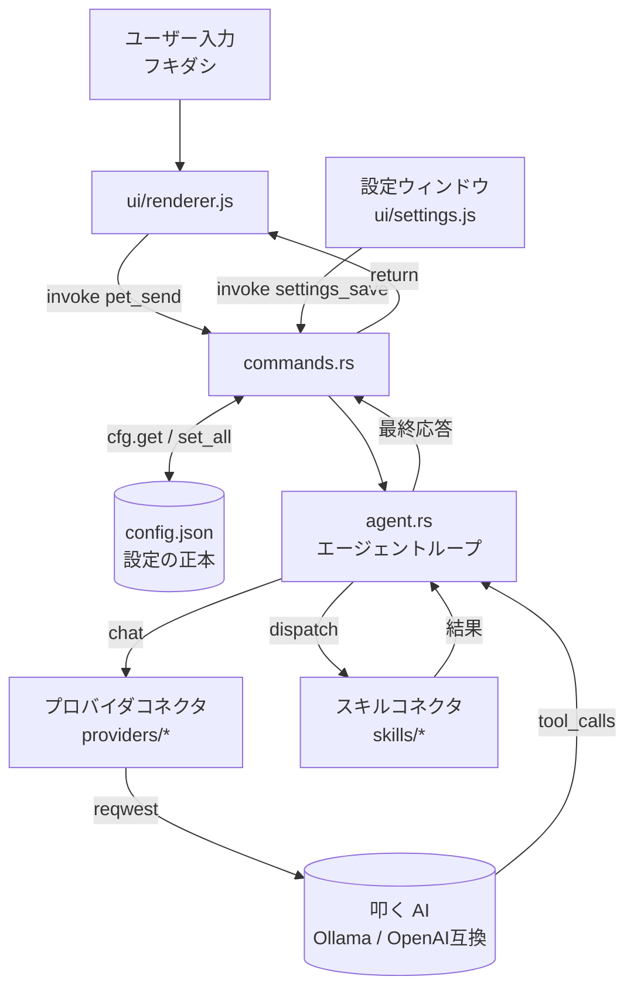

# PicoAgent 仕様書

対象: PicoAgent（コネクタ駆動デスクトップペット / Tauri）
最終更新: 2026-06-25

---

## 概要

PicoAgent は透明な **Tauri** ウィンドウに常駐する、キャラクターとフキダシだけのデスクトップペット。
バックエンドは Rust（`src-tauri/`）、フロントは webview（`ui/`）。
「叩く AI（LLM バックエンド）」と「エージェント機能（ツール）」をコネクタとして拡張できる。

- **叩く AI** → プロバイダコネクタ（`src-tauri/src/providers/`）。**既定は `local`（同梱 llama-server、Ollama 不要）**、Ollama / OpenAI 互換も同梱。
- **エージェント機能** → スキル（ツール）コネクタ（連結ファイルはプロジェクト直下の `skills/`、トレイトは `src-tauri/src/tools/mod.rs`）。モデルが function calling で呼び出す。
- **キャラクター** → 正本はプロジェクト直下の `characters/index.json` と各 `character.json`。`sync-characters.mjs` が `ui/assets/characters/` へ同期し webview が配信。見た目・アニメーション・人格を一体で切り替える。
- **両者をつなぐ中核** → エージェントループ（`src-tauri/src/agent.rs`）。

> [!NOTE]
> 起動・セットアップ・設定キーは **[README.md](README.md)**、作業ルールは **[AGENTS.md](AGENTS.md)** を参照。本書は仕様の正本。

---

## 📑 目次

- [システム構成](#システム構成)
- [メッセージ正規形](#メッセージ正規形コネクタ間の共通言語)
- [エージェントループ](#エージェントループ-agentrs)
- [プロバイダコネクタ](#プロバイダコネクタ-srcproviders)
- [スキル（ツール）コネクタ](#スキルツールコネクタ)
- [新しいコネクタの作り方](#新しいコネクタの作り方)
- [設定（config と設定画面）](#設定config-と設定画面)
- [設定キー一覧](#設定キー一覧)
- [フロント連携と製品化](#フロント連携と製品化)

---

## システム構成



- コネクタは **`inventory` でコンパイル時自動登録**。`build.rs` が `src/providers/*.rs`・ルートの `skills/*.rs` を走査して
  `#[path] pub mod` を生成するため、**`.rs` を1枚置くだけ**でコネクタ追加（`mod.rs` 編集不要）。
- `AppState`（`commands.rs`）が選択中プロバイダ・モデル・会話履歴を保持。プロバイダとモデルは設定画面から切替。
- 設定の正本は `config.rs`（`app_config_dir/config.json`）。コネクタは `cfg.get()` で都度読むため、設定変更は再起動なしに反映。

---

## メッセージ正規形（コネクタ間の共通言語）

`agent.rs` はプロバイダ固有のワイヤ形式を一切知らない。各プロバイダが自分の API 形式へ相互変換する（`message.rs`）。

| role | 形（serde） |
|---|---|
| system / user | `{ role, content }` |
| assistant | `{ role:"assistant", content, tool_calls?: [{ id, name, arguments(Value) }] }` |
| tool（結果） | `{ role:"tool", tool_call_id, name, content }` |

- `arguments` は **`serde_json::Value`（オブジェクト）** で持つ（OpenAI の JSON 文字列はプロバイダ内で相互変換）。
- Ollama は tool 結果を id で紐付けず位置・名前で扱うため `tool_call_id` は無視（正規形には残す）。

---

## エージェントループ（`agent.rs`）

`run(cfg, provider, model, messages, max_steps = 5) -> Result<String>`

1. `provider.chat()` を呼び、返った assistant を `messages` に積む。
2. `tool_calls` が無ければ、その `content` を最終応答として返す。
3. `tool_calls` があれば、各呼び出しを `tools::dispatch(cfg, name, arguments)` で実行し、結果を `tool` メッセージとして積み 1 に戻る。
4. `max_steps` を超えたら打ち切り、最後の文面を返す（暴走防止）。

通常の質問では、ローカルモデルの `tool_calls` 対応状況に依存させず、最初の `chat()` より前に
`web_search` を実行する。短い挨拶は検索結果に引っ張られて表記解説へ逸れやすいため検索を省き、キャラクター本人として返す指示だけを追加する。検索結果は外部の信頼できない参考データとして区切ってユーザーメッセージへ
付加し、結果内の指示には従わないよう明記する。検索失敗もモデルへ渡し、ユーザーへ明示させる。
参照元はMarkdownハイパーリンクで回答させ、フキダシはMarkdownリンクと通常のURLを安全なDOMリンクへ変換する。さらに、事前検索で得た参照元URLのうち本文に未掲載のものを、最終応答の末尾へ `参考:` として確定的に添える（モデルがリンクを出し損ねても参照元が残る）。URL 行は読み上げ（`speech_text`）で除外されるため音声には乗らない。

`messages` は `&mut Vec<Message>` を破壊的に伸ばす。

---

## プロバイダコネクタ（`src-tauri/src/providers/`）

`Provider` トレイトを実装し、`inventory::submit!` で登録する。

```rust
#[async_trait]
pub trait Provider: Send + Sync {
    fn id(&self) -> &'static str;
    fn label(&self) -> &'static str;
    fn config_schema(&self) -> Vec<Field> { Vec::new() }
    fn default_model(&self, cfg: &Config) -> String;
    async fn list_models(&self, cfg: &Config) -> anyhow::Result<Vec<String>>;
    async fn is_up(&self, cfg: &Config) -> bool;  // 接続不可・キー無は false に正規化してよい
    async fn chat(&self, cfg: &Config, model: &str, messages: &[Message], tools: &[Value]) -> anyhow::Result<Message>;
}
inventory::submit! { ProviderReg { make: || Box::new(MyProvider) } }
```

> 接続先・APIキー・モデルは各メソッド内で `cfg.get()` から都度読む（フィールドに固定しない）。設定変更を再起動なしに反映するため。

### 同梱プロバイダ

| id | 叩く先 | 接続条件 |
|---|---|---|
| `local`（既定） | 同梱 llama-server `/v1/chat/completions`（OpenAI 互換） | エンジン同梱＋モデル取得済（`engine.rs` が管理）。Ollama 不要 |
| `ollama` | ローカル Ollama `/api/chat` | `ollama serve` 起動 |
| `openai` | OpenAI 互換 `/chat/completions` | `OPENAI_API_KEY` 設定（未設定なら `is_up()=false`） |

`openai` は `OPENAI_BASE_URL` を変えれば OpenAI 本体に限らず OpenAI 形式の任意ゲートウェイに接続できる。
`local` は `openai.rs` の `to_wire`/`from_wire` を再利用し、tools 非対応テンプレートのモデルでも会話が成立するよう tools 付きで失敗したら tools 無しで再試行する。

### 同梱推論エンジン（`engine.rs`）

`local` プロバイダのために、Ollama の代わりに llama.cpp の `llama-server` をアプリに同梱して使う。

- エンジン本体（`llama-server` + ggml DLL）はリポジトリに含めず、`scripts/fetch-engine.mjs`（`npm run setup:engine`）で
  `src-tauri/resources/engine/` に取得。`tauri.conf.json` の `bundle.resources` で配布物に同梱する。
- 起動時（既定が `local` のとき）`engine::ensure_and_start` を非同期実行:
  1. モデル GGUF（既定: Gemma 3n E2B Q4_K_M）が `app_data_dir/models/` に無ければ `PICOAGENT_MODEL_URL` から
     ストリーミング DL（進捗を `engine:status {phase:"download", percent}` で UI へ）。
  2. `llama-server -m <model> --host 127.0.0.1 --port <PICOAGENT_LOCAL_PORT> -c <PICOAGENT_LOCAL_CTX> -ngl <PICOAGENT_LOCAL_NGL> --jinja`
     を spawn（`PICOAGENT_LOCAL_GPU_DEVICE` 指定時は `--device <値>` を追加。Windows は CREATE_NO_WINDOW）。
     既定の同梱ビルドは Vulkan(GPU) 版で、`-ngl 999` により全レイヤを GPU へオフロードする（GPU 非対応環境では自動 CPU フォールバック）。
     `/health` が 200 になったら `engine:status {phase:"ready"}`。
- 子プロセスは `RunEvent::Exit` で停止（`engine::stop`）。状態は `engine_status` command でも取得可能。
- 同梱 Aivis の状態は `aivis_status` command で取得する（フロントの起動時キャラ描画ゲートに使用）。

### AivisSpeech Engine 連携（`aivis.rs` / `pet_speak`）

`PICOAGENT_TTS_ENABLED` が有効な場合、回答テキストを AivisSpeech Engine の `/audio_query` → `/synthesis` へ渡して WAV を生成し、フロントで再生する。音声再生中のみ会話アニメーションを維持する。起動時・キャラクター変更時に吹き出しへ出る挨拶（`character.json` の `greeting`）も同じ経路で読み上げる。

- 読み上げには同梱 Aivis だけを使い、接続先は内部固定の `http://127.0.0.1:10102` とする。`PICOAGENT_TTS_ENABLED` が有効な場合はアプリ起動時に同梱 AivisSpeech Engine を即 spawn し、設定画面で ON にした場合も保存後すぐ起動する。`pet_speak` 時点で `/version` が未応答なら ready まで待つ。
- 推論デバイスは `PICOAGENT_TTS_DEVICE` で `auto` / `cpu` / `gpu` を選ぶ。`auto` と `gpu` は `--use_gpu`、`cpu` は `--no-use_gpu` で起動する。設定画面で ON/OFF やデバイスを変更した場合は、保存後に同梱 Aivis を停止/再起動して即時反映する。
- 初回合成では話者モデルのロードで時間がかかるため、Aivis への HTTP タイムアウトは 180 秒にする。
- Aivis の stdout/stderr はアプリログディレクトリの `aivis.log` に追記し、プロセスが起動直後に終了した場合や ready 待ちがタイムアウトした場合は、ログ末尾をエラー文字列に含めてフロントへ返す。
- 状態は `aivis_status` command（`{ enabled, up }`）で取得できる。TTS 有効時、フロントは Aivis が `up` になるまで**キャラ・フキダシを含む全 UI の描画を保留**する（`.pet-app.is-booting` で `visibility:hidden`）。待機中に挨拶を（非表示のまま）描画しつつ音声を事前合成（`prepareSpeech`）しておき、準備完了で `is-booting` を外して**描画した瞬間に挨拶を再生**する（`playPreparedSpeech`）。起動失敗で固まらないよう約120秒で諦めて描画する。TTS 無効時（`enabled=false`）は待たずに即描画する。
- 実行ファイルは同梱配置 `src-tauri/resources/aivis/` だけを探す。同梱配置は `npm run dev` / `npm run build` の起動前に、未取得なら `scripts/fetch-aivis.mjs` が公式 GitHub Releases から既定 `1.2.0` を取得する（手動実行は `npm run setup:aivis`、更新時は `AIVIS_RELEASE=latest` またはタグを指定）。配布物では `tauri.conf.json` の `bundle.resources` で `resources/aivis/*` を同梱対象にする。
- speaker ID は選択中キャラクターの `PICOAGENT_TTS_CHARACTER_OVERRIDES[characterId].speaker` を優先し、未設定なら共通の `PICOAGENT_TTS_SPEAKER` を使う。
- アプリが起動した子プロセスだけを `RunEvent::Exit` で停止する。既にユーザーが手動起動していた Aivis には触らない。

---

## スキル（ツール）コネクタ

連結ファイルはプロジェクト直下の `skills/`、`Tool` トレイト・レジストリ本体は `src-tauri/src/tools/mod.rs`。

`Tool` トレイトを実装し、`inventory::submit!` で登録する。

```rust
#[async_trait]
pub trait Tool: Send + Sync {
    fn name(&self) -> &'static str;
    fn description(&self) -> String;
    fn parameters(&self) -> Value;            // JSON Schema
    fn config_schema(&self) -> Vec<Field> { Vec::new() }
    async fn run(&self, cfg: &Config, args: Value) -> String;  // 失敗もエラー文字列で返す
}
inventory::submit! { ToolReg { make: || Box::new(MyTool) } }
```

- `tools::build_schemas()` が `{ type:"function", function:{name,description,parameters} }` 形式の配列を生成しプロバイダへ渡す。
- `tools::dispatch(cfg, name, args)` が実行を仲介する。未登録ツールもエラー文字列で返す（エージェントが回復できるように）。

### 同梱ツール

| name | 機能 | 安全策 |
|---|---|---|
| `get_time` | 現在の日付・時刻（任意で IANA タイムゾーン、`chrono-tz`） | 副作用なし |
| `read_file` | ローカルのテキストファイル読込 | 許可ルート `PICOAGENT_TOOLS_ROOT`（既定はホーム）配下に限定、`..` 等のルート外を拒否、64KB で打ち切り |
| `web_search` | Web検索結果のタイトル・URL・概要を返す。すべての回答前に必ず実行 | 検索語500文字、1〜8件、待ち時間3〜60秒、応答32KBで制限 |

---

## 新しいコネクタの作り方

### 叩く AI を増やす（例: Anthropic Claude）

1. `src-tauri/src/providers/anthropic.rs` を作り、`Provider` を実装して `inventory::submit!` する。`chat()` 内で正規形 ⇄ Anthropic Messages API 形式を変換。
2. 再ビルドすると設定画面のプロバイダ一覧に自動で現れる（`build.rs` が `pub mod` を生成、`inventory` が登録）。
3. `SPEC.md` の同梱プロバイダ表と、必要な設定キーを `README.md` に追記。

### エージェント機能を増やす（例: Web 検索）

1. `skills/web_search.rs` を作り、`Tool` を実装して `inventory::submit!` する。副作用があるなら境界（タイムアウト・件数上限）を設ける。
2. 再ビルドすると、ツールスキーマが自動でモデルへ渡る。
3. `SPEC.md` の同梱ツール表を更新。

どちらも **`mod.rs` の編集は不要**。フォルダに `.rs` を置くだけで検出される。設定値が要るなら `config_schema()` で申告すれば設定画面に項目が並ぶ。

---

## 設定（config と設定画面）

### 設定の正本（`config.rs`）

- 値の優先順位: **永続ファイル `app_config_dir/config.json` > 環境変数 > ハードコード既定値**。
- API: `load(path)` / `get(key, fallback)` / `get_bool(key, fallback)` / `get_all()` / `set_all(patch)`。
- 空文字は「未設定」とみなし env → 既定値へフォールバックする。

### 設定画面（右クリック →「設定…」）

- `ui/settings.{html,css,js}` の独立 Tauri ウィンドウ。`ui/picoagent.js` の `window.picoagent.settings.*` →
  `commands.rs` の `settings_load` / `settings_list_models` / `settings_save` command で構成。
- 画面は **基本** / **キャラクター** / **音声** / **叩くAI** / **スキル** のタブで構成し、導入済みスキル一覧・導入済みキャラクター一覧・各コネクタの `config_schema()` を動的に描画する。コネクタを足すと一覧も設定項目も自動で増える。
- スキル一覧は `settings_load` が返す各ツールの `name` / `label` / `description` を読み取り専用カードで表示する（設定項目を持たないツールもここに並ぶ）。キャラクター一覧は `assets/characters/index.json` から表示し、使用中のキャラに「（使用中）」を付ける。
- `Field` の項目: `{ key, label, type:"text"|"password"|"textarea"|"checkbox", placeholder }`。
- 保存は `config.set_all()` で永続化し、実行中の状態（プロバイダ・モデル・システムプロンプト・常に手前）へ即反映する。コネクタ固有設定は `cfg.get()` 都度読みのため自動反映。Ollama 選択時は `settings_list_models` で `/api/tags` の候補を読み込み、保存時に選択モデルを `PICOAGENT_MODEL` と `OLLAMA_MODEL` の両方へ反映する。

---

## 設定キー一覧

| キー | 既定 | 区分 | 用途 |
|---|---|---|---|
| `PICOAGENT_PROVIDER` | `local` | 基本 | 選択中の叩く AI の id |
| `PICOAGENT_MODEL` | プロバイダ既定 | 基本 | 選択中モデル |
| `PICOAGENT_SYSTEM_PROMPT` | 既定プロンプト | 基本 | system メッセージ |
| `PICOAGENT_BUBBLE_FONT_PX` | `13` | 基本 | フキダシの文字サイズ(px)。`pet:ui` で即反映 |
| `PICOAGENT_BUBBLE_WIDTH_PX` | 自動 | 基本 | フキダシ右下のドラッグで保存する幅(px)。`pet:ui` で即反映 |
| `PICOAGENT_BUBBLE_HEIGHT_PX` | 自動 | 基本 | フキダシ右下のドラッグで保存する高さ(px)。`pet:ui` で即反映 |
| `PICOAGENT_ALWAYS_ON_TOP` | `true` | 基本 | 常に手前に表示 |
| `PICOAGENT_CHARACTER` | `mugi` | 基本 | 選択中キャラクターのID |
| `PICOAGENT_CHARACTER_OVERRIDES` | `{}` | 基本 | キャラクターIDごとの人格設定上書き |
| `PICOAGENT_TTS_ENABLED` | `false` | 音声 | Aivis で回答を読み上げる |
| `PICOAGENT_TTS_DEVICE` | `auto` | 音声 | 同梱 Aivis の推論デバイス（`auto` は GPU 優先 / `cpu` / `gpu`） |
| `PICOAGENT_TTS_SPEAKER` | `888753760` | 音声 | Aivis の speaker/style ID |
| `PICOAGENT_TTS_CHARACTER_OVERRIDES` | `{}` | 音声 | キャラクターIDごとの Aivis speaker ID 上書き |
| `PICOAGENT_MODEL_URL` | gemma-3n-E2B Q4_K_M GGUF | local | 同梱エンジンが取得するモデル URL |
| `PICOAGENT_LOCAL_PORT` | `11435` | local | 同梱エンジンのポート |
| `PICOAGENT_LOCAL_CTX` | `4096` | local | コンテキスト長 |
| `PICOAGENT_LOCAL_NGL` | `999` | local | GPU へオフロードするレイヤ数（`999`=全レイヤ優先 / `0`=CPU 固定） |
| `PICOAGENT_LOCAL_GPU_DEVICE` | （空=既定先頭） | local | 使用 GPU の指定（複数 GPU 環境向け、例 `Vulkan1`） |
| `OLLAMA_HOST` | `http://127.0.0.1:11434` | ollama | Ollama 接続先 |
| `OLLAMA_MODEL` | `qwen3:8b` | ollama | Ollama 既定モデル |
| `OPENAI_BASE_URL` | `https://api.openai.com/v1` | openai | OpenAI 互換エンドポイント |
| `OPENAI_API_KEY` | （なし） | openai | OpenAI 互換の API キー。未設定なら選択不可 |
| `OPENAI_MODEL` | `gpt-4o-mini` | openai | OpenAI 互換の既定モデル |
| `PICOAGENT_TOOLS_ROOT` | ユーザーホーム | read_file | `read_file` が読み取れるルート |
| `PICOAGENT_WEB_SEARCH_MAX_RESULTS` | `5` | web_search | Web検索で返す件数（1〜8） |
| `PICOAGENT_WEB_SEARCH_TIMEOUT_SECS` | `15` | web_search | Web検索の待ち時間（秒、3〜60） |

各キーは環境変数としても渡せる（既定値としての参照のみ。保存先は常に `config.json`）。

---

## フロント連携と製品化

### キャラクターパック

- `characters/index.json` に `{ id, name, manifest }` を追加し、各フォルダへ `character.json` と連番フレームを置く（`ui/assets/characters/` へは `sync-characters.mjs` が同期）。
- `character.json` は `name`、`description`、`greeting`、`persona`、`animations` を持つ。任意で `assetVersion` を持て、同名フレーム更新時の画像キャッシュ回避に使う。人格には性格・口調・一人称・ユーザーの呼び方・追加指示を定義できる。
- 各アニメーションは `path`、`frames`、`fps`、`motion` を持つ。任意で `frameDurations`（ミリ秒配列）を持て、まばたきや口パクなど均等 `fps` だと不自然になるフレームだけ表示時間を調整できる。フロントは画像フレームとCSS補間動作を組み合わせる。
- 選択中キャラの人格は `pet_set_character_profile` でシステムプロンプトへ追加する。既定プロンプトは挨拶・自己紹介でアプリ説明ではなくキャラクター本人として名乗ることを優先する。設定画面のキャラ別上書きは `PICOAGENT_CHARACTER_OVERRIDES` に保存する。

- フロント（`ui/`）は Vite 等のバンドラを使わず、Tauri の静的 `frontendDist` で配信。`withGlobalTauri:true` で
  `window.__TAURI__` を有効化し、`ui/picoagent.js` が旧 `window.picoagent`（init/send/menu/on/settings.*）を再現する。
  これにより `renderer.js` / `settings.js` は Electron 版とほぼ同じコードのまま動く。
- フキダシ右下のリサイズつまみは Pointer Events で幅・高さを変更し、確定時に `pet_set_bubble_size` で設定へ永続化する。
- キャラクターまたはフキダシのダブルクリックはウィンドウをフルスクリーン化（`getCurrentWindow().setFullscreen`）し、その中でフキダシを画面最大化のように広げる（`.bubble.fullscreen`）。最大化中はキャラを薄く背面化し、送信ボタンや入力欄と被らないようにする。解除は再度ダブルクリックまたは `Esc`。ドラッグ領域のダブルクリックによるネイティブのウィンドウ最大化は `maximizable:false` で無効化している。
- 拡大時はセッション内の会話履歴をフキダシ内に表示し、最新応答と入力フォームは下部に残す。`pet:reset` では履歴もクリアする。
- ウィンドウ: 透明・枠なし・常に手前・タスクバー表示・最大化不可（`tauri.conf.json`）。ドラッグは `data-tauri-drag-region`。
- アプリ終了時は `RunEvent::Exit` で `engine::stop` が同梱 llama-server の子プロセスを kill し、`aivis::stop` がアプリ自身で裏起動した AivisSpeech Engine だけを停止する。さらに `npm run dev` / `npm run build` は Tauri 起動前に `scripts/stop-stale.mjs` を同期実行し、前回の残存プロセスを停止して同梱 DLL ロックによるビルド失敗（Windows os error 32）を防ぐ。手動停止は `npm run stop`。
- 権限は `src-tauri/capabilities/default.json`（start-dragging / set-always-on-top / set-fullscreen / event / webview 生成）。
- 製品化: `productName=PicoAgent` / `identifier=com.picoagent.app`（旧 `com.coda.app` から改名。既存環境は `app_config_dir`/`app_data_dir` のフォルダ名を新識別子へリネーム移行する）。Windows バンドルは NSIS（`bundle.targets`）。
  アイコンは `src-tauri/icons/`（`npx tauri icon src-tauri/icon-source.png` で再生成）。
  署名（Authenticode）・自動更新（`tauri-plugin-updater`）はリリース時に鍵・証明書を用意して設定する（現状未設定）。
