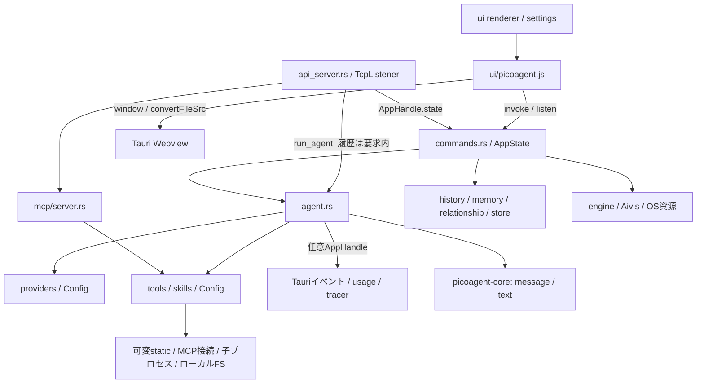
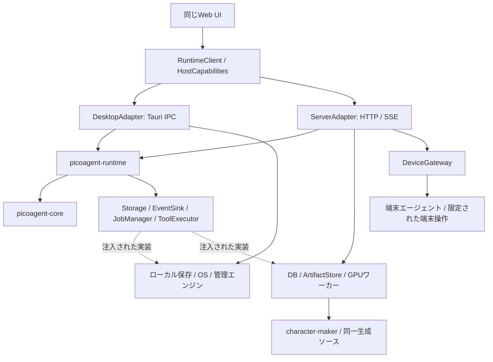

# 法人向け共通処理基盤（未実装の将来設計）

現行仕様は [SPEC.md](../SPEC.md)、段階移行の残作業は [TASKS.md](TASKS.md#corporate-runtime-tasks) を正本とする。この文書は実装前の設計であり、現行機能を説明しない。

**状態: 設計受入済み・実装未着手。以下の構成・型・APIは提案であり、現行機能ではない。** 認証・認可の方式、権限モデル、テナント管理画面は対象外とする。設計判断・却下案・検証記録と引継ぎの正本は[設計PR #256](https://github.com/benybeny777/PicoAgent/pull/256)、今後の実装作業は [段階別タスク](TASKS.md#corporate-runtime-tasks) に置く。コード・依存・配布仕様はこの設計では変更しない。

## 調査基準と現行依存

基準は2026-09-11の `origin/main`、コミット `95a37ad2a6be4e5bc7153d09d6845231ae213df7`。character-makerだけはmainに存在せず、未マージの [PR #255](https://github.com/benybeny777/PicoAgent/pull/255) の `5f6dec57ed69ead122df98059aea15857fe5ad39` をGitオブジェクトから読み取った。実装着手時は両者の差分を再確認し、#255のworktreeを利用・変更しない。

| 現行根拠（ファイル・シンボル） | 再利用可能な部分と制約 |
|---|---|
| `ui/picoagent.js` の `call` / `managedListen` / `window.picoagent` | invokeと購読を集中管理する良い入口。ただしロード冒頭で `window.__TAURI__` が必須。`convertFileSrc`、窓サイズ・位置・ドラッグも同居。renderer/settingsの直接Tauri参照だけを探しても、asset URL、D&D、音声、起動通知の意味的依存は残る |
| `commands.rs::AppState` / `pet_send` / `pet_send_image` | Config、選択AI、会話、キャラ、質問・コマンド承認待ち、感情、CLIセッション、cancelフラグを保持。`conversation_epoch` とキャラIDが古い非同期結果の書戻しを防ぐ。Tauri入口と業務処理が同居 |
| `agent.rs::run` / `run_scoped` / `agent/prompt.rs::compose` | 正規形によるループは再利用候補だがConfig、Tool登録、時刻、AppHandleによる挨拶取得・通知・usage・tracerに依存。promptもユーザースキル・案件ファイルを読むため全体が純粋関数ではない |
| `providers/mod.rs::Provider` | `chat` / `chat_stream`、wire変換は共用可能。引数は製品Config、localはローカル配置・エンジン設定、agent_cliは端末プロセス・会話セッションに依存。全プロバイダを一律にcoreへ移さない |
| `tools/mod.rs::Tool` / `run_tool` / `dispatch_interactive` | `run(&Config, Value) -> String`。失敗・承認が文字列に混在。ライセンス判定、CLI探索、MCPフォールバックも含む。`inventory` / 不変schemaのOnceLockは共用可能だが実行能力の判断とは分離する |
| `api_server.rs::start` / `run_agent` / `handle_connection` | localhost限定の簡易TCP。要求内の会話を `agent::run(..., None, None)` へ渡すがAppStateのConfig・AI選択とツール環境は共有。履歴がステートレスでも副作用・実行基盤はステートレスではない |
| 同APIの `/api/chat` / `/api/generate` / `/v1/chat/completions` / `/mcp` | Ollama風応答、OpenAI変換、MCP JSON-RPCは互換層として残せる。OpenAI SSEは全文完成後の単一本文チャンク。通常チャットUI全体の代替APIではない。MCPは `mcp/server.rs::handle_rpc` からツールを呼ぶ |
| `config.rs::Config` / `store.rs::lock_state` | ファイル・環境変数・既定値の優先順位、OS秘密保存を含む。Mutexと全体書戻しはプロセス内の排他。原子的renameだけで複数プロセスの競合は解決しない |
| `durable_jobs.rs` / `mcp/client.rs` | 前者はAPP、保存パス、sender等のstatic、既存ジョブ対象はAI Driveとartifact_pipeline、同時3件・自動試行通算5回。後者は接続とツール一覧を可変staticで保持。テナントや実行ごとの状態ではない |
| `skills/workspace_files` / `run_command/jobs.rs` / `browser_control` / `meeting_recorder` | undo履歴、コマンドジョブ、ブラウザの現在ページ・子、録音がプロセス共有。単にAppHandleを消しても法人共用できない |
| `crates/picoagent-core/src/{message,text}.rs` | 現在の再利用範囲はMessage・Field・UTF-8等。serde/serde_jsonだけを依存とする非公開crate。`src-tauri/src/{message,text}.rs` は互換再公開。業務ランタイムはまだない |
| #255の `character-maker/src/{pipeline,sidecar,config,recovery,store}.rs` | Tauri非依存crateだが、PipelineContextはPathBuf、MakerConfigは `Scripts/python.exe`、SidecarProcessは子プロセス・Windows Job Objectを持つ。ローカルFS上の生成・復旧は共用候補。サーバーワーカー実装済みとは扱わない |
| #255の `src-tauri/src/character_maker.rs` | pathsでapp_data/resourceを解決し、実行Mutex・中断フラグ・イベント・選択ダイアログを所有。Windows x64条件あり。`isolate → decompose → rig2d → complete` の工程・出力契約を参照するだけで変更しない |

## 目標構成と移動対象

依存方向は「各アダプター → 共通ランタイム → 純粋core」に固定する。共通層はTauri・Webview・OS秘密ストア・環境変数・プロセス全体のcwdを参照しない。Rustソースを共用してローカルではインプロセスで実行し、サーバーでは同じランタイムを別バイナリから呼ぶ。全処理をHTTP化する必要はない。

| 責務・配置案 | 移すもの | 残すもの・公開境界 |
|---|---|---|
| `picoagent-core`（既存） | Message、UTF-8、純粋なDTO・エラーcode・状態遷移値。promptは入力を集めた後の合成部分だけ | OS/HTTP/DB依存を入れず `publish=false` を維持。公開型を最小化する |
| `crates/picoagent-runtime`（将来追加） | 会話ユースケース、agent/feedbackの制御、Provider/Tool契約、候補選択、承認待ち・ジョブ状態遷移、文脈圧縮の方針 | 非公開。入力DTOと明示ポートだけに依存。AppState全体の移植やServiceLocator化をしない |
| 共用コネクタモジュール（まずruntime配下） | OpenAI互換/Anthropic等の変換・通信、HTTPツール、生成工程の制御を依存切離し後に順次移す | 個別wireはproviderに閉じ込める。登録の正本を1つにし、製品ごとの同じ実装のコピーを作らない。独立配布が必要になるまでツールごとのcrateを増やさない |
| `src-tauri`（DesktopAdapter） | 既存command名・戻り値・イベント名を保つ薄い変換入口へ段階移行 | 窓・トレイ・メニュー・DPI・ホットキー・ダイアログ・boot監視・OS秘密保護・インストール・管理プロセス回収・ローカルファイル許可を残す |
| サーバーバイナリ（将来追加） | HTTPルーティング、接続制限、Context生成、DB/ストレージ/ワーカーの組立て | Tauriをリンクしない。サービス固有運用をcoreへ持ち込まない。認証・認可を接続するまで外部公開しない |
| Web UI | 表示、入力、描画、音声再生、接続先選択と能力に応じた操作表示 | AI実行・保存・再試行を画面に複製しない。ブラウザのマイクやclipboard許可を端末エージェントの権限と同一視しない |
| character-maker（#255承認・統合後） | manifest、工程と再開判定、生成参照・復旧規則とPythonソースを共用 | OS別起動、作業ディレクトリ、モデル解決をワーカーへ隔離。既存crateをcoreへ丸ごと吸収せず重い画像/GPU依存を通常会話から外す |

server HTTP clientはruntimeが定義する外向き通信ポートまたは設定済みclientを使い、接続プール・timeout・egress制約を共有する。Providerのwire変換はそのclientとは独立して単体検証できる構造にする。`Clock` は現在時刻と利用者のTimeZoneを供給し、ローカル時刻やスケジュールをサーバーOSの時刻設定へ暗黙移行しない。

この新crate構成は、現行AGENTSの「依存はsrc-tauriへ集約、例外はcore」の拡張を要する。承認後の最初の実装PRで依存方向・ガード対象・ルールを同時更新する。本PRではルールやCargoを変更しない。

## 最小インターフェースと状態所有

以下は言語中立の署名で、Rust traitやライブラリの採用を実装済みとしない。小さいユースケースには必要なポートだけを渡す。

| 契約 | 最小操作・入力 | 保証・所有者 |
|---|---|---|
| `ExecutionContext` | requestId、runId、scope（tenant/subject/workspaceの不透明ID）、conversationId/epoch、deviceId、deadline、cancel、traceId | アダプターが信頼境界で構築。本文のtenantIdを信頼せず、不明scopeを共有既定値へ落とさない。子実行へscopeを明示継承し、権限を広げない。ローカルは端末内scope |
| `ConfigView` / `SecretResolver` | `get(key, fallback)`、`resolve(secretRef, providerId)` | 型付き公開設定と秘密参照を分離。ローカルの優先順位・都度参照を維持し、サーバーでプロセス環境を利用者設定にしない。次の操作に設定変更を反映、開始済みrunのprovider/model/資源版は固定。許可は副作用時に再評価 |
| `EventSink` | `publish(context, event) -> Result` | scopeとrunを必須化。Tauri変換は購読対象ウィンドウに限定。永続状態の正本ではない。配送不能を成功として隠さない |
| `ConversationStore` | `load(scope,id)`、`commit(expectedRevision,expectedEpoch,delta)`、`reset` | 会話単位に1書込み実行、競合は拒否。ローカルでは現行Mutex/原子的保存/世代検査へ委譲。サーバーはDBトランザクションとCAS、長時間LLM呼出中にDBロックを保持しない |
| `Storage` / `ArtifactStore` | `read(ref)`、`stage(scope,metadata,stream)`、`commit(expectedRevision)`、`open(ref,range)` | scope・version付きの参照を使用。原子的確定、ハッシュ・容量・型検査、不完全成果物の非公開。OS生パスを共通APIに流さない。削除/ゴミ箱・保持期間は実行場所別に明示 |
| `ProcessRunner` | `spawn(programRef, argv, cwdRef, envRefs, limits)` → handle、`wait`、`cancelAndReap` | ローカル/ワーカー内部専用。HTTPに任意shell起動口を作らない。所有プロセスの確認、時間/出力上限、子孫回収とwaitを実装側が保証。GPU利用権はModelRuntimeから取得 |
| `JobManager` | `submit(kind,input,key)`、`get/list`、`cancel`、`retry`、`claim/heartbeat/finish(lease,fence)` | 状態・試行・leaseを保存。GPUワーカーの死亡をAPIプロセス死亡と切離す。ローカル既存ジョブは互換adapter、サーバーはDBによる排他取得 |
| `ToolExecutor` / `PolicyGate` | `describe(context)`、`check(operation,target,effect)`、`execute(context,call)` → ToolOutcome | 候補提示と実行直前の両方で能力/許可を評価。承認要求にはcallId・引数ハッシュ・期限を結び付ける。認証・認可の中身は別設計。ローカルの許可・Pro制限を維持 |
| `ModelRuntime` | `capabilities`、`acquire(modelRef,resourceNeeds)`、`endpoint(lease)`、`release` | ローカル管理エンジンと法人GPUワーカーを交換。modelRefは形式・revision・SHA-256・ライセンス参照を持ち、モデル名だけで互換としない |
| `Telemetry` / `AuditSink` | span、counter/histogram、`append(context,action,targetRef,outcome)` | 診断と監査を分離。監査記録要否はPolicyGate出力を使い、記録必須操作は永続記録不能なら実行を開始しない |

状態のキーは原則 `scope + resourceId`、会話はさらにcharacterId/epoch、CLIセッションはprovider設定版を含める。history、memory、relationship、usage、undo、承認待ち、MCP接続、コマンドジョブを同じグローバルロックや全利用者共通ファイルにしない。現行の各保存責務は維持し、共通の巨大Stateオブジェクトへ集約し直さない。

ステートレス候補はメッセージ変換、UTF-8、スキーマ、不変のツール語彙、文脈を入力として受ける合成。LLM呼出は会話を保存しなくても外部課金・キャッシュ・ネットワーク状態を持つ。モデルロード、HTTPプール、MCP接続、生成キャッシュは状態ありとして資源管理する。不変登録のみプロセス共有可、Cookie/認証付きclient、会話、キャッシュはscopeを分離する。共通モデルの読取専用重みは権利と構成が一致する場合に共有可、KV cache・prompt cache・生成入力は利用者間で再利用しない。

## 共通API契約案（v1）

Tauri IPCとHTTPは同じユースケースDTOを使う。既存互換APIの `/v1/chat/completions` と混同しないよう、新規名前空間は `/pico/v1` とする。

| 操作 | HTTP写像 | 契約 |
|---|---|---|
| 接続確認 | `GET /pico/v1/capabilities` | apiVersion、serverInstanceId、deployment、機能/実行場所、制限、eventRetention、asset方式、対応契約版を返す。秘密や生パスは返さない |
| 同期実行 | `POST /pico/v1/runs`（mode=sync） | `{requestId,idempotencyKey,conversationId?,expectedRevision?,input,modelRef?,target,mode,deadline?}`。永続受付後、完了まで接続内で待つ。HTTP 200 `{runId,status,result,revision}`、待機上限で202 `{runId,status,links}`。処理を無言で作り直さない |
| ストリーム・非同期開始 | 同POST（mode=stream/job） | 202でrunIdとイベントURLを返す。LLM、ツール、キャラ生成も長時間化できる。ジョブ受付は永続化成功後のみ返す |
| 状態・結果・進捗 | `GET /pico/v1/runs/{id}`、`GET .../{id}/events`（SSE） | 状態の正本はGET。SSEは `id=seq` と共通イベント包絡。購読開始前の完了も再取得できる |
| 中断・再試行 | `POST .../{id}/cancel`、`POST .../{id}/retry` | cancelは要求受付と停止完了を区別。retryは許される状態だけ新attemptを作る。同一runId内でattempt増分、別操作の再実行は新runId |
| 対話待ち | `POST .../{id}/responses` | questionId/approvalId、callId、引数ハッシュ、expectedRevision、回答。期限・scope・run・世代不一致は拒否し、古い承認を転用しない |
| 会話 | `POST /pico/v1/conversations`、`GET .../{id}`、`POST .../{id}/reset` | 作成でID、読取りでrevision、resetでepoch更新。既存会話へinput.messagesを任意に上書きしない。conversationIdなしの実行は要求内会話、デスクトップ履歴へ保存しない |
| 入力・生成物 | `POST /pico/v1/artifacts`、`GET .../{id}`、`GET .../{id}/content` | 分離ストリーム転送。artifactRefはscope内のopaque ID＋版、応答に型・寸法・ハッシュ・容量・利用可能期限。要求JSONへ巨大base64や端末の絶対パスを入れない |

共通エラーは `{error:{code,message,requestId,runId?,retryable,retryAfterMs?,details}}`。codeは `invalid_input`(400)、`unauthenticated`(401)、`forbidden`(403)、`not_found`(404)、`conflict`(409)、`expired_cursor`(410)、`too_large`(413)、`unsupported_capability`(422)、`rate_limited`(429)、`internal`(500)、`dependency_unavailable`(503)、`deadline_exceeded`(504)。detailsは安全なfield/reasonだけで、秘密・OSパス・生のstderrを含めない。開始済みrunの失敗/中断はGETの状態とterminalイベントで返し、HTTP接続が成功したことと処理成功を混同しない。既存StringエラーとMCP JSON-RPC形式は互換層で変換し、ツール内部の失敗を文字列の先頭だけから判定する新規実装は作らない。

イベント包絡は `{v,eventId,runId,attempt,seq,conversationId?,epoch?,time,type,payload}`。種別はaccepted、status、progress、output.reset、output.delta、tool.started/completed、input.required、artifact.ready、completed/failed/cancelled。seqはrun内でattemptをまたいで単調増加、terminal遷移はCASで一度だけ確定する。配送は少なくとも1回、UIはeventIdで重複排除し、別接続先・別epochの通知を捨てる。

**公開ストリーミングでも現行の出力検査を省略しない。** 現在は `buffer_only` でproviderの生チャンクを公開せず、`strip_reasoning` と最終回答検査後の `publish_fn` だけが可視化する。v1のoutput.deltaも検査済み本文に限定するため、初期移行では本文の初回表示は全文検査後になる。進捗は途中配信できる。この待ち時間を減らすには別途増分検査の設計・漏出テストが必要で、今回の承認対象に生チャンク公開を含めない。

SSEはLast-Event-IDで再開し、保持期限切れは410で状態取得を要求する。run詳細が最終seqと検査済み出力スナップショットを返し、そこから購読し直す。進捗は間引けるが状態遷移・成果物確定・terminalは永続化する。出力チャンクも有限の再送領域を持つ。遅い購読者は上限到達で接続を切り、再同期させる。API/ワーカーの無制限バッファは禁止。接続切断でrunを自動再送・中断しない。deadlineと明示cancelは子実行へ伝播し、UIが閉じてもjobは存続する。ローカルアプリ終了時は現行の停止・次回再開境界を保つ。

状態遷移はqueued → running → succeeded/failed/cancelled、running → waiting_input/waiting_dependency → queued、queued/running/waiting → cancel_requested → cancelled。副作用や成果物の確定が先に完了した場合はsucceededとし、中断が遅かった事実を返す。旧completedはsucceeded、WaitingAuthはwaiting_dependencyへ互換変換するが、保存形式の書換えは別段階とする。failed/cancelledからのretryは副作用照合に合格した場合だけqueuedへ戻しattemptを増やす。succeededはretry不可。同じ会話の並行送信は409で拒否し、独立会話は並行実行できる。resetは実行中runのcancelも要求するが、epoch検査は停止完了に依存させない。

冪等キーはscope＋操作＋idempotencyKeyに一意制約を持たせ、正規化した入力・対象・モデル版のハッシュを保存する。同キー同内容は同run、内容違いは409。保持期間はcapabilitiesで明示し、最低でもrun存続中と終了後24時間は保持する。期限後はUIが新規キーを発行し、無条件再送しない。再試行は指数バックオフ＋jitterと上限、Retry-Afterを尊重する。既存ローカルジョブの通算5回は維持、共通化時に同じ層で回数を所有してproviderとjobの積算暴走を防ぐ。

「送信先では実行されたが応答を失った」副作用をexactly-onceとは呼ばない。外部操作ごとにoperationId・入力ハッシュ・receiptを記録し、外部冪等キーまたは結果照合がある場合だけ再実行する。証明できなければwaiting_input（結果確認が必要）で止める。手動retryもこの条件を迂回しない。ワーカーはlease切れ後の旧fenceによる成果物確定を拒否し、再取得側だけを正当な所有者にする。

## GPU・ファイル・端末機能の交換境界

GPUジョブはstageごとに `modelRef + input artifactRefs + pipelineVersion + parameters + seed + resourceNeeds` を受け、ワーカーがscope専用作業領域へmaterializeする。Pythonへ渡すローカルパスはワーカー内だけで解決する。既存生成工程をリモート呼出ごとに書き直さず、同じcharacter-maker/Rust・Pythonソースをワーカーへ配置する。Tauri非依存であっても現在のWindowsパス・子プロセス管理のままでLinux GPUへ移せるとは判断しない。

ModelRuntimeはOS/arch/GPU能力と空き資源を取得前に確認し、同一ハッシュの読取専用モデルをlease付きで再利用する。稼働中モデルは削除しない。法人側は配備時のモデル事前配置・検証と、実行時のload/unloadを分ける。自動ダウンロードは許可された管理操作だけ。GPU不足はqueue待ちまたは理由付き失敗で、CPU/クラウドへの移動による遅延・費用・送信先変更を黙って行わない。

成果物はstage用stagingへ出力し、manifest・参照・ハッシュ検証後にversionを原子的公開する。DBとオブジェクト保存は単一renameにはならないため、先に不変blobを保存し、DB transactionでartifact参照とjob完了とoutboxを確定する。未参照blobは猶予後に回収、公開済み旧版は復旧期限と稼働leaseが切れるまで保持する。既存ローカルの内部staging清掃、ユーザー原画非上書き、制作正本と実行画像の分離を維持する。

| 分類方法（action単位） | 現行例 | 配置条件 |
|---|---|---|
| 共通 | メッセージ整形、スキーマ・意図判定、引数からの計算 | I/Oなし。timeはClock/TimeZone注入後に共通候補。Tool名だけで判定しない |
| サーバー利用可 | web_fetch/web_search、SaaS連携、管理workspace内のread_file/edit_file、文書変換、画像・音声ファイル推論 | egress制限、scope保存、資格情報とCLI分離、資源上限を実装・検証したactionだけ。現行のまま利用可能という意味ではない |
| 端末エージェント必須 | desktop_control、clipboard_text、画面取得、マイク録音、利用者PCのファイル、利用者セッションのbrowser_control、端末agent_cli | 端末登録・接続・利用者同意・OS許可が揃い、明示deviceId宛のみ。サーバーの画面やファイルへ代替しない。ファイル推論とマイク取得は別action |
| デスクトップ専用 | app_controlの終了、窓配置、トレイ、ホットキー、boot監視、NSIS更新 | Tauriホストだけが実装。Web版で非対応を明示。ブラウザ全画面やダウンロードは別のWeb能力 |

登録metadataは `executionClass, supportedTargets, requiredCapabilities, effects, interactive, retrySafety, inputOutputTypes`。複合Toolはaction単位に厳しい条件を適用する。未分類と動的MCPツールは既定でサーバー利用不可、名前から推測しない。`describe` とdispatchの両方で同じpolicyを使い、Web UI非表示だけを制御にしない。`permissions::SafePath` の解決・実行時再検証をローカルで維持し、サーバーはscope付きartifact/workspace参照から自分の許可済みパスを作る。ローカルパスをサーバーFSへ読み替えない。

## ローカルAPI・Web接続・ハイブリッド

既存ローカルAPIのJSON変換、MCPの入力/出力意味、agent呼出は共用する。loopback、既定無効、キー設定時Bearer、Origin/Content-Type/サイズ制約と既存レスポンスは維持する。手書きTCP parser、ソケットごとのspawn、固定300秒、Connection: close、全文SSEを法人HTTP基盤として外へ広げない。成熟したHTTPスタックの専用adapterでheader/body/接続数・並列run数・送信バッファ上限、TLS終端との境界、graceful shutdownを担う。具体的なHTTP/DBライブラリと版は承認後の依存監査で確定し、今回は追加しない。

同じWeb UIは `RuntimeClient.connect(profile)` → capabilities照合 → `execute/getRun/subscribe/cancel/respond/resolveArtifact` を使う。profileは `profileId, mode(local/corporate/hybrid), endpoint?, deviceId?`。ローカルTauriではIPC、法人ではHTTPS、ハイブリッドでは法人を会話・jobの正本とし端末actionだけDeviceGatewayへ配送する。UIは `HostCapabilities` を別に持ち、ローカルAIの選択とデスクトップ窓操作を混ぜない。

純ブラウザからlocalhostへ接続する経路は既存APIのOrigin設定を広げるだけでは提供しない。将来の同一originローカルWebホスト/端末接続の検証を着手条件にし、それまではローカルモードはTauriホスト限定。企業ページからのloopbackへの暗黙接続は行わない。

接続変更時は旧購読解除とconnection generation更新、送信停止、未保存入力の保持、接続先別の会話/assetキャッシュへ切替を行う。実行中jobは元接続先に残し、移送や履歴アップロードを自動実施しない。オフラインで別接続先へ自動フォールバックしない。apiVersion不一致や能力欠落はその操作を拒否し理由表示する。asset URLはStorage参照からホスト別に解決し、TauriのconvertFileSrc形式をHTTPへ送らない。期限付きURLは期限切れ時に参照から再取得し、認証情報をlocalStorageやログに埋めない。

ハイブリッドの端末接続は端末から張るチャネルと限定actionの要求/receipt契約にし、任意コードを配送しない。DeviceGatewayはscope、deviceId、operationId、期限、引数ハッシュ、必要能力を送る。端末側も実行直前に許可を評価し、重複操作を保存照合する。端末切断・sleepはwaiting_dependency、再接続時は結果照合、別端末への代行は明示操作。端末データの外部転送は別の承認済みartifact転送として追跡する。登録認証・鍵・認可方式は別設計完了まで無効化しておく。

## 観測・復旧・運用上の代償

診断ログはrequest/run/attempt/tool/workerの相関ID、メトリクスは件数・queue待ち・推論時間・エラー・資源使用、トレースは受付→provider/tool→worker→保存を接続する。現行usageの永続集計とtracerの直近計測は互換adapterで残す。本文、画像、token、secret、個人パスを既定ログへ出さない。メトリクスのラベルへ会話ID等の高カーディナリティ値を載せない。

監査イベントは操作主体の不透明参照、対象、判断参照、操作種別、開始/確定/失敗、operationIdを持ち、診断ログ保持と分離する。job/成果物更新と監査outboxを同一transactionにし、外部操作では実行意図を先に永続化しreceiptを後で追記する。監査配送失敗はoutboxから再送し運用へ通知、記録できなかった外部結果はunknownとして照合する。保持・閲覧・改ざん耐性の詳細は法人要件の決定待ちとし、監査未整備のまま法人対応済みにしない。

| 観点 | 採用案の影響・対処 |
|---|---|
| 互換性 | 既存IPC名、イベントpayload、設定優先順位、履歴形式を段階adapterで維持。新APIは別version。旧UIに新DTOを直接渡さない。DB移行はcopy→検証→切替、単一writerを維持し二重書込みを避ける |
| 性能 | ローカルはインプロセスを維持。サーバーはqueue、永続受付、転送で遅延増。検査済み出力の方針により生tokenの即時表示は提供しない。GPUモデル常駐と参照転送で抑制し測定する |
| 配布容量 | 純粋coreとruntimeへGPU/Python/UI依存を入れず、デスクトップにサーバーDB/HTTPホストを既定同梱しない。サーバーはTauri/音声デバイスを除外。モデル・画像を共有するためだけにユーザー資産を再配布しない。実容量の増減は未測定 |
| 運用コスト | DB、artifact保存、監査、バックアップ、GPU待機、転送料、端末管理が増える。ジョブ別時間/GPU占有/転送/保存量を測定し、上限・保持・同時実行枠を明示。ローカル実行より安いとは保証しない |
| 障害復旧 | leaseとfence、idempotency、receipt、outbox、公開前検証で復旧。DB/成果物の整合バックアップを復元試験する。復旧不能な副作用は自動再実行しない。旧デスクトップへ戻す際は旧形式データを保持し、未変換サーバー状態を黙って捨てない |
| Windows | 既存Vulkan/専用GPU経路、パス・DPAPI・Job Object・DLLロック・単一起動を維持。端末とサービスでOS利用者が違う場合に秘密や画面を共有しない |
| macOS | Metal・キーチェーン・GUIのPATH・マイク/画面/アクセシビリティ許可をDesktopAdapterへ。character-maker対応を新たに約束しない |
| Ubuntu 24.04 LTS x64 | 現行Vulkan→CPUとX11/Waylandの能力差を保持。サーバーはヘッドレス、録音/入力を無条件提供しない。Linux GPU workerのCUDA/Python組合せは別途公式対応・実機検証が必要 |

最大リスクは「抽象化した型の裏で、設定・MCP・キャッシュ・ファイル・子プロセスが別利用者と共有されたままになること」。二つのscopeを同じプロセスと複数ワーカーで走らせ、同じ会話ID・ファイル名・冪等キーを意図的に使う隔離試験を、サーバー公開前の必須条件とする。認証・認可の方式が未決定でも、この所有境界は先に固定する。

## 採用案・却下案と分割判断

採用はポートを少数に絞った段階抽出と、同一runtimeを呼ぶ二つのホスト。巨大な一括書換えは既存デスクトップとの同値性を追えず却下する。Tauriモノリス維持は最小工数だがheadless・複数利用者がGUI状態と結合する。サーバー別実装はwire/ループ/ツールの二重保守になる。ローカルAPIの単純外部公開は共有状態・単一本文SSE・受付制御・復旧境界を解消しない。全ToolのRPC化はローカル遅延と運用依存を増やす。全AppHandleを巨大Contextへ名前変更するだけの案は可変globalと副作用を残すため採らない。

基準コミットの行数は肥大化の兆候として使い、行数だけで分割しない。

| 対象（行数） | 将来の境界・維持する正本 |
|---|---|
| `commands.rs`（5271） | 会話ユースケースをruntimeへ、設定/窓/端末はadapterへ。command登録と公開名を1入口で維持。相互にAppStateを書き換える細切れファイルは作らない |
| `agent.rs`（1650） | ループ状態の所有は一体。出力検査・prompt/feedback・イベント配送を独立検証可能な境界として抽出。工程順はループが所有 |
| `tools/mod.rs`（1014） | 契約・登録・実行方針と、CLI解決/プロセスを分ける。inventory/schemaの正本は一つ |
| `api_server.rs`（755） | wire互換変換とHTTP transportを分離。簡易TCPは既存ローカル互換の範囲だけ維持 |
| `engine.rs`（1030） / `durable_jobs.rs`（714） | モデルの解決/配置/プロセス所有と、job状態遷移/永続化/worker配送の境界で分ける。設定や状態の複製はしない |
| `renderer.js`（5996） / `settings.js`（3671） | RuntimeClientとHostCapabilitiesの呼出へ寄せる。描画状態と設定スナップショットの所有は各画面内に維持し、UI全面再設計を混ぜない |
| `picoagent.js`（214） | 既存互換facadeを維持し、transportとhost操作だけ分離。各commandごとのファイル化はしない |
| `SPEC.md`（追加前602） | 本節は将来設計の契約をまとめて同居させ、現行スキル分類表を分割しない。判断履歴と段階別検証記録はPR、未完了はTASKS。別の設計台帳は増やさない |

## 段階移行・検証ゲート

各段階は独立した目的別PRにし、前段階の同値性確認後に進む。着手条件と担当者が再開する具体的作業は [段階別タスク](TASKS.md#corporate-runtime-tasks) を参照する。順序はP0基準固定 → P1純粋契約 → P2runtime抽出 → P3状態/副作用のscope化 → P4法人HTTPとWeb接続 → P5GPU/生成 → P6ハイブリッド → P7運用受入。P5は#255の承認・統合待ち。認証・認可の別設計と実装が完了するまでは、P4以降も隔離検証環境のみとする。

各段階で既存設定・履歴をコピーした隔離データと固定provider応答を用い、挨拶、通常/画像会話、tool_call_id対応、確認待ち、キャンセル、世代変更、保存失敗、再起動を比較する。静的/ロジック検査は `cargo check`、該当unit/契約テスト、段階PR最終は `cargo xtask verify`。新クレートのソースをguard_scanと検証一覧へ先に追加し、検査対象外への移動で合格させない。画像/GUI/実モデルの未確認は静的合格と分ける。

性能の比較条件は同一OS/ハード/モデルhash/入力/並列数、coldとwarmを分離し各30回。最初はmock providerで純粋処理・dispatch・検査済み初回表示・完了時間・RSSを測る。ローカルp95処理時間とRSSが基準比10%超悪化、またはプロセス/購読リークがあれば次段階へ進めない（極小処理の測定ノイズは再測定で確認）。実GPUはqueue待ち、load、推論、転送、保存を分け、画質・モデル・生成設定を落として速度合格にしない。法人は同時1/10/50要求の容量試験を行い、利用者数・遅延SLO・GPU/保存予算はP0で承認するまで数値保証しない。

Windows、Apple Silicon macOS、Ubuntu 24.04 x64の実アプリで、窓/ドラッグ/音声/clip/ファイル/停止/起動を確認し、UbuntuはX11とWayland拒否を分ける。P5の画像は実成果物とWeb表示、P6は端末sleep/切断/権限拒否と重複receipt、P7はDB/worker障害・バックアップ復元と旧版復帰を検証する。今回これらの実装・実機検証・ベンチマークは行っていない。
