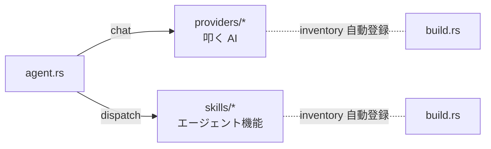

# PicoAgent 開発・配布ガイド

`cargo xtask verify`はNodeが使える環境でJavaScriptの構文だけでなく、追跡中の`tools/tests/*.mjs`の回帰テストも実行する。キャラクター修正時は追加で`python scripts/test-face-landmarks.py`（Pillowが必要）と`node tools/check-rig-feature-matrix.mjs temp/<新規検証名>`を実行し、全7体の実画像を確認する。後者のPlaywrightは`PICO_PLAYWRIGHT_MODULE`で作業用モジュールの絶対パスを指定する。生成成功やCPU検査だけで見た目合格にしない。

この文書は、ソースを変更する開発者と配布物を作る担当者向けの正本です。製品の利用手順は [MANUAL.md](../MANUAL.md)、アーキテクチャと動作仕様は [SPEC.md](../SPEC.md)、全設定キーは [SETTINGS.md](SETTINGS.md) を参照してください。

キャラクター作成は`character-maker/`の4工程をTauriから起動する。管理導入はCUDA対応NVIDIA GPUと85GB以上の空きを取得前に検査し、共通Python 3.12を`bundled/python`へ1環境だけ配置する。THA3は廃止済みで同梱しない。ComfyUIと固定SHAモデルは`bundled/character-maker`へstagingから公開し、正常終了後は`.part`、展開フォルダ、Python取得キャッシュ、旧版を残さない。UIビルド前には`cargo xtask setup pixi`で固定SHAのPIXI 6.5.10を準備する。欠けた状態の`build-ui`は、メッシュ表示と設定操作が壊れた実行ファイルを作らず明示的に失敗する。

ソースからの初回起動は [README.md の「まず動かす」](../README.md#-まず動かす)から始めてください。

## 作業エージェントのハーネス構成

作業ルール、再利用手順、開始時処理、作業状態、最終検証は、更新理由が異なるため次の正本へ分けます。分類名ごとのファイルをさらに増やさず、各正本から別の正本へ手順を複製しません。

| 責務 | 正本・関連ファイル | 保持する内容 |
|---|---|---|
| 恒久ルール | `AGENTS.md` | 全作業へ常時適用する方針と安全規則。`CLAUDE.md`はこの正本の場所だけを示す案内ファイル |
| 再利用手順 | `.agents/skills/<名前>/SKILL.md` | 繰り返す作業の入力条件、工程、停止条件、検証。`.claude/skills/<名前>/SKILL.md`はClaude Codeが自動認識し、同名正本を読むよう案内するだけのファイル |
| 開始時処理 | `.claude/hooks/` | Claude Code固有のセッション開始時処理。通常の検証手順を複製しない |
| 作業状態 | `HANDOFF.md` / `docs/TASKS.md` | 前者は未マージ作業と直後の再開手順、後者は未完了・条件待ちだけ |
| 最終検証 | `cargo xtask verify` | 書式（本体・xtask・`skills/`）、静的解析、テスト、共通スキル正本とClaude Code用自動認識ファイルの同期、JavaScript構文、Git差分 |
| 完了記録 | PR本文とGit履歴 | 目的、採否と理由、検証結果、未確認事項 |

ここでいう「作業状態」はPicoAgent製品の長期メモリ機能とは別物です。共通スキル正本とClaude Code用自動認識ファイルの名前・frontmatter・参照先・本文量は`cargo xtask verify`が機械検査します。

設計ガードのソース走査は `src-tauri/src/guard_scan.rs` に集約する。スキル、バックエンド、内部共通コアを再帰的に列挙し、読み取り・列挙の失敗は対象パス付きで検査失敗にする。同じテストプロセス内では各ソース本文を一度だけ読み、変更できないスナップショットとして共有する。編集後の検査ではテストプロセスを再実行する。

## 🧩 コネクタで拡張する



| 増やすもの | 置き場所 | やること |
|---|---|---|
| 叩く AI | `src-tauri/src/providers/<名前>.rs` | `Provider` トレイトを実装し `inventory::submit!` で登録 |
| エージェント機能 | `skills/<スキル名>/mod.rs` | `Tool` トレイトを実装し `inventory::submit!` で登録 |

`build.rs` が自動で `mod` 取り込みするので、**中央のレジストリを編集する必要はありません**。再ビルドすれば登録されます。

書き方は [SPEC.md](../SPEC.md#新しいコネクタの作り方) を参照してください。

---

## cargo xtask コマンド一覧

| コマンド | 内容 |
|---|---|
| `cargo xtask dev` | 開発起動（未取得の同梱物は自動取得） |
| `cargo xtask build` | 製品ビルド（各 OS の配布バンドルを生成） |
| `cargo xtask stop` | 残存プロセスの停止 |
| `cargo xtask cli <cmd>` | ローカル API を叩く CLI（status/models/chat/ask/repl） |
| `cargo xtask setup engine` | 同梱推論エンジンの取得 |
| `cargo xtask setup aivis` | 同梱 Aivis（読み上げ）の取得 |
| `cargo xtask setup whisper` | 同梱 Whisper の取得 |
| `cargo xtask setup live2d` | Live2D ランタイム + サンプルモデルの取得 |
| `cargo xtask setup pixi` | 自前メッシュリグとLive2Dが共有するPIXI 6.5.10の取得 |
| `cargo xtask setup office` | OfficeCLI（LibreOffice）の取得 |
| `cargo xtask setup tools` | OSS CLI ツール群の取得（`TOOLS_FORCE=1` で再取得） |
| `python scripts/build-live2d-psd.py` | レイヤー画像から Live2D 用 PSD を生成 |
| `python scripts/build-character-animations.py` | レイヤー画像から連番アニメーションを生成 |
| `uv run --with pillow python scripts/build-mesh-rig.py <id>` | 高精細レイヤーから自前メッシュリグ資産を生成 |
| `node tools/check-lvs-character.mjs <temp内出力先> [確認URL]` | LocalVTuberStudio形式の目口・待機動作をPicoAgent実Canvasで検証 |
| `cargo xtask sync-characters` | `characters/`（正本）を配信用 `ui/assets/characters/` へ同期 |
| `cargo xtask build-ui` / `cargo xtask build-ui --release` | `ui/` を配信用 `ui-dist/` へ生成（release はコメント・空白を除去） |
| `cargo xtask verify` | PR前の書式（`skills/`はrustfmtへ直接渡す）・静的解析・テスト・共通スキル正本とClaude Code用自動認識ファイル・JavaScript構文・Git差分の一括検証 |

> `sync-characters` と `build-ui` は `cargo xtask dev` / `build` が自動実行するため、通常は個別に実行する必要はありません。
> `setup *` も同様に自動実行されるので、明示的に呼ぶのは特定の同梱物だけ取り直したいときです。

LocalVTuberStudio形式の実画面検査は、まずリポジトリ直下を`uv run python -m http.server 8776 --bind 0.0.0.0 --directory .`で配信する。Codex DesktopのPlaywrightは製品依存へ追加せず、`load_workspace_dependencies`で取得した現行パスを指定する。2026年9月7日時点では次の形だが、存在しない場合は固定値を推測せず再取得する。

```powershell
$env:PICO_PLAYWRIGHT_MODULE='C:\Users\benyb\.cache\codex-runtimes\codex-primary-runtime\dependencies\node\node_modules\playwright\index.mjs'
node tools/check-lvs-character.mjs temp/pico-lvs-check
```

出力は`temp/pico-lvs-check/`の閉口・5母音、まばたき各時点、視線4方向、通常・笑顔・困り・考え・照れの全5表情、全8動作、腕寄せ0／0.5／1、待機5時点のPNGと`report.json`である。腕寄せ非対応パックは`armSupported: false`として撮影を省く。LocalVTuberStudio形式は5表情と6種類以上の動作差分が無ければ失敗する。固有ハッシュ数だけを見た目の合格根拠にせず、Chromeの`tools/mesh-rig-preview/`でも原画との輪郭、透過、目口、首・胴の境界を確認する。腕寄せでは、残余レイヤーに元位置の輪郭や色面が残らないことも3段階すべてで見る。
---

## 📦 配布ビルド

```powershell
# 開発確認用（開発キャラを含むため販売不可）
cargo xtask build

# 販売準備の現在地を確認
cargo xtask release-check

# 販売対象キャラだけの画面を確認（インストーラは作らない）
cargo xtask preview-distribution

# 販売条件が確定する前の試用インストーラ（軽量版）
cargo xtask bump-version patch
cargo xtask build-beta --bundles nsis

# 全ゲート通過後だけ作れる販売用ビルド
cargo xtask build-distribution

# 作成した配布物からlatest.jsonのサイズ・SHA-256を生成（.exe と .dmg を受け付ける）
cargo xtask update-feed src-tauri\target\release\bundle\nsis\PicoAgent_<版>_x64-setup.exe "更新内容"
```

`bump-version`はソースの現行版を起点に採番する。OS別の公開版が遅れていて`latest.json`がソースより古い場合は許容するが、公開版がソースより新しい場合は二重採番として停止する。

`build-beta` は、販売条件を完了扱いにせず、販売版と同じ軽量同梱範囲で試用インストーラを生成します。`build-distribution` はEULA・プライバシー表示・第三者同梱物台帳・Live2D審査参照・サポートURL等を検査し、未完了が1件でもあれば同梱物取得前に停止します。初期販売対象はWindowsだけで、コード署名と完全自動更新を必須にしません。macOSは販売対象へ追加する前に署名・公証と実機QAを行います。販売設定の正本は `distribution/release.json`、手順は [販売準備チェックリスト](SALE-READINESS.md) です。通常の`build`を含む製品ビルドは明示した自作キャラだけを同期し、開発用Live2D公式サンプルと制作途中モデルを含めません。

### macOS版のビルド（未署名アルファ）

macOSバンドルはmacOS実機でだけ作れます。WindowsやLinuxからのクロスビルドはできません。**配布対象はApple Siliconだけで、Intel Macは対象外です。**

Intelを対象外にしているのは、`xtask/src/bundled.rs` が同梱ローカルAIエンジンの資産を **xtask自身のホストarch** で選ぶためです（`let arm = cfg!(target_arch = "aarch64")`）。Apple Silicon機で `--target x86_64-apple-darwin` を指定してIntel版を作ると、arm64版のllama.cpp／Whisperが入ったx64アプリになり、ローカルAIが起動しません。Intelを対象へ加える場合は、実機のIntel Macでビルドするか、`bundled.rs` をビルド対象archへ追従させる修正を先に行います（[docs/TASKS.md](TASKS.md)）。

```bash
# 前提: Xcode Command Line Tools、Rust、Tauri CLI、7z（Aivisの分割書庫展開に使う）
xcode-select --install
cargo install tauri-cli --version '^2'
brew install p7zip

# 未署名アルファのビルド（.app と .dmg を作る）
cargo xtask build-beta --bundles app,dmg

# 生成物
# src-tauri/target/release/bundle/macos/PicoAgent.app
# src-tauri/target/release/bundle/dmg/PicoAgent_<版>_aarch64.dmg

# latest.json へ登録（OSごとに1回ずつ実行できる）
cargo xtask update-feed src-tauri/target/release/bundle/dmg/PicoAgent_<版>_aarch64.dmg "更新内容"
```

`update-feed` は拡張子とファイル名のCPU種別から `windows-x64` / `macos-arm64` / `macos-x64` の枠を選び、`latest.json` の版が同じなら他OSの枠を残したまま該当枠だけを差し替えます。版が上がった場合は前の版のURLを引き継がず枠を空にします。`.exe` はPE署名、`.dmg` はUDIFトレーラ（`koly`）を確認してから登録するため、取り違えた成果物は登録できません。

macOS固有の注意点は次のとおりです。

- **未署名アルファはGatekeeperに止められます。** 初回は Finder で右クリック →「開く」、または `xattr -dr com.apple.quarantine /Applications/PicoAgent.app` が必要です。取得ページで事前に案内します。署名・公証は販売対象へ追加する時点で行います
- **`tauri.conf.json`の`bundle.macOS.signingIdentity`は`"-"`（ad-hoc署名）を維持します。** これが無いと、Rustツールチェーンが実行バイナリ単体には自動でad-hoc署名を付けるのに対し、tauri-bundlerが`Contents/Resources`追加後の`.app`全体を再署名しないため、「バイナリの署名はリソースがシールされていると主張するのに実体が無い」という矛盾状態になります。この状態のDMGをGatekeeperがある環境（ダウンロード相当のquarantine属性付き）で開くと、「開発元を確認できません」ではなく**「壊れているため開けません」という回復不能な表示**になり、右クリック→「開く」でも回避できません（PR #186で実機確認）。
- **マイク・画面収録・アクセシビリティはOSの許可が要ります。** マイクの用途説明は `src-tauri/Info.plist` に入れてあります（無いとマイク取得の瞬間にOSがアプリを終了します）。画面収録と入力操作は「システム設定 → プライバシーとセキュリティ」で許可します
- **APIキー等はログインキーチェーンへ預けます。** `config.json` には項目名だけが残ります。未署名アプリは再ビルドのたびに署名が変わるため、キーチェーンの許可ダイアログが繰り返し出ます。署名を入れるまでの既知の使い勝手の劣化です
- **GUIアプリが継承するPATHにはHomebrewの設置先（`/opt/homebrew/bin`等）が含まれません。** ターミナルの`sh -lc "command -v ..."`はログインシェルがPATHを再構成するため「ある」と判定できても、Finderから起動したアプリが実際に`Command::new("名前")`でspawnすると見つからず`No such file or directory`になります（Aivis展開用`7z`で実際に発生。`aivis.rs`の`resolve_executable()`で対処済み）。macOSで外部コマンドをPATH経由に頼る実装を足す場合は、この二重基準に注意してください
- **対応OS版は macOS 11 以上のApple Silicon機**（`src-tauri/tauri.macos.conf.json`）。同梱ローカルAIエンジンのmacOS資産に合わせた下限で、実機QAで確定します

版番号はSemVerで管理します。通常の更新は同じ`major.minor`系列の`patch`を自動加算し、`minor`と`major`は製品管理者の明示指示がある場合だけ上げます。公開中の`latest.json`を起点に`cargo xtask bump-version <種別>`が3か所の版を同期するため、個別ファイルへ版番号を手入力しません。同じ版のRelease資産も上書きしません。patch番号もLP、アプリ、ファイル名、Releaseへ正確に表示します。起動時の自動確認はpatchだけなら通知せず、利用者が設定から「更新を確認」を実行した場合はpatchも案内し、手動でダウンロード・適用できます。`major.minor`が上がった場合は起動時にも通知します。アルファ期間中は表示名と更新説明へ`Alpha`を付けます。

初期販売はBOOTHとSteamを想定します。公開GitHubにはソースや第三者ソフトを置かず、`distribution/site/` の公開LP、Windows無料版、最新版情報 `latest.json`、サポート／プライバシー／利用条件、紹介資料 `PicoAgent-Intro.pptx` だけを置きます。LPの主画面例は完成済み2DのむぎとLive2Dのひよりを使い、別のキャラ一覧ページでは取得済みのLive2D公式サンプルも非同梱の動作例として紹介します。公開配布Repoへの同期は販売時の明示作業で、Releaseに実インストーラがない間はLPも取得導線も「準備中」と表示します。BOOTH購入者は `PA1.` で始まる署名済みキーを設定の「製品情報・ライセンス」へ登録するとPro機能が有効になります。秘密署名鍵は `%APPDATA%\PicoAgent-vendor\license-signing.key` に置き、Gitへ含めません。Steam版は将来Steamworksの所有確認へ追加対応する方針です。

設定の「製品情報・ライセンス」には「更新を確認」と「アップデート」があります。公開Gitの `latest.json` で新しい版を確認し、Windows x64インストーラの配布Repo内URL・サイズ・SHA-256が揃い、取得物がPE形式の場合だけ起動します。更新情報自体も256KBを上限とし、HTTP異常や破損は設定欄へ表示します。オフライン時は起動時確認を黙って見送り、手動確認では見送ったことだけを同じ欄へ表示します。

```powershell
# 初回だけ販売者署名鍵を作る（既存鍵は上書きしない）
cargo xtask license keygen

# BOOTH注文ごとのProキーを発行
cargo xtask license issue --customer "購入者名" --purchase-id "BOOTH注文番号" --edition pro
```

ゲート通過後は `src-tauri/target/release/bundle/` に各 OS の標準バンドル（WindowsはNSIS、macOSは`.app`／`.dmg`、Ubuntu Linux x64は`.deb`／AppImage）が生成されます。同梱物の未取得分は自動で取得してからビルドします。

通常の開発用製品ビルドは **`ui-dist/`** と **`src-tauri/resources/bundled/`** を使います。販売用の軽量ビルドは `tauri.distribution.conf.json` で本体に必要なローカルAIエンジンと公式取得元マニフェストだけを入れます。Aivis・Whisperは初回起動後に公式配布から直接取得し、LibreOffice・PDF/画像ツールは利用者による公式導入を案内します。開発用のツール・ドキュメント・README用画像は含まれません。

<details>
<summary>同梱物・制作ツールの扱い（エンジン / Aivis / Whisper / Live2D）</summary>

以下のパスは Windows 表記です。macOSとLinuxでは同等のユーザーデータ配下（`PicoAgent/...`）に読み替えてください。

**同梱推論エンジン（llama-server）**

- llama.cppは安定版v0.2.0が配布用に対応付けた`b10566`へ固定し、Windows Vulkan x64・macOS arm64／x64・Ubuntu Linux Vulkan x64の資産名とSHA-256をコードで照合します。WindowsのNVIDIA CUDA 13.3版、AMD ROCm 7.14版、Intel SYCL版は対応GPUを検出した場合だけ公式Releaseから追加取得し、固定サイズ・SHA-256・`--list-devices`の実認識をすべて確認した後に使います。取得済み配置もマニフェストのタグ・方式・資産名・SHA-256が一致する場合だけ再利用します
- 実行ファイルは配布物へ同梱しますが、モデル GGUF（数 GB）は含めず、初回起動時に `%APPDATA%\PicoAgent\bundled\models\` へ取得します
- 実行時に差し替える場合は `%APPDATA%\PicoAgent\bundled\engine\` を優先して探します

**同梱 Aivis（読み上げ）**

- 通常の開発ビルドは、`component-manifest.json` の `targetVersion` に指定した公式 GitHub Releaseを `src-tauri/resources/bundled/aivis/` へ準備します。一時的な取得確認だけは `AIVIS_RELEASE=latest` またはタグで上書きできます
- 軽量販売版はAivisをインストーラへ含めず、初回起動または設定の「追加機能・更新」で選んだ場合だけ、Aivis Project公式GitHub Releaseから `%APPDATA%\PicoAgent\bundled\aivis\` へ直接取得します。GitHub APIのサイズとSHA-256 digestを検証し、PicoAgentのReleaseからは再配布しません。インストール済み版と推奨版は設定画面に併記し、古い場合は更新、新しい場合は明示確認付きで推奨版へ戻す操作を表示します。大容量取得は接続と無通信の待ち時間だけを制限してストリームを止めず、更新・再導入時はステージング済みの新版へ原子的に入れ替え、失敗時は旧版を維持します。推奨版を上げるときは `component-manifest.json` の `targetVersion` と同じ版の公式Releaseリンクを1回の変更で更新します。実行時取得と開発用 `xtask` はこの正本を参照します
- `PICOAGENT_TTS_ENABLED` が有効なら起動時に内部ポート（既定 `11436`）で裏起動し、アプリ終了時に停止します。旧既定の `10102` が保存済みなら起動時に移行します
- 推論デバイスは内部設定 `PICOAGENT_TTS_DEVICE` の既定 `auto` で GPU 候補を確認し、あれば GPU、なければ CPU（通常の設定画面には出しません）
- 話者は設定画面に出さずキャラクター既定声を使います。未導入なら起動時のローディング画面で AIVMX を追加し、合成時に `/speakers` から実際の style ID を解決します
- 音量は `PICOAGENT_TTS_VOLUME`（0〜100、初期値50）。保存後すぐ、再生中の音声にも反映されます。読み上げをミュート、または音量を0にすると口パクも停止して口を閉じ、再生途中で音量を戻した場合だけその時点から再開します

> 同梱 Aivis の初回起動はモデル確認や BERT 読み込みで数十秒かかることがあります。キャラ固有の音声モデル導入は起動シーケンス中に「声を準備中…」としてまとめて行うため、通常画面での待ちは発生しません。

**同梱 Whisper（文字起こし）**

- 通常の開発ビルドは `resources/bundled/whisper/`、軽量販売版は選択時にggml-org公式GitHub ReleaseのCLIと公式whisper.cppモデル配布のsmallモデルを `%APPDATA%\PicoAgent\bundled\whisper\` へ直接取得します。Release digestと固定モデルSHA-256を検証し、削除対象は利用者データ側のPicoAgent管理ディレクトリだけです

**Live2D ランタイムと利用者モデル**

- `cargo xtask setup pixi` はPIXI 6.5.10をSHA-256照合して`ui/vendor/pixi/`へ取得します。`cargo xtask setup live2d`はこれを共有し、Cubism Coreとpixi-live2d-displayを`ui/vendor/live2d/`へ取得します。`dev` / `build` もサンプルモデルを自動取得しません
- 利用者は設定画面の「キャラ登録」で、配布元から自分で取得したzip／フォルダを選びます。`.model3.json` が1個なら、同じフォルダの組み込み用データだけを安全検査してユーザー領域へコピーし、PicoAgent用 `character.json` を自動作成します。モデル固有の顔位置を推測して切り取らず、初期倍率は全身が欠けない1倍にして、追加直後の一覧選択と配置編集へつなぎます
- 開発者が既存サンプルの描画回帰を行う場合だけ `cargo xtask setup live2d-samples` を明示実行します。通常の`build`と販売版は、手元に取得済みでも配布許可リスト外のサンプルを同期しません
- **ライセンス** — Cubism Core は [Live2D Proprietary Software License](https://www.live2d.com/eula/live2d-proprietary-software-license-agreement_jp.html)に従います。利用者モデルは配布元ごとに条件が違い、公式サンプルにも[個別の利用条件](https://www.live2d.com/learn/sample/model-terms/)があるため、取得・追加前に利用者自身が確認します

**その他**

- macOS では `llama-server` / `whisper-cli` / Aivis `run` に実行権限を付け直してから起動します。`.app` 配下など chmod できない場所は補正失敗だけで止めず、実際の起動結果で判定します
- AivisとWhisperはPicoAgent専用ディレクトリ・専用ポートだけを使い、グローバルインストールや既存プロセスへ干渉しません。外部導入のLibreOffice・各種ツールはPicoAgentから削除せず、提供元の手順に従います
- 配布ビルドでは `cargo xtask build-ui --release` が `ui/` を `ui-dist/` へ差分同期し、コメントと余分な空白を削ったものを同梱します。同期元にない生成先ファイルは削除し、必要な場合だけ`--force`で全再構築します。開発中アルファ版の `ALPHA` バッジは `--beta`（`build-beta` が自動で付与）を付けたときだけ残り、通常ビルドと販売ビルドの配信物からは取り除かれます。Rust の release profile は LTO・strip・panic abort・debug 情報無効化を有効化しています（解析を不可能にするものではなく、読みやすいソースやシンボル情報を減らすための基本対策です）

</details>

<details>
<summary>ログ・データの保存場所・識別子</summary>

**ログ** — `%APPDATA%\PicoAgent\log\` に保存します。**1 日ごとに日付付きファイルへローテートし、1 週間より古いログは起動時と 1 日ごとに自動削除**します（会話履歴はログではないため対象外）。

| ファイル | 内容 |
|---|---|
| `app.<日付>.log` | アプリ本体とフロントのエラー |
| `aivis.<日付>.log` | Aivis の起動ログ |
| `engine.<日付>.log` | 同梱 llama-server のログ |
| `dev.<日付>.log` | `cargo xtask dev` の再ビルド警告・コンパイルエラー（監視継続中の失敗を含む） |

**識別子とデータ**

- アプリ識別子は `com.picoagent.desktop`（旧 `com.picoagent.app` / `com.coda.app`。初回起動時に旧識別子配下の `config.json` / `history.json` / `memory.json` を現行へコピー移行）
- 設定・履歴・メモリは `app_config_dir` / `app_data_dir` 配下、同梱系の実行時取得物は `PicoAgent/bundled/`、ログは `PicoAgent/log/`
- アイコンは `src-tauri/icons/`（`cargo tauri icon src-tauri/icon-source.png` で再生成）

**インストール（上書き導入）**

NSIS インストーラは、ファイルをコピーする前にインストール先またはPicoAgent管理データ配下で動く本体・ローカルAI・Aivis・Whisperだけを実体パスで特定して止めます。本体だけを終了しても子プロセスは残り、インストール先の実行ファイルとDLLを掴んだままだと上書き導入が失敗して新旧が混ざり、更新後に起動できなくなるためです。PC上の同名プロセスは停止しません。

**アンインストール**

NSIS アンインストーラは、インストール先またはPicoAgent管理データ配下で動く本体・ローカルAI・Aivis・Whisperだけを実体パスで特定して止め、PicoAgent専用の一時ファイルを削除します。PC上の同名プロセスは停止しません。設定・会話履歴・追加キャラ・ダウンロード済みモデルは削除前に確認し、**既定の「いいえ」とサイレントアンインストールでは残します**。削除を明示した場合だけ、`%APPDATA%\PicoAgent\` / `%LOCALAPPDATA%\PicoAgent\` と現行・旧識別子のデータを削除します。

**署名・自動更新**

初期販売のWindows版はコード署名（Authenticode）とバックグラウンドでの完全自動更新を使いません。`distribution/release.json` の `platforms=["windows"]` / `signing.required=false` / `updates.required=false` がこの方針の正本です。未署名版ではWindows SmartScreenの警告が表示されるため、販売ページで事前に明記します。Windows版は利用者が設定画面で明示した場合だけ、公開Gitのサイズ・SHA-256を照合して更新インストーラを実行します。macOSまたはLinuxを販売対象へ加える場合は、対象形式の署名方針と実機QAを先に行います。更新署名付きの完全自動更新を有効化するときは各 `required` を `true` にし、公開URL・更新公開鍵・実装・署名確認が揃うまで販売ゲートで停止します。秘密鍵と証明書はリポジトリへ保存しません。

</details>

---

## 📁 フォルダ構成

```text
PicoAgent/
├── crates/picoagent-core/ ← 非公開の内部共通コア（publish=false）
├── characters/       ← キャラクター正本（人格定義・連番フレームまたは Live2D モデル）
├── skills/           ← エージェント機能コネクタ（<スキル名>/mod.rs と補助ファイル）
├── ui/               ← webview フロント（ペット UI・設定画面）
├── xtask/            ← 開発タスクランナー（cargo xtask setup / dev / build / cli / stop）
├── scripts/          ← キャラクター画像の生成スクリプト（Python）
├── .agents/plugins/  ← Codex・Claude Code共用の汎用開発プラグイン
├── tools/            ← 開発用の作業ツール
├── docs/            ← 未完了タスク、販売・設計資料、README掲載画像（images/）
└── src-tauri/
    ├── build.rs      ← コネクタの自動 mod 生成
    └── src/
        ├── agent.rs        ← エージェント実行ループ
        ├── agent/          ← systemルールと文脈の合成（prompt）／計画・自己評価（feedback）
        ├── providers/      ← 叩く AI コネクタ（.rs を足すと自動登録）
        ├── tools/          ← Tool登録・意図語彙・HTTP・プロセス実行の共通層
        ├── mcp/            ← MCP クライアント / サーバ
        ├── permissions.rs  ← 全スキル共通のファイル許可（SafePath）
        ├── store.rs        ← 状態ファイルの原子的な保存
        ├── durable_jobs.rs ← 再起動後に再開するツールジョブの永続キュー
        ├── user_skills.rs  ← 利用者のSKILL.md検証・索引・原子的保存
        └── character_framing.rs / stream_profile.rs / config.rs / commands.rs / …
```

`ui/assets/characters/` は `characters/` の配信コピー、`ui/vendor/live2d/` は Live2D ランタイムで、いずれも自動生成・自動取得です。

**ドキュメント**: [README.md](../README.md)（概要・起動） / [MANUAL.md](../MANUAL.md)（使いかた） / [SPEC.md](../SPEC.md)（仕様） / [SETTINGS.md](SETTINGS.md)（全設定キー） / [AGENTS.md](../AGENTS.md)（作業ルール） / [HANDOFF.md](../HANDOFF.md)（未マージ作業） / [TASKS.md](TASKS.md)（未完了・条件待ち）

---
