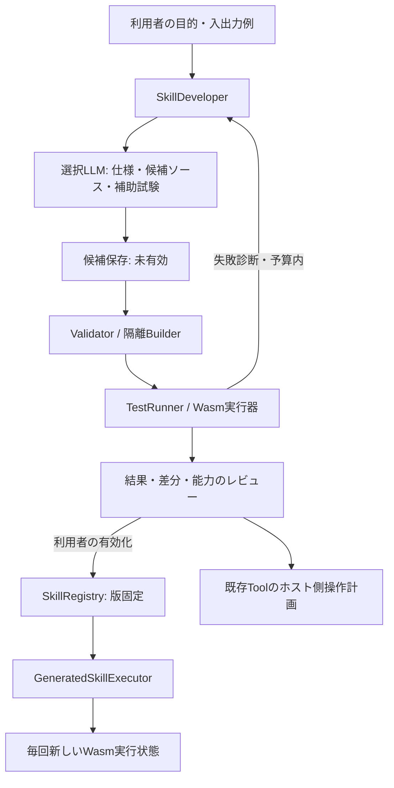

# LLMによるスキル開発・追加（未実装の将来設計）

**設計承認待ち。実装・ランタイム導入・生成コード実行は行っていない。** 本機能はPicoAgentで選択したLLMが、利用者の依頼からスキル候補を生成し、試験・修正・有効化まで支援するもの。Codex/Claude等の開発エージェントを自動起動する設計ではない。設計の採否・引継ぎ・検証記録は[設計Draft PR #257](https://github.com/benybeny777/PicoAgent/pull/257) を正本とする。

## 目的と初期範囲

「毎週の売上データを部門別に集計して」のような反復業務を、次回から名前で呼べるスキルにする。まず既存ToolとMarkdown手順で実現可能か判断し、既存Toolにない計算・データ整形が必要な場合だけコード型を提案する。利用者が使うLLMを勝手に変更せず、localでも外部providerでも同じ開発フローを使う。小型ローカルモデルのコード生成成功率は未確認で、作れると保証しない。

| 種別 | 生成内容 | 初期の利用範囲 |
|---|---|---|
| 手順型 | SKILL.md、用途、入力例、試験例、既存Toolの呼出計画 | 既存機能の組合せ。従来の利用者スキル互換を維持し、開発機能経由の新規候補には試行・版管理を追加 |
| コード型 | 固定SDK/固定APIに沿った処理本体、入出力schema、試験例、実行物（インタプリタへ渡すプログラム、またはビルド済みWasm） | JSON入力からJSON出力への計算・検査・集計・整形。ユーザーファイルを直接操作しない。既存Toolが読み取ったデータを渡し、生成結果の保存や送信もホスト側の既存Toolを使う |

たとえばCSV集計では、既存の読取りToolで入力を取得し、コード型で列検査・集計、結果プレビュー後に既存の保存Toolで書く。ファイル形式の解析は既存Toolか固定SDKの対応範囲に限る。未対応Excel書式、画像モデルの追加、GPU処理、任意Pythonパッケージ、PowerShellによるPC操作、新しいSaaS認証処理を初期コード型で作れるとは案内しない。

**代償:** どちらの実行方式でもWasm実行器が追加になる。方式B（生成Rustのビルド）を採る場合はコンパイラ配布・初回待ち・OS別の隔離Builderがさらに乗る。任意Pythonより使えるライブラリは少ない。通常会話と手順型には追加取得を要求せず、コード型を利用するときだけ必要容量と対応OSを提示して導入する。同梱物は`src-tauri/resources/bundled/<機能名>/`へ置き、取得は`cargo xtask setup`相当の明示操作に限る（AGENTS.mdの大容量取得ルール）。実容量・性能・対応OSはS0の実測まで未確定で、暗黙のクラウドビルドやホストPython実行で穴埋めしない。

## どこまで自動化できるかと拡張条件

既存Toolで足りない処理を自作できるため対応範囲は広がるが、「だいたい何でもできる」ことは受入条件にしない。コード生成では取得できない資格情報・データ・OS許可・アプリ・GPUがある。仕様が曖昧な業務や、誤処理を検出する期待値が無い仕事も、生成成功だけで自律完了としない。

自動化するのは不足処理の提案、候補生成、隔離試験、予算内の修正まで。通常の依頼から不足を検出した場合は「この処理用のスキルを作る」提案を出し、開発開始と予算の同意を得て進める。有効化後は許可した範囲の依頼で自動選択できるが、未承認の新能力を勝手に追加・有効化しない。

| 広げたい能力 | 初期設計との違い / 次の着手条件 |
|---|---|
| 未対応のデータ形式・高度な計算 | 固定SDKの機能不足。検証済みライブラリの版・ライセンス・容量・Wasm互換とfixtureを追加する。生成側の任意依存取得は許可しない |
| 新しい外部APIの処理 | 秘密をguestに渡さない限定HTTP brokerと、宛先・method・path・送信schema・認証参照の管理契約が必要。新コネクタの審査を完了してからhostcallを導入する |
| PCや専用アプリの操作 | 指定端末上の能力と実機QAが必要。既存desktop/browser/ファイルToolで可能な操作だけを先に再利用し、shell実行で代替しない |
| GPU・生成モデル | 既存の検証済み生成ジョブを呼ぶ。新たなモデル・ランタイムは対応機種/資源/取得/品質の別設計を先に行う |
| 機能追加の完全自動承認 | 今回は採用しない。許可済み能力内の低リスク更新に限定した組織policy・独立試験・自動停止を別途設計した場合にだけ再検討する |

この拡張は初期コード型が完了してから別PRで扱う。汎用処理へ近づく道筋として残し、制約のある初期版を万能な自律開発機能として案内しない。
## 現行コードの根拠

調査基準は2026-09-11のorigin/main `95a37ad2a6be4e5bc7153d09d6845231ae213df7`。[法人基盤設計PR #256](https://github.com/benybeny777/PicoAgent/pull/256) と [character-maker PR #255](https://github.com/benybeny777/PicoAgent/pull/255) は参照だけで変更しない。

| 現行ファイル・シンボル | 確認した内容 / 本設計との関係 |
|---|---|
| `src-tauri/src/user_skills.rs::create/update/catalog/use_text/prompt_context` | app_config_dir/user-skillsのSKILL.mdを管理。最大32件、厳密な名前/frontmatter検証、symlink拒否、原子的保存、都度索引。use_textはモデルへ手順を返すだけ。生成コードの実行・検証・版固定・rollbackはない |
| `skills/user_skill/mod.rs::UserSkillTool` | list/show/create/update/useを既に提供。新規時disable_model_invocationの既定はfalseなので作成後に候補へ出る。今回の新しい開発候補を、この公開済みカタログへ直接保存しない |
| SKILL.mdの `allowed-tools` | 現行はモデルに示す希望上限であり、実行器が強制する許可リストではない。本機能の強制能力境界へそのまま転用しない |
| `src-tauri/src/tools/mod.rs::Tool/dispatch/run_tool`、`src-tauri/build.rs` | Rust Toolはビルド時自動登録。agent_callable=falseはモデルの候補制御であり、dispatch自体のアクセス拒否ではない。生成コードをskills配下へ置いて本体再ビルド・再起動する案は採らない |
| `skills/code_runner/mod.rs::agent_callable/run` | Python/PowerShell実行の内部機能。cwd検査と破壊パターン検査はOS隔離ではなく、agent_callable=falseの理由がコードに明記されている。この機能を動的スキルの実行器として流用しない |
| `skills/workflow/mod.rs` | 既存Toolの手順を保持し、tools::dispatch経由で実行。動的コードのsandboxではない。ネスト経由も含めた能力検査が必要で、workflowに載せれば安全とは扱わない |
| `src-tauri/src/providers/mod.rs` / `agent.rs` | 選択provider、正規形Message、retry/cancelの基礎を再利用できる。生成LLMに通常agentの全Tool権限を渡す必要はない |
| `durable_jobs.rs` / `store.rs` / `permissions.rs` | ジョブ・原子的保存・SafePathを再利用する候補。ただし現行ジョブの対象はAI Drive/artifact_pipeline、global状態あり。開発job対応は新規実装が必要 |
| `ui/picoagent.js` / `ui/settings.js` | 既存IPC facadeと設定画面のスキル一覧を入口にする候補。新しい「作る/試す/有効化/旧版へ戻す」操作は未実装 |

## 処理の流れと責務

| 責務 | 所有するもの / 最小契約 |
|---|---|
| SkillDeveloper | 要件、種別選択、生成・修正の状態機械。`start(requirement, examples, providerRef, budget)`、`cancel(jobId)`。LLMは候補だけを書き、環境設定・registry・テスト結果を編集できない |
| CandidateStore | scope/developmentId/versionHash単位の不変候補、生成由来、診断。`saveCandidate(expectedRevision, files)`。active領域と分離し、名前だけで既存スキルを上書きしない |
| Validator / Builder | manifest/schema・ファイル一覧・import検査、固定ビルド。`build(candidateHash, sdkRef, toolchainRef)` → moduleHashとattestation。manifestやビルドコマンドは信頼するホストが生成する。方式A（固定インタプリタ）ではビルド工程が無く、Validatorがプログラムの構文・サイズ・禁止API参照を検査して実行物hashを同梱インタプリタのhashに固定する |
| TestRunner | 信頼済み受入試験・権限拒否試験・資源上限・比較。`test(moduleHash, testSuiteHash, limits)` → 完了/失敗/未確認。モデルの「合格」本文を結果として採用しない |
| SkillRegistry | 承認対象hash、activeRevision、履歴、停止。`activate(candidateHash, expectedActiveRevision, approval)`、`disable`、`rollback(targetHash)`。生成モデルとguestには書込み権限を与えない |
| GeneratedSkillExecutor | `execute(scope, skillId, versionHash, input, cancellation)` → 構造化結果。登録済みの1つの橋渡しToolから呼び、Tool traitのバイナリ登録と動的データを分離する |
| HostOperationBroker | 手順型/生成結果を使った読取り・保存・送信の許可と結果追跡。操作/対象を再評価。Wasm guestの文字列を直接Tool名やshellとして実行しない |

PR #256のExecutionContext/EventSink/Storage/JobManager/ToolExecutorへ対応付けられる契約にする。本PRは#256のブランチをベースにせず、未実装型を既存コードにあるものとして参照しない。先にローカル実装する場合は同じ責務の小さなローカルadapterを作り、#256統合時に巨大Contextや別の状態正本を増やさず接続する。両設計が競合したら実装前に公開型・scope・job所有者を一度だけ確定する。

## コード型の採用方式

実行境界は両案ともWasmtimeのWasm sandboxで固定し、**生成物をコンパイルするかどうかだけが違う2案をS0で比較する**。PoC未実施であり、本番採用はS0の成立確認後とする。ランタイム・SDK・（方式Bなら）コンパイラの版は同段階で公式安定版、対応CPU/OS、保守・配布条件を監査して固定する。

| 方式 | 生成物と実行 | 得るもの | 失うもの |
|---|---|---|---|
| **A: 固定インタプリタ（第1候補）** | PicoAgentが同梱する監査済みインタプリタWasm（QuickJS/Rhai/Starlark等の候補から1つ）を実行物として固定し、LLMは**そこへ渡すプログラム文字列だけ**を書く。ホストはプログラムと入力JSONを同じguestへ渡す | コンパイラ配布・OS別の隔離Builder・ビルド待ちが**すべて不要**。生成→試行が秒単位。実行物のhashは全利用者で同一なので検証も容易。小型ローカルモデルはRustより素直に書ける | 実行速度はネイティブWasmより遅い。使える標準ライブラリはインタプリタの範囲に限られる。インタプリタ自身の脆弱性は別の攻撃面になる（版固定と更新経路が要る） |
| B: 生成Rustのビルド | 固定SDK付きRustソースを `wasm32-unknown-unknown` へビルドし、成果物Wasmを実行する | 実行が速い。型で入出力を縛れる | Rustツールチェーンと標準ライブラリの配布（既定モデル本体より大きくなりうる）、初回待ちとビルド時間、そして**下記のOS別隔離Builder**が必須になる |

**S0では方式Aを先に評価する。** 理由は3つ。(1) 本設計の最難関である「コンパイル工程の隔離」と「3OSでのBuilder配布」が方式Aでは発生しない。(2) 既定の叩くAIはLFM2.5 2.6B QAD Q4のローカルモデルで、固定SDK付きRustを予算内で書き切れる保証がない。同じ課題ならスクリプト言語の方が生成成功率は高いと見込まれる。(3) 追加取得容量が小さく、コード型を使わない利用者への影響を最小にできる。方式Aが固定20課題の目標に届かない、または性能が業務に足りないと実測で分かった場合にだけ方式Bへ進み、**方式Bは「速度が必要になった場合の後段最適化」として扱う**。どちらも成立しない場合は手順型だけを提供する。

以下のsandbox契約・ABI・上限は両方式に共通で適用する。方式Aではプログラム文字列も入力と同じ「信頼しないデータ」として扱い、ホストのABI glueとインタプリタ本体だけを信頼する。

Wasm側にはWASI、ファイル、ネットワーク、環境変数、時計、乱数、プロセス、Tauri、動的ライブラリ、他スキルを呼ぶimportを一切登録しない。初期guestは純粋な入力→出力だけ。時刻や乱数が必要ならホストが固定値/seedを入力に含める。永続状態はguest内に持たず、毎実行新しいStore/instanceを作る。将来hostcallを足す場合は別設計と権限試験が必要で、汎用dispatchを1本追加して済ませない。

ABI v1は固定SDKが所有する。ホストがmoduleの公開memoryと `alloc(len)` で入力JSON用領域を確保し、境界を検証してコピー、`run(ptr,len)` を呼ぶ。結果のptr/lenと `dealloc` の規約はSDKに固定し、返されたptr・長さ・加算overflow・memory範囲・UTF-8・JSON schemaを毎回検証する。生成モデルはABI glueを変更せず `transform(Input) -> Result<Output, SkillError>` の本文だけを作る。予期しないexport/import、start関数、共有memory/thread、上限外memory/tableはValidatorで拒否する。alloc/run/deallocを含めすべてに実行予算を適用する。

実行上限の初期案は1回30秒、linear memory 64MB、入力1MB、出力1MB、同時2件。fuelと壁時計の両方を持ち、出力サイズ・hostメモリ・module compile時間も別に制限する。fuel量はS0で同じfixtureを使って校正し、値を変えた場合は検証をやり直す。timeout/cancel後はinstanceを破棄し、実行器子プロセスを所有確認して回収する。1実行器のOOMやpanicでPicoAgent本体を落とさないよう、実行器は管理sidecarに隔離する。Wasm sandboxとsidecarの障害分離を混同せず、sidecarだけを安全境界と呼ばない。

公式資料の確認日: 2026-09-11。WasmtimeはWasm sandboxとWASIの能力ベースのアクセスを説明している。本設計ではWASIを接続しない。[Wasmtime Security](https://docs.wasmtime.dev/security.html) を根拠とするが、ホスト実装の誤りや依存脆弱性が消える保証ではない。fuel/epochによる中断は [Interrupting Execution](https://docs.wasmtime.dev/examples-interrupting-wasm.html) を参照。Rust側のtargetと標準ライブラリの制約は [rustc target documentation](https://doc.rust-lang.org/rustc/platform-support/wasm32-unknown-unknown.html) を確認し、全std機能が動くとは扱わない。

### コンパイル工程も隔離する（方式Bを採る場合だけ）

以下は方式B（生成Rustのビルド）に固有の要件で、方式Aではコンパイル工程自体が無いため丸ごと不要になる。この節の重さが、S0で方式Aを先に評価する理由そのものである。

LLMが書いたRustソースは、コンパイル前から信頼しない。`include_str!`等によるコンパイル時のファイル読取りやコンパイラの不具合を考慮し、アプリと同じ資格情報・ホーム・ネットワークを見られる通常プロセスでビルドしない。ソース文字列のブラックリストだけを安全境界にしない。

Builderはホストが生成する固定Cargo設定、固定SDK・依存・lock・ビルド引数を使う。生成側からCargo.toml、build.rs、proc macro、依存追加、任意リンクフラグ、環境変数、コマンド列を受け付けない。承認済みtoolchain/SDKを読取専用、候補と出力だけを書込み可能にし、HOME・資格情報・一般workspaceをマウントせず、ネットワークを無効化したOS隔離環境でoffline buildする。依存取得は別の管理工程で版・hashを固定する。

ビルドのOS隔離backendと3OS対応は方式Bの必須判断事項。Windows、macOS、Ubuntuそれぞれで上記境界を強制できる実装・配布手段と回収を実証するまで、そのOSのコード型生成は無効にする。対応手段が無い場合は手順型だけ提供し、理由をUIへ表示する。法人ビルドworkerも同じ契約を満たす。ソースを外部へ送るクラウドビルドは接続先・送信内容への明示同意がある場合だけで、ローカルの代替として自動使用しない。

## パッケージと版管理

`app_data_dir`配下の専用スキル開発領域を将来追加する。候補、検証済み不変version、active参照、試験結果を分ける。既存 `app_config_dir/user-skills` は互換形式のまま扱う。実際のパスと設定キーは実装PRでSETTINGS/DEVELOPMENTへ同期する。

**保存機構は新規に作らず既存の正本を使う。** 「読む→直す→書き戻す」は`store::lock_state(名前)`を取ってから行い（既存の利用者スキルも`store::lock_state("user-skills")`で直列化している）、書き込みは`store::write_atomic()`／`store::write_json_atomic()`、読めなかったファイルは空で置き換えず`store::quarantine_corrupt()`で退避する。パスは`permissions::resolve`／`SafePath`を通し、独自の許可判定やルート設定キーを増やさない。PicoAgentは単一インスタンス前提なので、プロセス間排他を必要とする設計にしない。`store::guard`と`permissions::guard`のテストがこれらの迂回を検出して失敗させるため、別実装のCASやロックを持ち込むと実装段階で必ず落ちる。新しい設定キーは`docs/SETTINGS.md`へ同時に記載する（`doc_sync::guard`が実装と双方向で検出する）。

| パッケージ項目 | 内容 |
|---|---|
| skillId / kind / contractVersion | 名前空間付きID、instruction/code、契約版。既存組込みTool名や別scopeのIDへ上書き不可 |
| versionHash / sourceHash / moduleHash | manifestと全入力ファイルの正規化hash、ソース、実行物。ファイル順・文字コードを正規化。active判定は名前やmtimeに依存しない |
| requirement / schemas / examples | 目的、非対象、入出力JSON schema、利用者の期待例。schema参照は同梱だけ、外部URL解決を禁止 |
| capabilities / effects / executionClass | 手順が要求する読取/保存/送信先と上限、実行場所。code guest自体は純粋処理。要求metadataは権限の付与ではない |
| SDK / interpreter / compiler / runtime / platform | 固定版とhash、実行可能契約。方式Aは同梱インタプリタWasmのhashとプログラムのhash、方式Bはtoolchain/SDKのhashとmoduleHash。生成したネイティブ実行ファイルや外部取得バイナリを混ぜない |
| tests / report / provenance | 信頼済み試験セットhash、各結果、未確認、生成provider/model、prompt template版、生成試行数。秘密や実データ全文を記録しない |
| approval / activeRevision | 有効化した利用者の参照、対象hash、能力hash、試験hash、時刻。モデルはこれを生成・変更できない |

パッケージ入力ではsymlink、絶対パス、`..`、重複名、大量ファイル、zip展開容量超過を拒否する。外部から入手したmoduleやキャッシュ済みnativeコードのdeserializeをそのまま信用せず、Wasmの再検証と再コンパイルを行う。生成物hashを試験時・承認時・実行直前に照合する。

更新は新versionを作って試験・承認し、active参照をCASで交換する。旧版はそのまま保持し、実行中runは開始時のversionを固定する。disableは新規開始を停止して実行中へcancelを要求する。rollbackも互換性・現時点の権限を再確認する。ファイル保存や送信済みメールはコードのrollbackでは戻らないので、副作用の取消と別操作にする。

既存SKILL.mdは勝手に移動・書換え・無効化しない。開発機能へ取り込むときはコピーして新versionを作り、元パス/元hashを関連付ける。開発管理へ切替後は、そのIDのactive正本をregistryに一本化し、同じ名前を旧索引にも重複表示しない。外部エディタや旧user_skill.updateが管理版を変更しようとした場合は新候補として扱い、検証・有効化を迂回しない。従来の管理外SKILL.md作成・更新は現行互換を保つ。生成機能が作った指示ファイルの存在だけで自動有効にはしない。

## 生成・試験・承認の契約

開発jobは `draft → generating → validating → building(codeのみ) → testing → review_required → activated`。各実行段階からfailed/cancelledへ遷移でき、予算不足はpaused_budget、入力不足はwaiting_input。修正は新candidateHashでgeneratingへ戻し、古い検証と承認を失効させる。有効化はjobの成功と独立した明示操作にする。

要求は `developmentId?, idempotencyKey, requirement, kindPreference, inputSchema, outputSchema, examples, selectedProvider, budget`。応答はjobId、revision、state、progress、candidateHash、検証結果と未確認事項。進捗イベントはjobId/attempt/seq付き、再接続時は状態取得が正本。cancelは受付と停止完了を分け、再起動時は最後の確定candidate/検証から再開する。生成中tokenの途中断片を有効版へ保存しない。

予算の初期案は生成1回＋修正2回、開発全体10分、入出力合計24,000tokenを上限とする。これは開発job全体の合計であって1回の呼出ではない。**現行の既定ローカルモデル（LFM2.5 2.6B QAD Q4）のプリセットctxは8,192で、`large`と`gpt_oss_20b`だけが16,384**（`src-tauri/src/providers/local.rs`、設定キーは`PICOAGENT_LOCAL_CTX`で利用者が変更可能）。SDK説明・入出力schema・入力例・失敗テストログを1回の呼出へ詰めるとこの幅に収まらないため、**コード型生成には最低ctx要件を設ける**。S0で「1呼出あたりに必要な実測token数」を測り、満たさない構成ではコード型を提示せず、理由（必要ctxと現在値、変更方法）を画面に出して手順型で続ける。非対応OSと同じ扱いにする。各呼出のcontext/window/最大出力制約を先に検査し、長いテストログは必要箇所だけ渡す。全工程をLLM呼出前に予約できるtoken枠で管理し、usageが不明でも無制限に続けない。時間・回数・tokenのいずれか到達で停止する。外部providerでは利用者が金額上限も指定し、料金を確定できなければ追加費用の上限を保証せず開始前に条件確認する。既定の通常会話モデルを変更せず、別モデル提案は選択操作にする。

生成用LLMには入力例、公開SDK、許可されたToolのschemaと安全な診断だけを渡す。一般agent loopのtools一覧を丸ごと渡さず、出力を候補データとして受け取る専用経路にする。修正ループが別のskill-developを起動する再帰、追加モデルの自動導入、課金providerへの自動切替を禁止する。外部providerへのコード/入力例送信範囲を明示し、既定は合成データ、実業務データは利用者が指定したものだけを使う。

試験は三層に分ける。(1) ホストが持つ権限・ABI・サイズ・拒否ケース、(2) 利用者の要件と期待値から凍結した受入試験、(3) LLMが追加する補助試験。モデルは(1)(2)の期待値や判定器を書換えられない。同じLLMのコードとテストだけが一致しても品質合格にしない。集計の空入力、欠損列、日本語、負数、桁あふれ、順序、重複は固定fixtureを用意する。曖昧な文章品質は自動合否を装わずプレビューで確認する。

手順型の試行では読取りも含めてホスト側のテスト用ToolExecutorへ接続し、既定はfixture/mockだけにする。ライブ試行は対象・読み書き・送信先を具体化し、別の明示操作にする。生成SKILL.mdがworkflow/subagent/run_command/code_runner/MCP等へ迂回しても、新しいmanaged実行経路の許可境界を通ることを検証する。未分類Tool・任意コード・汎用shell・開発/有効化の自己呼出は既定拒否。既存のagent_callableやSKILL.md.allowed-toolsだけではこの強制を満たさない。

能力の実効範囲は「利用者/組織の許可 ∩ パッケージ要求 ∩ 当該runで指定した対象 ∩ ホストで利用可能な機能」。live操作直前に確認する。approvalはcandidateHash/testSuiteHash/capabilityHash/activeRevisionに結び付け、生成内容・権限・SDKが変われば再検証する。失敗した操作を修正後に再試行して二重送信しないようoperationId/receiptを保持し、結果不明なら利用者の確認待ちにする。

## 利用者の操作

チャットの「スキルを作って」から目的と例を取り出し、足りなければ入力形式/期待出力だけを質問する。実現方式と送信先・導入が必要な物・予算を示して開始し、進捗と取消を表示する。結果画面では目的、試験結果、入力/出力の例、必要能力、未確認、前版との差分を見せる。コードは詳細表示で参照でき、読めない利用者でも動作と権限から判断できるようにする。

操作は「試す」「修正を頼む」「有効にする」「無効にする」「旧版へ戻す」。設定のスキル一覧に手順型/コード型、由来、状態、版、利用可能な実行場所を表示する。コード型の有効化がファイル送信や全権限への包括同意にならないよう、実行時の対象確認を残す。LLMからの回答や生成ファイルに「承認済み」と書かれていても有効化しない。

初期の呼出入口は固定Toolの `generated_skill.execute(skillId, input)` 相当とし、候補索引に公開するのは有効版の名前・説明・schemaだけ。任意の名前でネイティブTool登録を上書きできない。指示型の本文は必要時だけ読む既存方式を保ち、無制限にsystem promptへ詰めない。disabledな版は明示名指定でも実行不可とし、現行disable-model-invocation（自動選択だけを止める）とは区別する。

### ライセンス境界

現行の`license::tool_requires_pro`は**Tool名の一致**でPro判定しており、`code_runner`と`browser_control`はPro扱いである。橋渡しToolを1本にすると全生成スキルが同じ判定を共有するため、**生成スキル単位のライセンス制御はできない**。実装前に次を決める。

- コード型実行（`generated_skill.execute`）とブラウザセッションToolをPro限定にするか、無償で提供するか。
- 生成スキルごとに分けたい場合は、Tool名一致ではなくskillIdまで見る判定へ拡張するか、名前空間付きTool名を割り当てるか。
- 判定を変える場合、既存の`code_runner`／`browser_control`のPro扱いを退行させないこと。

この決定は販売条件に直結するため、S1着手前に利用者の判断を得る。

## 利用者の操作を妨げないブラウザ機能（追加要件・未実装）

本設計で目指す体験は、利用者が別の作業をしている間にPicoAgentが専用ブラウザで調査・入力を進め、結果を見せ、必要な箇所だけ引き渡すもの。Codexの内部実装と同一方式という意味ではない。通常のデスクトップマウス操作をバックグラウンドで行う案は採らない。

### 現行との差分と採用案

`skills/browser_control/mod.rs` はopen/read/pages/closeだけの読み取り用Tool。`launch_options` にはheadless設定があるが既定はfalse、current_targetは可変static。`cdp.rs::ensure_running` は専用プロファイルとloopbackのCDP、`--headless=new` 起動を持つ。生成手順から利用するクリック・入力・セッションごとの排他・引渡しは未実装。`allowed_domain` と `render_page` はURL/遷移後を検査するが、ソース内にも遷移の事前遮断の限界が書かれており、法人用egress制御済みとは扱わない。Linuxの既定ブラウザ候補は空で、実行パスの明示が必要な実装である。

採用は既存CDP資産を活かした `BrowserSessionService`。新しい管理セッションは常に専用プロファイル・headlessを既定にし、通常Chrome/Edgeのプロファイル・タブ・Cookieをコピーせず、既存デバッグポートにも接続しない。旧browser_controlの設定互換は保つが、新しい管理セッションにdefault profile設定を引き継がない。ブラウザ本体は検証済み導入済みChrome/Edgeを検出し、無ければ明示導入を案内する。管理版ブラウザの配布はライセンス・容量・更新経路の別検証を要し、自動取得を前提にしない。

scope/device/accountProfile単位の所有者とprofile lockを持ち、run/sessionごとのtargetId、snapshotRevision、action列、cancel、receiptを保存する。異なる利用者はプロセス/プロファイルも分ける。同じaccountProfileの操作は最初は直列化し、セッションを混ぜない。不変の接続実装以外を可変staticにしない。CDPの接続先情報・Cookie・storage・ログイン秘密をLLMやguestへ返さない。

**プロファイルの置き場所とポートは、既存の回収機構に合わせる（守らないと実害が出る）。** 現行`cdp.rs`はプロファイルが`<data_dir>/PicoAgent/browser-profile`の1つ、デバッグポートが`11437`固定、子プロセスもプロセス全体で1つ（`child_slot`）である。セッション別に分けるときは次を必須にする。

- 新しいプロファイルは必ず`PicoAgent/browser-profile`配下（例: `PicoAgent/browser-profile/<scope>`）に置く。`cargo xtask stop`は`--user-data-dir`にこの文字列を含むブラウザだけを回収し、目印は`xtask/src/assets.rs`の定数と回帰テストで固定されている。配下から外すと残留ブラウザを回収できず、「PicoAgentが管理していないブラウザに使われています」で次回起動が必ず失敗する既知の実害へ戻る。
- ポートはセッションごとに割り当て、使用中ポートの検出（現行は他ブラウザが使っていれば起動を止める）を同時セッション前提で作り直す。空きポート探索と所有確認をセットにし、他人のブラウザへ接続しない現行の安全側動作は維持する。
- 目印や既定ポートを変える場合は`xtask`の回収実装と回帰テストを同じPRで更新する。

ブラウザ機能は固定Toolとして手順型から使い、純粋Wasm guestにCDPや任意JavaScriptを渡さない。コード型はブラウザで取得したデータの集計や入力候補の整形を担当する。ブラウザ制御の実装はWasm/コンパイラに依存せず、ブラウザ自身のB段階が合格すれば先行提供できる。

| 契約 | 最小操作と条件 |
|---|---|
| セッション | `create(scope, profileRef, mode=background)`、`get`、`close`。返すのはopaque sessionIdと能力/状態。プロファイルと接続先はホスト専用 |
| 観測 | `navigate(sessionId,url)`、`snapshot`、`screenshot`、`pages`。DOM/アクセシビリティ要素から一時elementRefを作り、snapshotRevisionとURLを返す。画面取得はブラウザ内部だけでOS全画面を撮らない |
| 操作 | `click/fill/select/scroll/press(elementRef,expectedSnapshot)`。elementRefは現在セッションの実観測からだけ取得。古いDOM、複数一致、別frame/targetは再観測要求。任意eval/CDP method/shell/OS入力は公開しない。内部抽出scriptはホストの固定資産 |
| 待機 | `wait(condition,deadline)`。DOM/URL/要素の具体的条件を使い、長い固定sleepや無限retryを避ける。非冪等クリックは失敗後に自動反復しない |
| 転送 | downloadはscope専用領域へ保存・検査後artifact化。uploadは明示されたartifactだけ。ページが要求した任意ローカルパスを開かず、ブラウザの標準保存ダイアログや自動ファイルopenを起動しない |
| 引渡し | `requestTakeover(reason)` → waiting_user。利用者が「操作画面を開く」を選んだときだけアプリ内プレビュー/操作パネルを表示。操作権をuserへ移してagentを停止し、`resume(expectedRevision)`後に再観測して再開 |
| 停止 | queued/running/waitingをcancelし、通信・target・所有プロセス・購読を回収する。送信済み外部操作の取消は別扱い。accountProfileの保存/ログアウト/削除は利用者の明示操作 |

### 邪魔をしない条件とログイン

バックグラウンド中はnative窓を表示・前面化せず、OSマウス/キーボード/クリップボードを使わず、音声・通知・ポップアップ表示を抑止する。別タブへのpopupも管理セッション内だけで捕捉する。結果はPicoAgentの進捗と必要時のプレビューへ出し、通常のPC操作へフォーカスを奪わない。

ログイン、MFA、CAPTCHA、証明書、passkey、OS認証が必要ならwaiting_userにする。ログイン済みの普段のプロファイルを勝手に流用しないため、初回は専用セッションでログインが必要になる。利用者はアプリ内操作パネルで入力し、パスワード欄・Cookie・tokenをLLM観測と録画・ログから除外する。パネルはheadless画面とブラウザ内入力を中継する案とし、実装可能性・入力精度をB0で検証する。対応できない認証は、利用者が明示したときだけ専用の可視ブラウザへ引き渡す。headlessと可視起動を同じプロファイルで同時に動かさず、停止/再起動と再観測で所有を渡す。このときページ途中状態が失われる可能性を表示し、完璧な継続を保証しない。

保存ログインはopt-inでaccountProfile単位にし、OS秘密保護/暗号化・保持/ログアウトを管理する。単なるincognito contextを永続ログイン保存の代わりにしない。バックグラウンド非対応・bot検知・画面でしか扱えない認証は限界として表示し、認証の回避を試みない。

CPU/RAM/GPU/タブ数も利用者の作業へ影響するため、初期は同時1run・最大3tab・各action 30秒・run 5分（利用者待ち除外）・idle 60秒で資源解放を既定案とする。実測前に「邪魔しない」と品質合格にしない。ブラウザを起動するためにGPUや画質を強制的に落とさず、資源不足時はqueue待ちと理由を表示する。

### 許可・副作用・ネットワーク境界

通常のページ閲覧・検索・許可範囲の入力まで毎クリック確認を要求しない。一方、送信・投稿・購入・削除・契約・ファイル外部転送などの確定操作は、利用者の明示指示が対象/内容/範囲を既に満たす場合にその権限を再利用し、満たさない場合だけ具体的プレビューで確認する。名前が「入力」でもautosave/検索送信で通信が起きるため、fillを無条件に読取り扱いしない。対象サイトと操作の副作用が判別できなければその操作は自動実行せず引き渡す。

承認はsessionId/対象origin/action/送信内容hash/期限と結び付ける。DOMが変われば再観測し、対象・内容が変わった承認を流用しない。結果不明の送信はURL、表示結果、operation receiptを確認し、確認できなければwaiting_user。人が介入している間にagentがクリックしないよう単一操作権を守る。

ページ本文・ラベル・要素属性は外部データであり、スキル追加、有効化、権限拡張の指示として受け取らない。サイト内の「このコマンドを実行」等でコード型のsandboxやTool制約を越えない。

navigate後のURL検査だけでは送信阻止に間に合わない。新管理セッションではナビゲーション、redirect、iframe、popup、download、fetch/WebSocket等の接続を事前に制御するネットワーク境界を設計し、許可originと必要なCDN/認証originを管理する。DNS再解決・private address・localhost・metadata endpointも検査する。法人の社内サイトは別の明示されたegress policyとして許可し、全内部ネットワークへ拡大しない。CDPで捕捉できない経路はworkerのネットワーク制約で補い、B0の実証まで境界完成としない。Chromeのsandboxを無効化する起動引数を解決策にしない。

### ブラウザ拡張（必要時だけ用意する設計）

専用headlessブラウザをCDPで操作する基本経路にはブラウザ拡張を必須にしない。利用者が既存のログイン済みタブを明示して引き渡す場合や、CDPの配布・企業ポリシー上の制約を解消する必要がある場合に、別の任意ブラウザ拡張を用意する案とする。Codex用プラグインの導入を意味しない。必要性の判定はB0で行い、今回は設計のみで拡張コード作成・インストール・ストア公開はしない。

拡張を採る場合はChrome/Edge向けManifest V3の補助adapterとする。PicoAgentの認証されたローカルブリッジへ接続し、ユーザー操作で選んだtabId/originだけを期間限定で貸し出す。候補はNative Messagingであり、通信相手の拡張ID/ネイティブホストとメッセージschema、scope/session/nonce/期限を固定する。Webページから直接使える汎用loopback制御口を追加しない。配布形態・組織ポリシー・署名/更新・各OSのホスト登録は別の導入検証を要する。

権限はユーザー操作でのactiveTabと必要最小限のAPIを初期候補とし、追加originはoptional権限で明示する。常時all_urls、履歴全読取り、全Cookie読取り、パスワード取得を既定にしない。activeTabだけで跨originの長時間自動化までできるとは扱わず、遷移で権限が失われたら停止・再許可する。デバッガ権限が必要な実装は影響範囲を説明し、最小権限で成立するかB0で判断する。

利用者の通常タブを拡張経由で動かすモードはページ内容が変化するため、専用headlessと同等の「邪魔しない」保証はできない。既定は専用ブラウザのままとし、通常タブの支援モードは明示開始・対象表示・停止ボタン・排他的な操作権を持つ。利用者が触ったらagentを停止する。対象外タブへの移動、ブラウザ全体のフォーカス変更、Cookieコピーによるheadlessへの移送をしない。

拡張サービスワーカーの停止・再起動を前提に、ジョブ正本はPicoAgent側へ置く。再接続ではsessionと最後のreceiptを照合し、未確認クリックを再送しない。拡張が無い・無効・更新不整合なら専用ブラウザ経路を提示し、知らないうちに切り替えない。Firefox/Safariまで対応済みにせず、追加対象ごとに別検証する。

公式仕様は [activeTab](https://developer.chrome.com/docs/extensions/develop/concepts/activeTab) と [Native Messaging](https://developer.chrome.com/docs/extensions/develop/concepts/native-messaging) を参照し、実装時に対象ブラウザ版へ照合する。
### 検証と公式資料

B0は独立fixtureサイトでDOM変化、iframe、popup、autosave、download/upload、ログイン、切断、CSRF相当の外部送信誘導、ページ内注入、許可外redirect/subresourceを検証する。B1では利用者が別アプリで入力している間にブラウザ処理を実行し、フォーカス・マウス・クリップボードが不変、可視窓/音声なし、タブ/資源上限と停止回収をWindows/macOS/Ubuntuで実測する。認証やheadless非対応サイトは合格対象から黙って外さず対応表へ残す。生成スキルとの結合はB2で、権限の推移的な検査・古いelementRef・二重送信・user/agent操作権競合を確認する。

headlessはChromeの公式機能であることを [Chrome Headless mode](https://developer.chrome.com/docs/automation-and-testing/headless) で確認する。CDPの独立contextと破棄操作は [Target domain](https://chromedevtools.github.io/devtools-protocol/tot/Target/) に定義されるが、実製品では対象ブラウザ版に対して機能検出・固定fixtureを実行する。2026-09-11の文書参照であり、PicoAgentでの実機成功を意味しない。
## 法人・ローカル・ハイブリッドと運用

候補・試験・承認・成果物・実行履歴はscope付き。ローカルでは端末内scope、法人では検証済みtenant/subject/workspace参照をホストが付与し、LLM出力やUI本文からtenantを採用しない。法人共有は個人の有効化と別に昇格レビューを要求し、共有先ごとに権限と依存・試験を確認する。認証・認可と組織ロールの詳細は別設計とする。

共通純粋Wasmはローカル/サーバーで同一hashを使えるが、端末の読取り・保存・clip・画面操作はPR #256の指定device境界に従う。データを転送するだけのために「共通だから」と自動アップロードしない。接続先変更・端末不在・版不一致は明示エラーとし、別実行場所へ自動移送しない。

観測はdevelopmentId/runId/skillId/versionHash、生成試行・token使用・ビルド/試験時間・trap/拒否・有効化/停止/rollbackを記録する。監査は主体・対象hash・判断・操作結果を持ち、コードや実業務データ全文、秘密を既定ログへ載せない。保持期間はホスト方針で制御し、実行中・active・復旧用旧版の参照がある物を清掃しない。破損検出はそのversionだけ停止し、原本と診断を保持する。

## 採用案・却下案・最大リスク

| 案 | 判断 |
|---|---|
| 手順型優先＋純粋Wasmコード型 | 採用設計。既存Toolとコードを分担できる。初期の機能範囲と追加導入コストは上記のとおり制限がある |
| コード型を固定インタプリタWasmで動かす（方式A） | **第1候補。S0で先に評価する。** コンパイラ配布・OS別隔離Builder・ビルド待ちが不要になり、既定の小型ローカルモデルでも書きやすい。代償は実行速度と標準ライブラリの幅、インタプリタ自身の版管理 |
| コード型を生成Rustのビルドで動かす（方式B） | 条件付き採用。方式Aで性能または表現力が足りないと実測で分かった場合の後段最適化として残す。単独の初期案としては、ツールチェーン配布と3OSの隔離Builderが前提条件になり過大 |
| LLM生成Rustを本体skillsへ直接追加して再ビルド | 却下。製品バイナリ・依存・署名・更新・全利用者の可用性へ影響する。生成スキルをデータとして追加する境界を失う |
| Python/PowerShellをcode_runnerで保存して再実行 | 却下。cwdやパターン検査は隔離を提供しない。既存ツール非公開理由を解消できない |
| コンテナを全端末の必須条件にする | 初期案として却下。Windows/macOSの導入・管理・容量が増え、単にコンテナを起動しても適切なmount/権限なしには隔離を保証しない。法人Builderの実装候補としてはS0で検証可 |
| LLMが評価して合格なら自動有効化 | 却下。期待値の自己改変、誤判定、権限拡大を防げない。検査済みhashに対するホストの結果と利用者操作を使う |
| 新たな任意SaaS連携をコード型へ一括開放 | 初期範囲外。秘密・egress・副作用を汎用guest呼出へ流すため、認証済み既存Toolか別のコネクタ設計で扱う |
| 手順型だけで完了扱い | 却下。既存にない処理の追加という目的を満たさない。コード型の検証が未完了なら別段階の未完了として残す |

最大リスクは、Wasmの外側にある実行前工程（方式BのBuilder）、既存Tool、registry更新が迂回路になること。LLM生成物を信頼しないだけでなく、compile-timeの読取り、nested Tool呼出、候補差替え、承認の再利用を実際に拒否できることが完了条件になる。もう一つの製品リスクは、ローカルモデルが予算内に正しいコードを作れないこと。成功例だけを選ばず固定課題の成功率・修正回数・待ち時間を評価する。

## 分割と実装ゲート

`user_skills.rs`（約800行）は既存Markdownのparse/保存/索引正本として維持する。生成job・Builder・Wasm実行・registryを同ファイルへ追加しない。将来の `skill_development` は状態機械、`generated_skills` は契約・registry・実行、OS別Builder/runnerはadapterとして独立検証する。Wasm/コンパイラ依存を純粋picoagent-coreへ入れない。Tool入口は薄い1つとし、skilled名ごとのRustファイルやcrateを生成しない。

SPECの現行スキル説明を増殖させず、本書へ未実装契約を分けた。読者は生成機能の実装担当で、更新理由はパッケージ/隔離/承認契約の変更。SPECは現行挙動と本書の入口、TASKSは未完了、PRは採否・検証・引継ぎ記録を所有する。PR #256とは同じ文書の別節なので、統合時は双方の節を保持し一方で上書きしない。

実装は [段階別タスク](TASKS.md#llm-skill-development-tasks) に従う。各段階を別の目的別PRにし、設計承認と実装開始の明示まで着手しない。コード型はS0の方式比較（方式Aの成立、または方式Bの隔離Builder成立・OS配布条件）とモデル評価の合格が必須。依存、設定、Tool追加時は既存共通スキルとガードを同期する。

実装PRで必ず通す機械検査を、着手前に把握しておく。新しいToolは`SPEC.md`の分類表へ載せる（`doc_sync::guard::スキルはspecの分類表に載せる`）。新しい設定キーは`docs/SETTINGS.md`へ載せる（`doc_sync::guard`の双方向検査）。状態保存とパスは`store::guard`／`permissions::guard`、外部プロセス起動は`tools::process::guard`、HTTPは`tools::http::guard`が違反を検出する。同梱するランタイム・インタプリタ・SDKは`src-tauri/resources/bundled/<機能名>/`へ置き、取得は`cargo xtask setup`相当の明示操作に限る。最終確認は`cargo xtask verify`。
