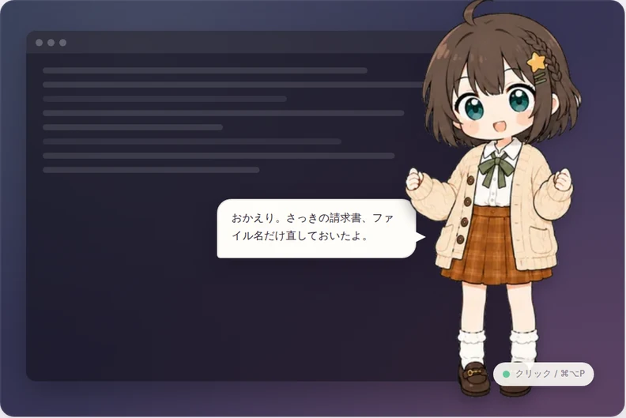
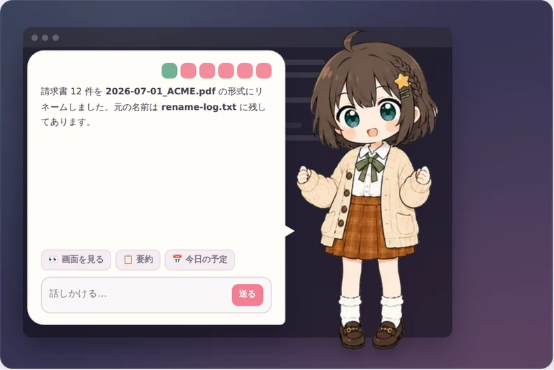
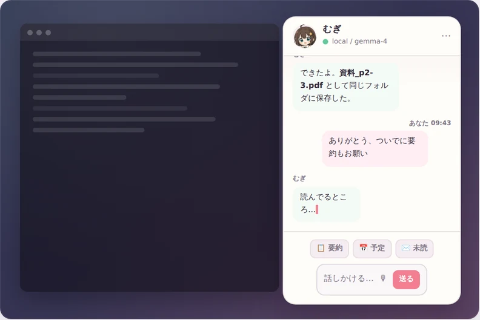
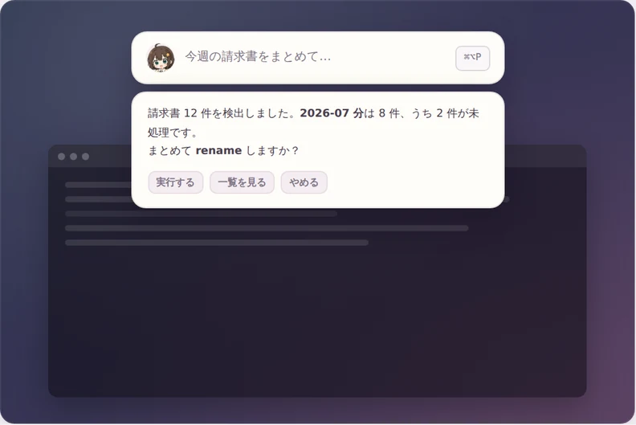
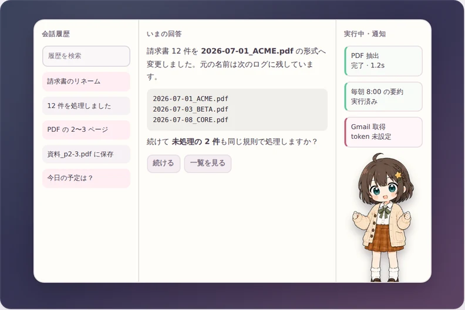
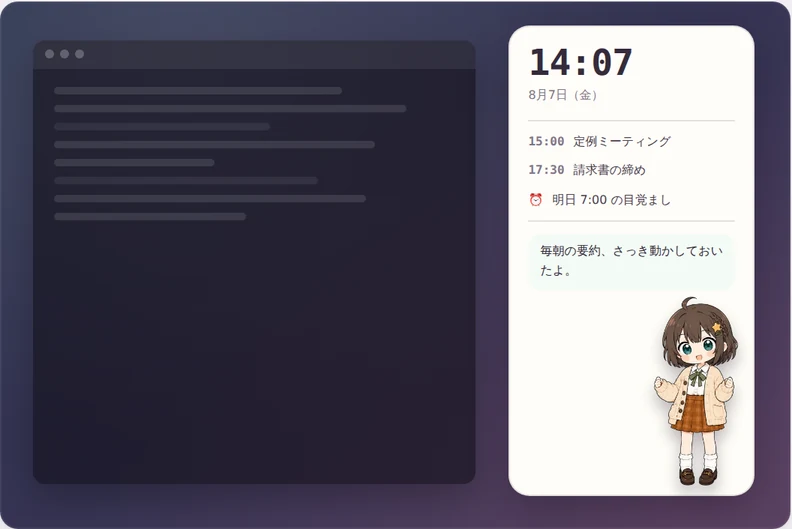

# 表示形式の提案（画面構成の見直し）

> **状態: 提案（未着手）** — 2026-08-07 作成。実装前の検討資料であり、仕様の正本ではありません。
> 確定した内容は [SPEC.md](../SPEC.md) へ移してから実装します。

今の PicoAgent は **560×430 の透明窓ひとつ**で、「待機」も「会話」も「長い作業」も引き受けています。
そのため待機中でもフキダシが最大サイズで居座り、逆に長い作業をするには全画面にするしかありません。
ここでは**同じ機能のまま見た目だけを切り替える**案を 6 つ並べます。
既存のキャラクター描画・履歴・通知・音声・許可はすべて共通のまま使えます。

**決定済み: 「ペット」は必須・既定とする。** 他の形式はすべてこれに足す扱いです。

---

## 目次

| 節 | 内容 |
|---|---|
| [出発点](#出発点今の画面で起きていること) | 今の画面の課題 4 点 |
| [しくみ](#しくみ切り替えの実現方法) | どう切り替えるか |
| [6 つの表示形式](#6-つの表示形式) | モックアップと仕様 |
| [並べて比べる](#並べて比べる) | 比較表 |
| [進めかた](#進めかた) | 段階導入 |
| [決めてほしいこと](#決めてほしいこと) | 未定の論点 |

---

## 出発点：今の画面で起きていること

批判ではなく、形式を分ける理由の確認です。いずれも `ui/styles.css` と README 掲載のスクリーンショットから確かめられます。

**01. 待機中もフキダシが最大サイズで居座る**
フキダシは `height:calc(100% - 50px)` の固定で、中身が一行でも板の大きさは変わりません。README のスクリーンショットでも面積の大半が余白です。デスクトップペットとしては、置いているだけで画面を取りすぎています。

**02. 「通常」と「全画面」の 2 段しかない**
過去の発言は `.bubble.fullscreen` のときだけ表示されます。つまり**履歴を見たいだけでウィンドウ全体を全画面にする**必要があり、その中間——小さいまま会話の流れを追う——がありません。

**03. フキダシの幅がキャラクターの大きさに縛られている**
`width:min(420px, 100% - 297px)` と、キャラ枠 265px 前提の数値が入っています。キャラを小さくしたい人にも、文字を大きくして読みたい人にも逃げ道がありません。

**04. 情報の出口が「フキダシ」1 本に集中している**
目覚まし・スケジュール実行結果・今日の予定・通知は、すべてアクションセンターのパネルを開かないと見えません。せっかく常駐しているのに、話しかけるまで何も教えてくれない状態です。

---

## しくみ：切り替えの実現方法

6 形式それぞれを作り込むのではなく、**同じ DOM に別のレイアウトを当てる**構成です。増えるのは CSS が中心で、バックエンドはほぼ触りません。

| 項目 | 内容 |
|---|---|
| **設定キー** | `PICOAGENT_LAYOUT` 1 本。値は `mascot` / `pet` / `chat` / `bar` / `workspace` / `widget`。既定は `pet`、未知の値が入っていた場合も `pet` へ戻す |
| **当てかた** | `<main id="petApp" data-layout="…">` を切り替えるだけ。`index.html` の要素は今のまま、`styles.css` に形式ごとの配置を足す |
| **切替の導線** | 設定「基本」タブ／右クリックメニューの「表示形式」／ホットキー。作業に合わせてその場で変えるものなので、設定画面だけに置くのは不十分 |
| **要注意** | ウィンドウ位置・サイズの保存キー（`PICOAGENT_WINDOW_*`）は今 1 組だけ。形式ごとに適した寸法が違うので、**形式別に持たないと切り替えるたび配置が壊れる** |
| **共通のまま** | キャラクター描画（PNG 連番 / Live2D / THA3）、会話履歴、アクションセンター、読み上げ、音声入力、ファイル添付、許可判定、グローバルホットキー |
| **キャラクター** | 全形式でキャラを残す前提。消せるようにするかは未定（[決めてほしいこと](#決めてほしいこと)） |

---

## 6 つの表示形式

モックアップは読めるよう拡大しています。実際の大きさの比較は各形式の「占有」の数値（1920×1080 の画面に対する面積比）を見てください。

---

### 1. マスコット `mascot` 〔新規・推奨〕

キャラクターだけを置く、**デスクトップペット本来の姿**。話しかけられたときだけ吹き出しが出て、読み終われば消えます。

| | |
|---|---|
| **主役** | キャラクター。UI は原則ゼロ |
| **向く場面** | 常時つけっぱなし。作業の邪魔をさせたくないとき |
| **入力** | キャラをクリック、またはホットキー。入力欄は必要になったときだけ下から生える |
| **現行との差** | **フキダシを常設しない。** 吹き出しは中身にフィットし、数秒後に自動で引っ込む |
| **寸法** | `200 × 300`（吹き出し表示時は左へ伸びる） |
| **占有** | **2.9 %** — 現行の約 1/4 |

---

### 2. ペット `pet` 〔必須・既定／決定済み〕

今の画面。**キャラクターと会話が同じ大きさで並ぶ**バランス型。**必須・既定として残すことが決まりました**——他の形式はすべてこれに足す形になります。

| | |
|---|---|
| **主役** | キャラクターと直近の回答が半々 |
| **向く場面** | ときどき話しかけながら作業する、いちばん普通の使い方 |
| **入力** | フキダシをクリックで入力欄。クイック操作つき |
| **直したい点** | **中身が短いときは縦に縮む。** 幅もキャラ枠に連動させず、独立して指定できるようにする |
| **寸法** | `560 × 430`（現行のまま） |
| **占有** | **11.6 %** — 比較の基準 |

---

### 3. チャット `chat` 〔新規・推奨〕

メッセージアプリと同じ形。**説明されなくても使える**のが最大の価値で、往復の多い相談に向きます。

| | |
|---|---|
| **主役** | 会話の流れ。過去の発言が常に見えている |
| **向く場面** | 何度も往復する相談、長い回答を読み返しながら進めるとき |
| **入力** | 下部に常設。クイック操作は入力欄の上 |
| **現行との差** | **全画面にしなくても履歴が読める。** 今の `.history-log` をそのまま常時表示に回すだけで作れる |
| **寸法** | `360 × 620`／画面の右端または左端にドック |
| **占有** | **10.8 %** — 現行とほぼ同じ面積で情報量は増える |

---

### 4. バー `bar` 〔新規〕

Spotlight や Raycast と同じ 1 行入力。**先に入れたグローバルホットキーと最も相性がいい形**で、用が済んだら自分から消えます。

| | |
|---|---|
| **主役** | 入力欄。回答はその下に一時的に開く |
| **向く場面** | 作業を止めずに一問一答。「これ何だっけ」を投げて閉じる |
| **入力** | ホットキーで出現しフォーカス済み。`Esc` で消える |
| **現行との差** | **常駐しない唯一の形式。** 普段は画面に何も無く、キャラは呼んだときだけ左端に小さく現れる |
| **寸法** | `620 × 64`（回答表示時 `620 × 280`）／画面上部中央 |
| **占有** | **1.9 %** — 回答を開いても 8.4 % |

---

### 5. ワークスペース `workspace` 〔新規〕

腰を据えて長い作業をするための形。**アクションセンターを開かなくても実行状況が見える**のが現行との一番の違いです。

| | |
|---|---|
| **主役** | 履歴 / 回答 / 実行状況の 3 ペイン同時表示 |
| **向く場面** | スーパーエージェントで多段の作業を回すとき、結果を追いたいとき |
| **入力** | 中央ペイン下部に常設 |
| **現行との差** | 今の全画面は履歴と回答だけ。**右ペインに通知・スケジュール実行結果・ツール実行のレイテンシを出す** |
| **寸法** | `1100 × 700`／通常のウィンドウ（透明・常に手前は解除） |
| **占有** | **37.1 %** — 常駐向きではない・必要なときだけ |

---

### 6. ウィジェット `widget` 〔新規〕

時計・今日の予定・目覚まし・スケジュール結果を出しておく情報カード。**すでにある機能を表に出すだけ**で、新しい仕組みはほぼ要りません。

| | |
|---|---|
| **主役** | 今日の情報。会話は従 |
| **向く場面** | サブディスプレイに置きっぱなし。目覚まし・定期実行をよく使う人 |
| **入力** | カードをクリックすると入力欄が開く（普段は畳んでおく） |
| **現行との差** | `pet_daily_events` / `pet_alarms` / `pet_schedule_runs` は**すでにある。今は通知パネルの奥に隠れているだけ** |
| **寸法** | `300 × 420`／画面の隅 |
| **占有** | **6.1 %** — 現行の約半分 |

---

## 並べて比べる

実装コストは、現行の HTML 要素をどれだけそのまま使い回せるかで見積もっています。

| 形式 | 主役 | 寸法 | 占有 | 向く場面 | 実装コスト |
|---|---|---|---|---|---|
| マスコット | キャラクター | 200×300 | 2.9 % | つけっぱなし・邪魔をさせない | 小 — CSS 中心 |
| **ペット** | キャラ ＋ 回答 | 560×430 | 11.6 % | ふだん使い（**必須・既定**） | 小 — 縮む修正のみ |
| チャット | 会話の流れ | 360×620 | 10.8 % | 往復の多い相談 | 小 — 履歴を常時表示に |
| バー | 入力欄 | 620×64 | 1.9 % | 一問一答・呼んで消す | 中 — 出現／退出の制御 |
| ワークスペース | 3 ペイン | 1100×700 | 37.1 % | 長い作業・結果を追う | 中 — 右ペインを新設 |
| ウィジェット | 今日の情報 | 300×420 | 6.1 % | 置きっぱなし・定期実行 | 中 — 情報の集約表示 |

---

## 進めかた

切替のしくみ自体は最初に入れてしまい、形式は価値の高い順に足していく想定です。

**STEP 1 — 切替のしくみ ＋ マスコット ＋ チャット**
`PICOAGENT_LAYOUT` と `data-layout` を通し、既定の `pet` はそのまま。「もっと小さく」と「よくある形」という真逆の要望を最小の追加で両方満たします。フキダシが縮む修正と、形式別のウィンドウ寸法保存もここに含めます。

**STEP 2 — バー**
ホットキーが入った直後の今がいちばん活きます。出現・フォーカス・`Esc` で退出という挙動が本体なので、レイアウトというより小さな機能として作ります。

**STEP 3 — ワークスペース ／ ウィジェット**
どちらも「すでにある情報を出す」形式です。先に 1・2 を使ってみて、実際に足りないと感じた方から作るのが無駄がありません。

---

## 決めてほしいこと

### ✅ 既定はどれにするか — 決定済み

**「ペット」を必須・既定とする。** 既存ユーザーの画面が勝手に変わらず、他の形式はすべてこれに足す扱いになります。`PICOAGENT_LAYOUT` の既定値は `pet`、未知の値が入っていた場合も `pet` へ戻します。

### ⬜ キャラクターを消せる形式を作るか — 未定

**作らないことを推奨。** どの形式でもキャラは残す前提で描いています。消せると「ただのチャットアプリ」になり、このアプリを選ぶ理由が薄くなります。

### ⬜ ペット以外をどこまで作るか — 未定

絞るなら **ペット ＋ マスコット ＋ チャット の 3 つを推奨。** 「もっと小さく」と「よくある形」という真逆の要望を最小の追加で両方満たせます。バー・ワークスペース・ウィジェットは後から足しても既存の設定を壊しません。

---

モックアップは実際の `ui/styles.css` のデザイントークンで描画しています（ライトテーマ。ダークテーマも既存のトークンがそのまま効きます）。
