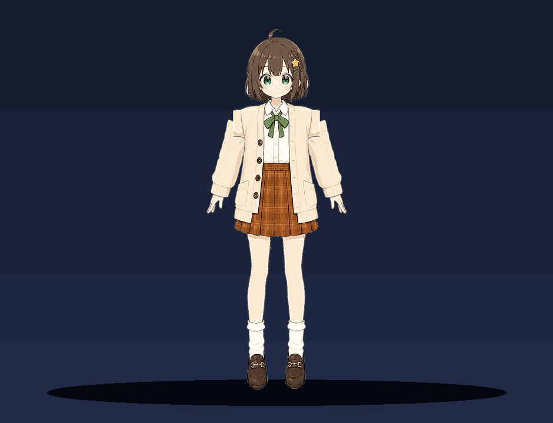

# むぎ VRM（実験）

## 位置づけ

`mugi-vrm-experimental` はPicoAgentのVRM 1.0ランタイムを検証する独立した実験キャラクターです。正式なPNG版「むぎ」のvariantには混ぜず、販売対象にも自動追加しません。PicoAgentの全キャラクター共通ルールに従い、通常画面は胸上、小型アイコンは首上を標準にします。

モデルは、Photoshopで高解像度化した同一Tポーズ原画を17枚の透過カードへ分けた多層平面VRMです。横・背面の立体形状はありません。

- 本体: `characters/mugi-vrm-experimental/mugi.vrm`
- 再生成資材: `tools/mugi-vrm/`
- 形式: VRM 1.0（GLBコンテナ）、両面Unlit、アルファ透過
- メッシュ: 17枚、347頂点
- Humanoid: 必須ボーンとchest / neck
- 表情: blink系、視線4方向、5母音、happy / angry / sad / relaxed / surprised
- カスタム表情: breath / idleLeft / idleRight / greet
- 揺れ物: VRMC_springBone 1.0、3チェーン、5可動ジョイント

PicoAgent側はThree.jsとthree-vrmの固定版をSHA-256照合して取得し、まばたき、口パク、視線、感情、呼吸、ボーン微動を `ui/vrm-runtime.js` から制御します。

## 最新プレビュー

[](mugi-vrm-preview.mp4)

GIF / MP4は制作版の品質記録です。PicoAgentへの組み込み完了判定には、別途 `renderer.js` を通した実ランタイム検査を使います。

## 再生成と検証

`tools/mugi-vrm/` で実行します。

```powershell
uv sync
uv run python -m scripts.build_tpose_vrm_experiment
uv run python -m scripts.validate_vrm ..\..\characters\mugi-vrm-experimental\mugi.vrm
uv run python -m scripts.validate_vrm_release
uv run python -m scripts.validate_vrm_visual
uv run pytest -q
uv run ruff check .
```

PicoAgentリポジトリ直下では次を実行します。

```powershell
cargo xtask setup vrm
cargo xtask sync-characters
$env:PLAYWRIGHT_MODULE = "$(npm root -g)\playwright\index.mjs"
$env:SHOOT_VRM_MATRIX = "1"
node tools/screenshots/shoot.mjs
```

最後の検査はマスコット／ペット／配信の3形式で、上半身のcanvas表示、透明背景、継続モーションを `temp/vrm-layout-matrix/` へ記録します。GLB構造検査だけで表示完了とはしません。

## 利用条件

この試作VRMのメタデータは安全側の初期値として次を記録しています。

- アバターとしての利用: 作者本人のみ
- 再配布・改変: 不可
- クレジット: 必須
- 過度な暴力・性的表現、政治・宗教、反社会・ヘイト目的の利用: 不可

条件を変える場合は `tools/mugi-vrm/pipeline/vrm_model.py` の `VRM_META`、この節、VRM本体を同じ変更で更新します。

## 仕様資料

- [VRM 1.0 specification](https://github.com/vrm-c/vrm-specification/tree/master/specification/VRMC_vrm-1.0)
- [glTF 2.0 specification](https://registry.khronos.org/glTF/specs/2.0/glTF-2.0.html)
